# 货叮咚ERP教程（Toktik）新_20260701135132.pdf — 预览版

- 附件序号：4（manifest.attachments 原顺序）
- 来源：https://dcni26t4qg0z.feishu.cn/wiki/EVUtwnBTMiSx0Okr4QiciHrTnof
- 采集日期：2026-10-11（Asia/Shanghai）
- 采集证据：[04.dom.json](../raw/04.dom.json)
- 范围：浏览器预览文字与已采集的逐页图片；原文件下载状态另行记录，转换过程未产生原文件。
- 页图可保留预览中显示的文内图片；未恢复原始图片素材、可编辑Word文档、Excel公式或原始附件。
- 文字页覆盖：采集JSON中每一页均有非空DOM文字记录；这不证明图片中文字已转录或每页文字绝对完整。
- 预览记录总页数：110（0 表示查看器状态，不能推断原文件无页）
- 明确文字页号：1、2、3、4、5、6、7、8、9、10、11、12、13、14、15、16、17、18、19、20、21、22、23、24、25、26、27、28、29、30、31、32、33、34、35、36、37、38、39、40、41、42、43、44、45、46、47、48、49、50、51、52、53、54、55、56、57、58、59、60、61、62、63、64、65、66、67、68、69、70、71、72、73、74、75、76、77、78、79、80、81、82、83、84、85、86、87、88、89、90、91、92、93、94、95、96、97、98、99、100、101、102、103、104、105、106、107、108、109、110
- 页图覆盖：110/110 页；所有已观测预览页均有尺寸合格且PNG完整的页图。
- 有效页图页号：1、2、3、4、5、6、7、8、9、10、11、12、13、14、15、16、17、18、19、20、21、22、23、24、25、26、27、28、29、30、31、32、33、34、35、36、37、38、39、40、41、42、43、44、45、46、47、48、49、50、51、52、53、54、55、56、57、58、59、60、61、62、63、64、65、66、67、68、69、70、71、72、73、74、75、76、77、78、79、80、81、82、83、84、85、86、87、88、89、90、91、92、93、94、95、96、97、98、99、100、101、102、103、104、105、106、107、108、109、110
- 原文件：本次预览转换保存 0 个原文件；图片文字不计作已采集DOM文字。
- 原始采集候选：[04-erp.snapshot.txt](../raw/source-captures/04-e55ca9293b88-04-erp.snapshot.txt)
- 原始采集候选：[04-dom.json](../raw/source-captures/04-0021023daab3-04-dom.json)

## 预览正文

## 第 1 页

[打开第 1 页图片](../images/04/page-001.png)（741×1049）

[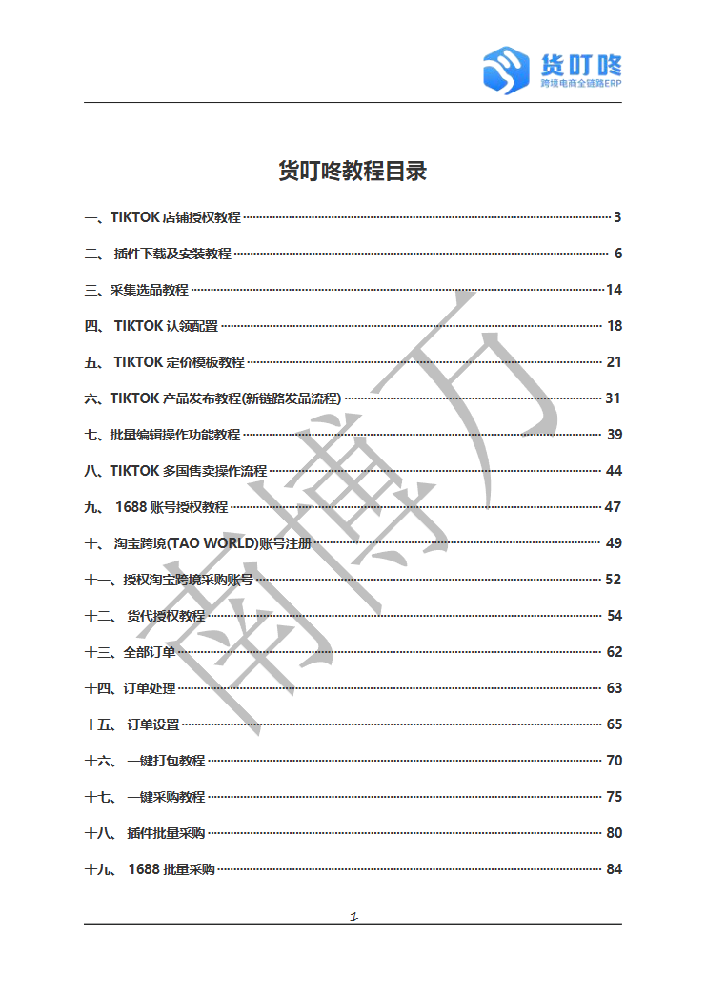](../images/04/page-001.png)

货叮咚教程目录一、TIKTOK店铺授权教程.................................................................................................................3二、插件下载及安装教程...................................................................................................................6三、采集选品教程...............................................................................................................................14四、TIKTOK认领配置.....................................................................................................................18五、TIKTOK定价模板教程.............................................................................................................21六、TIKTOK产品发布教程(新链路发品流程)...............................................................................31七、批量编辑操作功能教程..............................................................................................................39八、TIKTOK多国售卖操作流程......................................................................................................44九、1688账号授权教程..................................................................................................................47十、淘宝跨境(TAOWORLD)账号注册........................................................................................49十一、授权淘宝跨境采购账号..........................................................................................................52十二、货代授权教程.........................................................................................................................54十三、全部订单..................................................................................................................................62十四、订单处理..................................................................................................................................63十五、订单设置.................................................................................................................................65十六、一键打包教程.........................................................................................................................70十七、一键采购教程.........................................................................................................................75十八、插件批量采购.........................................................................................................................80十九、1688批量采购......................................................................................................................841

## 第 2 页

[打开第 2 页图片](../images/04/page-002.png)（510×720）

[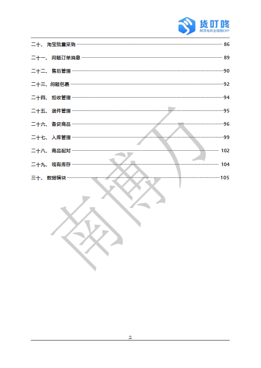](../images/04/page-002.png)

二十、淘宝批量采购.........................................................................................................................86二十一、问题订单消息.....................................................................................................................89二十二、售后管理..............................................................................................................................90二十三、问题包裹...............................................................................................................................92二十四、拒收管理..............................................................................................................................94二十五、退件管理..............................................................................................................................95二十六、备货商品..............................................................................................................................96二十七、入库管理..............................................................................................................................99二十八、商品配对..........................................................................................................................102二十九、现有库存..........................................................................................................................104三十、数据模块...............................................................................................................................1052

## 第 3 页

[打开第 3 页图片](../images/04/page-003.png)（764×1080）

[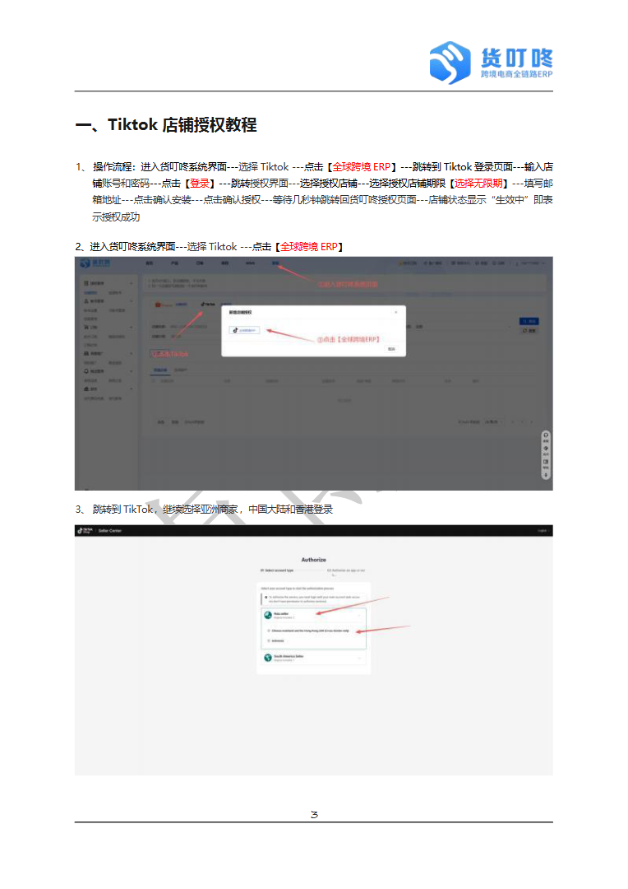](../images/04/page-003.png)

一、Tiktok店铺授权教程1、操作流程：进入货叮咚系统界面---选择Tiktok---点击【全球跨境ERP】---跳转到Tiktok登录页面---输入店铺账号和密码---点击【登录】---跳转授权界面---选择授权店铺---选择授权店铺期限【选择无限期】---填写邮箱地址---点击确认安装---点击确认授权---等待几秒钟跳转回货叮咚授权页面---店铺状态显示“生效中”即表示授权成功2、进入货叮咚系统界面---选择Tiktok---点击【全球跨境ERP】3、跳转到TikTok，继续选择亚洲商家，中国大陆和香港登录3

## 第 4 页

[打开第 4 页图片](../images/04/page-004.png)（510×720）

[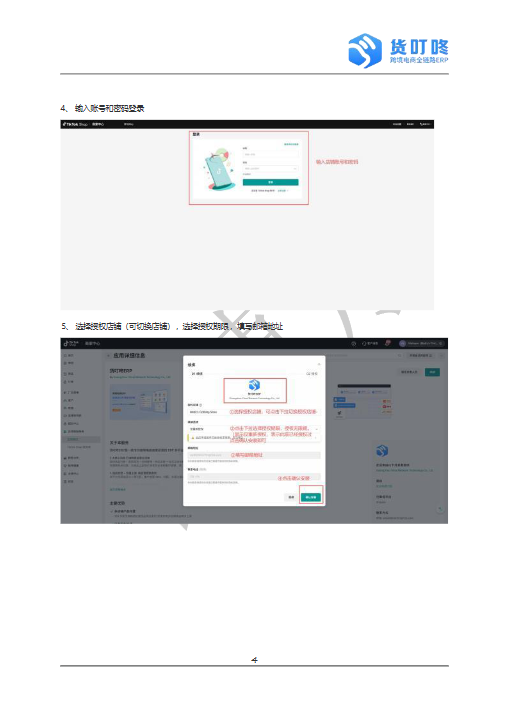](../images/04/page-004.png)

4、输入账号和密码登录5、选择授权店铺（可切换店铺），选择授权期限，填写邮箱地址4

## 第 5 页

[打开第 5 页图片](../images/04/page-005.png)（510×720）

[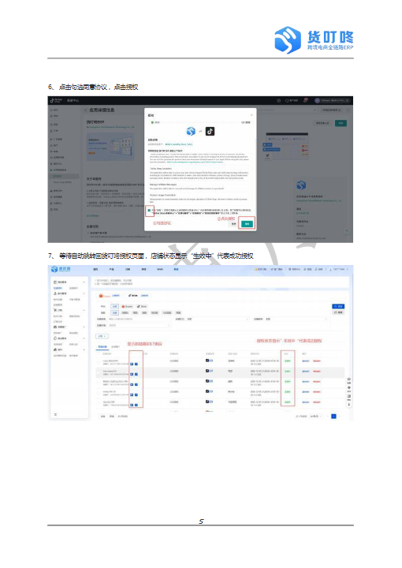](../images/04/page-005.png)

6、点击勾选同意协议，点击授权7、等待自动跳转回货叮咚授权页面，店铺状态显示“生效中”代表成功授权5

## 第 6 页

[打开第 6 页图片](../images/04/page-006.png)（510×720）

[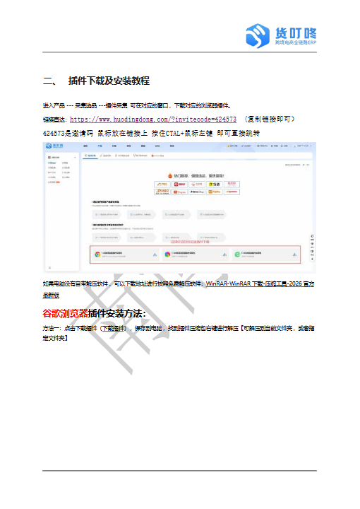](../images/04/page-006.png)

二、插件下载及安装教程进入产品---采集选品---插件采集可在对应的窗口，下载对应的浏览器插件。链接直达：https://www.huodingdong.com/?invitecode=424573(复制链接即可）424573是邀请码鼠标放在链接上按住CTAL+鼠标左键即可直接跳转如果电脑没有自带解压软件，可以下载地址进行按照免费解压软件：WinRAR-WinRAR下载-压缩工具-2026官方最新版谷歌浏览器插件安装方法：方法一：点击下载插件（下载插件），保存到电脑，找到插件压缩包右键进行解压【可解压到当前文件夹，或者指定文件夹】

## 第 7 页

[打开第 7 页图片](../images/04/page-007.png)（510×720）

6

## 第 8 页

[打开第 8 页图片](../images/04/page-008.png)（510×720）

[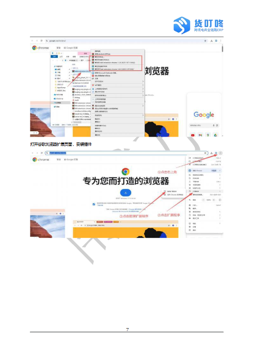](../images/04/page-008.png)

打开谷歌浏览器扩展页面，安装插件7

## 第 9 页

[打开第 9 页图片](../images/04/page-009.png)（510×720）

[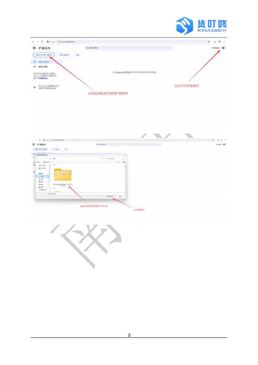](../images/04/page-009.png)

8

## 第 10 页

[打开第 10 页图片](../images/04/page-010.png)（510×720）

[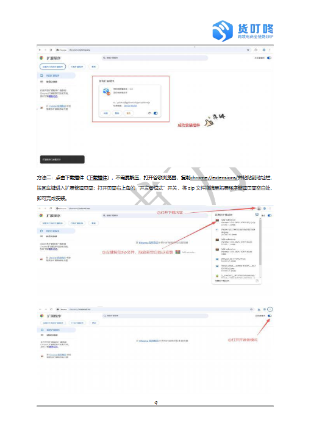](../images/04/page-010.png)

方法二：点击下载插件（下载插件），不需要解压，打开谷歌浏览器，复制chrome://extensions/并粘贴到地址栏，按回车键进入扩展管理页面；打开页面右上角的“开发者模式”开关，将zip文件拖拽至拓展程序管理页面空白处，即可完成安装。9

## 第 11 页

[打开第 11 页图片](../images/04/page-011.png)（510×720）

[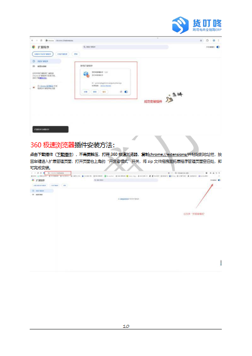](../images/04/page-011.png)

360极速浏览器插件安装方法：点击下载插件（下载插件），不需要解压，打开360极速浏览器，复制chrome://extensions/并粘贴到地址栏，按回车键进入扩展管理页面；打开页面右上角的“开发者模式”开关，将zip文件拖拽至拓展程序管理页面空白处，即可完成安装。10

## 第 12 页

[打开第 12 页图片](../images/04/page-012.png)（510×720）

[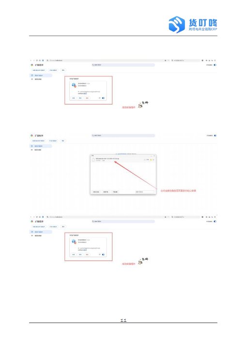](../images/04/page-012.png)

11

## 第 13 页

[打开第 13 页图片](../images/04/page-013.png)（510×720）

[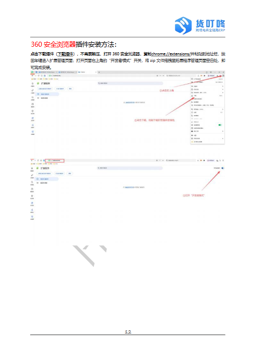](../images/04/page-013.png)

360安全浏览器插件安装方法：点击下载插件（下载插件），不需要解压，打开360安全浏览器，复制chrome://extensions/并粘贴到地址栏，按回车键进入扩展管理页面；打开页面右上角的“开发者模式”开关，将zip文件拖拽至拓展程序管理页面空白处，即可完成安装。12

## 第 14 页

[打开第 14 页图片](../images/04/page-014.png)（510×720）

[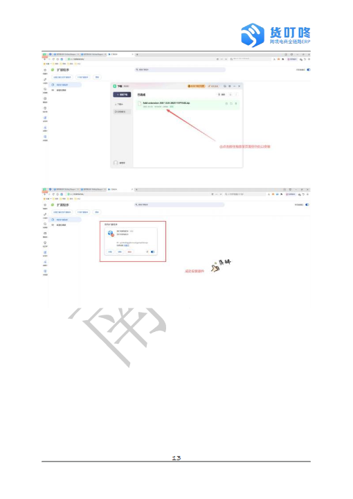](../images/04/page-014.png)

13

## 第 15 页

[打开第 15 页图片](../images/04/page-015.png)（510×720）

[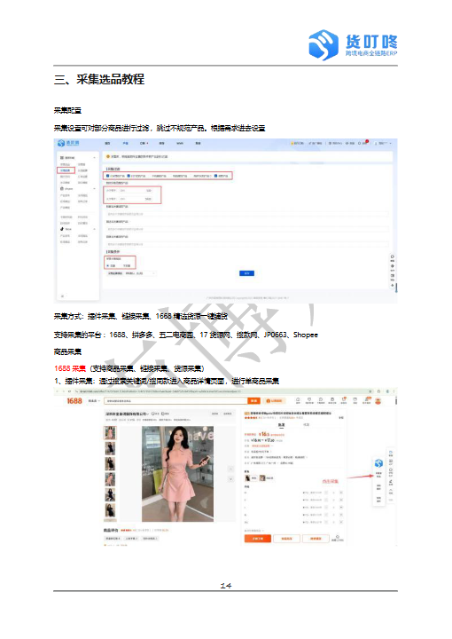](../images/04/page-015.png)

三、采集选品教程采集配置采集设置可对部分商品进行过滤，跳过不规范产品。根据需求进去设置采集方式：插件采集、链接采集、1668精选货源一键铺货支持采集的平台：1688、拼多多、五二电商园、17货源网、搜款网、JP0663、Shopee商品采集1688采集（支持商品采集、链接采集、货源采集）1、插件采集：通过搜索关键词/搜同款进入商品详情页面，进行单商品采集14

## 第 16 页

[打开第 16 页图片](../images/04/page-016.png)（510×720）

[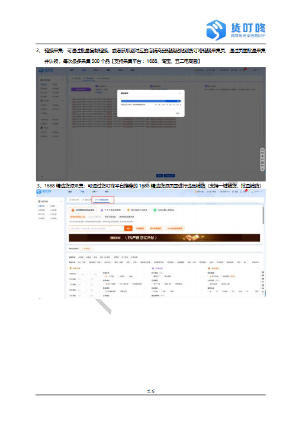](../images/04/page-016.png)

2、链接采集：可通过批量复制链接，或者获取到对应的店铺商品链接黏贴到货叮咚链接采集页、通过页面批量采集并认领，每次最多采集500个品【支持采集平台：1688、淘宝、五二电商园】3、1688精选货源采集：可通过货叮咚平台推荐的1688精选货源页面进行选品铺货（支持一键铺货、批量铺货）15

## 第 17 页

[打开第 17 页图片](../images/04/page-017.png)（510×720）

[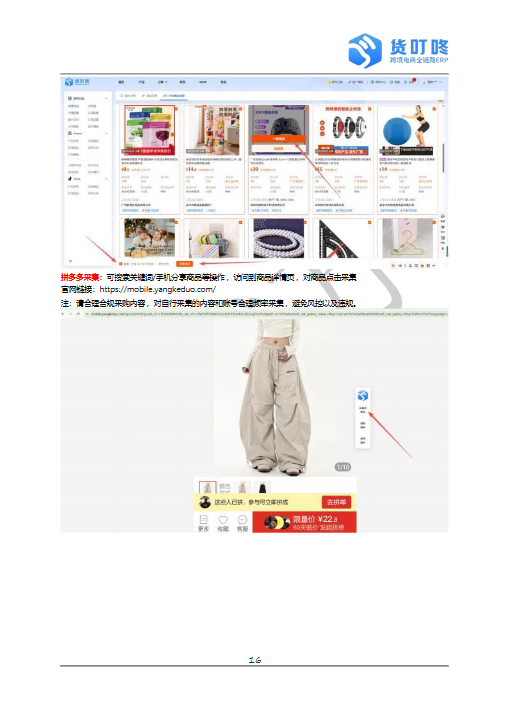](../images/04/page-017.png)

拼多多采集：可搜索关键词/手机分享商品等操作，访问到商品详情页，对商品点击采集官网链接：https://mobile.yangkeduo.com/注：请合理合规采购内容，对自行采集的内容和账号合理频率采集，避免风控以及违规。16

## 第 18 页

[打开第 18 页图片](../images/04/page-018.png)（510×720）

[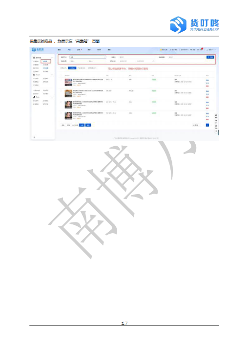](../images/04/page-018.png)

采集后的商品，均展示在“采集箱”页面17

## 第 19 页

[打开第 19 页图片](../images/04/page-019.png)（510×720）

[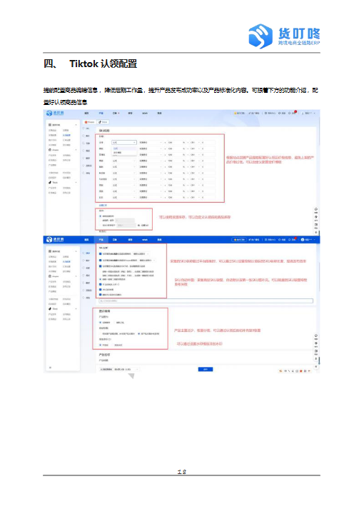](../images/04/page-019.png)

四、Tiktok认领配置提前配置商品编辑信息，降低后期工作量，提升产品发布成功率以及产品标准化内容。可跟着下方的功能介绍，配置好认领商品信息18

## 第 20 页

[打开第 20 页图片](../images/04/page-020.png)（510×720）

[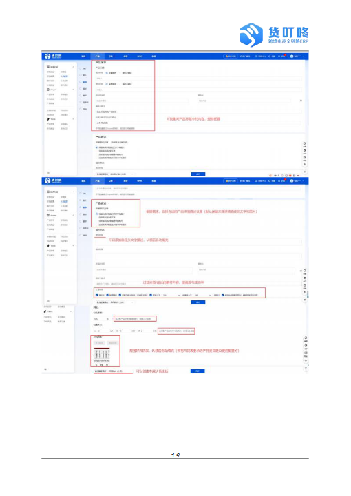](../images/04/page-020.png)

19

## 第 21 页

[打开第 21 页图片](../images/04/page-021.png)（510×720）

[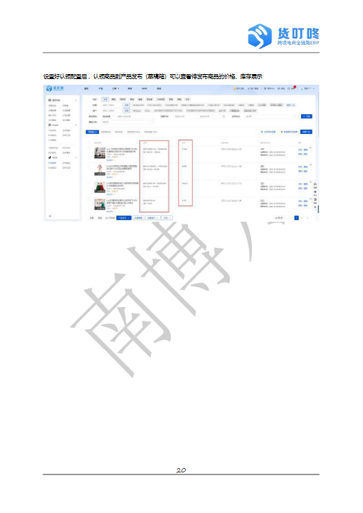](../images/04/page-021.png)

设置好认领配置后，认领商品到产品发布（草稿箱）可以查看待发布商品的价格、库存展示20

## 第 22 页

[打开第 22 页图片](../images/04/page-022.png)（510×720）

[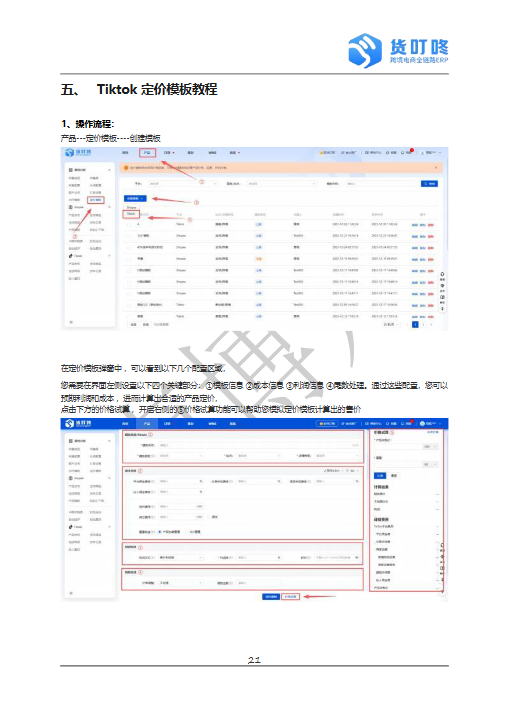](../images/04/page-022.png)

五、Tiktok定价模板教程1、操作流程：产品---定价模板----创建模板在定价模板弹窗中，可以看到以下几个配置区域，您需要在界面左侧设置以下四个关键部分：①模板信息②成本信息③利润信息④尾数处理。通过这些配置，您可以预期利润和成本，进而计算出合适的产品定价，点击下方的价格试算，开启右侧的⑤价格试算功能可以帮助您模拟定价模板计算出的售价21

## 第 23 页

[打开第 23 页图片](../images/04/page-023.png)（510×720）

[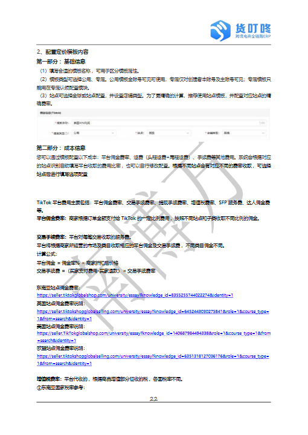](../images/04/page-023.png)

2、配置定价模板内容第一部分：基础信息（1）填写合适的模板名称，可用于区分模板属性。（2）模板类型可选择公用、专属。公用模板全账号可见可使用，专属仅对创建者本账号及主账号可见；专属模板只能用在专属认领配置模块。（3）站点可选择全球或站点配置，并设置店铺类型。为了更精确的计算，推荐使用站点模板，并配置对应站点的精确费率。第二部分：成本信息您可以通过模板配置以下成本：平台佣金费率、运费（头程运费+尾程运费）、手续费等其他费用。系统会根据对应的站点识别自动填写平台收取的费用比率，也可以自行修改配置。根据不同站点会有对应不同的费率收取，可选择站点后进行填写选项配置TikTok平台费用主要包括：平台佣金费率、交易手续费率、提现手续费率、增值税费率、SFP服务费、达人佣金费等。平台佣金费率：商家根据订单金额支付给TikTok的一定比例费用，按照不同站点和子类收取不同比例的佣金。交易手续费率：平台对每笔交易收取的服务费。平台将根据商家所经营的市场及类目收取相应的平台佣金及交易手续费，不同类目佣金不同。计算公式：平台佣金=佣金率%×商家折扣后价格交易手续费=（买家支付费用-买家退款）×交易手续费率东南亚站点佣金费率：https://seller.tiktokglobalshop.com/university/essay?knowledge_id=8355255744022274&identity=1英国站点佣金费率说明：https://seller.tiktokshopglobalselling.com/university/essay?knowledge_id=6452443030275841&role=1&course_type=1&from=search&identity=1美国站点佣金费率说明：https://seller.TikTokglobalshop.com/university/essay?knowledgeid=140687984494338&role=1&coursetype=1&from=search&identity=1欧盟站点佣金费率说明：https://seller.tiktokshopglobalselling.com/university/essay?knowledge_id=6351318127036176&role=1&course_type=1&from=search&identity=1增值税费率：平台代收的，根据商品增值部分征收的税，各国税率不同。①东南亚国家税率参考：22

## 第 24 页

[打开第 24 页图片](../images/04/page-024.png)（510×720）

[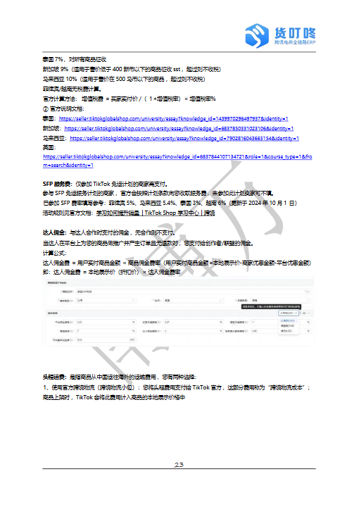](../images/04/page-024.png)

泰国7%，对所有商品征收新加坡9%（适用于售价低于400新币以下的商品征收sst，超过则不收税）马来西亚10%（适用于售价在500马币以下的商品，超过则不收税）菲律宾/越南无税费计算。官方计算方法：增值税费=买家实付价/（1+增值税率）×增值税率%②官方说明文档：泰国：https://seller.tiktokglobalshop.com/university/essay?knowledge_id=1439970296497937&identity=1新加坡：https://seller.tiktokglobalshop.com/university/essay?knowledge_id=6837850331023106&identity=1马来西亚：https://seller.tiktokglobalshop.com/university/essay?knowledge_id=7902816043665154&identity=1英国：https://seller.tiktokglobalshop.com/university/essay?knowledge_id=6837844107134721&role=1&course_type=1&from=search&identity=1SFP服务费：仅参加TikTok免运计划的商家需支付。参与SFP免运服务计划的商家，官方会按照计划条款向您收取服务费，未参加此计划卖家可不填。已参加SFP费率填写参考：菲律宾5%、马来西亚5.4%、泰国3%、越南6%（更新于2024年10月1日）活动规则见官方文档：学习如何提升销量|TikTokShop学习中心|跨境达人佣金：与达人合作时支付的佣金，无合作则不支付。当达人在平台上为您的商品做推广并产生订单且无退款时，您支付给创作者/联盟的佣金。计算公式：达人佣金费=用户实付商品金额×商品佣金费率（用户实付商品金额=本地展示价-商家优惠金额-平台优惠金额）即：达人佣金费=本地展示价（折扣价）×达人佣金费率头程运费：是指商品从中国运往海外的运输费用，您有两种选择：1、使用官方跨境物流（跨境物流小包）：您将头程费用支付给TikTok官方，这部分费用称为“跨境物流成本”；商品上架时，TikTok会将此费用计入商品的本地展示价格中23

## 第 25 页

[打开第 25 页图片](../images/04/page-025.png)（510×720）

[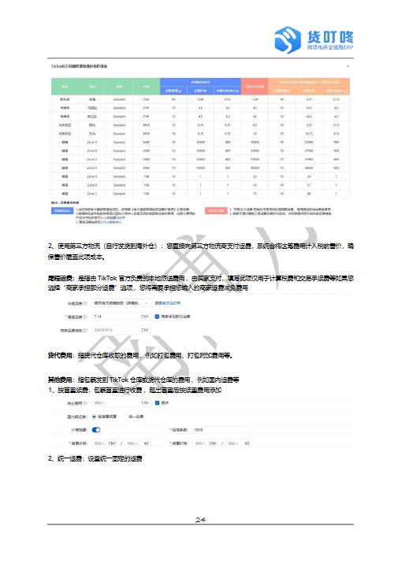](../images/04/page-025.png)

2、使用第三方物流（自行发货到海外仓）：您直接向第三方物流商支付运费，系统会将这笔费用计入税前售价，确保售价覆盖此项成本。尾程运费：是指由TikTok官方负责的本地派送费用，由买家支付，填写此项仅用于计算税费和交易手续费等如果您选择“商家承担部分运费”选项，您将需要承担您输入的商家运费减免费用货代费用：指货代仓库收取的费用，例如打包费用、打包附加费用等。其他费用：指包裹发到TikTok仓库或货代仓库的费用，例如国内运费等1、按首重续费：包裹首重进行收费，超出首重后按续重费用添加2、统一运费：设置统一固定的运费24

## 第 26 页

[打开第 26 页图片](../images/04/page-026.png)（510×720）

[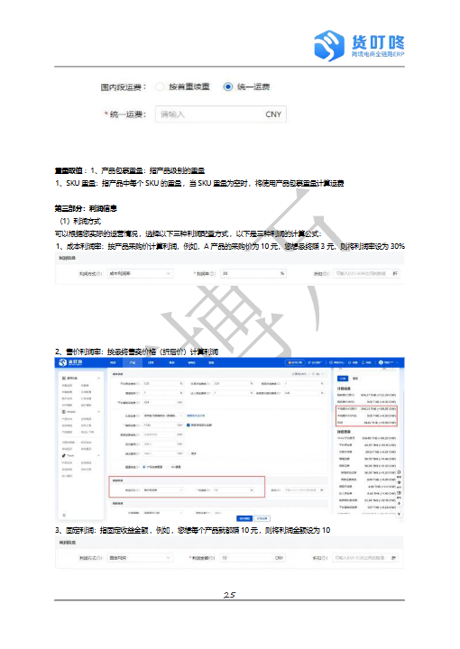](../images/04/page-026.png)

重量取值：1、产品包裹重量：指产品级别的重量1、SKU重量：指产品中每个SKU的重量，当SKU重量为空时，将使用产品包裹重量计算运费第三部分：利润信息（1）利润方式可以根据您实际的运营情况，选择以下三种利润配置方式，以下是三种利润的计算公式：1、成本利润率：按产品采购价计算利润，例如，A产品的采购价为10元，您想最终赚3元，则将利润率设为30%2、售价利润率：按最终售卖价格（折后价）计算利润3、固定利润：指固定收益金额，例如，您想每个产品就都赚10元，则将利润金额设为1025

## 第 27 页

[打开第 27 页图片](../images/04/page-027.png)（510×720）

[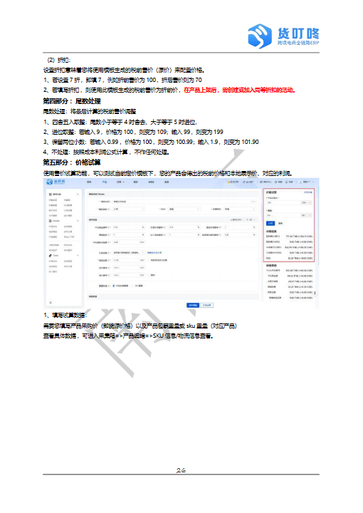](../images/04/page-027.png)

（2）折扣：设置折扣意味着您将使用模板生成的税前售价（原价）来配置价格。1、若设置7折，即填7，例如折前售价为100，折后售价则为702、若填写折扣，则使用此模板生成的税前售价为折前价，在产品上架后，需创建或加入同等折扣的活动。第四部分：尾数处理尾数处理：将最后计算的税前售价调整1、四舍五入取整：尾数小于等于4时舍去、大于等于5时进位，2、进位取整：若输入9，价格为100，则变为109；输入99，则变为1993、保留两位小数：若输入0.99，价格为100，则变为100.99；输入1.9，则变为101.904、不处理：按照成本利润公式计算，不作任何处理。第五部分：价格试算使用售价试算功能，可以测试当前定价模板下，您的产品会得出的税前价格和本地展示价、对应的利润。1、填写试算数据：需要您填写产品采购价（即货源价格）以及产品包裹重量或sku重量（对应产品）查看具体数据，可进入采集箱=>产品编辑=>SKU信息/物流信息查看。26

## 第 28 页

[打开第 28 页图片](../images/04/page-028.png)（510×720）

[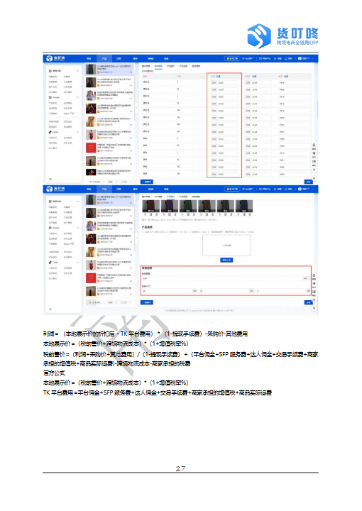](../images/04/page-028.png)

利润=（本地展示价的折扣后-TK平台费用）*（1-提现手续费）-采购价-其他费用本地展示价=（税前售价+跨境物流成本）*（1+增值税率%）税前售价=（利润+采购价+其他费用）/（1-提现手续费）+（平台佣金+SFP服务费+达人佣金+交易手续费+商家承担的增值税+商品实际运费)-跨境物流成本-商家承担的税费官方公式本地展示价=（税前售价+跨境物流成本）*（1+增值税率%）TK平台费用=平台佣金+SFP服务费+达人佣金+交易手续费+商家承担的增值税+商品实际运费27

## 第 29 页

[打开第 29 页图片](../images/04/page-029.png)（510×720）

[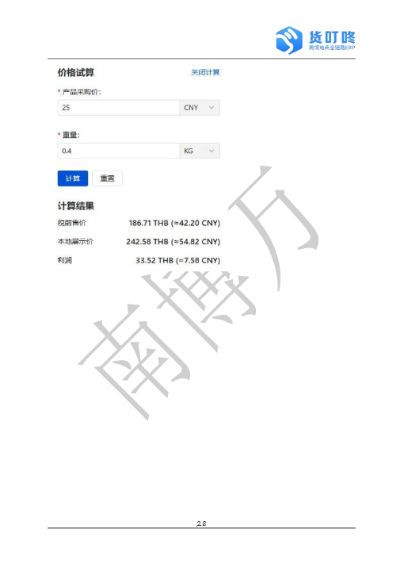](../images/04/page-029.png)

28

## 第 30 页

[打开第 30 页图片](../images/04/page-030.png)（510×720）

[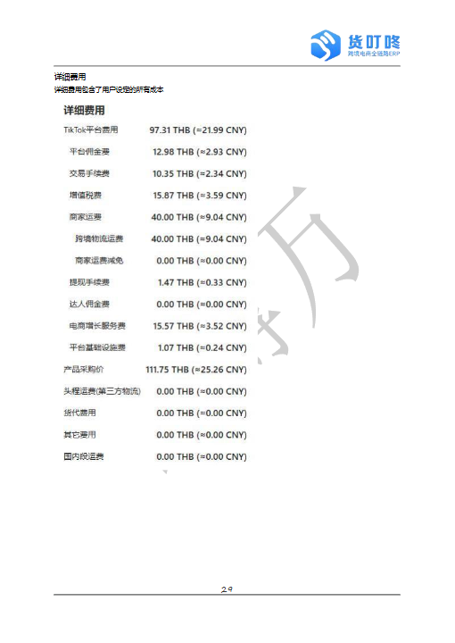](../images/04/page-030.png)

详细费用详细费用包含了用户设定的所有成本29

## 第 31 页

[打开第 31 页图片](../images/04/page-031.png)（510×720）

[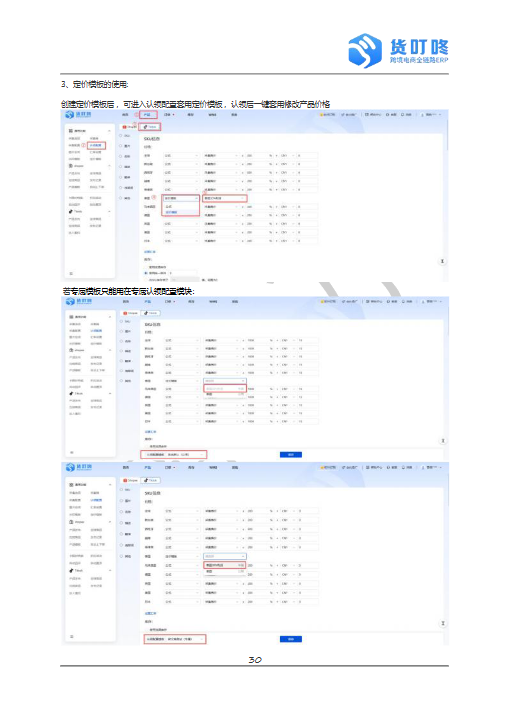](../images/04/page-031.png)

3、定价模板的使用:创建定价模板后，可进入认领配置套用定价模板，认领后一键套用修改产品价格若专属模板只能用在专属认领配置模块：30

## 第 32 页

[打开第 32 页图片](../images/04/page-032.png)（510×720）

[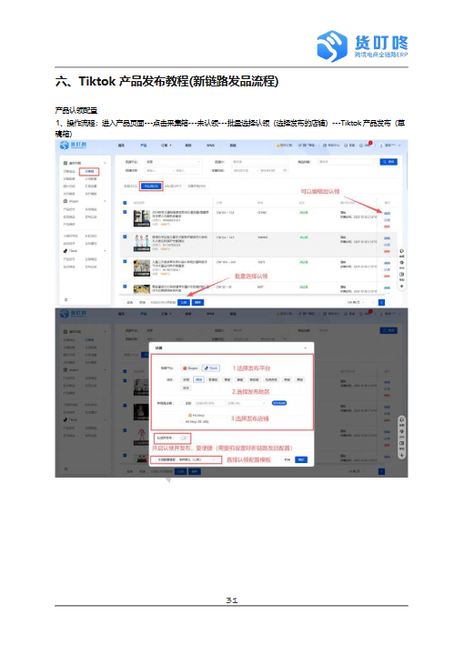](../images/04/page-032.png)

六、Tiktok产品发布教程(新链路发品流程)产品认领配置1、操作流程：进入产品页面---点击采集箱---未认领---批量选择认领（选择发布的店铺）---Tiktok产品发布（草稿箱）31

## 第 33 页

[打开第 33 页图片](../images/04/page-033.png)（510×720）

[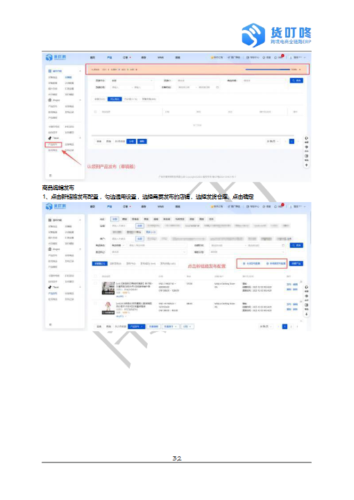](../images/04/page-033.png)

商品编辑发布1、点击新链路发布配置，勾选通用设置，选择需要发布的店铺，选择发货仓库、点击确定32

## 第 34 页

[打开第 34 页图片](../images/04/page-034.png)（510×720）

[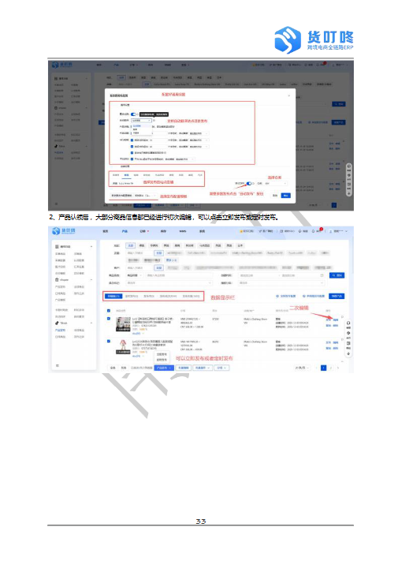](../images/04/page-034.png)

2、产品认领后，大部分商品信息都已经进行初次编辑，可以点击立即发布或定时发布。33

## 第 35 页

[打开第 35 页图片](../images/04/page-035.png)（510×720）

[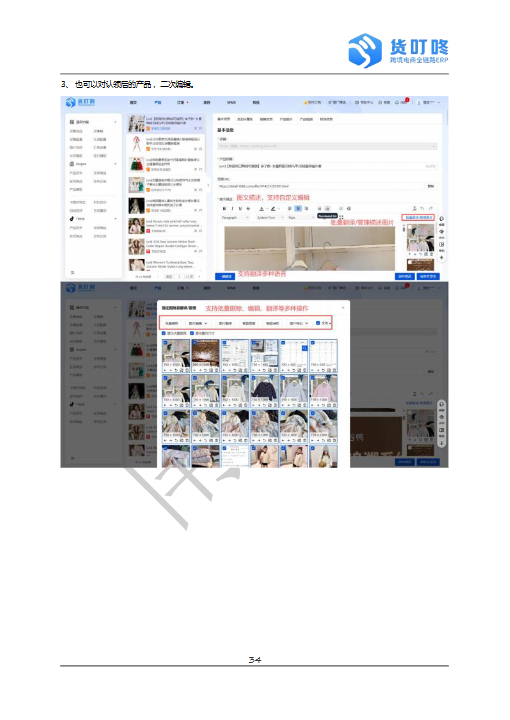](../images/04/page-035.png)

3、也可以对认领后的产品，二次编辑。34

## 第 36 页

[打开第 36 页图片](../images/04/page-036.png)（510×720）

[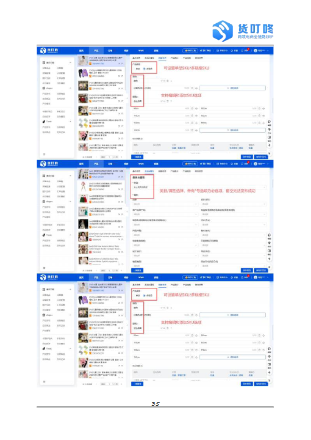](../images/04/page-036.png)

35

## 第 37 页

[打开第 37 页图片](../images/04/page-037.png)（510×720）

[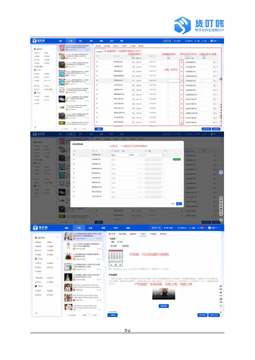](../images/04/page-037.png)

36

## 第 38 页

[打开第 38 页图片](../images/04/page-038.png)（510×720）

[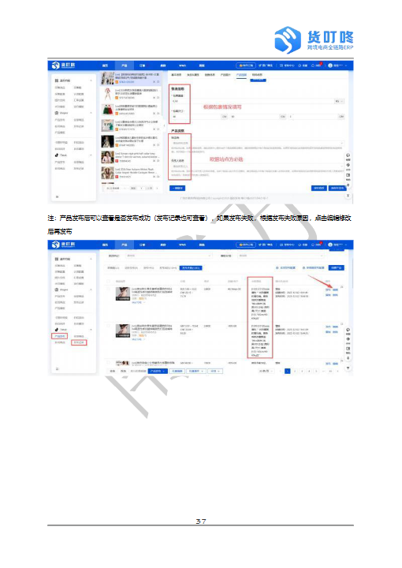](../images/04/page-038.png)

注：产品发布后可以查看是否发布成功（发布记录也可查看），如果发布失败，根据发布失败原因，点击编辑修改后再发布37

## 第 39 页

[打开第 39 页图片](../images/04/page-039.png)（510×720）

38

## 第 40 页

[打开第 40 页图片](../images/04/page-040.png)（510×720）

[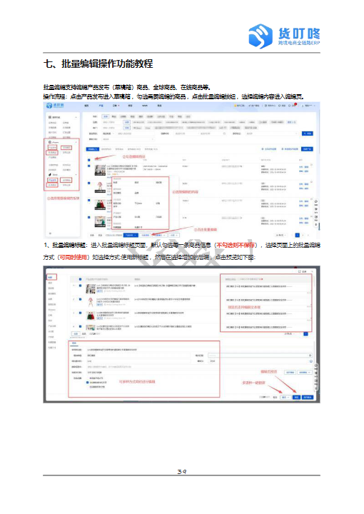](../images/04/page-040.png)

七、批量编辑操作功能教程批量编辑支持编辑产品发布（草稿箱）商品、全球商品、在线商品等。操作流程：点击产品发布进入草稿箱，勾选需要编辑的商品，点击批量编辑按钮，选择编辑内容进入编辑页。1、批量编辑标题：进入批量编辑标题页面，默认勾选每一条商品信息（不勾选则不保存），选择页面上的批量编辑方式（可同时使用）如选择方式:使用新标题，然后在选择增加前后缀，点击预览如下图：39

## 第 41 页

[打开第 41 页图片](../images/04/page-041.png)（510×720）

[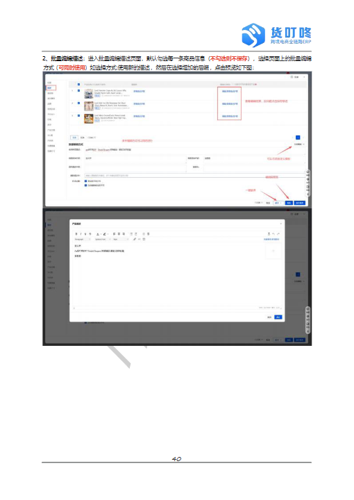](../images/04/page-041.png)

2、批量编辑描述：进入批量编辑描述页面，默认勾选每一条商品信息（不勾选则不保存），选择页面上的批量编辑方式可同时使用如选择方式:使用新的描述，然后在选择增加前后缀，点击预览如下图：40()

## 第 42 页

[打开第 42 页图片](../images/04/page-042.png)（510×720）

[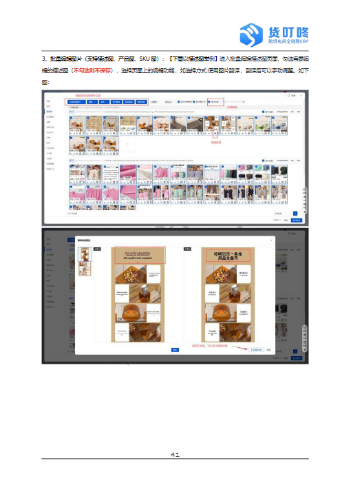](../images/04/page-042.png)

3、批量编辑图片（支持描述图、产品图、SKU图）：【下面以描述图举例】进入批量编辑描述图页面，勾选需要编辑的描述图（不勾选则不保存），选择页面上的编辑功能，如选择方式:使用图片翻译，翻译后可以手动调整。如下图：41

## 第 43 页

[打开第 43 页图片](../images/04/page-043.png)（510×720）

[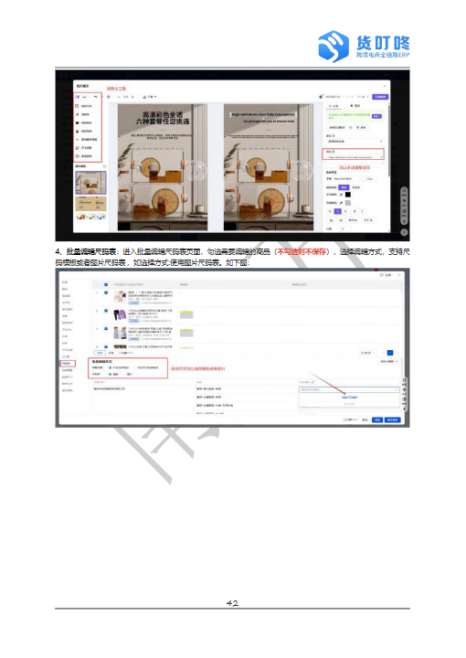](../images/04/page-043.png)

4、批量编辑尺码表：进入批量编辑尺码表页面，勾选需要编辑的商品（不勾选则不保存），选择编辑方式，支持尺码模板或者图片尺码表，如选择方式:使用图片尺码表。如下图：42

## 第 44 页

[打开第 44 页图片](../images/04/page-044.png)（510×720）

[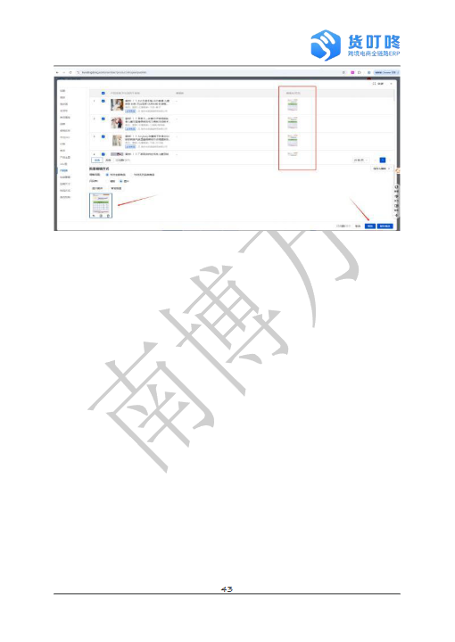](../images/04/page-044.png)

43

## 第 45 页

[打开第 45 页图片](../images/04/page-045.png)（510×720）

[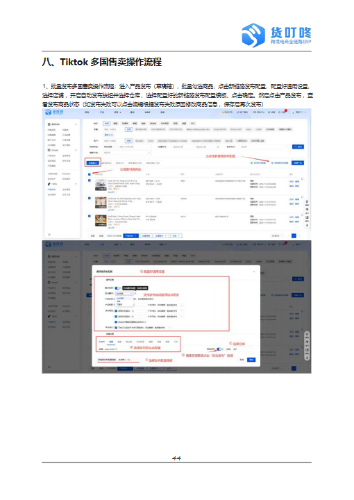](../images/04/page-045.png)

八、Tiktok多国售卖操作流程1、批量发布多国售卖操作流程：进入产品发布（草稿箱），批量勾选商品，点击新链路发布配置，配置好通用设置，选择店铺，开启自动发布按钮并选择仓库，选择配置好的新链路发布配置模板、点击确定。然后点击产品发布，查看发布商品状态（如发布失败可以点击编辑根据发布失败原因修改商品信息，保存后再次发布）44

## 第 46 页

[打开第 46 页图片](../images/04/page-046.png)（510×720）

[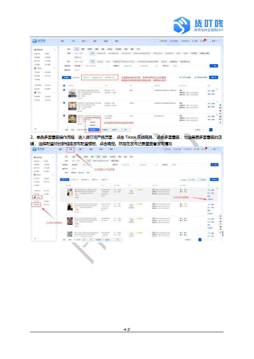](../images/04/page-046.png)

2、单品多国售卖操作流程：进入货叮咚产品页面，点击Tiktok在线商品，点击多国售卖，勾选需要多国售卖的店铺，选择配置好的新链路发布配置模板、点击确定。然后在发布记录里查看发布情况45

## 第 47 页

[打开第 47 页图片](../images/04/page-047.png)（510×720）

[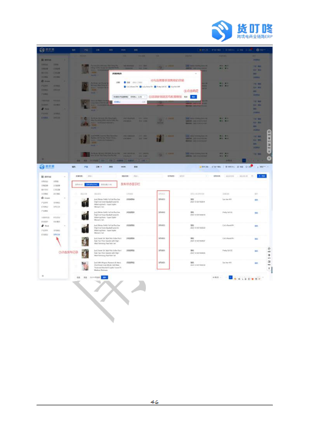](../images/04/page-047.png)

46

## 第 48 页

[打开第 48 页图片](../images/04/page-048.png)（510×720）

[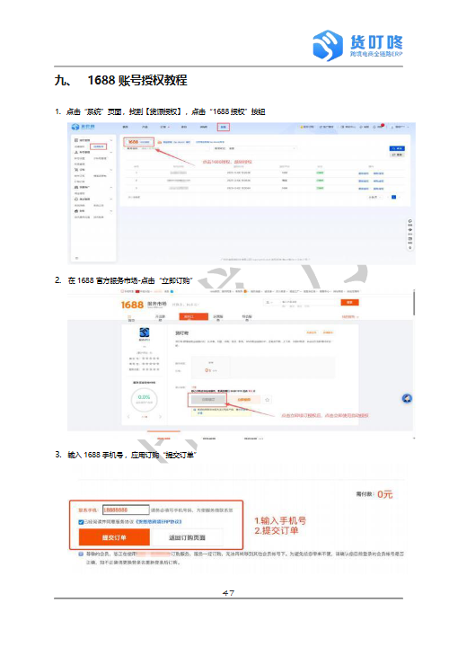](../images/04/page-048.png)

九、1688账号授权教程1.点击“系统”页面，找到【货源授权】，点击“1688授权”按钮2.在1688官方服务市场-点击“立即订购”3.输入1688手机号，应用订购“提交订单”47

## 第 49 页

[打开第 49 页图片](../images/04/page-049.png)（510×720）

[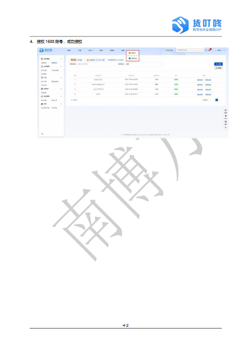](../images/04/page-049.png)

4.授权1688账号，成功授权48

## 第 50 页

[打开第 50 页图片](../images/04/page-050.png)（510×720）

[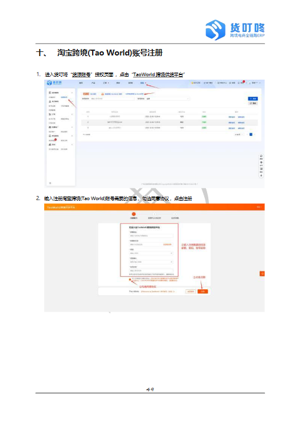](../images/04/page-050.png)

十、淘宝跨境(TaoWorld)账号注册1.进入货叮咚“货源账号”授权页面，点击“TaoWorld跨境供货平台”2.输入注册淘宝跨境(TaoWorld)账号需要的信息，勾选同意协议，点击注册49

## 第 51 页

[打开第 51 页图片](../images/04/page-051.png)（510×720）

[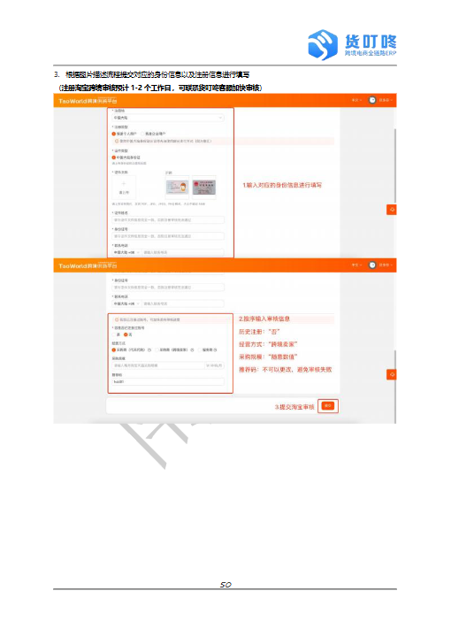](../images/04/page-051.png)

3.根据图片描述流程提交对应的身份信息以及注册信息进行填写（注册淘宝跨境审核预计1-2个工作日，可联系货叮咚客服加快审核）50

## 第 52 页

[打开第 52 页图片](../images/04/page-052.png)（510×720）

[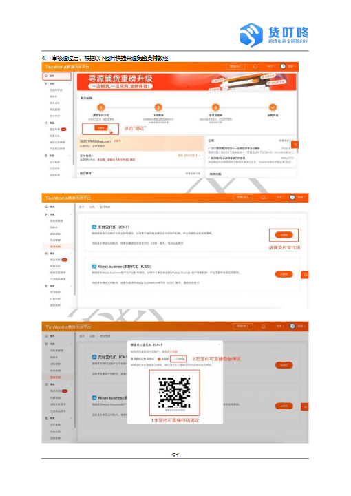](../images/04/page-052.png)

4.审核通过后，根据以下图片快捷开通免密支付教程51

## 第 53 页

[打开第 53 页图片](../images/04/page-053.png)（510×720）

十一、授权淘宝跨境采购账号1、点击【淘宝跨境(TaoWorld)授权】2、登陆淘宝跨境账号52

## 第 54 页

[打开第 54 页图片](../images/04/page-054.png)（510×720）

3、绑定授权53

## 第 55 页

[打开第 55 页图片](../images/04/page-055.png)（510×720）

十二、货代授权教程卖家在处理订单时推送订单到货代之前，需要先授权货代到货叮咚ERP，可以根据实际情况筛选服务平台、服务站点、货代位置作为合作货代。在货代管理注册绑定货代服务商授权店铺后，系统可以自动同步订单时，一键采购选择打包仓库。采购插件自动将货代商仓库作为收件人，实现高效采购发货。一、如何绑定授权货代商登录系统后，选择订单-货代管理-货代服务商，选择心仪的货代进入货代商家端注册账号复制授权码绑定授权54

## 第 56 页

[打开第 56 页图片](../images/04/page-056.png)（510×720）

首次开通货代系统，需要使用您的货叮咚注册的手机号进行注册货代服务商系统的账号，填写图形验证码后获取短信验证码，提交两次密码需要一致。55

## 第 57 页

[打开第 57 页图片](../images/04/page-057.png)（510×720）

成功注册后可以在首页查看货代标识码，右上角可添加货代客服微信进行咨询货代打包费用细节以及仓库收货地址信息。无须关闭页面，可以回到货叮咚系统货代页面点击注册货代的【授权货代】获取授权码，跳转复制粘贴授权码授权56

## 第 58 页

[打开第 58 页图片](../images/04/page-058.png)（510×720）

点击获取授权码，自动跳转复制授权码57

## 第 59 页

[打开第 59 页图片](../images/04/page-059.png)（510×720）

粘贴授权码即可完成授权货代当看到这个界面即表示授权货代完成，还需要授权店铺才能同步订单到货代仓库端进行打包。58

## 第 60 页

[打开第 60 页图片](../images/04/page-060.png)（510×720）

成功开通注册之后需要登录货代服务商系统进行授权店铺，才能同步店铺订单信息。点击授权管理-店铺授权页面进行授权成功授权店铺后可在订单编辑打包进行选择货代，进行提交同步仓库打包。如授权多家货代仓库，也可以设置默认仓库，提交订单默认选择该仓库发货。59

## 第 61 页

[打开第 61 页图片](../images/04/page-061.png)（510×720）

二、如何查看管理授权货代商进入订单-货代管理-我的货代服务商可以查看管理已开通的货代商情况，如需要关闭货代商对应的仓库，可以点击启用仓库进行勾选开启关闭。如需要解绑货代商，可以点击操作解绑按钮后即可成功解绑。60

## 第 62 页

[打开第 62 页图片](../images/04/page-062.png)（510×720）

货代解绑后可重新二次绑定，重新绑定货代商后需要手动授权。可以重新再登录货代系统后台，点击菜单【账号管理-账号设置-用户授权信息】，复制用户授权信息进行绑定。复制系统授权码可以重新进行授权。61

## 第 63 页

[打开第 63 页图片](../images/04/page-063.png)（510×720）

十三、全部订单货叮咚分为以下几种订单状态区分，方便您快速区分定位到订单类型处理：待处理订单：未申请运单号订单，需要注意采购拍单填写快递单号提交到货代仓库-未出货：需处理打包发货的订单（提交打包后自动申请运单号）-已出货：已采购商家未发货的订单待打单发货：已经申请运单号订单，需要注意货代仓库是否安排出货-未出货：区分已采购订单是否已发货，需要注意发货时间（关联申请运单号移入待打单规则；详订单设置）-已出货：采购订单发货后状态流转，需要注意交运时间交运中：货代仓库已经将包裹完成打包出库，安排送仓发货，等待官方物流扫描揽收中已发货：包裹已交付给官方物流已揽收包裹，订单正在运输中，处于物流转运环节已隔离：隔离无需打包处理的订单已取消：店铺订单状态已取消，如买家取消订单状态待确认：用户下单两个小时内的订单为风控待确认状态，订单不可编辑操作，2小时后会自动成为正常待处理订单全部：已同步ERP系统的全部订单，支持批量操作、同步、导出订单。62

## 第 64 页

[打开第 64 页图片](../images/04/page-064.png)（510×720）

十四、订单处理1、店铺订单展现的是您店铺所有的订单及订单状态，自动同步近15天订单，如需同步更多需手动操作同步订单按钮2、如需提交给货代仓库打包，请前往“待处理-未出货”填写打包信息提交，提交打包后订单会同步至“待打单发货-已出货”63

## 第 65 页

[打开第 65 页图片](../images/04/page-065.png)（510×720）

3、如需二次编辑打包信息，请前往“待打单发货--已出货”处编辑打包信息64

## 第 66 页

[打开第 66 页图片](../images/04/page-066.png)（510×720）

十五、订单设置货叮咚根据不同卖家情况，预先配置各种订单设置，可以让您出货事半功倍，降低后期工作量目前货叮咚拥有三种订单出货方式展示，可以根据自身的出货喜好进行调整1、优先展示货源：适合无货源卖家设置，订单展示优先显示绑定货源信息，一键采购高效处理。2、优先展示库存：适合部分囤货+无货源卖家设置，订单优先显示库存信息，一键配对仓库库存发货。3、仅库存：适合拥有固定货源供应链卖家设置，可以直接提交库存打包，无采购需求。65

## 第 67 页

[打开第 67 页图片](../images/04/page-067.png)（510×720）

自动填写货代备注：如每一笔订单都有固定备注信息需同步货代仓库可以，可以设置自动填写货代备注，每次提交订单出货，系统会自动提交备注信息。减少重复工作内容。66

## 第 68 页

[打开第 68 页图片](../images/04/page-068.png)（510×720）

货代备注标签：如有不同类型的商品需要专属备注反馈，也可以设置备注标签可快速提交同步备注。67

## 第 69 页

[打开第 69 页图片](../images/04/page-069.png)（510×720）

默认货币：可设置显示为人民币或对应站点币种68

## 第 70 页

[打开第 70 页图片](../images/04/page-070.png)（510×720）

拣货单设置：如需打印拣货单交付给仓库拣货员拣货，可根据自身仓库需求设置打印拣货单内容明细移入待打单规则：获取运单号成功时，自动移入获取运单号成功，且包裹所有产品都添加了出货信息，自动移入商品显示语种：中文原文69

## 第 71 页

[打开第 71 页图片](../images/04/page-071.png)（510×720）

十六、一键打包教程货叮咚系统分类了订单状态：待处理-未出货，把未出货/未采购订单归类，快速定位到每天需要采购的订单。让采购人员轻松快速进入采购状态1、选择打包的货代仓库：固定一个仓库使用的话，可以设置为默认仓库，2、核对收件的仓库地址：检查核对采购发往的仓库地址和提交打包信息的仓库地址是否一致，否则将无法打包出库3、对货代仓库的备注：一般备注拆包，组合件，或者买家更换SKU等信息注：商品类目众多，个别产品SKU难区分的，请一定要备注好打包人员怎么去核对商品。70

## 第 72 页

[打开第 72 页图片](../images/04/page-072.png)（510×720）

4、输入采购的国内物流单号：用于仓库收件扫描匹配您的shopee发货订单，供应商未发货的可以留空有单号再填写；如果有库存，也可以选择库存下单，选择对应的库存商品，下单后仓库会对您的库存商品进行拣货打包。5、缺货打包：一般用于采购过晚，物流过慢，快递未到齐，送仓时间紧急的时候，可以优先发出已到达仓库的订单71

## 第 73 页

[打开第 73 页图片](../images/04/page-073.png)（510×720）

6、添加额外发货信息：供应商分开包裹发货，补发货物，需要赠送小礼品，均可以使用添加额外发货信息功能7、库存下单需要先申请入库，囤货到仓库代发才可以使用库存下单（如何申请备货库存）72

## 第 74 页

[打开第 74 页图片](../images/04/page-074.png)（510×720）

73

## 第 75 页

[打开第 75 页图片](../images/04/page-075.png)（510×720）

如已经手动采购，但未有更新发货物流单号，可以填写采购订单号进行同步74

## 第 76 页

[打开第 76 页图片](../images/04/page-076.png)（510×720）

十七、一键采购教程1、使用一键采购可以节省你提交打包信息的时间，您只需要安装货叮咚跨境助手插件操作一键采购，系统会自动帮您同步发货单号回来提交打包信息至仓库2、请保持采购货源平台账号在货叮咚网站上处于登录状态才可以同步采购物流单号，建议每天查看检查是否有登录采购账号3、一键采购步骤：安装好货叮咚跨境助手插件---配置采购连接---点击一键采购---自动同步快递单号提交打包，采购完成的订单会提示绑定成功，您可以在已采购清单查看注：需要先申请出货编号，采购完成系统才能进行自动帮您进行发货预报1、进入“我的订单—待处理订单”查看需要采购的订单，配置采购链接，可以配置多个采购链接，采购链接是灰色的时候代表还没配置采购链接75

## 第 77 页

[打开第 77 页图片](../images/04/page-077.png)（510×720）

2、在对应需要采购的订单，点击一键采购/批量采购，跳转到采购页面。教程采用批量采购演示3、选择收货的货代仓库地址，提交订单的时候，会自动填入收货地址。注：如果您需要采购的商品是同一款，可以合并SKU采购，系统在同步到订单编号时候会自动填入单号到对应的订单提交打包信息，可以达到店铺满减优惠和节省您的采购时间4、点击发起采购，会打开新的标签页进行采购，页面的左侧是插件的页面，可以看到收货地址，采购账号，当前的采购清单。76

## 第 78 页

[打开第 78 页图片](../images/04/page-078.png)（510×720）

注：所有的采购流程都只能在这个标签页进行，要不然无法绑定订单，如果当前拼多多商品不是你要采购的商品，你也可以在该标签页浏览到正确的商品再采购，但是只能在该标签页完成77

## 第 79 页

[打开第 79 页图片](../images/04/page-079.png)（510×720）

5、在拼多多页面选择要购买的sku和数量，提交订单，就到拼多多的购买流程的下一步，在这里会自动帮你把收货地址填好、默认选择支付宝支付（目前插件只支持支付宝支付）。温馨提示：如果是第二次采购这个商品，点击采购就会直接到这一步，把sku、数量选择好，只需点击支付即可6、点击立即支付，会跳到支付宝支付页面，到了这个页面，就把支付订单号和采购商品绑定，在ERP系统的采购够清单可以看到具体信息。接下来输入支付宝密码支付就可以(如果设置支付宝账户密码会自动填充)，支付成功之后，会自动跳到下个采购清单进行采购。78

## 第 80 页

[打开第 80 页图片](../images/04/page-080.png)（510×720）

7、采购完成之后，可以在采购清单页面看到，之前采购的清单，你可以在这里手动批量/单个同步采购信息，比如采购订单状态、物流单号；也撤销采购订单，注意：浏览器插件会每2小时自动同步一次，同步期间不要关闭浏览器，同时保证采购账号处于登录状态。1、采购完成之后，货叮咚跨境助手浏览器插件会自动同步采购的快递单号回来提交打包信息至仓库，订单状态从“待处理订单”变为“已打包订单”2、自动同步采购单号提交代打包，需要保持采购账号登录状态，同时确保货代账户余额充值，否则将提交打包失败79

## 第 81 页

[打开第 81 页图片](../images/04/page-081.png)（510×720）

十八、插件批量采购采购前需绑定好对应平台货源，以便批量发起采购点击操作编辑货源，可以关联不同的货源链接，如遇缺货或价格变更可更换更优质的供应商选择采购80

## 第 82 页

[打开第 82 页图片](../images/04/page-082.png)（510×720）

批量选择待采购订单，点击批量采购，可选择插件批量采购、1688批量采购、淘宝批量采购81

## 第 83 页

[打开第 83 页图片](../images/04/page-083.png)（510×720）

拼多多货源采购页面：82

## 第 84 页

[打开第 84 页图片](../images/04/page-084.png)（510×720）

1688货源采购页面：淘宝货源采购页面：83

## 第 85 页

[打开第 85 页图片](../images/04/page-085.png)（510×720）

十九、1688批量采购一．批量选择待采购订单-发起“采购页面”1.点击“商品信息”-批量选择订单信息2.点击“批量采购（1688）”3.也可以单独发起一键快捷采购二．发起“采购页面”后，核对拍单sku-“预览采购单”1.首次下单需要手动选择采购sku，商品不满足采购需求货源链接，可直接更换采购货源【后续自动默认规格，减少出错，提高拍单效率】2.采购页面可直接快捷新增绑定1688货源链接3.一键移除未绑定1688货源商品4.提交采购单，预览下单实际金额和利润84

## 第 86 页

[打开第 86 页图片](../images/04/page-086.png)（510×720）

三．预览采购单页面，进行确认下单规格信息1.预览每个订单等实际下单费用【如果有需要联系商家改价，需提交订单后联系】2.预览实际等采购支出以及预估利润3.核对采购账号-“提交并支付订单”四．支付订单，自动绑定采购信息无需网页插件同时在线，自动推送发货单号至货代仓库注：当前1688页面需登陆下单一致的1688账号，否则会提示账号不一致导致付款失败。提交后会自动绑定对应的1688采购订单，运费自动平摊订单，利润核算更精准。85

## 第 87 页

[打开第 87 页图片](../images/04/page-087.png)（510×720）

二十、淘宝批量采购一．批量选择待采购订单-发起“采购页面”1.点击“商品信息”-批量选择订单信息2.点击“批量采购（淘宝）”3.也可以单独发起淘宝快捷采购86

## 第 88 页

[打开第 88 页图片](../images/04/page-088.png)（510×720）

二．发起“采购页面”后，核对拍单sku-“预览采购单”1.首次下单需要手动选择采购sku，商品不满足采购需求货源链接，可直接更换采购货源【后续自动默认规格，减少出错，提高拍单效率】2.采购页面可直接快捷新增绑定淘宝货源链接3.一键移除未绑定淘宝货源商品4.提交采购单，预览下单实际金额和利润三．预览采购单页面，进行二次确认下单规格信息1.预览每个订单的实际下单费用2.预览实际等采购支出以及预估利润3.核对采购账号-“提交并支付订单”【开通淘宝会自动免密支付】87

## 第 89 页

[打开第 89 页图片](../images/04/page-089.png)（510×720）

四．免密支付订单，自动绑定采购信息无需网页插件同时在线，自动推送发货单号至货代仓库注：提交后自动会自动绑定对应的淘宝采购订单，淘宝免密支付需要根据教程开通88

## 第 90 页

[打开第 90 页图片](../images/04/page-090.png)（510×720）

二十一、问题订单消息若货代仓库将您的包裹拆包检查发现跟您订单发货信息不一致，会通过这个问题订单消息反馈给您，需要您及时做出如何发货处理的决定反馈给您的信息会有标明是哪个订单编号发货过程中遇到哪些问题，您可以点击该订单编号跳转到对应的订单查看反之，若仓库收到的包裹拆开检查跟您发货订单信息一致，就会直接打包贴面单送往官方仓，不需要通知您点击订单编号跳转到对应的订单查看详情89

## 第 91 页

[打开第 91 页图片](../images/04/page-091.png)（510×720）

二十二、售后管理货叮咚ERP目前支持多平台的售后订单处理，包括Shopee、、TikTokShop。用户可通过【售后管理】模块统一处理各平台不同类型的售后申请，例如买家取消订单、退货/退款及仅退款等。系统支持针对不同平台订单进行单独或批量操作，如同意或拒绝取消、处理退货退款、执行快速退款等，并可追踪退货件状态及历史处理记录，显著提升多平台售后处理效率，减轻人工操作负担。（1）取消订单处理：在“售后订单”页面勾选买家申请取消的订单，可以同意买家取消订单或者拒绝买家取消订单90

## 第 92 页

[打开第 92 页图片](../images/04/page-092.png)（510×720）

（2）退货/退款处理：在“处理中”根据需求进行退款/退货处理在“申请取消”“申请退货退款”“申请仅退款”页面处理不同类型的售后订单，可批量处理91

## 第 93 页

[打开第 93 页图片](../images/04/page-093.png)（510×720）

二十三、问题包裹（一）定义用户采购发往仓库的包裹，仓库收到后扫描发现用户未提交打包信息，仓库将通过问题包裹通知用户及时录单提交打包。（二）注意事项1、采购收货人、收货地址需添加上用户标识，以便仓库区分归属；2、若使用货叮咚插件采购，需检查采购账号是否为登录状态，同时确保网站账户余额充足，否则无法提交打包，系统也无法同步更新物流单号；92

## 第 94 页

[打开第 94 页图片](../images/04/page-094.png)（510×720）

3、未提交打包信息给仓库的，无法匹配订单信息打包出库；4、因用户单方面未提交订单信息给仓库导致包裹成为问题包裹，若造成丢件、打包出库异常等后果，仓库一律不予理赔。93

## 第 95 页

[打开第 95 页图片](../images/04/page-095.png)（510×720）

二十四、拒收管理（一）定义用户采购的商品包裹在发往仓库途中，因买家取消订单等因素无需该包裹签收时，可通过拒收功能节省退件成本。（二）操作流程新增→选择拒收仓库→填入需要拒收的快递单号→确定。（三）注意事项1、需在仓库签收之前提交拒收信息，仓库签收后无法拒收；2、拒收成功后会显示“已拒收”状态，代表快递已被取走并原路退回或换单退回，需联系货代客服查询；3、若包裹仍需仓库签收，需及时取消拒收申请；包裹状态为“已拒收”时，无法取消申请。94

## 第 96 页

[打开第 96 页图片](../images/04/page-096.png)（510×720）

二十五、退件管理（一）定义将已在仓库且无需发货或发货后剩余的商品，退回到用户指定的退件地址。（二）操作流程新增→选择退件仓库→依次填入需要退件的信息→确定。（三）注意事项退件完成后，仓库会填入寄回的快递单号，用户可在此处自行查看；申请上门取件时，务必在备注中填写取件码，否则退件失败；建议预约取件时间为隔天，预留充足时间让仓库找出退件，避免超时取消；95

## 第 97 页

[打开第 97 页图片](../images/04/page-097.png)（510×720）

二十六、备货商品如有需要在货代仓库进行囤货，可以先提交备货商品规格信息，以便于仓库为您清点上架以及后续快速匹配订单备货可以选择提交单SKU商品，和组合商品。先选择SKU商品进行备货：96

## 第 98 页

[打开第 98 页图片](../images/04/page-098.png)（510×720）

组合商品，可以使用多个单SKU商品组合成一个新的组合商品选择两个以上SKU组合成一个组合SKU97

## 第 99 页

[打开第 99 页图片](../images/04/page-099.png)（510×720）

98

## 第 100 页

[打开第 100 页图片](../images/04/page-100.png)（510×720）

二十七、入库管理添加创建备货商品后，可以发起商品进行提交入库，仓库收货后，会对入库商品进行清点上架。点击操作：库存-入库管理-入库申请99

## 第 101 页

[打开第 101 页图片](../images/04/page-101.png)（510×720）

入库申请可一次提交多个SKU入库，也可以提交多包裹进行提交入库。100

## 第 102 页

[打开第 102 页图片](../images/04/page-102.png)（510×720）

101

## 第 103 页

[打开第 103 页图片](../images/04/page-103.png)（510×720）

二十八、商品配对商品配对是把备货的商品与在线商品进行关联配对，出单后可直接关联配对库存一键打包出库。配对方法有两种：备货配对：可以直接引用在线商品保存备货，快速备货。选中配对后自动填充规格信息，需填写好成本价，后续系统可以根据出库自动统计成本及利润102

## 第 104 页

[打开第 104 页图片](../images/04/page-104.png)（510×720）

一键配对：可针对当前页面规格SKU进行配对，也可以勾选多个SKU进行配对103

## 第 105 页

[打开第 105 页图片](../images/04/page-105.png)（510×720）

二十九、现有库存此页面可查询到囤货仓库的库存商品，直观展示整体商品库存的状态，可定位到仓库-仓位。快速掌握库存健康度，自定义设置库存预警数量及时补货。库存数量分为：可用数量、冻结数量、在途数量；可用数量：您还有多少个商品是可以用来打包发货的；冻结数量：已经提交发货的将会冻结，仓库打包出库后会实际扣除；在途数量：已经提交入库申请，尚未到仓库签收清点上架。104

## 第 106 页

[打开第 106 页图片](../images/04/page-106.png)（510×720）

三十、数据模块1、成本设置设置好成本设置，每个订单会根据规则来进行分摊（1）选择费用项目105

## 第 107 页

[打开第 107 页图片](../images/04/page-107.png)（510×720）

（2）选择分摊方式按SKU销售额分摊按产品SKU销量占比：(产品SKU销量/订单总销量)*分摊金额按SKU销量分摊按产品SKU销售额占比：(产品SKU销售额/订单总销售额)*分摊金额，若销售额为0，则暂不分摊（3）选择触发类型自动分摊：获取到费用后，系统将按分摊方式自动执行分摊手动分摊：获取到费用后，由商家自己手动执行分摊106

## 第 108 页

[打开第 108 页图片](../images/04/page-108.png)（510×720）

2、利润明细功能说明（1）目前利润明细表支持Shopee、Tiktok每个平台所展示的内容有些许差异，本篇教程以Tiktok平台为例以下情况中，订单的各数据会受订单状态影响：（1）部分数据在订单产生时即可展示；例如订单原始金额、采购金额、买家实付金额等（2）部分数据暂时为0不是数据错误，需要等平台结算后返回数据，返回时间以平台为准；例如平台佣金、平台手续费金额等（3）部分数据为负数，指的是由平台方向商家收取的费用；例如平台佣金、商家运费等（4）进入到功能界面，可以选择平台、结算状态、经营状态、筛选数据范围，并且支持选择按订单&产品、订单、包裹三个维度查看利润明细，默认统计近三个月的数据，可根据筛选项进行搜索107

## 第 109 页

[打开第 109 页图片](../images/04/page-109.png)（510×720）

（5）订单明细数据说明①总成本=采购商品成本+库存商品成本+货代费用+广告成本+运营成本+包材成本+其他成本+调整成本②有效订单金额=下单已付数，而且未退款、未取消的订单总金额③有效订单量=下单已付数，而且未退款、未取消的订单④预估回款金额=产品实付金额(产品原价-商家产品折扣-平台产品折扣)-税费-商家运费⑤实际回款金额=产品实付金额(产品原价-商家产品折扣-平台产品折扣)-平台佣金-税费-服务费-商家运费⑥利润=实际回款金额-退款金额-订单成本（订单成本=采购商品成本+库存商品成本+货代费用+广告成本+运营成本+包材成本+其他成本+调整成本）⑦销售利润率=利润/订单回款金额*100%（订单回款金额=预估回款金额(实际回款金额)）⑧成本利润率=利润/总成本*100%（总成本=采购商品成本+库存商品成本+货代费用+广告成本+运营成本+包材成本+其他成本+调整成本）3、导出利润明细点击【导出数据】选择需导出的范围108

## 第 110 页

[打开第 110 页图片](../images/04/page-110.png)（510×720）

4、数据大屏（1）、在数据大屏中，显示的是所有已授权到货叮咚ERP的店铺总数据（包含所有授权平台及店铺），可以查看实时数据、热销产品排行、热销店铺排行、销售趋势、销售额、商品销量、订单量、利润、实时销售订单等等109
