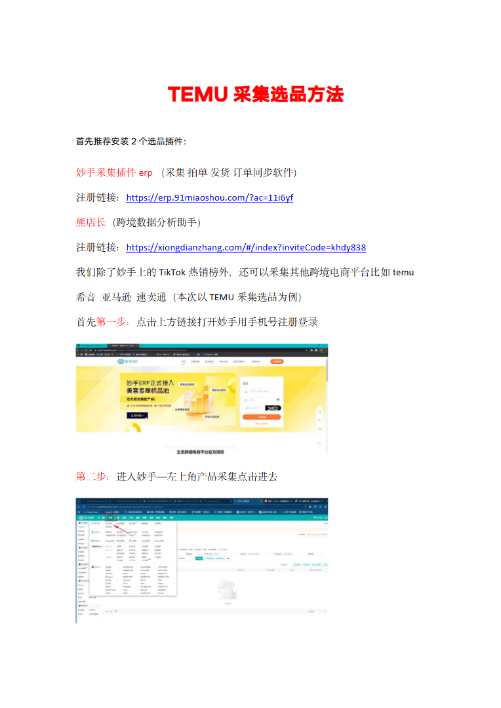
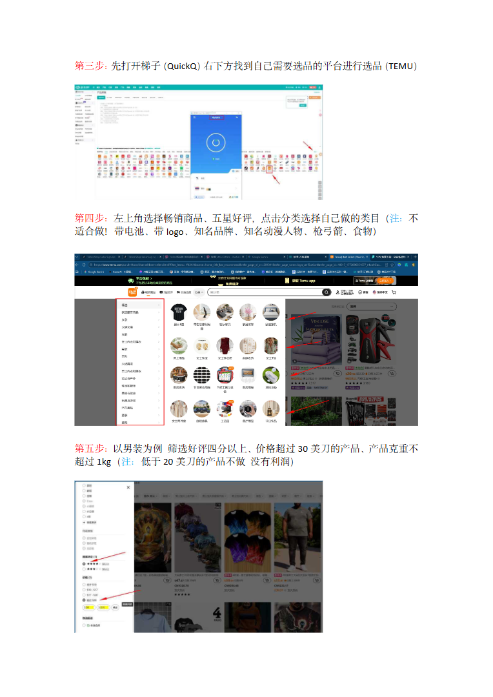
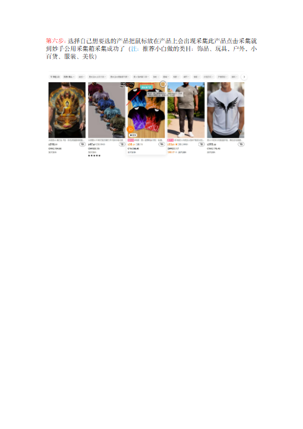

# TEMU采集选品.doc — 预览版

- 附件序号：6（manifest.attachments 原顺序）
- 来源：https://dcni26t4qg0z.feishu.cn/wiki/EVUtwnBTMiSx0Okr4QiciHrTnof
- 采集日期：2026-10-11（Asia/Shanghai）
- 采集证据：[06.dom.json](../raw/06.dom.json)
- 范围：浏览器预览文字与已采集的逐页图片；原文件下载状态另行记录，转换过程未产生原文件。
- 页图可保留预览中显示的文内图片；未恢复原始图片素材、可编辑Word文档、Excel公式或原始附件。
- 文字页覆盖：采集JSON中每一页均有非空DOM文字记录；这不证明图片中文字已转录或每页文字绝对完整。
- 预览记录总页数：3（0 表示查看器状态，不能推断原文件无页）
- 明确文字页号：1、2、3
- 页图覆盖：3/3 页；所有已观测预览页均有尺寸合格且PNG完整的页图。
- 有效页图页号：1、2、3
- 原文件：本次预览转换保存 0 个原文件；图片文字不计作已采集DOM文字。
- 原始采集候选：[06-temu.snapshot.txt](../raw/source-captures/06-98d7f7346676-06-temu.snapshot.txt)
- 原始采集候选：[06-dom.json](../raw/source-captures/06-75256083e988-06-dom.json)

## 预览正文

## 第 1 页

[打开第 1 页图片](../images/06/page-001.png)（764×1080）

TEMU采集选品方法首先推荐安装2个选品插件：妙手采集插件erp（采集拍单发货订单同步软件）注册链接：https://erp.91miaoshou.com/?ac=11i6yf熊店长（跨境数据分析助手）注册链接：https://xiongdianzhang.com/#/index?inviteCode=khdy838我们除了妙手上的TikTok热销榜外，还可以采集其他跨境电商平台比如temu希音亚马逊速卖通（本次以TEMU采集选品为例）首先第一步：点击上方链接打开妙手用手机号注册登录第二步：进入妙手—左上角产品采集点击进去

## 第 2 页

[打开第 2 页图片](../images/06/page-002.png)（764×1080）

第三步：先打开梯子（QuickQ）右下方找到自己需要选品的平台进行选品（TEMU）第四步：左上角选择畅销商品、五星好评，点击分类选择自己做的类目（注：不适合做！带电池、带logo、知名品牌、知名动漫人物、枪弓箭、食物）第五步：以男装为例筛选好评四分以上、价格超过30美刀的产品、产品克重不超过1kg（注：低于20美刀的产品不做没有利润）

## 第 3 页

[打开第 3 页图片](../images/06/page-003.png)（510×720）

第六步：选择自己想要选的产品把鼠标放在产品上会出现采集此产品点击采集就到妙手公用采集箱采集成功了（注：推荐小白做的类目：饰品、玩具。户外。小百货、服装、美妆）
