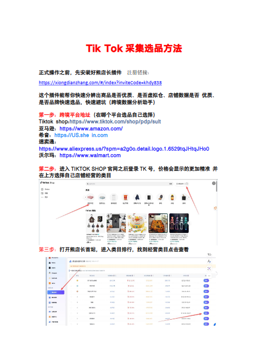
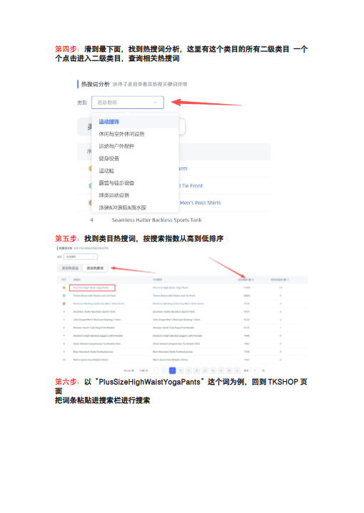
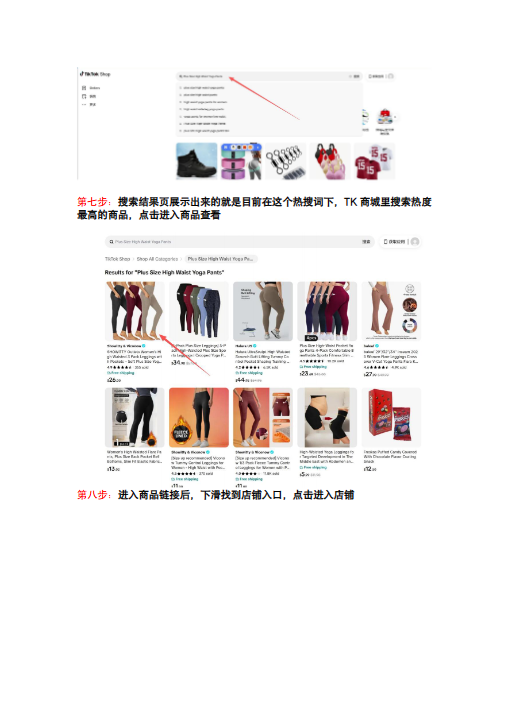
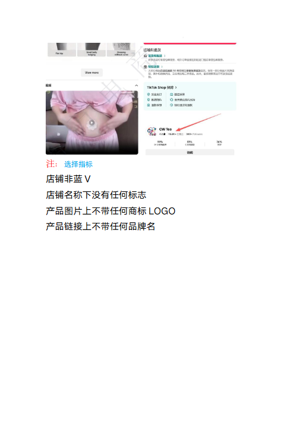

# TikTok采集选品.doc — 预览版

- 附件序号：7（manifest.attachments 原顺序）
- 来源：https://dcni26t4qg0z.feishu.cn/wiki/EVUtwnBTMiSx0Okr4QiciHrTnof
- 采集日期：2026-10-11（Asia/Shanghai）
- 采集证据：[07.dom.json](../raw/07.dom.json)
- 范围：浏览器预览文字与已采集的逐页图片；原文件下载状态另行记录，转换过程未产生原文件。
- 页图可保留预览中显示的文内图片；未恢复原始图片素材、可编辑Word文档、Excel公式或原始附件。
- 文字页覆盖：采集JSON中每一页均有非空DOM文字记录；这不证明图片中文字已转录或每页文字绝对完整。
- 预览记录总页数：4（0 表示查看器状态，不能推断原文件无页）
- 明确文字页号：1、2、3、4
- 页图覆盖：4/4 页；所有已观测预览页均有尺寸合格且PNG完整的页图。
- 有效页图页号：1、2、3、4
- 原文件：本次预览转换保存 0 个原文件；图片文字不计作已采集DOM文字。
- 原始采集候选：[07-tiktok-products.snapshot.txt](../raw/source-captures/07-17295151aace-07-tiktok-products.snapshot.txt)
- 原始采集候选：[07-dom.json](../raw/source-captures/07-c2f3b62d4363-07-dom.json)

## 预览正文

## 第 1 页

[打开第 1 页图片](../images/07/page-001.png)（510×720）

TikTok采集选品方法正式操作之前，先安装好熊店长插件注册链接：https://xiongdianzhang.com/#/index?inviteCode=khdy838这个插件能帮你快速分辨出商品是否优质、是否虚拟仓、店铺数据是否优质、是否品牌快速选品，快速避坑（跨境数据分析助手）第一步：跨境平台地址（在哪个平台选品自己选择）Tiktokshop:https://www.tiktok.com/shop/pdp/sult亚马逊：https://www.amazon.com/希音：https://US.shein.com速卖通：https://www.aliexpress.us/?spm=a2g0o.detail.logo.1.6529tqJHtqJHo0沃尔玛：https://www.walmart.com第二步：进入TIKTOKSHOP官网之后登录TK号，价格会显示的更加精准并在上方选择自己店铺经营的类目第三步：打开熊店长首站，进入类目排行，找到经营类目点击查看

## 第 2 页

[打开第 2 页图片](../images/07/page-002.png)（510×720）

第四步：滑到最下面，找到热搜词分析，这里有这个类目的所有二级类目一个个点击进入二级类目，查询相关热搜词第五步：找到类目热搜词，按搜索指数从高到低排序第六步：以“PlusSizeHighWaistYogaPants”这个词为例，回到TKSHOP页面把词条粘贴进搜索栏进行搜索

## 第 3 页

[打开第 3 页图片](../images/07/page-003.png)（510×720）

第七步：搜索结果页展示出来的就是目前在这个热搜词下，TK商城里搜索热度最高的商品，点击进入商品查看第八步：进入商品链接后，下滑找到店铺入口，点击进入店铺

## 第 4 页

[打开第 4 页图片](../images/07/page-004.png)（510×720）

注：选择指标店铺非蓝V店铺名称下没有任何标志产品图片上不带任何商标LOGO产品链接上不带任何品牌名
