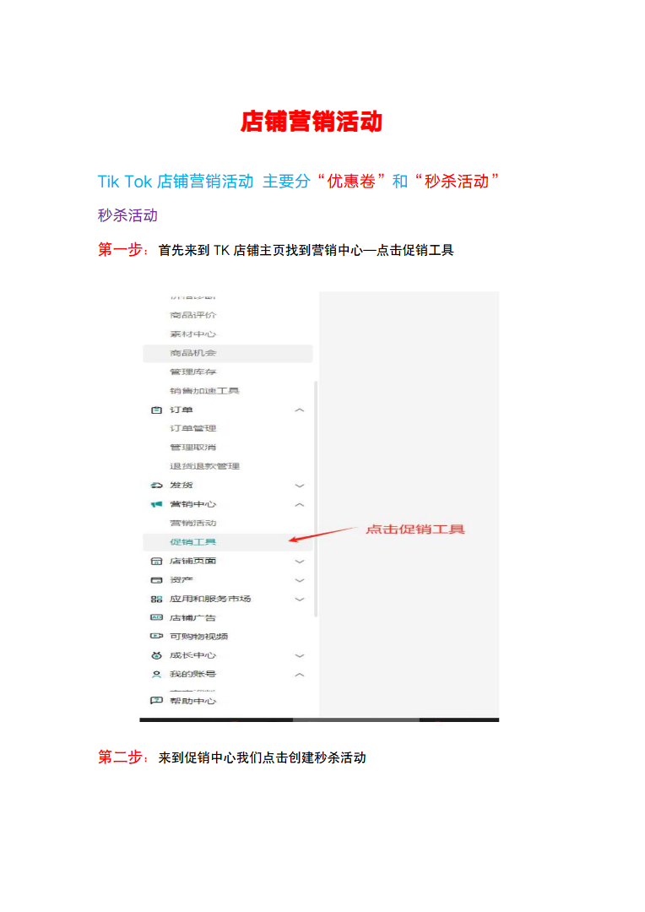
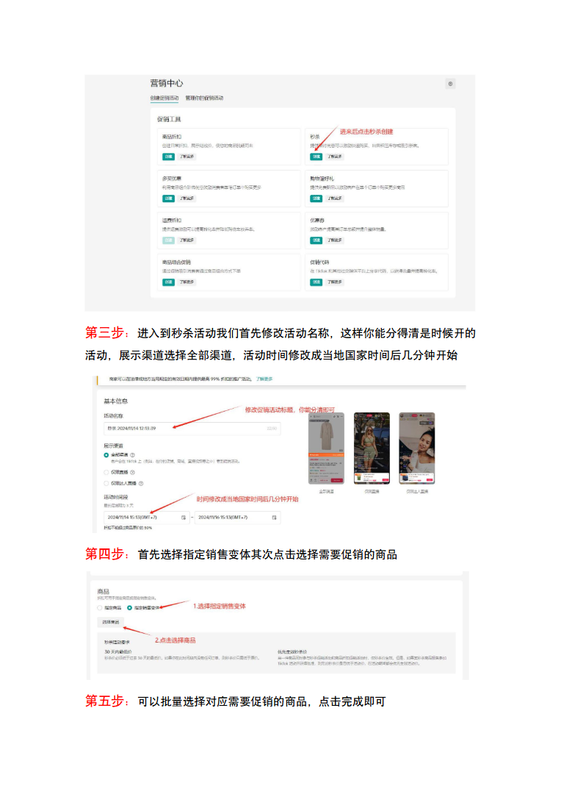
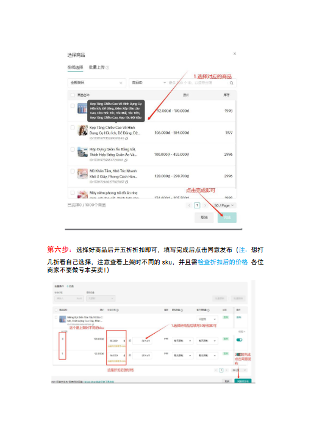
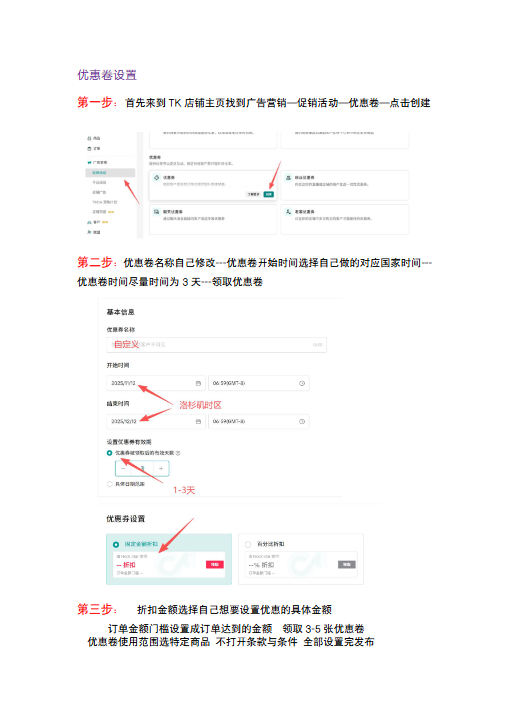
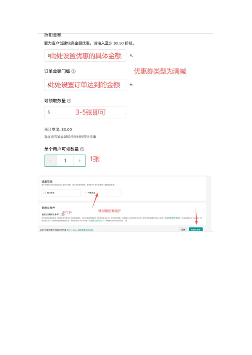

# 店铺营销活动.doc — 预览版

- 附件序号：8（manifest.attachments 原顺序）
- 来源：https://dcni26t4qg0z.feishu.cn/wiki/EVUtwnBTMiSx0Okr4QiciHrTnof
- 采集日期：2026-10-11（Asia/Shanghai）
- 采集证据：[08.dom.json](../raw/08.dom.json)
- 范围：浏览器预览文字与已采集的逐页图片；原文件下载状态另行记录，转换过程未产生原文件。
- 页图可保留预览中显示的文内图片；未恢复原始图片素材、可编辑Word文档、Excel公式或原始附件。
- 文字页覆盖：部分或未知；不能把侧栏页号当作已采集正文页。
- 预览记录总页数：5（0 表示查看器状态，不能推断原文件无页）
- 明确文字页号：1、2、3、4
- 页图覆盖：5/5 页；所有已观测预览页均有尺寸合格且PNG完整的页图。
- 有效页图页号：1、2、3、4、5
- 原文件：本次预览转换保存 0 个原文件；图片文字不计作已采集DOM文字。
- 原始采集候选：[08-marketing.snapshot.txt](../raw/source-captures/08-dfa0cbd4e520-08-marketing.snapshot.txt)
- 原始采集候选：[08-dom.json](../raw/source-captures/08-2dd26a2ba71f-08-dom.json)

## 预览正文

## 第 1 页

[打开第 1 页图片](../images/08/page-001.png)（764×1080）

店铺营销活动TikTok店铺营销活动主要分“优惠卷”和“秒杀活动”秒杀活动第一步：首先来到TK店铺主页找到营销中心—点击促销工具第二步：来到促销中心我们点击创建秒杀活动

## 第 2 页

[打开第 2 页图片](../images/08/page-002.png)（764×1080）

第三步：进入到秒杀活动我们首先修改活动名称，这样你能分得清是时候开的活动，展示渠道选择全部渠道，活动时间修改成当地国家时间后几分钟开始第四步：首先选择指定销售变体其次点击选择需要促销的商品第五步：可以批量选择对应需要促销的商品，点击完成即可

## 第 3 页

[打开第 3 页图片](../images/08/page-003.png)（510×720）

第六步：选择好商品后开五折折扣即可，填写完成后点击同意发布（注：想打几折看自己选择，注意查看上架时不同的sku，并且需检查折扣后的价格各位商家不要做亏本买卖！）

## 第 4 页

[打开第 4 页图片](../images/08/page-004.png)（510×720）

优惠卷设置第一步：首先来到TK店铺主页找到广告营销—促销活动—优惠卷—点击创建第二步：优惠卷名称自己修改---优惠卷开始时间选择自己做的对应国家时间---优惠卷时间尽量时间为3天---领取优惠卷第三步：折扣金额选择自己想要设置优惠的具体金额订单金额门槛设置成订单达到的金额领取3-5张优惠卷优惠卷使用范围选特定商品不打开条款与条件全部设置完发布

## 第 5 页

[打开第 5 页图片](../images/08/page-005.png)（510×720）

> 此页未返回非图片DOM正文文字；不推测图片中的内容。
