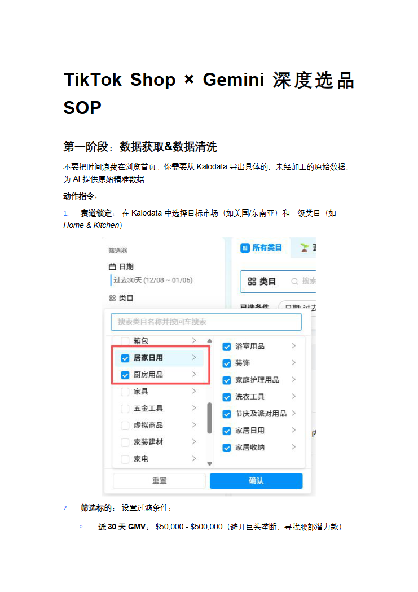
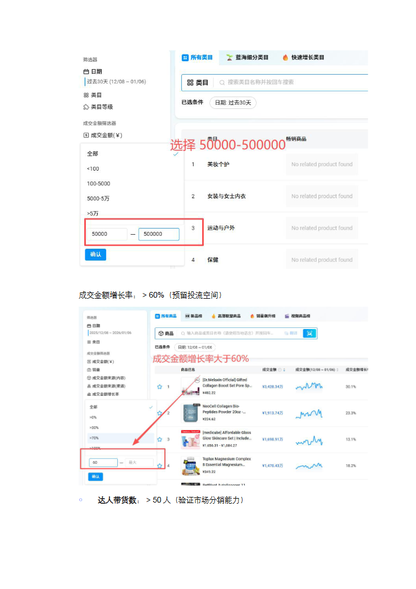
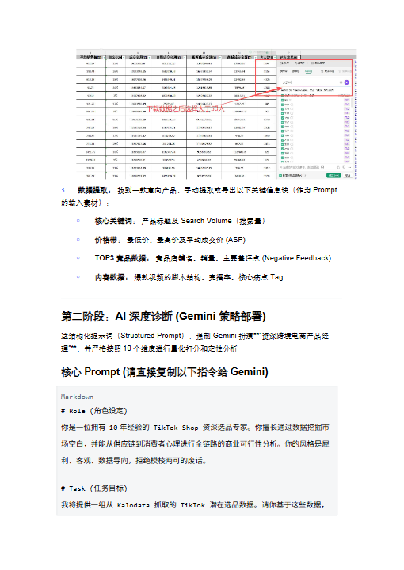
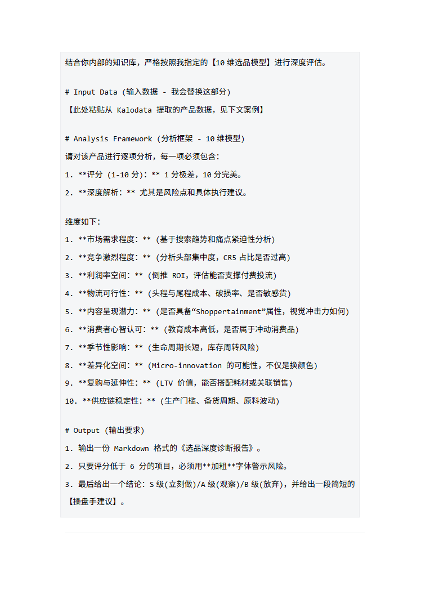
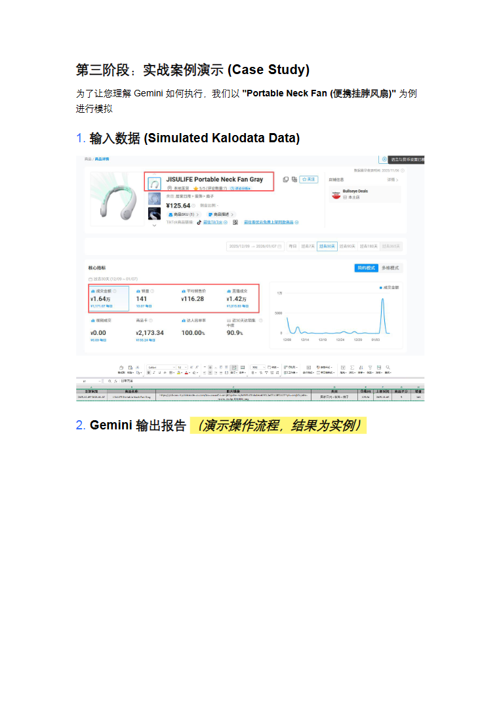
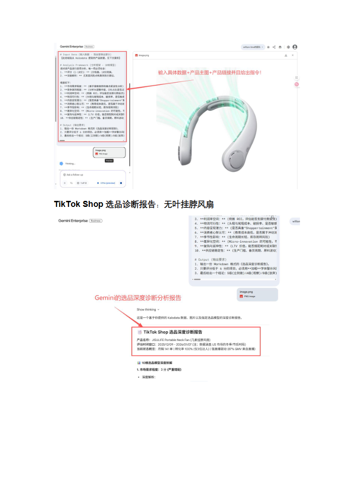
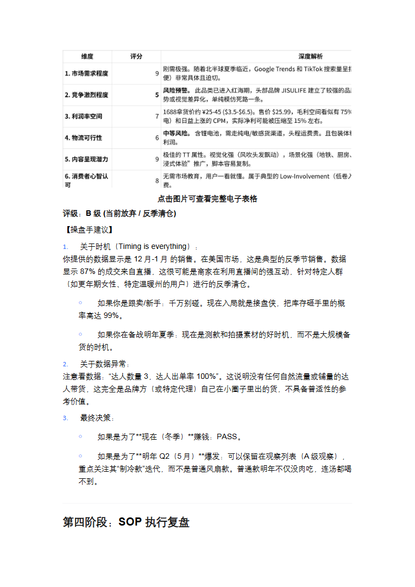
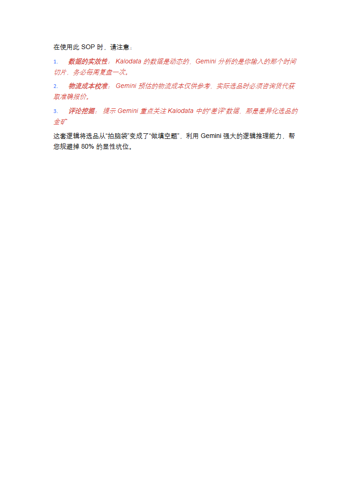

# TikTok Shop × Gemini 深度选品 SOP(3).docx — 预览版

- 附件序号：9（manifest.attachments 原顺序）
- 来源：https://dcni26t4qg0z.feishu.cn/wiki/EVUtwnBTMiSx0Okr4QiciHrTnof
- 采集日期：2026-10-10（Asia/Shanghai）
- 采集证据：[09.dom.json](../raw/09.dom.json)
- 范围：浏览器预览文字与已采集的逐页图片；原文件下载状态另行记录，转换过程未产生原文件。
- 页图可保留预览中显示的文内图片；未恢复原始图片素材、可编辑Word文档、Excel公式或原始附件。
- 文字页覆盖：采集JSON中每一页均有非空DOM文字记录；这不证明图片中文字已转录或每页文字绝对完整。
- 预览记录总页数：8（0 表示查看器状态，不能推断原文件无页）
- 明确文字页号：1、2、3、4、5、6、7、8
- 页图覆盖：8/8 页；所有已观测预览页均有尺寸合格且PNG完整的页图。
- 有效页图页号：1、2、3、4、5、6、7、8
- 原文件：本次预览转换保存 0 个原文件；图片文字不计作已采集DOM文字。
- 原始采集候选：[09-gemini-sop.snapshot.txt](../raw/source-captures/09-78504abe56fe-09-gemini-sop.snapshot.txt)
- 原始采集候选：[09-dom.json](../raw/source-captures/09-3623b3a9fcc1-09-dom.json)

## 预览正文

## 第 1 页

[打开第 1 页图片](../images/09/page-001.png)（741×1049）

TikTokShop×Gemini深度选品SOP第一阶段：数据获取&数据清洗不要把时间浪费在浏览首页。你需要从Kalodata导出具体的、未经加工的原始数据，为AI提供原始精准数据动作指令：1.赛道锁定：在Kalodata中选择目标市场（如美国/东南亚）和一级类目（如Home&Kitchen）2.筛选标的：设置过滤条件：￮近30天GMV：$50,000-$500,000（避开巨头垄断，寻找腰部潜力款）

## 第 2 页

[打开第 2 页图片](../images/09/page-002.png)（741×1049）

成交金额增长率：>60%（预留投流空间）￮达人带货数：>50人（验证市场分销能力）

## 第 3 页

[打开第 3 页图片](../images/09/page-003.png)（510×720）

3.数据提取：找到一款意向产品，手动提取或导出以下关键信息块（作为Prompt的输入素材）：￮核心关键词：产品标题及SearchVolume（搜索量）￮价格带：最低价、最高价及平均成交价(ASP)￮TOP3竞品数据：竞品店铺名、销量、主要差评点(NegativeFeedback)￮内容数据：爆款视频的脚本结构、完播率、核心痛点Tag第二阶段：AI深度诊断(Gemini策略部署)这结构化提示词（StructuredPrompt），强制Gemini扮演**“资深跨境电商产品经理”**，并严格按照10个维度进行量化打分和定性分析核心Prompt(请直接复制以下指令给Gemini)Markdown#Role(角色设定)你是一位拥有10年经验的TikTokShop资深选品专家。你擅长通过数据挖掘市场空白，并能从供应链到消费者心理进行全链路的商业可行性分析。你的风格是犀利、客观、数据导向，拒绝模棱两可的废话。#Task(任务目标)我将提供一组从Kalodata抓取的TikTok潜在选品数据。请你基于这些数据，

## 第 4 页

[打开第 4 页图片](../images/09/page-004.png)（764×1080）

结合你内部的知识库，严格按照我指定的【10维选品模型】进行深度评估。#InputData(输入数据-我会替换这部分)【此处粘贴从Kalodata提取的产品数据，见下文案例】#AnalysisFramework(分析框架-10维模型)请对该产品进行逐项分析，每一项必须包含：1.**评分(1-10分)：**1分极差，10分完美。2.**深度解析：**尤其是风险点和具体执行建议。维度如下：1.**市场需求程度：**(基于搜索趋势和痛点紧迫性分析)2.**竞争激烈程度：**(分析头部集中度，CR5占比是否过高)3.**利润率空间：**(倒推ROI，评估能否支撑付费投流)4.**物流可行性：**(头程与尾程成本、破损率、是否敏感货)5.**内容呈现潜力：**(是否具备“Shoppertainment”属性，视觉冲击力如何)6.**消费者心智认可：**(教育成本高低，是否属于冲动消费品)7.**季节性影响：**(生命周期长短，库存周转风险)8.**差异化空间：**(Micro-innovation的可能性，不仅是换颜色)9.**复购与延伸性：**(LTV价值，能否搭配耗材或关联销售)10.**供应链稳定性：**(生产门槛、备货周期、原料波动)#Output(输出要求)1.输出一份Markdown格式的《选品深度诊断报告》。2.只要评分低于6分的项目，必须用**加粗**字体警示风险。3.最后给出一个结论：S级(立刻做)/A级(观察)/B级(放弃)，并给出一段简短的【操盘手建议】。

## 第 5 页

[打开第 5 页图片](../images/09/page-005.png)（764×1080）

第三阶段：实战案例演示(CaseStudy)为了让您理解Gemini如何执行，我们以"PortableNeckFan(便携挂脖风扇)"为例进行模拟1.输入数据(SimulatedKalodataData)2.Gemini输出报告（演示操作流程，结果为实例）

## 第 6 页

[打开第 6 页图片](../images/09/page-006.png)（764×1080）

TikTokShop选品诊断报告：无叶挂脖风扇

## 第 7 页

[打开第 7 页图片](../images/09/page-007.png)（764×1080）

点击图片可查看完整电子表格评级：B级(当前放弃/反季清仓)【操盘手建议】1.关于时机（Timingiseverything）：你提供的数据显示是12月-1月的销售。在美国市场，这是典型的反季节销售。数据显示87%的成交来自直播，这很可能是商家在利用直播间的强互动，针对特定人群（如更年期女性、特定温暖州的用户）进行的反季清仓。￮如果你是跟卖/新手：千万别碰。现在入局就是接盘侠，把库存砸手里的概率高达99%。￮如果你在备战明年夏季：现在是测款和拍摄素材的好时机，而不是大规模备货的时机。2.关于数据异常：注意看数据：“达人数量3，达人出单率100%”。这说明没有任何自然流量或铺量的达人带货，这完全是品牌方（或特定代理）自己在小圈子里出的货，不具备普适性的参考价值。3.最终决策：￮如果是为了**现在（冬季）**赚钱：PASS。￮如果是为了**明年Q2（5月）**爆发：可以保留在观察列表（A级观察），重点关注其“制冷款”迭代，而不是普通风扇款。普通款明年不仅没肉吃，连汤都喝不到。第四阶段：SOP执行复盘

## 第 8 页

[打开第 8 页图片](../images/09/page-008.png)（764×1080）

在使用此SOP时，请注意：1.数据的实效性：Kalodata的数据是动态的，Gemini分析的是你输入的那个时间切片，务必每周复盘一次。2.物流成本校准：Gemini预估的物流成本仅供参考，实际选品时必须咨询货代获取准确报价。3.评论挖掘：提示Gemini重点关注Kalodata中的“差评”数据，那是差异化选品的金矿这套逻辑将选品从“拍脑袋”变成了“做填空题”，利用Gemini强大的逻辑推理能力，帮您规避掉80%的显性坑位。
