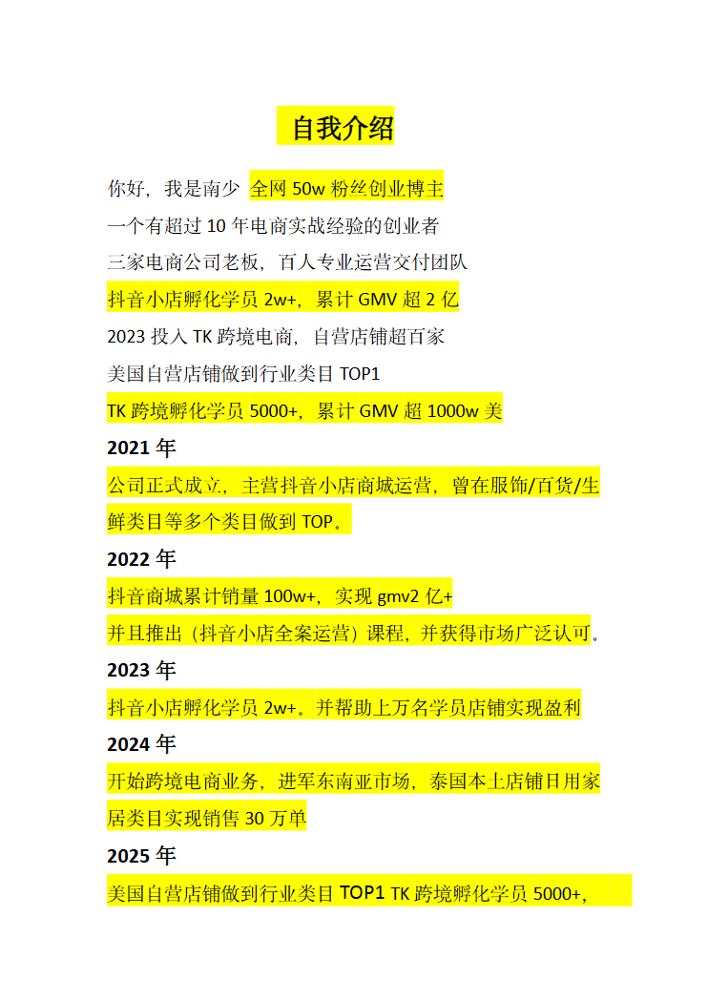
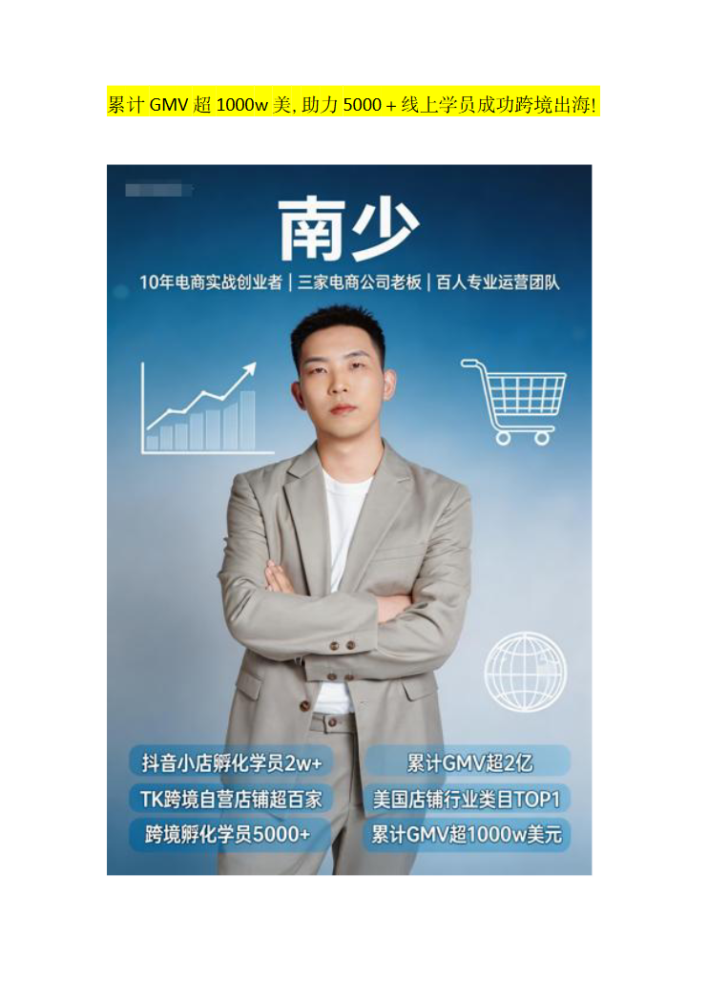
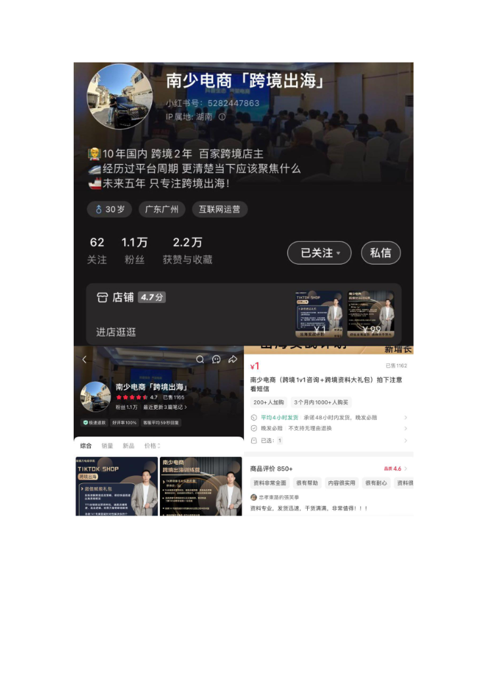

# 个人简介.docx — 预览版

- 附件序号：11（manifest.attachments 原顺序）
- 来源：https://dcni26t4qg0z.feishu.cn/wiki/EVUtwnBTMiSx0Okr4QiciHrTnof
- 采集日期：2026-10-10（Asia/Shanghai）
- 采集证据：[11.dom.json](../raw/11.dom.json)
- 范围：浏览器预览文字与已采集的逐页图片；原文件下载状态另行记录，转换过程未产生原文件。
- 页图可保留预览中显示的文内图片；未恢复原始图片素材、可编辑Word文档、Excel公式或原始附件。
- 文字页覆盖：部分或未知；不能把侧栏页号当作已采集正文页。
- 预览记录总页数：5（0 表示查看器状态，不能推断原文件无页）
- 明确文字页号：1
- 页图覆盖：5/5 页；所有已观测预览页均有尺寸合格且PNG完整的页图。
- 有效页图页号：1、2、3、4、5
- 原文件：本次预览转换保存 0 个原文件；图片文字不计作已采集DOM文字。
- 页内换行：仅依据原DOM顺序和真实span top坐标恢复，忽略小于半个相邻字号的基线偏移；原text整串及span样式保留在JSON中，不按语义划分段落。
- 原始采集候选：[11-personal.snapshot.txt](../raw/source-captures/11-82121df54690-11-personal.snapshot.txt)
- 原始采集候选：[11-dom.json](../raw/source-captures/11-5c8ee98c0a70-11-dom.json)

## 预览正文

## 第 1 页

[打开第 1 页图片](../images/11/page-001.png)（742×1048）

自我介绍  
你好，我是南少全网50w粉丝创业博主  
一个有超过10年电商实战经验的创业者  
三家电商公司老板，百人专业运营交付团队  
抖音小店孵化学员2w+，累计GMV超2亿  
2023投入TK跨境电商，自营店铺超百家  
美国自营店铺做到行业类目TOP1  
TK跨境孵化学员5000+，累计GMV超1000w美  
2021年  
公司正式成立，主营抖音小店商城运营，曾在服饰/百货/生  
鲜类目等多个类目做到TOP。  
2022年  
抖音商城累计销量100w+，实现gmv2亿+  
并且推出（抖音小店全案运营）课程，并获得市场广泛认可。  
2023年  
抖音小店孵化学员2w+。并帮助上万名学员店铺实现盈利  
2024年  
开始跨境电商业务，进军东南亚市场，泰国本土店铺日用家  
居类目实现销售30万单  
2025年  
美国自营店铺做到行业类目TOP1TK跨境孵化学员5000+，

## 第 2 页

[打开第 2 页图片](../images/11/page-002.png)（742×1048）

> 此页DOM文字未加载，文字标记为未读；页图覆盖另行记录。

## 第 3 页

[打开第 3 页图片](../images/11/page-003.png)（742×1048）

> 此页DOM文字未加载，文字标记为未读；页图覆盖另行记录。

## 第 4 页

[打开第 4 页图片](../images/11/page-004.png)（742×1048）

> 此页DOM文字未加载，文字标记为未读；页图覆盖另行记录。

## 第 5 页

[打开第 5 页图片](../images/11/page-005.png)（742×1048）

> 此页DOM文字未加载，文字标记为未读；页图覆盖另行记录。
