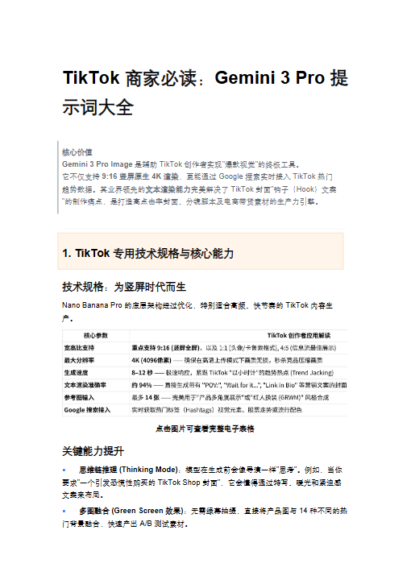
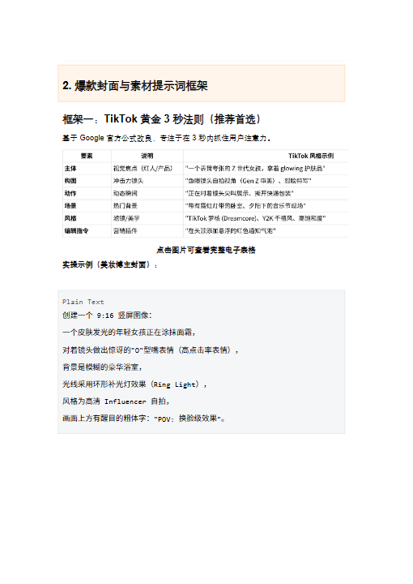
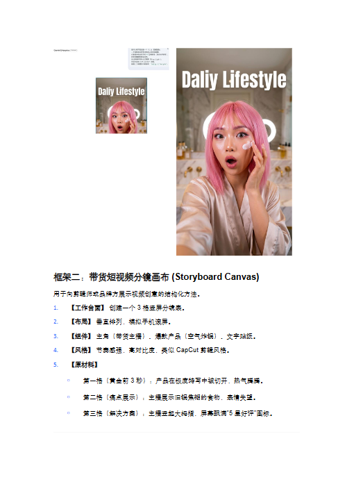
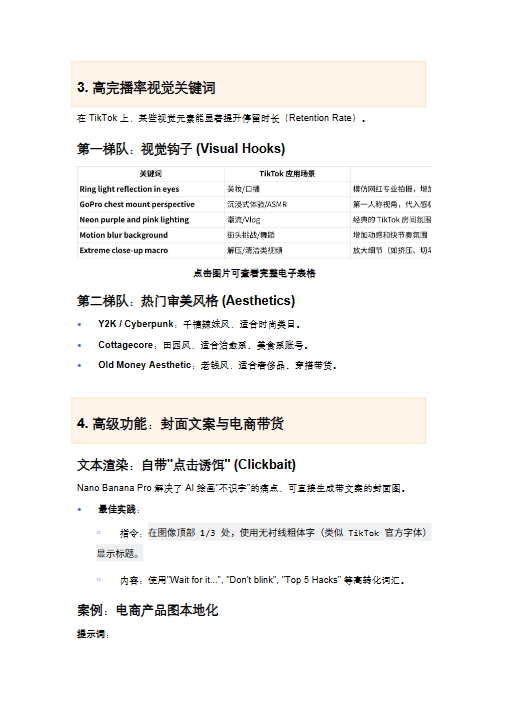
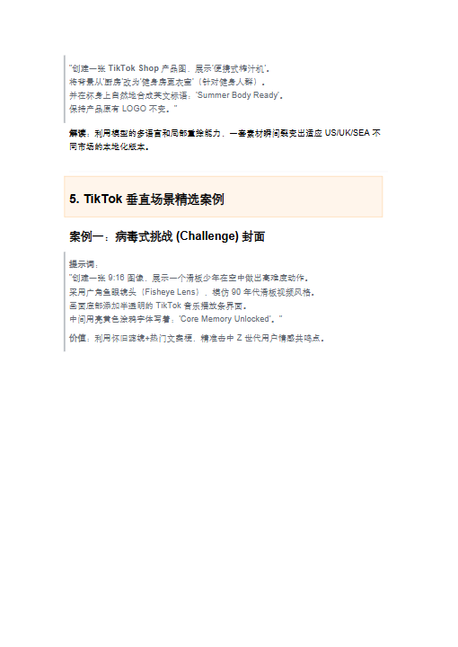
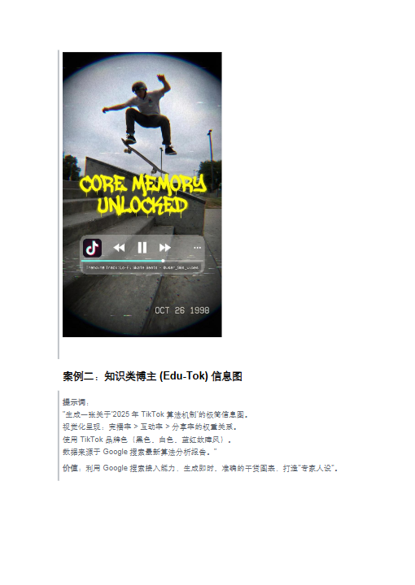
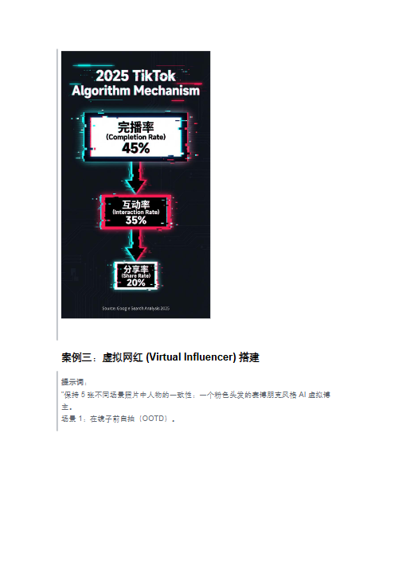
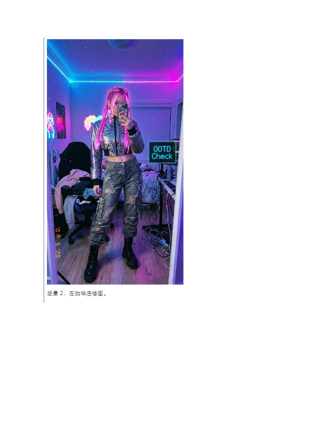
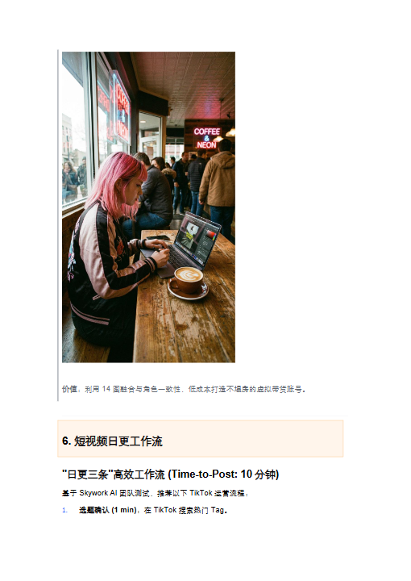
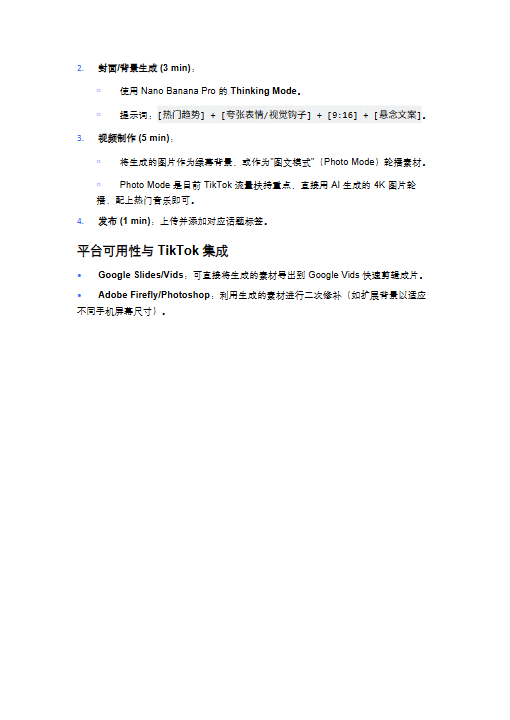

# TikTok 商家必读：Gemini 3 Pro 提示词大全.docx — 预览版

- 附件序号：12（manifest.attachments 原顺序）
- 来源：https://dcni26t4qg0z.feishu.cn/wiki/EVUtwnBTMiSx0Okr4QiciHrTnof
- 采集日期：2026-10-10（Asia/Shanghai）
- 采集证据：[12.dom.json](../raw/12.dom.json)
- 范围：浏览器预览文字与已采集的逐页图片；原文件下载状态另行记录，转换过程未产生原文件。
- 页图可保留预览中显示的文内图片；未恢复原始图片素材、可编辑Word文档、Excel公式或原始附件。
- 文字页覆盖：采集JSON中每一页均有非空DOM文字记录；这不证明图片中文字已转录或每页文字绝对完整。
- 预览记录总页数：10（0 表示查看器状态，不能推断原文件无页）
- 明确文字页号：1、2、3、4、5、6、7、8、9、10
- 页图覆盖：10/10 页；所有已观测预览页均有尺寸合格且PNG完整的页图。
- 有效页图页号：1、2、3、4、5、6、7、8、9、10
- 原文件：本次预览转换保存 0 个原文件；图片文字不计作已采集DOM文字。
- 页内换行：仅依据原DOM顺序和真实span top坐标恢复，忽略小于半个相邻字号的基线偏移；原text整串及span样式保留在JSON中，不按语义划分段落。
- 原始采集候选：[12-dom.json](../raw/source-captures/12-161d8973deec-12-dom.json)

## 预览正文

## 第 1 页

[打开第 1 页图片](../images/12/page-001.png)（510×720）

TikTok商家必读：Gemini3Pro提  
示词大全  
核心价值  
Gemini3ProImage是辅助TikTok创作者实现"爆款视觉"的终极工具。  
它不仅支持9:16竖屏原生4K渲染，更能通过Google搜索实时接入TikTok热门  
趋势数据。其业界领先的文本渲染能力完美解决了TikTok封面"钩子（Hook）文案  
"的制作痛点，是打造高点击率封面、分镜脚本及电商带货素材的生产力引擎。  
1.TikTok专用技术规格与核心能力  
技术规格：为竖屏时代而生  
NanoBananaPro的底层架构经过优化，特别适合高频、快节奏的TikTok内容生  
产。  
点击图片可查看完整电子表格  
关键能力提升  
•思维链推理(ThinkingMode)：模型在生成前会像导演一样"思考"。例如，当你  
要求"一个引发恐慌性购买的TikTokShop封面"，它会懂得通过特写、暖光和紧迫感  
文案来布局。  
•多图融合(GreenScreen效果)：无需绿幕拍摄，直接将产品图与14种不同的热  
门背景融合，快速产出A/B测试素材。

## 第 2 页

[打开第 2 页图片](../images/12/page-002.png)（510×720）

2.爆款封面与素材提示词框架  
框架一：TikTok黄金3秒法则（推荐首选）  
基于Google官方公式改良，专注于在3秒内抓住用户注意力。  
点击图片可查看完整电子表格  
实操示例（美妆博主封面）：  
PlainText  
创建一个9:16竖屏图像：  
一个皮肤发光的年轻女孩正在涂抹面霜，  
对着镜头做出惊讶的"O"型嘴表情（高点击率表情），  
背景是模糊的豪华浴室，  
光线采用环形补光灯效果（RingLight），  
风格为高清Influencer自拍，  
画面上方有醒目的粗体字："POV:换脸级效果"。

## 第 3 页

[打开第 3 页图片](../images/12/page-003.png)（510×720）

框架二：带货短视频分镜画布(StoryboardCanvas)  
用于向剪辑师或品牌方展示视频创意的结构化方法。  
1.【工作台面】创建一个3格竖屏分镜表。  
2.【布局】垂直排列，模拟手机滚屏。  
3.【组件】主角（带货主播）、爆款产品（空气炸锅）、文字贴纸。  
4.【风格】节奏感强，高对比度，类似CapCut剪辑风格。  
5.【原材料】  
￮第一格（黄金前3秒）：产品在极度特写中被切开，热气腾腾。  
￮第二格（痛点展示）：主播展示旧锅焦糊的食物，表情失望。  
￮第三格（解决方案）：主播竖起大拇指，屏幕飘满"5星好评"图标。

## 第 4 页

[打开第 4 页图片](../images/12/page-004.png)（510×720）

3.高完播率视觉关键词  
在TikTok上，某些视觉元素能显著提升停留时长（RetentionRate）。  
第一梯队：视觉钩子(VisualHooks)  
点击图片可查看完整电子表格  
第二梯队：热门审美风格(Aesthetics)  
•Y2K/Cyberpunk：千禧辣妹风，适合时尚类目。  
•Cottagecore：田园风，适合治愈系、美食系账号。  
•OldMoneyAesthetic：老钱风，适合奢侈品、穿搭带货。  
4.高级功能：封面文案与电商带货  
文本渲染：自带"点击诱饵"(Clickbait)  
NanoBananaPro解决了AI绘画"不识字"的痛点，可直接生成带文案的封面图。  
•最佳实践：  
￮指令：在图像顶部1/3处，使用无衬线粗体字（类似TikTok官方字体）  
显示标题。  
￮内容：使用"Waitforit...","Don'tblink","Top5Hacks"等高转化词汇。  
案例：电商产品图本地化  
提示词：

## 第 5 页

[打开第 5 页图片](../images/12/page-005.png)（510×720）

"创建一张TikTokShop产品图，展示'便携式榨汁机'。  
将背景从'厨房'改为'健身房更衣室'（针对健身人群）。  
并在杯身上自然地合成英文标语：'SummerBodyReady'。  
保持产品原有LOGO不变。"  
解读：利用模型的多语言和局部重绘能力，一套素材瞬间裂变出适应US/UK/SEA不  
同市场的本地化版本。  
5.TikTok垂直场景精选案例  
案例一：病毒式挑战(Challenge)封面  
提示词：  
"创建一张9:16图像，展示一个滑板少年在空中做出高难度动作。  
采用广角鱼眼镜头（FisheyeLens），模仿90年代滑板视频风格。  
画面底部添加半透明的TikTok音乐播放条界面。  
中间用亮黄色涂鸦字体写着：'CoreMemoryUnlocked'。"  
价值：利用怀旧滤镜+热门文案梗，精准击中Z世代用户情感共鸣点。

## 第 6 页

[打开第 6 页图片](../images/12/page-006.png)（510×720）

案例二：知识类博主(Edu-Tok)信息图  
提示词：  
"生成一张关于'2025年TikTok算法机制'的极简信息图。  
视觉化呈现：完播率>互动率>分享率的权重关系。  
使用TikTok品牌色（黑色、白色、蓝红故障风）。  
数据来源于Google搜索最新算法分析报告。"  
价值：利用Google搜索接入能力，生成即时、准确的干货图表，打造"专家人设"。

## 第 7 页

[打开第 7 页图片](../images/12/page-007.png)（510×720）

案例三：虚拟网红(VirtualInfluencer)搭建  
提示词：  
"保持5张不同场景照片中人物的一致性：一个粉色头发的赛博朋克风格AI虚拟博  
主。  
场景1：在镜子前自拍（OOTD）。

## 第 8 页

[打开第 8 页图片](../images/12/page-008.png)（510×720）

场景2：在咖啡店修图。

## 第 9 页

[打开第 9 页图片](../images/12/page-009.png)（510×720）

价值：利用14图融合与角色一致性，低成本打造不塌房的虚拟带货账号。  
6.短视频日更工作流  
"日更三条"高效工作流(Time-to-Post:10分钟)  
基于SkyworkAI团队测试，推荐以下TikTok运营流程：  
1.选题确认(1min)：在TikTok搜索热门Tag。

## 第 10 页

[打开第 10 页图片](../images/12/page-010.png)（510×720）

2.封面/背景生成(3min)：  
￮使用NanoBananaPro的ThinkingMode。  
￮提示词：[热门趋势]+[夸张表情/视觉钩子]+[9:16]+[悬念文案]。  
3.视频制作(5min)：  
￮将生成的图片作为绿幕背景，或作为"图文模式"（PhotoMode）轮播素材。  
￮PhotoMode是目前TikTok流量扶持重点，直接用AI生成的4K图片轮  
播，配上热门音乐即可。  
4.发布(1min)：上传并添加对应话题标签。  
平台可用性与TikTok集成  
•GoogleSlides/Vids：可直接将生成的素材导出到GoogleVids快速剪辑成片。  
•AdobeFirefly/Photoshop：利用生成的素材进行二次修补（如扩展背景以适应  
不同手机屏幕尺寸）。
