# Gemini 3 Pro精准分析GMVMax 广告数据_与素材迭代（2026年3月）.docx — 预览版

- 附件序号：13（manifest.attachments 原顺序）
- 来源：https://dcni26t4qg0z.feishu.cn/wiki/EVUtwnBTMiSx0Okr4QiciHrTnof
- 采集日期：2026-10-10（Asia/Shanghai）
- 采集证据：[13.dom.json](../raw/13.dom.json)
- 范围：浏览器预览文字与已采集的逐页图片；原文件下载状态另行记录，转换过程未产生原文件。
- 页图可保留预览中显示的文内图片；未恢复原始图片素材、可编辑Word文档、Excel公式或原始附件。
- 文字页覆盖：部分或未知；不能把侧栏页号当作已采集正文页。
- 预览记录总页数：12（0 表示查看器状态，不能推断原文件无页）
- 明确文字页号：1、2、3、4、5、6、7、8、9、10、12
- 页图覆盖：12/12 页；所有已观测预览页均有尺寸合格且PNG完整的页图。
- 有效页图页号：1、2、3、4、5、6、7、8、9、10、11、12
- 原文件：本次预览转换保存 0 个原文件；图片文字不计作已采集DOM文字。
- 页内换行：仅依据原DOM顺序和真实span top坐标恢复，忽略小于半个相邻字号的基线偏移；原text整串及span样式保留在JSON中，不按语义划分段落。
- 原始采集候选：[13-dom.json](../raw/source-captures/13-be934c81ef9e-13-dom.json)

## 预览正文

## 第 1 页

[打开第 1 页图片](../images/13/page-001.png)（741×1048）

[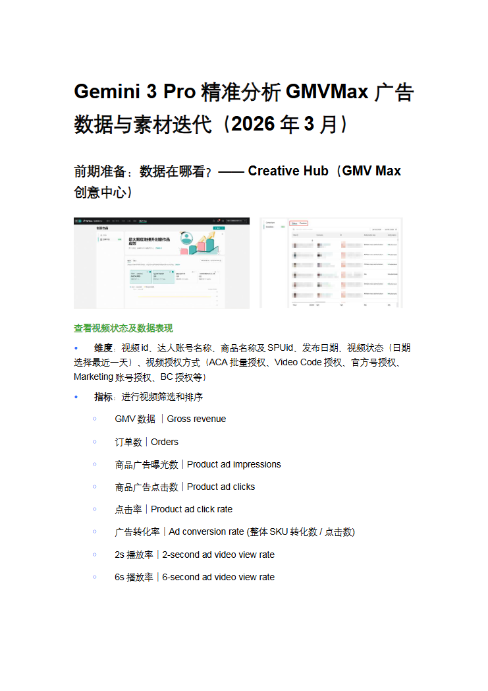](../images/13/page-001.png)

Gemini3Pro精准分析GMVMax广告  
数据与素材迭代（2026年3月）  
前期准备：数据在哪看？——CreativeHub（GMVMax  
创意中心）  
查看视频状态及数据表现  
•维度：视频id、达人账号名称、商品名称及SPUid、发布日期、视频状态（日期  
选择最近一天）、视频授权方式（ACA批量授权、VideoCode授权、官方号授权、  
Marketing账号授权、BC授权等）  
•指标：进行视频筛选和排序  
￮GMV数据｜Grossrevenue  
￮订单数｜Orders  
￮商品广告曝光数｜Productadimpressions  
￮商品广告点击数｜Productadclicks  
￮点击率｜Productadclickrate  
￮广告转化率｜Adconversionrate(整体SKU转化数/点击数)  
￮2s播放率｜2-secondadvideoviewrate  
￮6s播放率｜6-secondadvideoviewrate

## 第 2 页

[打开第 2 页图片](../images/13/page-002.png)（741×1048）

[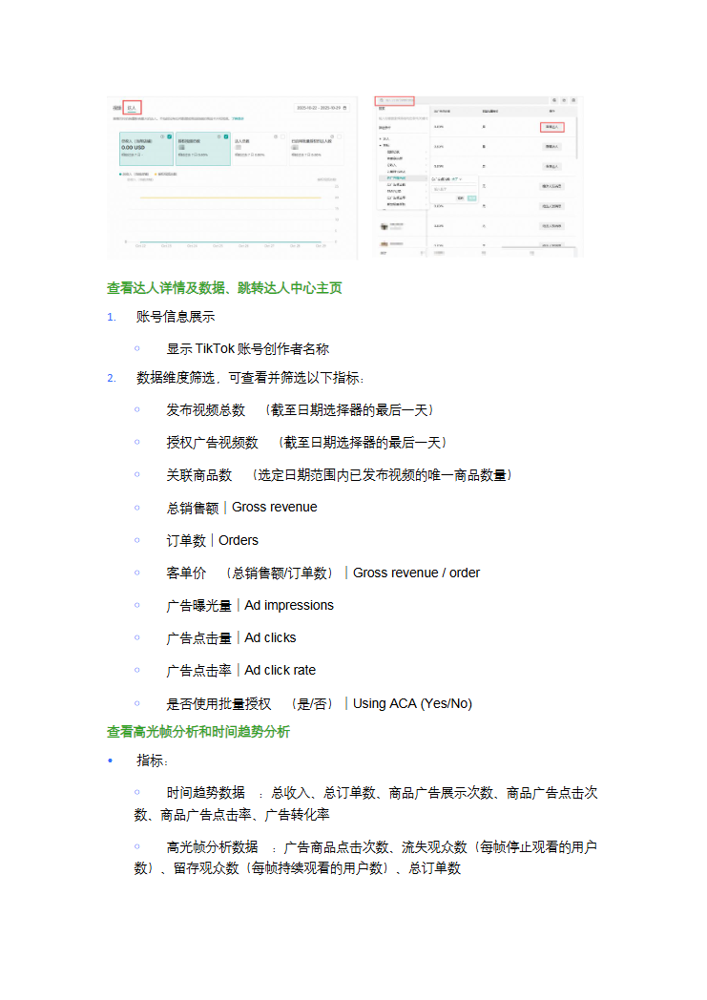](../images/13/page-002.png)

查看达人详情及数据、跳转达人中心主页  
1.账号信息展示  
￮显示TikTok账号创作者名称  
2.数据维度筛选，可查看并筛选以下指标：  
￮发布视频总数​（截至日期选择器的最后一天）  
￮授权广告视频数​（截至日期选择器的最后一天）  
￮关联商品数​（选定日期范围内已发布视频的唯一商品数量）  
￮总销售额｜Grossrevenue  
￮订单数｜Orders  
￮客单价​（总销售额/订单数）｜Grossrevenue/order  
￮广告曝光量｜Adimpressions  
￮广告点击量｜Adclicks  
￮广告点击率｜Adclickrate  
￮是否使用批量授权​（是/否）｜UsingACA(Yes/No)  
查看高光帧分析和时间趋势分析  
•指标：  
￮时间趋势数据​：总收入、总订单数、商品广告展示次数、商品广告点击次  
数、商品广告点击率、广告转化率  
￮高光帧分析数据​：广告商品点击次数、流失观众数（每帧停止观看的用户  
数）、留存观众数（每帧持续观看的用户数）、总订单数

## 第 3 页

[打开第 3 页图片](../images/13/page-003.png)（741×1048）

[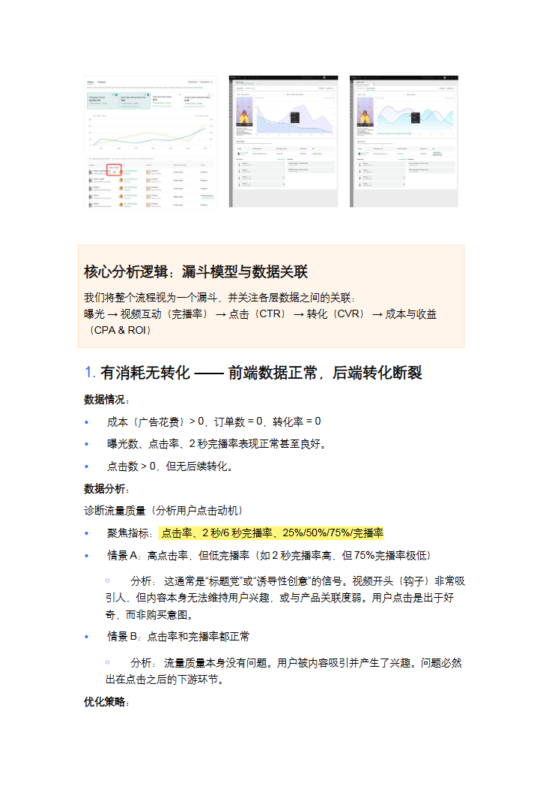](../images/13/page-003.png)

核心分析逻辑：漏斗模型与数据关联  
我们将整个流程视为一个漏斗，并关注各层数据之间的关联：  
曝光→视频互动（完播率）→点击（CTR）→转化（CVR）→成本与收益  
（CPA&ROI）  
1.有消耗无转化——前端数据正常，后端转化断裂  
数据情况：  
•成本（广告花费）>0，订单数=0，转化率=0  
•曝光数、点击率、2秒完播率表现正常甚至良好。  
•点击数>0，但无后续转化。  
数据分析：  
诊断流量质量（分析用户点击动机）  
•聚焦指标：点击率、2秒/6秒完播率、25%/50%/75%/完播率  
•情景A：高点击率，但低完播率（如2秒完播率高，但75%完播率极低）  
￮分析：这通常是“标题党”或“诱导性创意”的信号。视频开头（钩子）非常吸  
引人，但内容本身无法维持用户兴趣，或与产品关联度弱。用户点击是出于好  
奇，而非购买意图。  
•情景B：点击率和完播率都正常  
￮分析：流量质量本身没有问题。用户被内容吸引并产生了兴趣。问题必然  
出在点击之后的下游环节。  
优化策略：

## 第 4 页

[打开第 4 页图片](../images/13/page-004.png)（741×1048）

[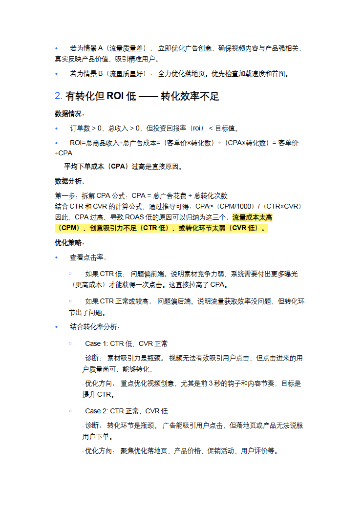](../images/13/page-004.png)

•若为情景A（流量质量差）：立即优化广告创意，确保视频内容与产品强相关，  
真实反映产品价值，吸引精准用户。  
•若为情景B（流量质量好）：全力优化落地页。优先检查加载速度和首图。  
2.有转化但ROI低——转化效率不足  
数据情况：  
•订单数>0，总收入>0，但投资回报率（roi）<目标值。  
•ROI=总商品收入÷总广告成本=（客单价×转化数）÷（CPA×转化数）=客单价  
÷CPA  
平均下单成本（CPA）过高是直接原因。  
数据分析：  
第一步：拆解CPA公式：CPA=总广告花费÷总转化次数  
结合CTR和CVR的计算公式，通过推导可得：CPA≈（CPM/1000）/（CTR×CVR）  
因此，CPA过高、导致ROAS低的原因可以归纳为这三个：流量成本太高  
（CPM）、创意吸引力不足（CTR低）、或转化环节太弱（CVR低）。  
优化策略：  
•查看点击率：  
￮如果CTR低：问题偏前端。说明素材竞争力弱，系统需要付出更多曝光  
（更高成本）才能获得一次点击。这直接拉高了CPA。  
￮如果CTR正常或较高：问题偏后端。说明流量获取效率没问题，但转化环  
节出了问题。  
•结合转化率分析：  
￮Case1:CTR低，CVR正常  
▪  
诊断：素材吸引力是瓶颈。视频无法有效吸引用户点击，但点击进来的用  
户质量尚可，能够转化。  
▪  
优化方向：重点优化视频创意，尤其是前3秒的钩子和内容节奏，目标是  
提升CTR。  
￮Case2:CTR正常，CVR低  
▪  
诊断：转化环节是瓶颈。广告能吸引用户点击，但落地页或产品无法说服  
用户下单。  
▪  
优化方向：聚焦优化落地页、产品价格、促销活动、用户评价等。

## 第 5 页

[打开第 5 页图片](../images/13/page-005.png)（741×1048）

[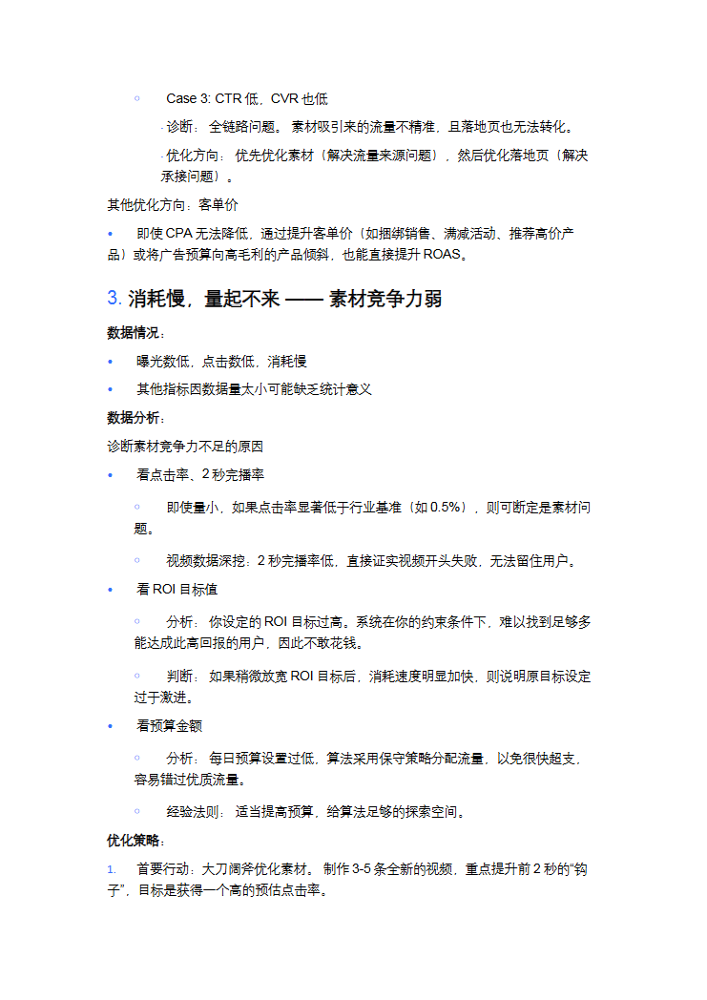](../images/13/page-005.png)

￮Case3:CTR低，CVR也低  
▪  
诊断：全链路问题。素材吸引来的流量不精准，且落地页也无法转化。  
▪  
优化方向：优先优化素材（解决流量来源问题），然后优化落地页（解决  
承接问题）。  
其他优化方向：客单价  
•即使CPA无法降低，通过提升客单价（如捆绑销售、满减活动、推荐高价产  
品）或将广告预算向高毛利的产品倾斜，也能直接提升ROAS。  
3.消耗慢，量起不来——素材竞争力弱  
数据情况：  
•曝光数低，点击数低，消耗慢  
•其他指标因数据量太小可能缺乏统计意义  
数据分析：  
诊断素材竞争力不足的原因  
•看点击率、2秒完播率  
￮即使量小，如果点击率显著低于行业基准（如0.5%），则可断定是素材问  
题。  
￮视频数据深挖：2秒完播率低，直接证实视频开头失败，无法留住用户。  
•看ROI目标值  
￮分析：你设定的ROI目标过高。系统在你的约束条件下，难以找到足够多  
能达成此高回报的用户，因此不敢花钱。  
￮判断：如果稍微放宽ROI目标后，消耗速度明显加快，则说明原目标设定  
过于激进。  
•看预算金额  
￮分析：每日预算设置过低，算法采用保守策略分配流量，以免很快超支，  
容易错过优质流量。  
￮经验法则：适当提高预算，给算法足够的探索空间。  
优化策略：  
1.首要行动：大刀阔斧优化素材。制作3-5条全新的视频，重点提升前2秒的“钩  
子”，目标是获得一个高的预估点击率。

## 第 6 页

[打开第 6 页图片](../images/13/page-006.png)（741×1048）

[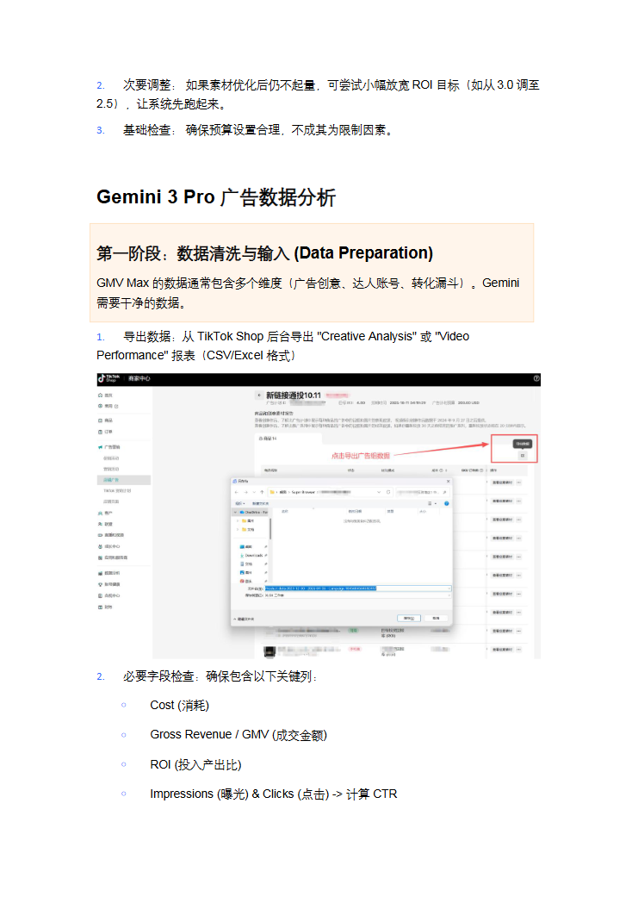](../images/13/page-006.png)

2.次要调整：如果素材优化后仍不起量，可尝试小幅放宽ROI目标（如从3.0调至  
2.5），让系统先跑起来。  
3.基础检查：确保预算设置合理，不成其为限制因素。  
Gemini3Pro广告数据分析  
第一阶段：数据清洗与输入(DataPreparation)  
GMVMax的数据通常包含多个维度（广告创意、达人账号、转化漏斗）。Gemini  
需要干净的数据。  
1.导出数据：从TikTokShop后台导出"CreativeAnalysis"或"Video  
Performance"报表（CSV/Excel格式）  
2.必要字段检查：确保包含以下关键列：  
￮Cost(消耗)  
￮GrossRevenue/GMV(成交金额)  
￮ROI(投入产出比)  
￮Impressions(曝光)&Clicks(点击)->计算CTR

## 第 7 页

[打开第 7 页图片](../images/13/page-007.png)（741×1048）

[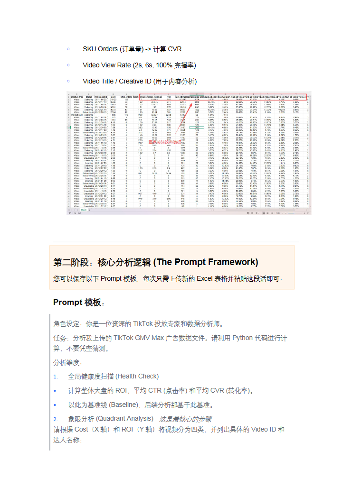](../images/13/page-007.png)

￮SKUOrders(订单量)->计算CVR  
￮VideoViewRate(2s,6s,100%完播率)  
￮VideoTitle/CreativeID(用于内容分析)  
第二阶段：核心分析逻辑(ThePromptFramework)  
您可以保存以下Prompt模板，每次只需上传新的Excel表格并粘贴这段话即可：  
Prompt模板：  
角色设定：你是一位资深的TikTok投放专家和数据分析师。  
任务：分析我上传的TikTokGMVMax广告数据文件。请利用Python代码进行计  
算，不要凭空猜测。  
分析维度：  
1.全局健康度扫描(HealthCheck)  
•计算整体大盘的ROI、平均CTR(点击率)和平均CVR(转化率)。  
•以此为基准线(Baseline)，后续分析都基于此基准。  
2.象限分析(QuadrantAnalysis)-这是最核心的步骤  
请根据Cost（X轴）和ROI（Y轴）将视频分为四类，并列出具体的VideoID和  
达人名称：

## 第 8 页

[打开第 8 页图片](../images/13/page-008.png)（510×720）

[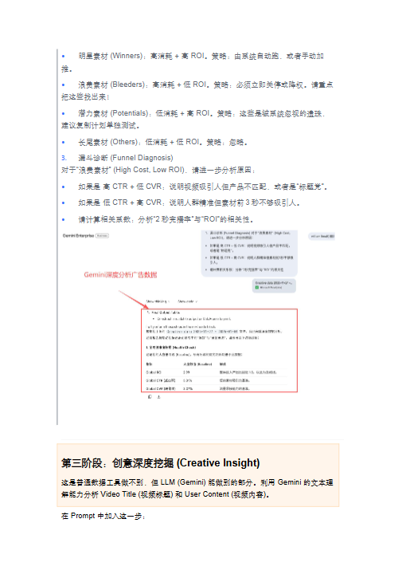](../images/13/page-008.png)

•明星素材(Winners)：高消耗+高ROI。策略：由系统自动跑，或者手动加  
推。  
•浪费素材(Bleeders)：高消耗+低ROI。策略：必须立即关停或降权。请重点  
把这些找出来！  
•潜力素材(Potentials)：低消耗+高ROI。策略：这些是被系统忽视的遗珠，  
建议复制计划单独测试。  
•长尾素材(Others)：低消耗+低ROI。策略：忽略。  
3.漏斗诊断(FunnelDiagnosis)  
对于“浪费素材”(HighCost,LowROI)，请进一步分析原因：  
•如果是高CTR+低CVR：说明视频吸引人但产品不匹配，或者是“标题党”。  
•如果是低CTR+高CVR：说明人群精准但素材前3秒不够吸引人。  
•请计算相关系数：分析“2秒完播率”与“ROI”的相关性。  
第三阶段：创意深度挖掘(CreativeInsight)  
这是普通数据工具做不到，但LLM(Gemini)能做到的部分。利用Gemini的文本理  
解能力分析VideoTitle(视频标题)和UserContent(视频内容)。  
在Prompt中加入这一步：

## 第 9 页

[打开第 9 页图片](../images/13/page-009.png)（510×720）

[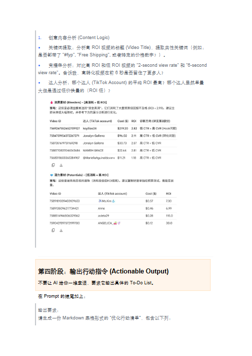](../images/13/page-009.png)

1.创意内容分析(ContentLogic)  
•关键词提取：分析高ROI视频的标题(VideoTitle)，提取共性关键词（例如：  
是否都带了"#fyp","FreeShipping",或者特定的价格数字？）。  
•完播率分析：对比高ROI和低ROI视频的"2-secondviewrate"和"6-second  
viewrate"。告诉我，高转化视频在前6秒是否留住了更多人？  
•达人分析：哪个达人(TikTokAccount)的平均ROI最高？哪个达人虽然单量  
大但是通过低价换量的（ROI低）？  
第四阶段：输出行动指令(ActionableOutput)  
不要让AI给你一堆废话，要求它输出具体的To-DoList。  
在Prompt的结尾加上：  
输出要求：  
请生成一份Markdown表格形式的“优化行动清单”，包含以下列：

## 第 10 页

[打开第 10 页图片](../images/13/page-010.png)（510×720）

[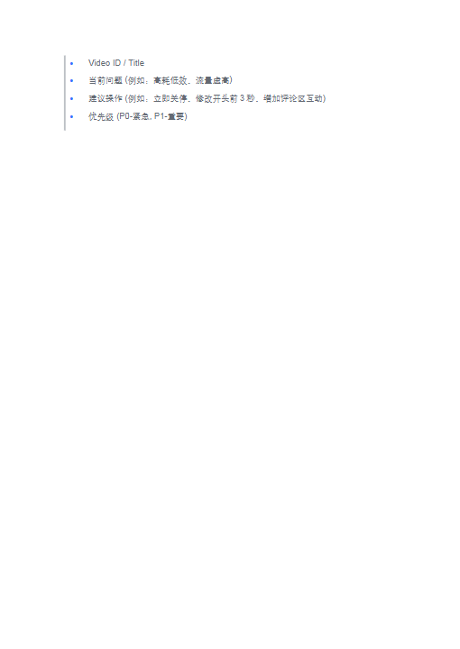](../images/13/page-010.png)

•VideoID/Title  
•当前问题(例如：高耗低效、流量虚高)  
•建议操作(例如：立即关停、修改开头前3秒、增加评论区互动)  
•优先级(P0-紧急,P1-重要)

## 第 11 页

[打开第 11 页图片](../images/13/page-011.png)（510×720）

[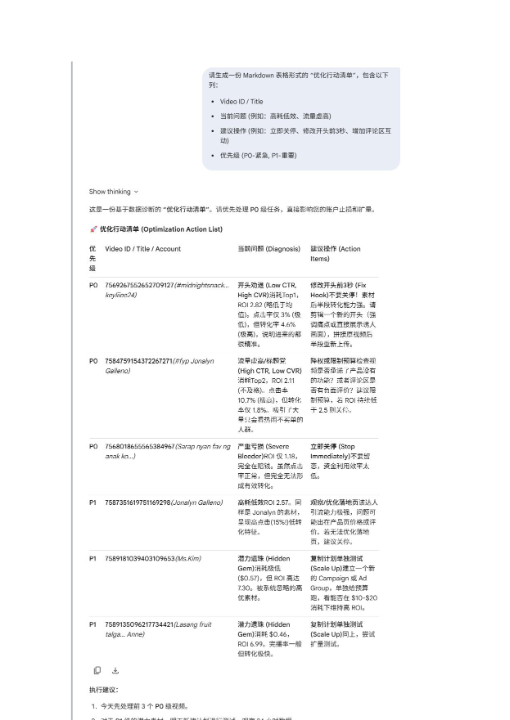](../images/13/page-011.png)

> 此页未返回非图片DOM正文文字；不推测图片中的内容。

## 第 12 页

[打开第 12 页图片](../images/13/page-012.png)（510×720）

[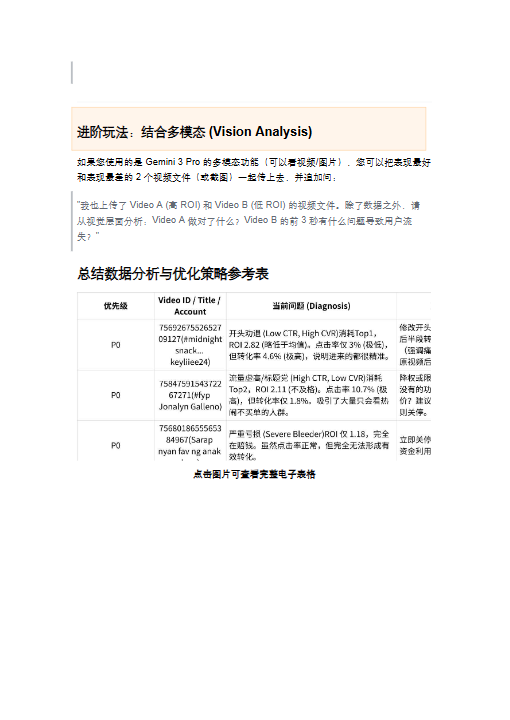](../images/13/page-012.png)

进阶玩法：结合多模态(VisionAnalysis)  
如果您使用的是Gemini3Pro的多模态功能（可以看视频/图片），您可以把表现最好  
和表现最差的2个视频文件（或截图）一起传上去，并追加问：  
"我也上传了VideoA(高ROI)和VideoB(低ROI)的视频文件。除了数据之外，请  
从视觉层面分析：VideoA做对了什么？VideoB的前3秒有什么问题导致用户流  
失？"  
总结数据分析与优化策略参考表  
点击图片可查看完整电子表格
