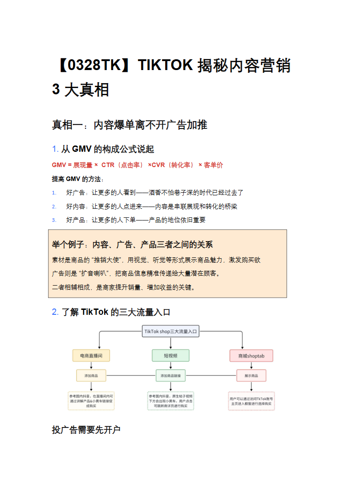
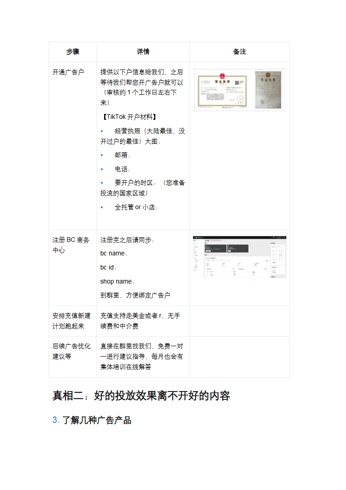
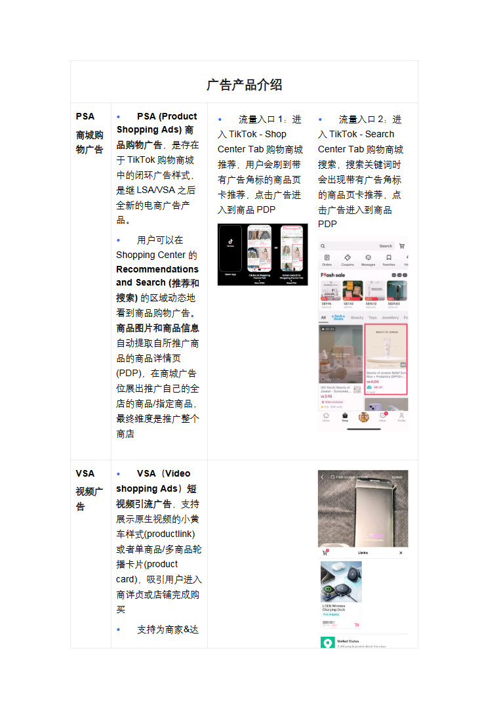
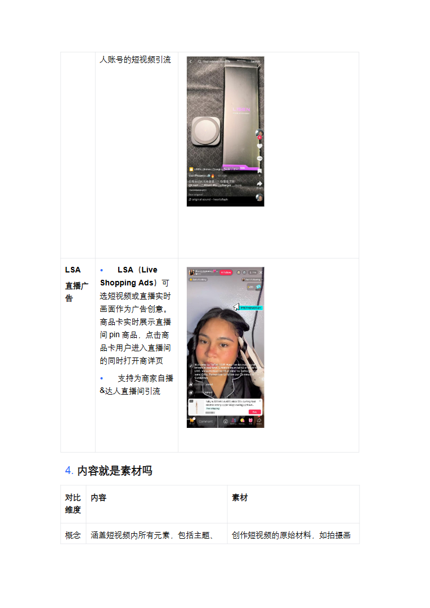
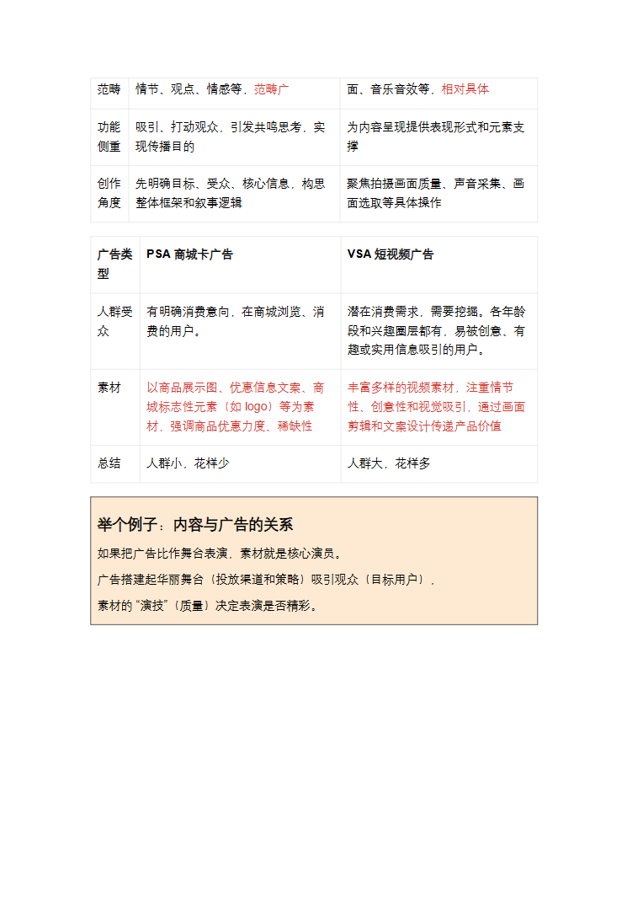

# 【0328TK】TIKTOK揭秘内容营销 3 大真相.docx — 预览版

- 附件序号：15（manifest.attachments 原顺序）
- 来源：https://dcni26t4qg0z.feishu.cn/wiki/EVUtwnBTMiSx0Okr4QiciHrTnof
- 采集日期：2026-10-11（Asia/Shanghai）
- 采集证据：[15.dom.json](../raw/15.dom.json)
- 范围：浏览器预览文字与已采集的逐页图片；原文件下载状态另行记录，转换过程未产生原文件。
- 页图可保留预览中显示的文内图片；未恢复原始图片素材、可编辑Word文档、Excel公式或原始附件。
- 文字页覆盖：采集JSON中每一页均有非空DOM文字记录；这不证明图片中文字已转录或每页文字绝对完整。
- 预览记录总页数：5（0 表示查看器状态，不能推断原文件无页）
- 明确文字页号：1、2、3、4、5
- 页图覆盖：5/5 页；所有已观测预览页均有尺寸合格且PNG完整的页图。
- 有效页图页号：1、2、3、4、5
- 原文件：本次预览转换保存 0 个原文件；图片文字不计作已采集DOM文字。
- 原始采集候选：[15-dom.json](../raw/source-captures/15-511fc6e3632e-15-dom.json)

## 预览正文

## 第 1 页

[打开第 1 页图片](../images/15/page-001.png)（764×1080）

【0328TK】TIKTOK揭秘内容营销3大真相真相一：内容爆单离不开广告加推1.从GMV的构成公式说起GMV=展现量×CTR（点击率）×CVR（转化率）×客单价提高GMV的方法：1.好广告：让更多的人看到——酒香不怕巷子深的时代已经过去了2.好内容：让更多的人点进来——内容是串联展现和转化的桥梁3.好产品：让更多的人下单——产品的地位依旧重要举个例子：内容、广告、产品三者之间的关系素材是商品的“推销大使”，用视觉、听觉等形式展示商品魅力，激发购买欲广告则是“扩音喇叭”，把商品信息精准传递给大量潜在顾客。二者相辅相成，是商家提升销量、增加收益的关键。2.了解TikTok的三大流量入口投广告需要先开户

## 第 2 页

[打开第 2 页图片](../images/15/page-002.png)（764×1080）

步骤详情备注开通广告户提供以下户信息给我们，之后等待我们帮您开广告户就可以（审核约1个工作日左右下来）【TikTok开户材料】•经营执照（大陆最佳，没开过户的最佳）大图：•邮箱：•电话：•要开户的时区：（您准备投流的国家区域）•全托管or小店：注册BC商务中心注册完之后请同步：bcname：bcid：shopname：到群里，方便绑定广告户安排充值新建计划跑起来充值支持走美金或者r，无手续费和中介费后续广告优化建议等直接在群里找我们，免费一对一进行建议指导，每月也会有集体培训在线解答真相二：好的投放效果离不开好的内容3.了解几种广告产品

## 第 3 页

[打开第 3 页图片](../images/15/page-003.png)（764×1080）

广告产品介绍PSA商城购物广告•PSA(ProductShoppingAds)商品购物广告，是存在于TikTok购物商城中的闭环广告样式，是继LSA/VSA之后全新的电商广告产品。•用户可以在ShoppingCenter的RecommendationsandSearch(推荐和搜索)的区域动态地看到商品购物广告。商品图片和商品信息自动提取自所推广商品的商品详情页(PDP)，在商城广告位展出推广自己的全店的商品/指定商品，最终维度是推广整个商店•流量入口1：进入TikTok-ShopCenterTab购物商城推荐，用户会刷到带有广告角标的商品页卡推荐，点击广告进入到商品PDP•流量入口2：进入TikTok-SearchCenterTab购物商城搜索，搜索关键词时会出现带有广告角标的商品页卡推荐，点击广告进入到商品PDPVSA视频广告•VSA（VideoshoppingAds）短视频引流广告，支持展示原生视频的小黄车样式(productlink)或者单商品/多商品轮播卡片(productcard)，吸引用户进入商详贞或店铺完成购买•支持为商家&达

## 第 4 页

[打开第 4 页图片](../images/15/page-004.png)（764×1080）

人账号的短视频引流LSA直播广告•LSA（LiveShoppingAds）可选短视频或直播实时画面作为广告创意。商品卡实时展示直播间pin商品，点击商品卡用户进入直播间的同时打开商详页•支持为商家自播&达人直播间引流4.内容就是素材吗对比维度内容素材概念涵盖短视频内所有元素，包括主题、创作短视频的原始材料，如拍摄画

## 第 5 页

[打开第 5 页图片](../images/15/page-005.png)（764×1080）

范畴情节、观点、情感等，范畴广面、音乐音效等，相对具体功能侧重吸引、打动观众，引发共鸣思考，实现传播目的为内容呈现提供表现形式和元素支撑创作角度先明确目标、受众、核心信息，构思整体框架和叙事逻辑聚焦拍摄画面质量、声音采集、画面选取等具体操作广告类型PSA商城卡广告VSA短视频广告人群受众有明确消费意向，在商城浏览、消费的用户。潜在消费需求，需要挖掘。各年龄段和兴趣圈层都有，易被创意、有趣或实用信息吸引的用户。素材以商品展示图、优惠信息文案、商城标志性元素（如logo）等为素材，强调商品优惠力度、稀缺性丰富多样的视频素材，注重情节性、创意性和视觉吸引，通过画面剪辑和文案设计传递产品价值总结人群小，花样少人群大，花样多举个例子：内容与广告的关系如果把广告比作舞台表演，素材就是核心演员。广告搭建起华丽舞台（投放渠道和策略）吸引观众（目标用户），素材的“演技”（质量）决定表演是否精彩。
