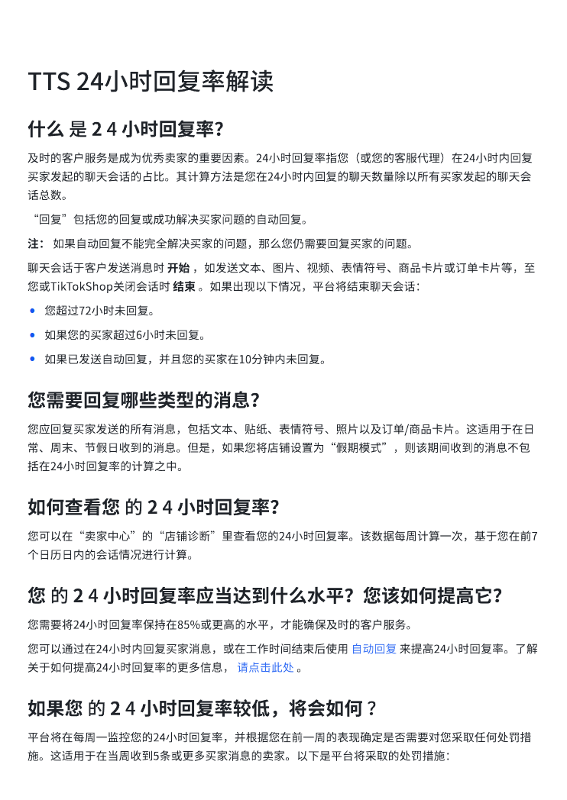
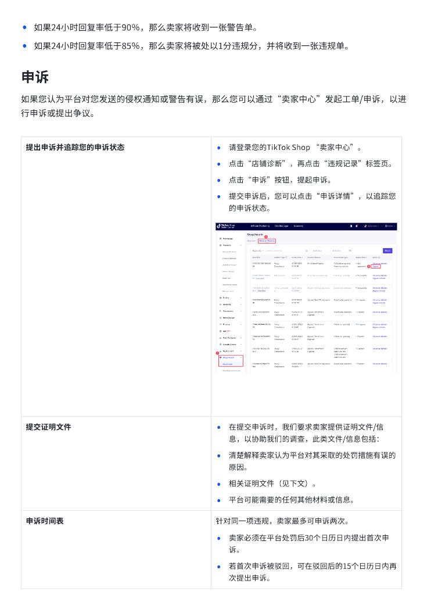
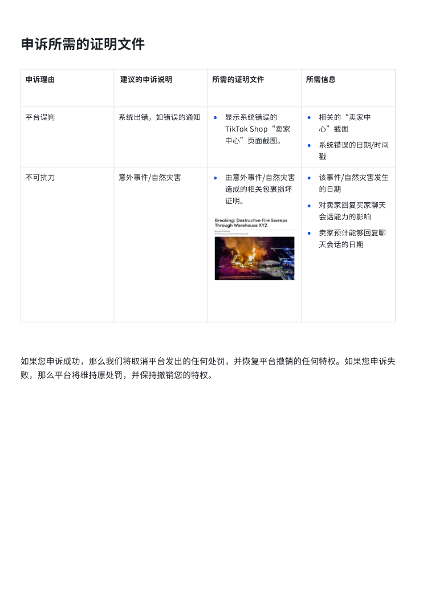

# TTS 24小时回复率解读.pdf — 预览版

- 附件序号：17（manifest.attachments 原顺序）
- 来源：https://dcni26t4qg0z.feishu.cn/wiki/EVUtwnBTMiSx0Okr4QiciHrTnof
- 采集日期：2026-10-10（Asia/Shanghai）
- 采集证据：[17.dom.json](../raw/17.dom.json)
- 范围：浏览器预览文字与已采集的逐页图片；原文件下载状态另行记录，转换过程未产生原文件。
- 页图可保留预览中显示的文内图片；未恢复原始图片素材、可编辑Word文档、Excel公式或原始附件。
- 文字页覆盖：采集JSON中每一页均有非空DOM文字记录；这不证明图片中文字已转录或每页文字绝对完整。
- 预览记录总页数：3（0 表示查看器状态，不能推断原文件无页）
- 明确文字页号：1、2、3
- 页图覆盖：3/3 页；所有已观测预览页均有尺寸合格且PNG完整的页图。
- 有效页图页号：1、2、3
- 原文件：本次预览转换保存 0 个原文件；图片文字不计作已采集DOM文字。
- 预览文本层包含控制字符；以 ⟦U+XXXX⟧ 标记保留，不猜测其含义。
- 页内换行：仅依据原DOM顺序和真实span top坐标恢复，忽略小于半个相邻字号的基线偏移；原text整串及span样式保留在JSON中，不按语义划分段落。
- 原始采集候选：[17-dom.json](../raw/source-captures/17-43d98bc928b2-17-dom.json)

## 预览正文

## 第 1 页

[打开第 1 页图片](../images/17/page-001.png)（742×1048）

TTS⟦U+0001⟧24小时回复率解读⟦U+0001⟧  
什么⟦U+0001⟧是⟦U+0001⟧2⟦U+0001⟧4⟦U+0001⟧小时回复率？⟦U+0001⟧  
及时的客戶服务是成为优秀卖家的重要因素。24小时回复率指您（或您的客服代理）在24小时内回复  
买家发起的聊天会话的占比。其计算方法是您在24小时内回复的聊天数量除以所有买家发起的聊天会  
话总数。  
“回复”包括您的回复或成功解决买家问题的自动回复。  
注：⟦U+0001⟧如果自动回复不能完全解决买家的问题，那么您仍需要回复买家的问题。⟦U+0001⟧  
聊天会话于客戶发送消息时⟦U+0001⟧开始⟦U+0001⟧，如发送文本、图片、视频、表情符号、商品卡片或订单卡片等，至  
您或TikTokShop关闭会话时⟦U+0001⟧结束⟦U+0001⟧。如果出现以下情况，平台将结束聊天会话：⟦U+0001⟧  
•您超过72小时未回复。⟦U+0001⟧  
•如果您的买家超过6小时未回复。⟦U+0001⟧  
•如果已发送自动回复，并且您的买家在10分钟内未回复。⟦U+0001⟧  
您需要回复哪些类型的消息？  
您应回复买家发送的所有消息，包括文本、贴纸、表情符号、照片以及订单/商品卡片。这适用于在日  
常、周末、节假日收到的消息。但是，如果您将店铺设置为“假期模式”，则该期间收到的消息不包  
括在24小时回复率的计算之中。⟦U+0001⟧  
如何查看您⟦U+0001⟧的⟦U+0001⟧2⟦U+0001⟧4⟦U+0001⟧小时回复率？⟦U+0001⟧  
您可以在“卖家中心”的“店铺诊断”里查看您的24小时回复率。该数据每周计算一次，基于您在前7  
个日历日内的会话情况进行计算。  
您⟦U+0001⟧的⟦U+0001⟧2⟦U+0001⟧4⟦U+0001⟧小时回复率应当达到什么水平？您该如何提高它？⟦U+0001⟧  
您需要将24小时回复率保持在85%或更高的水平，才能确保及时的客戶服务。⟦U+0001⟧  
您可以通过在24小时内回复买家消息，或在工作时间结束后使用⟦U+0001⟧自动回复⟦U+0001⟧来提高24小时回复率。了解  
关于如何提高24小时回复率的更多信息，⟦U+0001⟧请点击此处⟦U+0001⟧。⟦U+0001⟧  
如果您⟦U+0001⟧的⟦U+0001⟧2⟦U+0001⟧4⟦U+0001⟧小时回复率较低，将会如何⟦U+0001⟧？⟦U+0001⟧  
平台将在每周一监控您的24小时回复率，并根据您在前一周的表现确定是否需要对您采取任何处罚措  
施。这适用于在当周收到5条或更多买家消息的卖家。以下是平台将采取的处罚措施：⟦U+0001⟧

## 第 2 页

[打开第 2 页图片](../images/17/page-002.png)（742×1048）

•如果24小时回复率低于90％，那么卖家将收到一张警告单。⟦U+0001⟧  
•如果24小时回复率低于85％，那么卖家将被处以1分违规分，并将收到一张违规单。⟦U+0001⟧  
申诉  
如果您认为平台对您发送的侵权通知或警告有误，那么您可以通过“卖家中心”发起工单/申诉，以进  
行申诉或提出争议。  
提出申诉并追踪您的申诉状态⟦U+0001⟧•请登录您的TikTok⟦U+0001⟧Shop⟦U+0001⟧“卖家中心”。⟦U+0001⟧  
•点击“店铺诊断”，再点击“违规记录”标签⻚。⟦U+0001⟧  
•点击“申诉”按钮，提起申诉。⟦U+0001⟧  
•提交申诉后，您可以点击“申诉详情”，以追踪您  
的申诉状态。⟦U+0001⟧  
提交证明文件⟦U+0001⟧•在提交申诉时，我们要求卖家提供证明文件/信  
息，以协助我们的调查，此类文件/信息包括：⟦U+0001⟧  
•清楚解释卖家认为平台对其采取的处罚措施有误的  
原因。⟦U+0001⟧  
•相关证明文件（⻅下文）。⟦U+0001⟧  
•平台可能需要的任何其他材料或信息。⟦U+0001⟧  
申诉时间表⟦U+0001⟧针对同一项违规，卖家最多可申诉两次。⟦U+0001⟧  
•卖家必须在平台处罚后30个日历日内提出首次申  
诉。⟦U+0001⟧  
•若首次申诉被驳回，可在驳回后的15个日历日内再  
次提出申诉。⟦U+0001⟧

## 第 3 页

[打开第 3 页图片](../images/17/page-003.png)（742×1048）

申诉所需的证明文件申诉理由⟦U+0001⟧⟦U+0001⟧建议的申诉说明⟦U+0001⟧所需的证明文件⟦U+0001⟧所需信息⟦U+0001⟧平台误判⟦U+0001⟧系统出错，如错误的通知⟦U+0001⟧•显示系统错误的TikTok⟦U+0001⟧Shop“卖家中心”⻚面截图。⟦U+0001⟧•相关的“卖家中心”截图⟦U+0001⟧•系统错误的日期/时间戳⟦U+0001⟧不可抗力⟦U+0001⟧意外事件/自然灾害⟦U+0001⟧•由意外事件/自然灾害造成的相关包裹损坏证明。⟦U+0001⟧•该事件/自然灾害发生的日期⟦U+0001⟧•对卖家回复买家聊天会话能力的影响⟦U+0001⟧•卖家预计能够回复聊天会话的日期⟦U+0001⟧如果您申诉成功，那么我们将取消平台发出的任何处罚，并恢复平台撤销的任何特权。如果您申诉失败，那么平台将维持原处罚，并保持撤销您的特权。
