# TTS 维护店铺评分.pdf — 预览版

- 附件序号：18（manifest.attachments 原顺序）
- 来源：https://dcni26t4qg0z.feishu.cn/wiki/EVUtwnBTMiSx0Okr4QiciHrTnof
- 采集日期：2026-10-11（Asia/Shanghai）
- 采集证据：[18.dom.json](../raw/18.dom.json)
- 范围：浏览器预览文字与已采集的逐页图片；原文件下载状态另行记录，转换过程未产生原文件。
- 页图可保留预览中显示的文内图片；未恢复原始图片素材、可编辑Word文档、Excel公式或原始附件。
- 文字页覆盖：部分或未知；不能把侧栏页号当作已采集正文页。
- 预览记录总页数：11（0 表示查看器状态，不能推断原文件无页）
- 明确文字页号：1、2、4、5、7、8、9、10、11
- 页图覆盖：11/11 页；所有已观测预览页均有尺寸合格且PNG完整的页图。
- 有效页图页号：1、2、3、4、5、6、7、8、9、10、11
- 原文件：本次预览转换保存 0 个原文件；图片文字不计作已采集DOM文字。
- 预览文本层包含控制字符；以 ⟦U+XXXX⟧ 标记保留，不猜测其含义。
- 原始采集候选：[18-dom.json](../raw/source-captures/18-30aa09f07a05-18-dom.json)

## 预览正文

## 第 1 页

[打开第 1 页图片](../images/18/page-001.png)（510×720）

[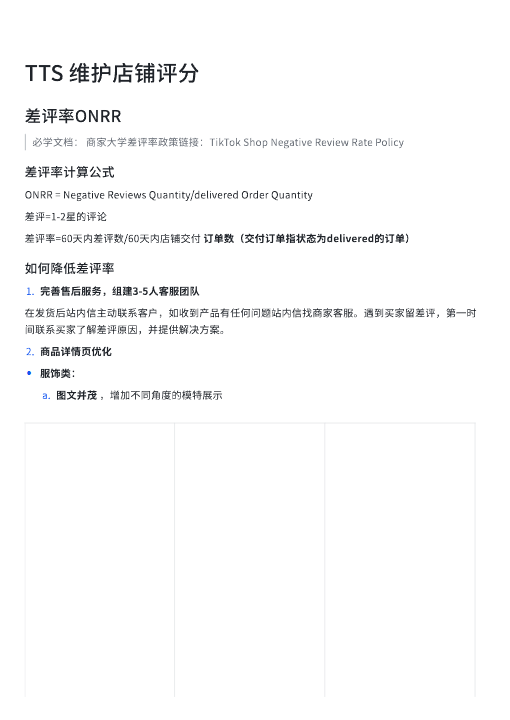](../images/18/page-001.png)

TTS⟦U+0001⟧维护店铺评分⟦U+0001⟧差评率ONRR⟦U+0001⟧必学文档：⟦U+0001⟧商家大学差评率政策链接：TikTok⟦U+0001⟧Shop⟦U+0001⟧Negative⟦U+0001⟧Review⟦U+0001⟧Rate⟦U+0001⟧Policy⟦U+0001⟧差评率计算公式⟦U+0001⟧ONRR⟦U+0001⟧=⟦U+0001⟧Negative⟦U+0001⟧Reviews⟦U+0001⟧Quantity/delivered⟦U+0001⟧Order⟦U+0001⟧Quantity⟦U+0001⟧差评=1-2星的评论⟦U+0001⟧差评率=60天内差评数/60天内店铺交付⟦U+0001⟧订单数（交付订单指状态为delivered的订单）⟦U+0001⟧如何降低差评率⟦U+0001⟧1.完善售后服务，组建3-5人客服团队⟦U+0001⟧在发货后站内信主动联系客戶，如收到产品有任何问题站内信找商家客服。遇到买家留差评，第一时间联系买家了解差评原因，并提供解决方案。2.商品详情⻚优化•服饰类：a.图文并茂⟦U+0001⟧，增加不同⻆度的模特展示⟦U+0001⟧

## 第 2 页

[打开第 2 页图片](../images/18/page-002.png)（510×720）

[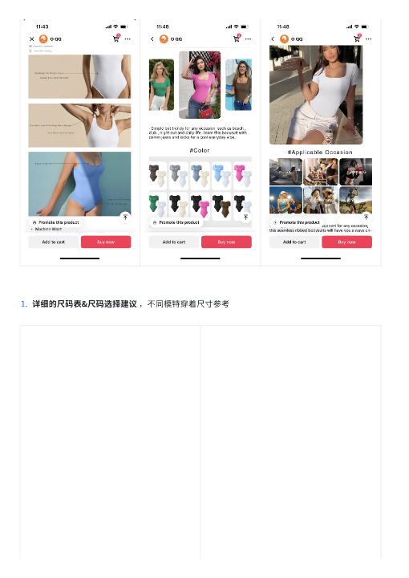](../images/18/page-002.png)

1.详细的尺码表&尺码选择建议⟦U+0001⟧，不同模特穿着尺寸参考⟦U+0001⟧

## 第 3 页

[打开第 3 页图片](../images/18/page-003.png)（765×1081）

[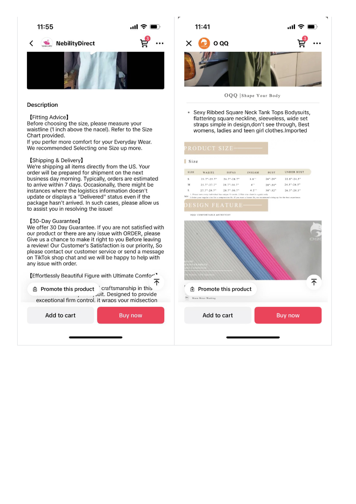](../images/18/page-003.png)

> 此页未返回非图片DOM正文文字；不推测图片中的内容。

## 第 4 页

[打开第 4 页图片](../images/18/page-004.png)（765×1081）

[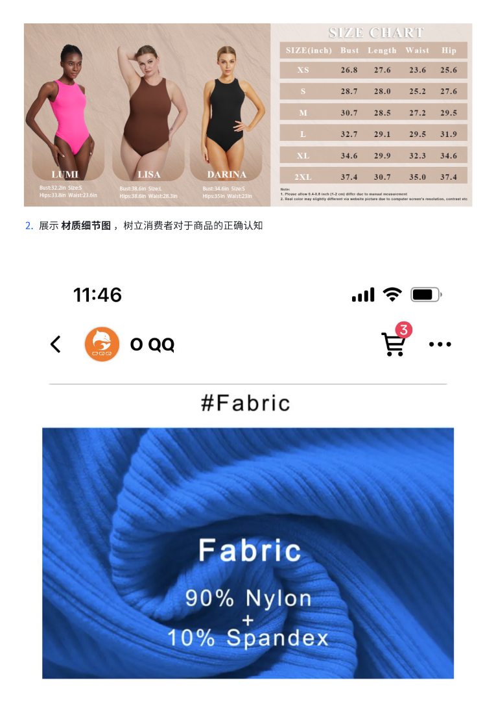](../images/18/page-004.png)

2.展示⟦U+0001⟧材质细节图⟦U+0001⟧，树立消费者对于商品的正确认知⟦U+0001⟧

## 第 5 页

[打开第 5 页图片](../images/18/page-005.png)（765×1081）

[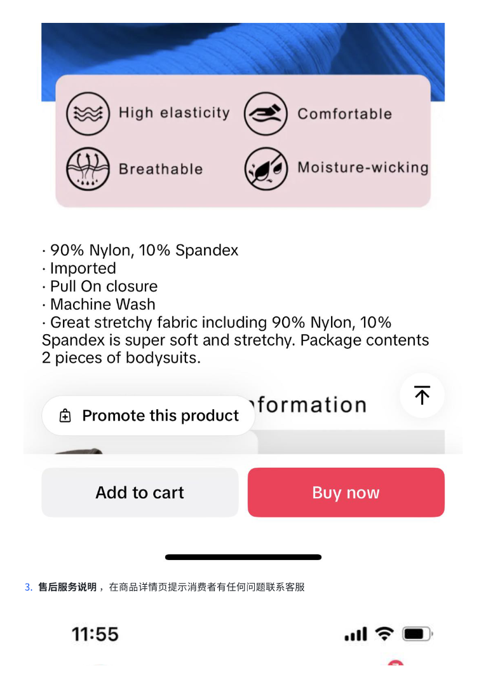](../images/18/page-005.png)

3.售后服务说明⟦U+0001⟧，在商品详情⻚提示消费者有任何问题联系客服⟦U+0001⟧

## 第 6 页

[打开第 6 页图片](../images/18/page-006.png)（765×1081）

[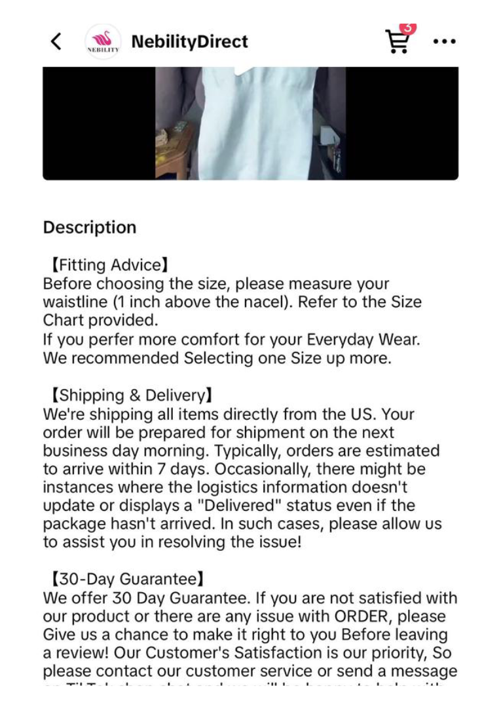](../images/18/page-006.png)

> 此页未返回非图片DOM正文文字；不推测图片中的内容。

## 第 7 页

[打开第 7 页图片](../images/18/page-007.png)（765×1081）

[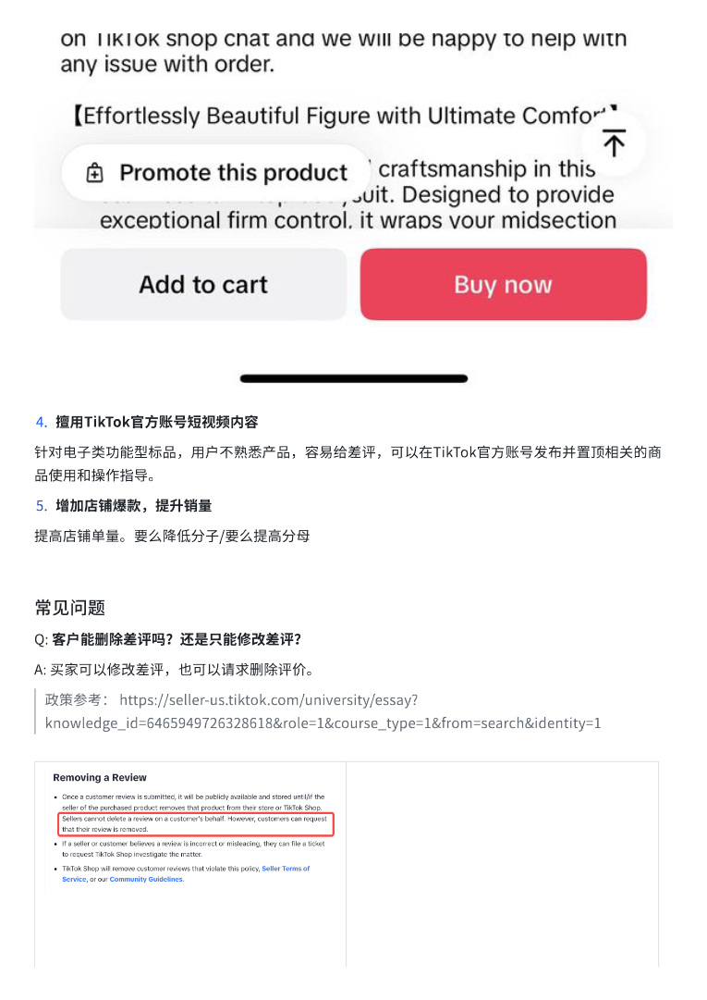](../images/18/page-007.png)

4.擅用TikTok官方账号短视频内容⟦U+0001⟧针对电子类功能型标品，用戶不熟悉产品，容易给差评，可以在TikTok官方账号发布并置顶相关的商品使用和操作指导。5.增加店铺爆款，提升销量提高店铺单量。要么降低分子/要么提高分母⟦U+0001⟧常⻅问题⟦U+0001⟧Q:⟦U+0001⟧客戶能删除差评吗？还是只能修改差评？⟦U+0001⟧A:⟦U+0001⟧买家可以修改差评，也可以请求删除评价。⟦U+0001⟧政策参考：⟦U+0001⟧https://seller-us.tiktok.com/university/essay?knowledge_id=6465949726328618&role=1&course_type=1&from=search&identity=1⟦U+0001⟧

## 第 8 页

[打开第 8 页图片](../images/18/page-008.png)（765×1081）

[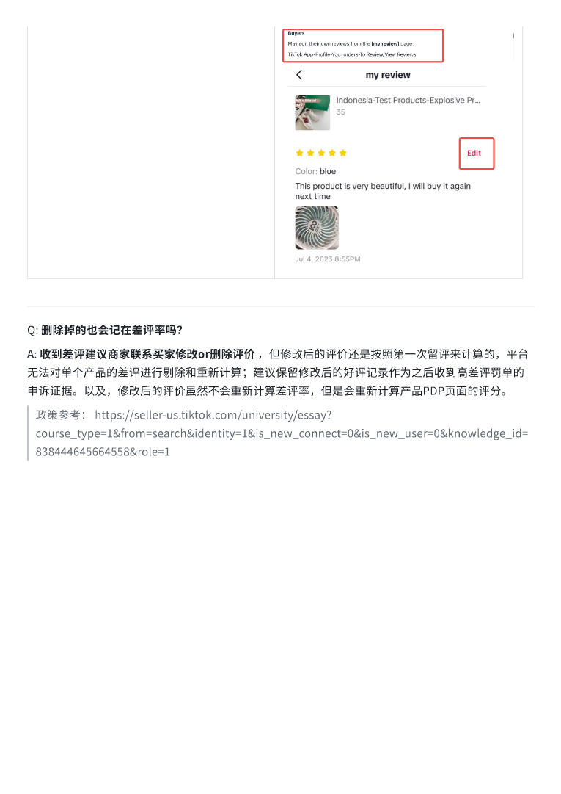](../images/18/page-008.png)

Q:⟦U+0001⟧删除掉的也会记在差评率吗？⟦U+0001⟧A:⟦U+0001⟧收到差评建议商家联系买家修改or删除评价⟦U+0001⟧，但修改后的评价还是按照第一次留评来计算的，平台无法对单个产品的差评进行剔除和重新计算；建议保留修改后的好评记录作为之后收到高差评罚单的申诉证据。以及，修改后的评价虽然不会重新计算差评率，但是会重新计算产品PDP⻚面的评分。⟦U+0001⟧政策参考：⟦U+0001⟧https://seller-us.tiktok.com/university/essay?course_type=1&from=search&identity=1&is_new_connect=0&is_new_user=0&knowledge_id=838444645664558&role=1⟦U+0001⟧

## 第 9 页

[打开第 9 页图片](../images/18/page-009.png)（510×720）

[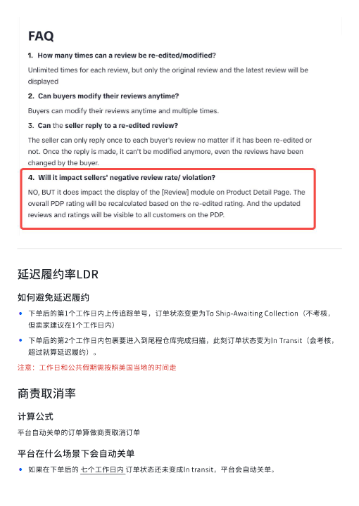](../images/18/page-009.png)

延迟履约率LDR⟦U+0001⟧如何避免延迟履约⟦U+0001⟧•下单后的第1个工作日内上传追踪单号，订单状态变更为To⟦U+0001⟧Ship-Awaiting⟦U+0001⟧Collection（不考核，但卖家建议在1个工作日内）⟦U+0001⟧•下单后的第2个工作日内包裹要进入到尾程仓库完成扫描，此刻订单状态变为In⟦U+0001⟧Transit（会考核，超过就算延迟履约）。注意：工作日和公共假期需按照美国当地的时间走商责取消率计算公式⟦U+0001⟧平台自动关单的订单算做商责取消订单平台在什么场景下会自动关单⟦U+0001⟧•如果在下单后的⟦U+0001⟧七个工作日内⟦U+0001⟧订单状态还未变成In⟦U+0001⟧transit，平台会自动关单。⟦U+0001⟧

## 第 10 页

[打开第 10 页图片](../images/18/page-010.png)（510×720）

[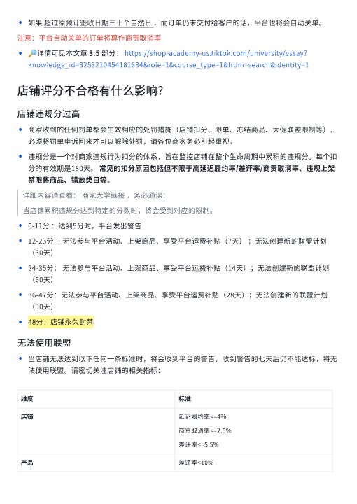](../images/18/page-010.png)

•如果⟦U+0001⟧超过原预计签收日期三十个自然日⟦U+0001⟧，而订单仍未交付给客戶的话，平台也将会自动关单。⟦U+0001⟧注意：平台自动关单的订单将算作商责取消率•🔎详情可⻅本文章⟦U+0001⟧3.5⟦U+0001⟧部分：⟦U+0001⟧https://shop-academy-us.tiktok.com/university/essay?knowledge_id=3253210454181634&role=1&course_type=1&from=search&identity=1⟦U+0001⟧店铺评分不合格有什么影响？店铺违规分过高⟦U+0001⟧•商家收到的任何罚单都会生效相应的处罚措施（店铺扣分、限单、冻结商品、大促联盟限制等），必须将罚单申诉回来才可以解除处罚，请各位商家务必引起重视。•违规分是一个对商家违规行为扣分的体系，旨在监控店铺在整个生命周期中累积的违规分。每个扣分的有效期是180天。⟦U+0001⟧常⻅的扣分原因包括但不限于高延迟履约率/差评率/商责取消率、违规上架禁限售商品、错放类目等。详细内容请查看：⟦U+0001⟧商家大学链接⟦U+0001⟧，务必通读！⟦U+0001⟧当店铺累积违规分达到特定的分数时，将会受到对应的限制。•0-11分⟦U+0001⟧：达到5分时，平台发出警告⟦U+0001⟧•12-23分⟦U+0001⟧：无法参与平台活动、上架商品、享受平台运费补贴（7天）⟦U+0001⟧；无法创建新的联盟计划（30天）⟦U+0001⟧•24-35分：⟦U+0001⟧无法参与平台活动、上架商品、享受平台运费补贴（14天）；无法创建新的联盟计划（60天）⟦U+0001⟧•36-47分：无法参与平台活动、上架商品、享受平台运费补贴（28天）；无法创建新的联盟计划（90天）⟦U+0001⟧•48分：店铺永久封禁⟦U+0001⟧无法使用联盟⟦U+0001⟧•当店铺无法达到以下任何一条标准时，将会收到平台的警告，收到警告的七天后仍不能达标，将无法使用联盟。请密切关注店铺的相关指标：维度⟦U+0001⟧标准⟦U+0001⟧店铺⟦U+0001⟧延迟履约率<=4%⟦U+0001⟧商责取消率<=2.5%⟦U+0001⟧差评率<=5.5%⟦U+0001⟧产品⟦U+0001⟧差评率<10%⟦U+0001⟧

## 第 11 页

[打开第 11 页图片](../images/18/page-011.png)（510×720）

[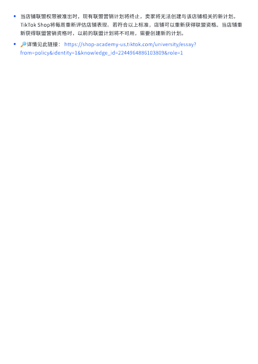](../images/18/page-011.png)

•当店铺联盟权限被准出时，现有联盟营销计划将终止，卖家将无法创建与该店铺相关的新计划。TikTok⟦U+0001⟧Shop将每周重新评估店铺表现。若符合以上标准，店铺可以重新获得联盟资格。当店铺重新获得联盟营销资格时，以前的联盟计划将不可用，需要创建新的计划。•🔎详情⻅此链接：⟦U+0001⟧https://shop-academy-us.tiktok.com/university/essay?from=policy&identity=1&knowledge_id=2244964886103809&role=1⟦U+0001⟧
