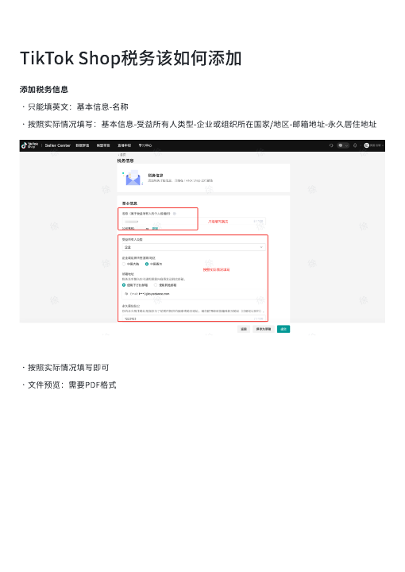
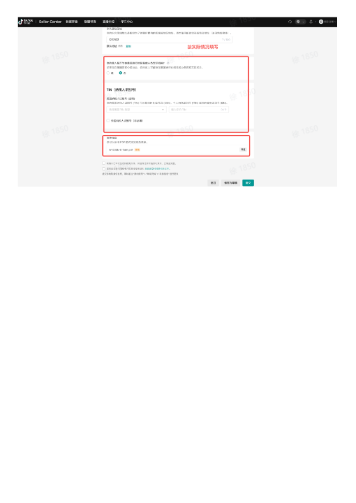

# TikTok Shop税务该如何添加.pdf — 预览版

- 附件序号：20（manifest.attachments 原顺序）
- 来源：https://dcni26t4qg0z.feishu.cn/wiki/EVUtwnBTMiSx0Okr4QiciHrTnof
- 采集日期：2026-10-11（Asia/Shanghai）
- 采集证据：[20.dom.json](../raw/20.dom.json)
- 范围：浏览器预览文字与已采集的逐页图片；原文件下载状态另行记录，转换过程未产生原文件。
- 页图可保留预览中显示的文内图片；未恢复原始图片素材、可编辑Word文档、Excel公式或原始附件。
- 文字页覆盖：部分或未知；不能把侧栏页号当作已采集正文页。
- 预览记录总页数：2（0 表示查看器状态，不能推断原文件无页）
- 明确文字页号：1
- 页图覆盖：2/2 页；所有已观测预览页均有尺寸合格且PNG完整的页图。
- 有效页图页号：1、2
- 原文件：本次预览转换保存 0 个原文件；图片文字不计作已采集DOM文字。
- 预览文本层包含控制字符；以 ⟦U+XXXX⟧ 标记保留，不猜测其含义。
- 原始采集候选：[20-dom.json](../raw/source-captures/20-76615b517372-20-dom.json)

## 预览正文

## 第 1 页

[打开第 1 页图片](../images/20/page-001.png)（510×720）

TikTok⟦U+0001⟧Shop税务该如何添加⟦U+0001⟧添加税务信息•只能填英文：基本信息-名称⟦U+0001⟧•按照实际情况填写：基本信息-受益所有人类型-企业或组织所在国家/地区-邮箱地址-永久居住地址⟦U+0001⟧•按照实际情况填写即可•文件预览：需要PDF格式⟦U+0001⟧

## 第 2 页

[打开第 2 页图片](../images/20/page-002.png)（510×720）

> 此页未返回非图片DOM正文文字；不推测图片中的内容。
