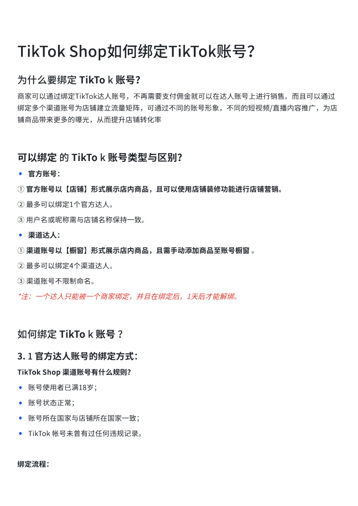
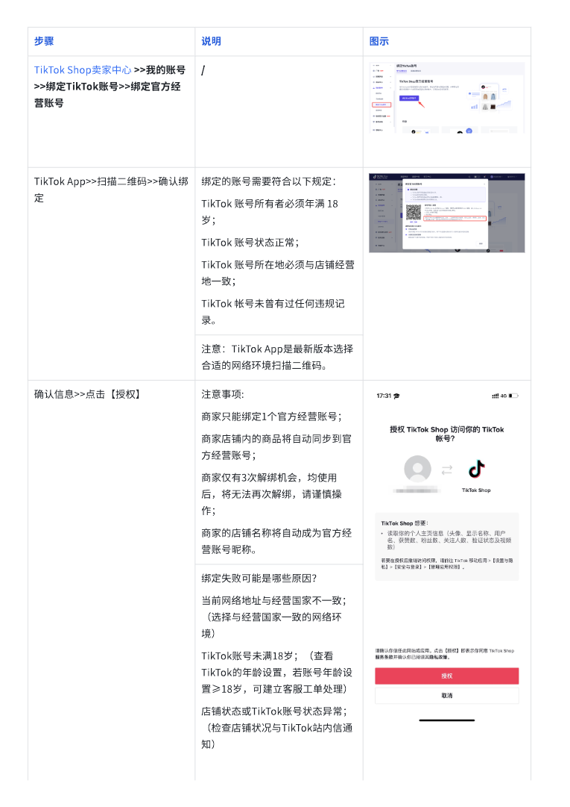
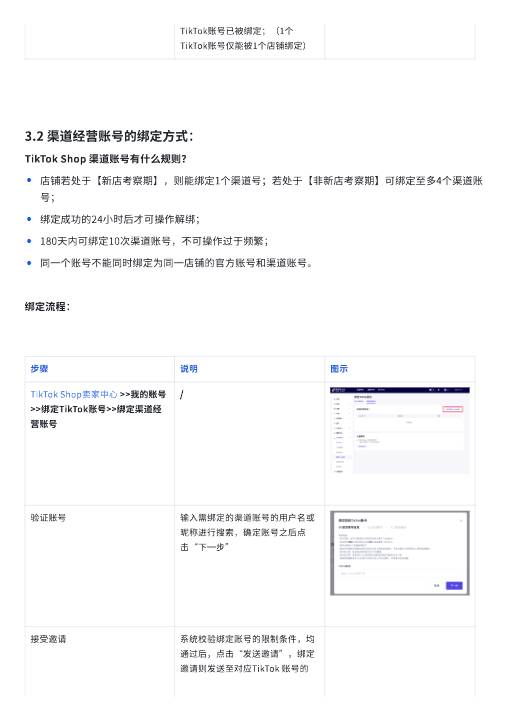
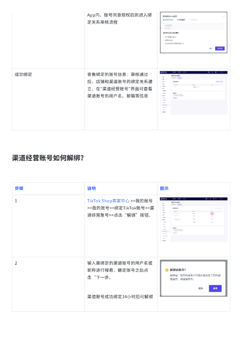
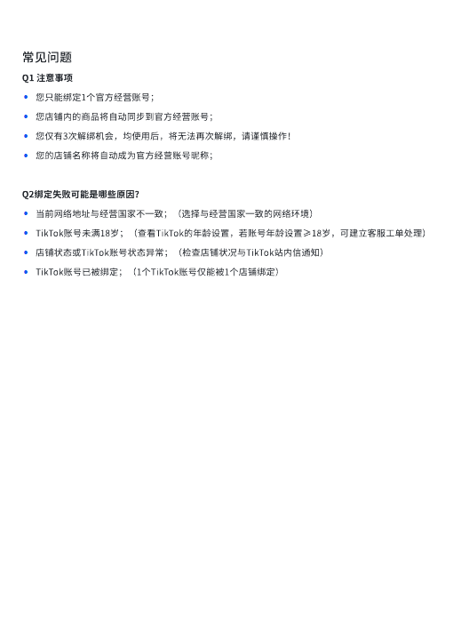

# TikTok Shop如何绑定TikTok账号？.pdf — 预览版

- 附件序号：21（manifest.attachments 原顺序）
- 来源：https://dcni26t4qg0z.feishu.cn/wiki/EVUtwnBTMiSx0Okr4QiciHrTnof
- 采集日期：2026-10-11（Asia/Shanghai）
- 采集证据：[21.dom.json](../raw/21.dom.json)
- 范围：浏览器预览文字与已采集的逐页图片；原文件下载状态另行记录，转换过程未产生原文件。
- 页图可保留预览中显示的文内图片；未恢复原始图片素材、可编辑Word文档、Excel公式或原始附件。
- 文字页覆盖：采集JSON中每一页均有非空DOM文字记录；这不证明图片中文字已转录或每页文字绝对完整。
- 预览记录总页数：5（0 表示查看器状态，不能推断原文件无页）
- 明确文字页号：1、2、3、4、5
- 页图覆盖：5/5 页；所有已观测预览页均有尺寸合格且PNG完整的页图。
- 有效页图页号：1、2、3、4、5
- 原文件：本次预览转换保存 0 个原文件；图片文字不计作已采集DOM文字。
- 预览文本层包含控制字符；以 ⟦U+XXXX⟧ 标记保留，不猜测其含义。
- 原始采集候选：[21.snapshot.txt](../raw/source-captures/21-48266c027ef0-21.snapshot.txt)
- 原始采集候选：[21-dom.json](../raw/source-captures/21-a7bd113f828b-21-dom.json)

## 预览正文

## 第 1 页

[打开第 1 页图片](../images/21/page-001.png)（765×1081）

TikTok⟦U+0001⟧Shop如何绑定TikTok账号？⟦U+0001⟧为什么要绑定⟦U+0001⟧TikTo⟦U+0001⟧k⟦U+0001⟧账号？⟦U+0001⟧商家可以通过绑定TikTok达人账号，不再需要支付佣金就可以在达人账号上进行销售。而且可以通过绑定多个渠道账号为店铺建立流量矩阵，可通过不同的账号形象，不同的短视频/直播内容推广，为店铺商品带来更多的曝光，从而提升店铺转化率可以绑定⟦U+0001⟧的⟦U+0001⟧TikTo⟦U+0001⟧k⟦U+0001⟧账号类型与区别？⟦U+0001⟧•官方账号：①⟦U+0001⟧官方账号以【店铺】形式展示店内商品，且可以使用店铺装修功能进行店铺营销。⟦U+0001⟧②⟦U+0001⟧最多可以绑定1个官方达人。⟦U+0001⟧③⟦U+0001⟧用戶名或昵称需与店铺名称保持一致。⟦U+0001⟧•渠道达人：①⟦U+0001⟧渠道账号以【橱窗】形式展示店内商品，且需手动添加商品至账号橱窗⟦U+0001⟧。⟦U+0001⟧②⟦U+0001⟧最多可以绑定4个渠道达人。⟦U+0001⟧③⟦U+0001⟧渠道账号不限制命名。⟦U+0001⟧*注：一个达人只能被一个商家绑定，并且在绑定后，1天后才能解绑。⟦U+0001⟧如何绑定⟦U+0001⟧TikTo⟦U+0001⟧k⟦U+0001⟧账号⟦U+0001⟧？⟦U+0001⟧3.⟦U+0001⟧1⟦U+0001⟧官方达人账号的绑定方式：⟦U+0001⟧TikTok⟦U+0001⟧Shop⟦U+0001⟧渠道账号有什么规则？⟦U+0001⟧•账号使用者已满18岁；⟦U+0001⟧•账号状态正常；•账号所在国家与店铺所在国家一致；•TikTok⟦U+0001⟧帐号未曾有过任何违规记录。⟦U+0001⟧绑定流程：

## 第 2 页

[打开第 2 页图片](../images/21/page-002.png)（765×1081）

步骤⟦U+0001⟧说明⟦U+0001⟧图示⟦U+0001⟧TikTok⟦U+0001⟧Shop卖家中心⟦U+0001⟧>>我的账号>>绑定TikTok账号>>绑定官方经营账号⟦U+0001⟧/⟦U+0001⟧TikTok⟦U+0001⟧App>>扫描二维码>>确认绑定⟦U+0001⟧绑定的账号需要符合以下规定：⟦U+0001⟧TikTok⟦U+0001⟧账号所有者必须年满⟦U+0001⟧18⟦U+0001⟧岁；⟦U+0001⟧TikTok⟦U+0001⟧账号状态正常；⟦U+0001⟧TikTok⟦U+0001⟧账号所在地必须与店铺经营地一致；⟦U+0001⟧TikTok⟦U+0001⟧帐号未曾有过任何违规记录。⟦U+0001⟧注意：TikTok⟦U+0001⟧App是最新版本选择合适的网络环境扫描二维码。⟦U+0001⟧确认信息>>点击【授权】⟦U+0001⟧注意事项:⟦U+0001⟧商家只能绑定1个官方经营账号；⟦U+0001⟧商家店铺内的商品将自动同步到官方经营账号；⟦U+0001⟧商家仅有3次解绑机会，均使用后，将无法再次解绑，请谨慎操作；⟦U+0001⟧商家的店铺名称将自动成为官方经营账号昵称。⟦U+0001⟧绑定失败可能是哪些原因？⟦U+0001⟧当前网络地址与经营国家不一致；（选择与经营国家一致的网络环境）⟦U+0001⟧TikTok账号未满18岁；（查看TikTok的年龄设置，若账号年龄设置≥18岁，可建立客服工单处理）⟦U+0001⟧店铺状态或TikTok账号状态异常；（检查店铺状况与TikTok站内信通知）⟦U+0001⟧

## 第 3 页

[打开第 3 页图片](../images/21/page-003.png)（510×720）

TikTok账号已被绑定；（1个TikTok账号仅能被1个店铺绑定）⟦U+0001⟧3.2⟦U+0001⟧渠道经营账号的绑定方式：⟦U+0001⟧TikTok⟦U+0001⟧Shop⟦U+0001⟧渠道账号有什么规则？⟦U+0001⟧•店铺若处于【新店考察期】，则能绑定1个渠道号；若处于【非新店考察期】可绑定至多4个渠道账号；•绑定成功的24小时后才可操作解绑；⟦U+0001⟧•180天内可绑定10次渠道账号，不可操作过于频繁；⟦U+0001⟧•同一个账号不能同时绑定为同一店铺的官方账号和渠道账号。绑定流程：步骤⟦U+0001⟧说明⟦U+0001⟧图示⟦U+0001⟧TikTok⟦U+0001⟧Shop卖家中心⟦U+0001⟧>>我的账号>>绑定TikTok账号>>绑定渠道经营账号⟦U+0001⟧/⟦U+0001⟧验证账号⟦U+0001⟧输入需绑定的渠道账号的用戶名或昵称进行搜索，确定账号之后点击“下一步”⟦U+0001⟧接受邀请⟦U+0001⟧系统校验绑定账号的限制条件，均通过后，点击“发送邀请”，绑定邀请则发送至对应TikTok⟦U+0001⟧账号的

## 第 4 页

[打开第 4 页图片](../images/21/page-004.png)（510×720）

App内，账号同意授权后则进入绑定关系审核流程⟦U+0001⟧成功绑定⟦U+0001⟧查看绑定的账号信息：审核通过后，店铺和渠道账号的绑定关系建立，在"渠道经营账号"界面可查看渠道账号的用戶名、邮箱等信息⟦U+0001⟧渠道经营账号如何解绑？步骤⟦U+0001⟧说明⟦U+0001⟧图示⟦U+0001⟧1⟦U+0001⟧TikTok⟦U+0001⟧Shop卖家中心⟦U+0001⟧>>我的账号>>我的账号>>绑定TikTok账号>>渠道经营账号>>点击“解绑”按钮。⟦U+0001⟧2⟦U+0001⟧输入需绑定的渠道账号的用戶名或昵称进行搜索，确定账号之后点击“下一步。⟦U+0001⟧渠道账号成功绑定24小时后可解绑⟦U+0001⟧

## 第 5 页

[打开第 5 页图片](../images/21/page-005.png)（510×720）

常⻅问题Q1⟦U+0001⟧注意事项⟦U+0001⟧•您只能绑定1个官方经营账号；⟦U+0001⟧•您店铺内的商品将自动同步到官方经营账号；•您仅有3次解绑机会，均使用后，将无法再次解绑，请谨慎操作！⟦U+0001⟧•您的店铺名称将自动成为官方经营账号昵称；Q2绑定失败可能是哪些原因？⟦U+0001⟧•当前网络地址与经营国家不一致；（选择与经营国家一致的网络环境）•TikTok账号未满18岁；（查看TikTok的年龄设置，若账号年龄设置≥18岁，可建立客服工单处理）⟦U+0001⟧•店铺状态或TikTok账号状态异常；（检查店铺状况与TikTok站内信通知）⟦U+0001⟧•TikTok账号已被绑定；（1个TikTok账号仅能被1个店铺绑定）
