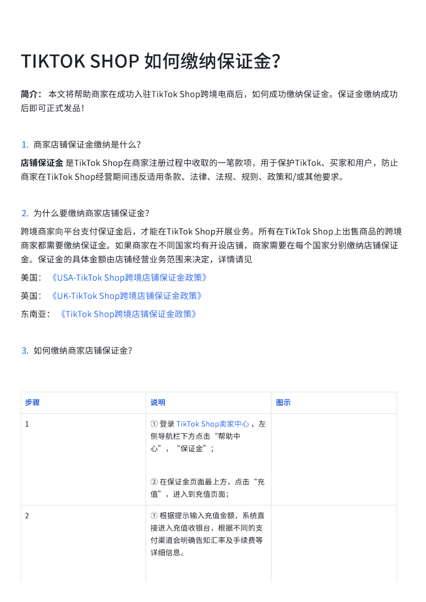
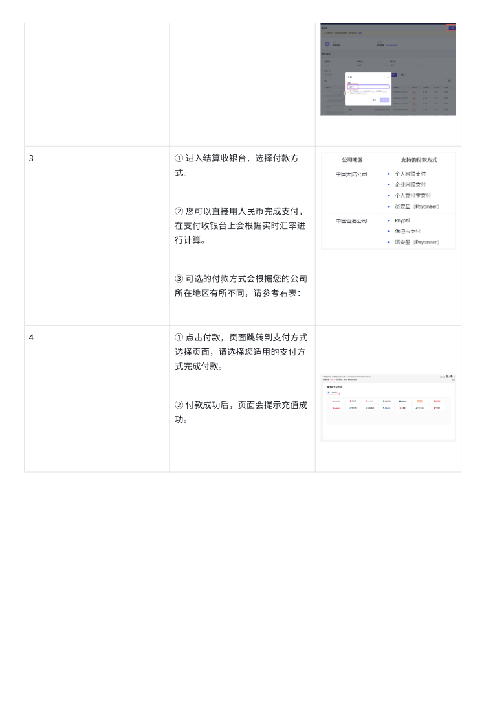

# TIKTOK SHOP 如何缴纳保证金？.pdf — 预览版

- 附件序号：22（manifest.attachments 原顺序）
- 来源：https://dcni26t4qg0z.feishu.cn/wiki/EVUtwnBTMiSx0Okr4QiciHrTnof
- 采集日期：2026-10-11（Asia/Shanghai）
- 采集证据：[22.dom.json](../raw/22.dom.json)
- 范围：浏览器预览文字与已采集的逐页图片；原文件下载状态另行记录，转换过程未产生原文件。
- 页图可保留预览中显示的文内图片；未恢复原始图片素材、可编辑Word文档、Excel公式或原始附件。
- 文字页覆盖：采集JSON中每一页均有非空DOM文字记录；这不证明图片中文字已转录或每页文字绝对完整。
- 预览记录总页数：2（0 表示查看器状态，不能推断原文件无页）
- 明确文字页号：1、2
- 页图覆盖：2/2 页；所有已观测预览页均有尺寸合格且PNG完整的页图。
- 有效页图页号：1、2
- 原文件：本次预览转换保存 0 个原文件；图片文字不计作已采集DOM文字。
- 预览文本层包含控制字符；以 ⟦U+XXXX⟧ 标记保留，不猜测其含义。
- 原始采集候选：[22.snapshot.txt](../raw/source-captures/22-5a696762c7e0-22.snapshot.txt)
- 原始采集候选：[22-dom.json](../raw/source-captures/22-39f0aa7ca4ef-22-dom.json)

## 预览正文

## 第 1 页

[打开第 1 页图片](../images/22/page-001.png)（765×1081）

TIKTOK⟦U+0001⟧SHOP⟦U+0001⟧如何缴纳保证金？⟦U+0001⟧简介：⟦U+0001⟧本文将帮助商家在成功入驻TikTok⟦U+0001⟧Shop跨境电商后，如何成功缴纳保证金。保证金缴纳成功后即可正式发品！1.商家店铺保证金缴纳是什么？店铺保证金⟦U+0001⟧是TikTok⟦U+0001⟧Shop在商家注册过程中收取的一笔款项，用于保护TikTok、买家和用戶，防止商家在TikTok⟦U+0001⟧Shop经营期间违反适用条款、法律、法规、规则、政策和/或其他要求。⟦U+0001⟧2.为什么要缴纳商家店铺保证金？跨境商家向平台支付保证金后，才能在TikTok⟦U+0001⟧Shop开展业务。所有在TikTok⟦U+0001⟧Shop上出售商品的跨境商家都需要缴纳保证金。如果商家在不同国家均有开设店铺，商家需要在每个国家分别缴纳店铺保证金。保证金的具体金额由店铺经营业务范围来决定，详情请⻅美国：⟦U+0001⟧《USA-TikTok⟦U+0001⟧Shop跨境店铺保证金政策》⟦U+0001⟧英国：⟦U+0001⟧《UK-TikTok⟦U+0001⟧Shop跨境店铺保证金政策》⟦U+0001⟧东南亚：⟦U+0001⟧《TikTok⟦U+0001⟧Shop跨境店铺保证金政策》⟦U+0001⟧3.如何缴纳商家店铺保证金？步骤⟦U+0001⟧说明⟦U+0001⟧图示⟦U+0001⟧1⟦U+0001⟧①⟦U+0001⟧登录⟦U+0001⟧TikTok⟦U+0001⟧Shop卖家中心⟦U+0001⟧，左侧导航栏下方点击“帮助中心”，“保证金”；⟦U+0001⟧②⟦U+0001⟧在保证金⻚面最上方，点击“充值”，进入到充值⻚面；⟦U+0001⟧2⟦U+0001⟧①⟦U+0001⟧根据提示输入充值金额，系统直接进入充值收银台，根据不同的支付渠道会明确告知汇率及手续费等详细信息。⟦U+0001⟧

## 第 2 页

[打开第 2 页图片](../images/22/page-002.png)（765×1081）

3⟦U+0001⟧①⟦U+0001⟧进入结算收银台，选择付款方式。⟦U+0001⟧②⟦U+0001⟧您可以直接用人⺠币完成支付，在支付收银台上会根据实时汇率进行计算。⟦U+0001⟧③⟦U+0001⟧可选的付款方式会根据您的公司所在地区有所不同，请参考右表：⟦U+0001⟧4⟦U+0001⟧①⟦U+0001⟧点击付款，⻚面跳转到支付方式选择⻚面，请选择您适用的支付方式完成付款。⟦U+0001⟧②⟦U+0001⟧付款成功后，⻚面会提示充值成功。⟦U+0001⟧
