# 账号注册绑定和账号装修 .pdf — 预览版

- 附件序号：23（manifest.attachments 原顺序）
- 来源：https://dcni26t4qg0z.feishu.cn/wiki/EVUtwnBTMiSx0Okr4QiciHrTnof
- 采集日期：2026-10-11（Asia/Shanghai）
- 采集证据：[23.dom.json](../raw/23.dom.json)
- 范围：浏览器预览文字与已采集的逐页图片；原文件下载状态另行记录，转换过程未产生原文件。
- 页图可保留预览中显示的文内图片；未恢复原始图片素材、可编辑Word文档、Excel公式或原始附件。
- 文字页覆盖：采集JSON中每一页均有非空DOM文字记录；这不证明图片中文字已转录或每页文字绝对完整。
- 预览记录总页数：13（0 表示查看器状态，不能推断原文件无页）
- 明确文字页号：1、2、3、4、5、6、7、8、9、10、11、12、13
- 页图覆盖：13/13 页；所有已观测预览页均有尺寸合格且PNG完整的页图。
- 有效页图页号：1、2、3、4、5、6、7、8、9、10、11、12、13
- 原文件：本次预览转换保存 0 个原文件；图片文字不计作已采集DOM文字。
- 预览文本层包含控制字符；以 ⟦U+XXXX⟧ 标记保留，不猜测其含义。
- 原始采集候选：[23.snapshot.txt](../raw/source-captures/23-1efec5e38b95-23.snapshot.txt)
- 原始采集候选：[23-dom.json](../raw/source-captures/23-6795764d1067-23-dom.json)

## 预览正文

## 第 1 页

[打开第 1 页图片](../images/23/page-001.png)（765×1081）

[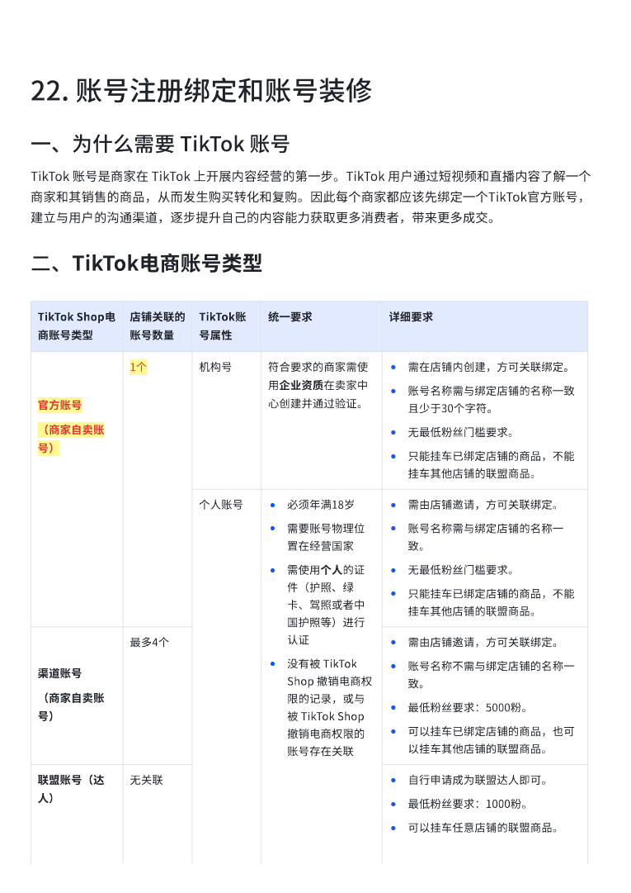](../images/23/page-001.png)

22.⟦U+0001⟧账号注册绑定和账号装修⟦U+0001⟧⟦U+0001⟧一、为什么需要⟦U+0001⟧TikTok⟦U+0001⟧账号⟦U+0001⟧TikTok⟦U+0001⟧账号是商家在⟦U+0001⟧TikTok⟦U+0001⟧上开展内容经营的第一步。TikTok⟦U+0001⟧用戶通过短视频和直播内容了解一个商家和其销售的商品，从而发生购买转化和复购。因此每个商家都应该先绑定一个TikTok官方账号，建立与用戶的沟通渠道，逐步提升自己的内容能力获取更多消费者，带来更多成交。二、TikTok电商账号类型⟦U+0001⟧TikTok⟦U+0001⟧Shop电商账号类型⟦U+0001⟧店铺关联的账号数量⟦U+0001⟧TikTok账号属性⟦U+0001⟧统一要求⟦U+0001⟧详细要求⟦U+0001⟧官方账号⟦U+0001⟧（商家自卖账号）⟦U+0001⟧1个⟦U+0001⟧机构号⟦U+0001⟧符合要求的商家需使用企业资质在卖家中心创建并通过验证。⟦U+0001⟧•需在店铺内创建，方可关联绑定。⟦U+0001⟧•账号名称需与绑定店铺的名称一致且少于30个字符。⟦U+0001⟧•无最低粉丝⻔槛要求。⟦U+0001⟧•只能挂⻋已绑定店铺的商品，不能挂⻋其他店铺的联盟商品。⟦U+0001⟧个人账号⟦U+0001⟧•必须年满18岁⟦U+0001⟧•需要账号物理位置在经营国家⟦U+0001⟧•需使用个人的证件（护照、绿卡、驾照或者中国护照等）进行认证⟦U+0001⟧•没有被⟦U+0001⟧TikTok⟦U+0001⟧Shop⟦U+0001⟧撤销电商权限的记录，或与被⟦U+0001⟧TikTok⟦U+0001⟧Shop⟦U+0001⟧撤销电商权限的账号存在关联⟦U+0001⟧•需由店铺邀请，方可关联绑定。⟦U+0001⟧•账号名称需与绑定店铺的名称一致。⟦U+0001⟧•无最低粉丝⻔槛要求。⟦U+0001⟧•只能挂⻋已绑定店铺的商品，不能挂⻋其他店铺的联盟商品。⟦U+0001⟧渠道账号⟦U+0001⟧（商家自卖账号）⟦U+0001⟧最多4个⟦U+0001⟧•需由店铺邀请，方可关联绑定。⟦U+0001⟧•账号名称不需与绑定店铺的名称一致。⟦U+0001⟧•最低粉丝要求：5000粉。⟦U+0001⟧•可以挂⻋已绑定店铺的商品，也可以挂⻋其他店铺的联盟商品。⟦U+0001⟧联盟账号（达人）⟦U+0001⟧无关联⟦U+0001⟧•自行申请成为联盟达人即可。⟦U+0001⟧•最低粉丝要求：1000粉。⟦U+0001⟧•可以挂⻋任意店铺的联盟商品。⟦U+0001⟧

## 第 2 页

[打开第 2 页图片](../images/23/page-002.png)（765×1081）

[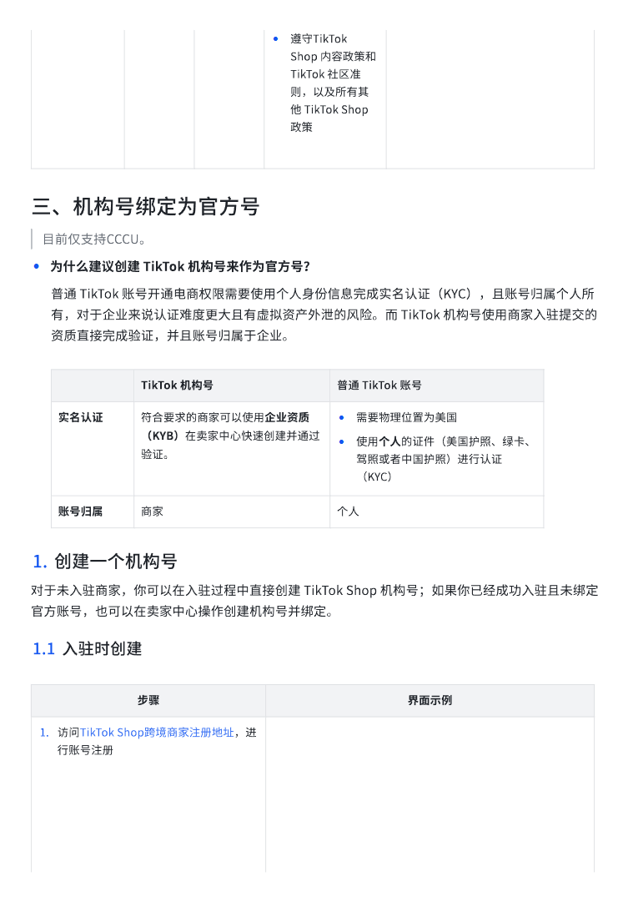](../images/23/page-002.png)

•遵守TikTok⟦U+0001⟧Shop⟦U+0001⟧内容政策和⟦U+0001⟧TikTok⟦U+0001⟧社区准则，以及所有其他⟦U+0001⟧TikTok⟦U+0001⟧Shop政策⟦U+0001⟧三、机构号绑定为官方号目前仅支持CCCU。⟦U+0001⟧•为什么建议创建⟦U+0001⟧TikTok⟦U+0001⟧机构号来作为官方号？⟦U+0001⟧普通⟦U+0001⟧TikTok⟦U+0001⟧账号开通电商权限需要使用个人身份信息完成实名认证（KYC），且账号归属个人所有，对于企业来说认证难度更大且有虚拟资产外泄的⻛险。而⟦U+0001⟧TikTok⟦U+0001⟧机构号使用商家入驻提交的资质直接完成验证，并且账号归属于企业。TikTok⟦U+0001⟧机构号⟦U+0001⟧普通⟦U+0001⟧TikTok⟦U+0001⟧账号⟦U+0001⟧实名认证⟦U+0001⟧符合要求的商家可以使用企业资质（KYB）在卖家中心快速创建并通过验证。⟦U+0001⟧•需要物理位置为美国⟦U+0001⟧•使用个人的证件（美国护照、绿卡、驾照或者中国护照）进行认证（KYC）⟦U+0001⟧账号归属⟦U+0001⟧商家⟦U+0001⟧个人⟦U+0001⟧1.创建一个机构号⟦U+0001⟧对于未入驻商家，你可以在入驻过程中直接创建⟦U+0001⟧TikTok⟦U+0001⟧Shop⟦U+0001⟧机构号；如果你已经成功入驻且未绑定官方账号，也可以在卖家中心操作创建机构号并绑定。1.1入驻时创建⟦U+0001⟧步骤⟦U+0001⟧界面示例⟦U+0001⟧1.访问TikTok⟦U+0001⟧Shop跨境商家注册地址，进行账号注册⟦U+0001⟧

## 第 3 页

[打开第 3 页图片](../images/23/page-003.png)（510×720）

[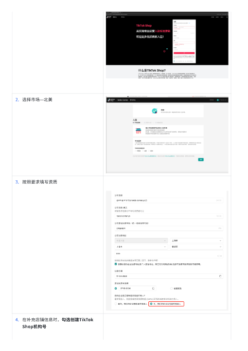](../images/23/page-003.png)

2.选择市场—北美⟦U+0001⟧3.按照要求填写资质⟦U+0001⟧4.在补充店铺信息时，勾选创建TikTok⟦U+0001⟧Shop机构号⟦U+0001⟧

## 第 4 页

[打开第 4 页图片](../images/23/page-004.png)（510×720）

[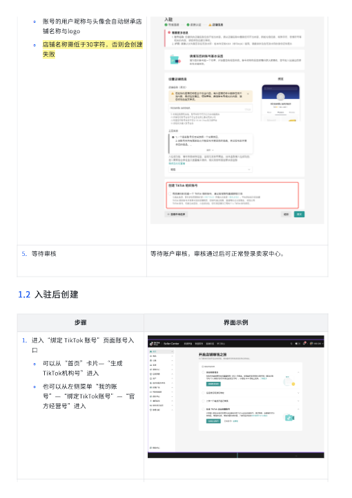](../images/23/page-004.png)

◦账号的用戶昵称与头像会自动继承店铺名称与logo⟦U+0001⟧◦店铺名称需低于30字符，否则会创建失败⟦U+0001⟧5.等待审核⟦U+0001⟧等待账戶审核，审核通过后可正常登录卖家中心。⟦U+0001⟧1.2入驻后创建⟦U+0001⟧步骤⟦U+0001⟧界面示例⟦U+0001⟧1.进入“绑定⟦U+0001⟧TikTok⟦U+0001⟧账号”⻚面账号入口⟦U+0001⟧◦可以从“首⻚”卡片—“生成TikTok机构号”进入⟦U+0001⟧◦也可以从左侧菜单“我的账号”—“绑定TikTok账号”—“官方经营号”进入⟦U+0001⟧

## 第 5 页

[打开第 5 页图片](../images/23/page-005.png)（510×720）

[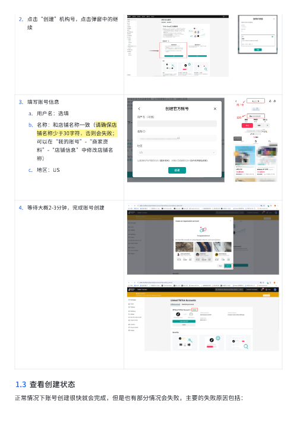](../images/23/page-005.png)

2.点击“创建”机构号，点击弹窗中的继续⟦U+0001⟧⟦U+0001⟧3.填写账号信息⟦U+0001⟧a.用戶名：选填⟦U+0001⟧b.名称：和店铺名称一致（请确保店铺名称少于30字符，否则会失败；可以在“我的账号”-“商家资料”-“店铺信息”中修改店铺名称）⟦U+0001⟧c.地区：US⟦U+0001⟧4.等待大概2-3分钟，完成账号创建⟦U+0001⟧1.3查看创建状态⟦U+0001⟧正常情况下账号创建很快就会完成，但是也有部分情况会失败，主要的失败原因包括：

## 第 6 页

[打开第 6 页图片](../images/23/page-006.png)（510×720）

[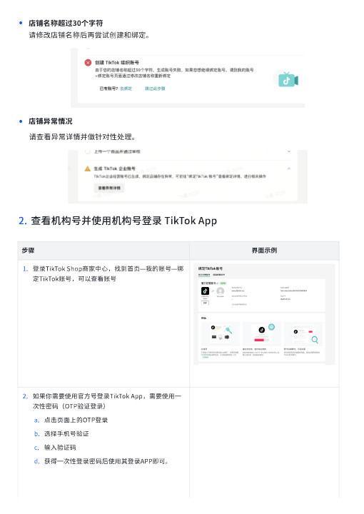](../images/23/page-006.png)

•店铺名称超过30个字符⟦U+0001⟧请修改店铺名称后再尝试创建和绑定。•店铺异常情况请查看异常详情并做针对性处理。2.查看机构号并使用机构号登录⟦U+0001⟧TikTok⟦U+0001⟧App⟦U+0001⟧步骤⟦U+0001⟧界面示例⟦U+0001⟧1.登录TikTok⟦U+0001⟧Shop商家中心，找到首⻚—我的账号—绑定TikTok账号，可以查看账号⟦U+0001⟧2.如果你需要使用官方号登录TikTok⟦U+0001⟧App，需要使用一次性密码（OTP验证登录）⟦U+0001⟧a.点击⻚面上的OTP登录⟦U+0001⟧b.选择手机号验证⟦U+0001⟧c.输入验证码⟦U+0001⟧d.获得一次性登录密码后使用其登录APP即可。⟦U+0001⟧

## 第 7 页

[打开第 7 页图片](../images/23/page-007.png)（510×720）

[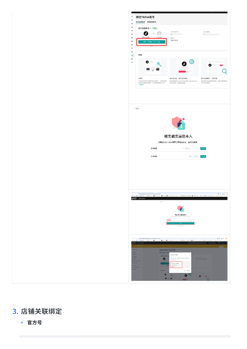](../images/23/page-007.png)

3.店铺关联绑定⟦U+0001⟧◦官方号

## 第 8 页

[打开第 8 页图片](../images/23/page-008.png)（510×720）

[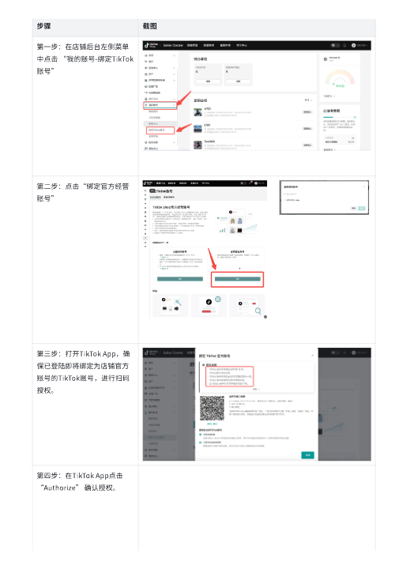](../images/23/page-008.png)

步骤⟦U+0001⟧截图⟦U+0001⟧第一步：在店铺后台左侧菜单中点击⟦U+0001⟧“我的账号-绑定TikTok账号”⟦U+0001⟧第二步：点击“绑定官方经营账号”⟦U+0001⟧⟦U+0001⟧第三步：打开TikTok⟦U+0001⟧App，确保已登陆即将绑定为店铺官方账号的TikTok账号，进行扫码授权。⟦U+0001⟧第四步：在TikTok⟦U+0001⟧App点击⟦U+0001⟧“Authorize”⟦U+0001⟧确认授权。⟦U+0001⟧

## 第 9 页

[打开第 9 页图片](../images/23/page-009.png)（510×720）

[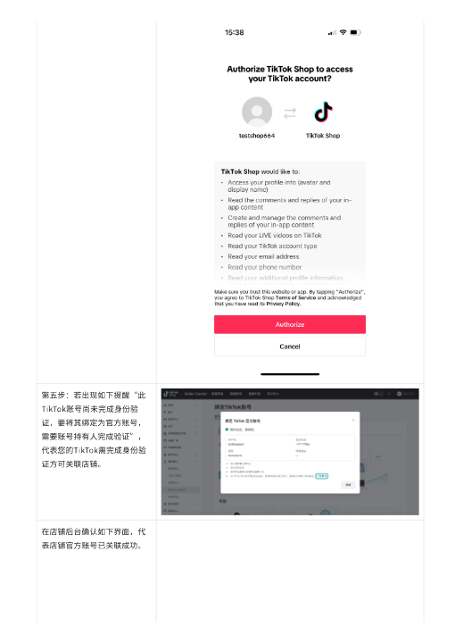](../images/23/page-009.png)

第五步：若出现如下提醒“此TikTok账号尚未完成身份验证，要将其绑定为官方账号，需要账号持有人完成验证”，代表您的TikTok需完成身份验证方可关联店铺。⟦U+0001⟧在店铺后台确认如下界面，代表店铺官方账号已关联成功。⟦U+0001⟧

## 第 10 页

[打开第 10 页图片](../images/23/page-010.png)（510×720）

[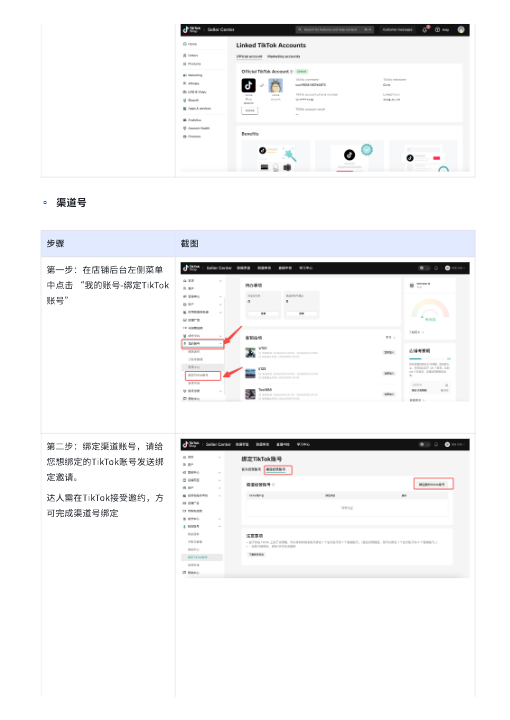](../images/23/page-010.png)

◦渠道号步骤⟦U+0001⟧截图⟦U+0001⟧第一步：在店铺后台左侧菜单中点击⟦U+0001⟧“我的账号-绑定TikTok账号”⟦U+0001⟧第二步：绑定渠道账号，请给您想绑定的TikTok账号发送绑定邀请。⟦U+0001⟧达人需在TikTok接受邀约，方可完成渠道号绑定⟦U+0001⟧

## 第 11 页

[打开第 11 页图片](../images/23/page-011.png)（510×720）

[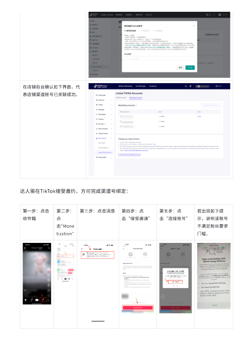](../images/23/page-011.png)

在店铺后台确认如下界面，代表店铺渠道账号已关联成功。⟦U+0001⟧达人需在TikTok接受邀约，方可完成渠道号绑定：⟦U+0001⟧第一步：点击收件箱⟦U+0001⟧第二步：点击"Monetization"⟦U+0001⟧第三步：点击消息⟦U+0001⟧第四步：点击“接受邀请”⟦U+0001⟧第五步：点击“连接账号”⟦U+0001⟧若出现如下提示，说明该账号不满足粉丝要求⻔槛。⟦U+0001⟧

## 第 12 页

[打开第 12 页图片](../images/23/page-012.png)（510×720）

[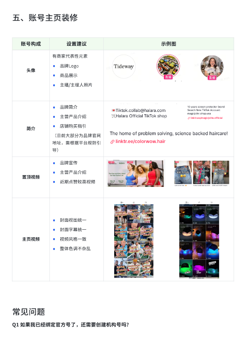](../images/23/page-012.png)

五、账号主⻚装修账号构成⟦U+0001⟧设置建议⟦U+0001⟧示例图⟦U+0001⟧头像⟦U+0001⟧⟦U+0001⟧有商家代表性元素⟦U+0001⟧•品牌Logo⟦U+0001⟧•商品展示⟦U+0001⟧•主播/主理人照片⟦U+0001⟧简介⟦U+0001⟧•品牌简介⟦U+0001⟧•主营产品介绍⟦U+0001⟧•店铺购买指引⟦U+0001⟧（目前大部分为品牌官网地址，需根据平台规则引导）⟦U+0001⟧置顶视频⟦U+0001⟧•品牌宣传⟦U+0001⟧•主营产品介绍⟦U+0001⟧•近期点赞较高视频⟦U+0001⟧主⻚视频⟦U+0001⟧•封面视图统一⟦U+0001⟧•封面字幕统一⟦U+0001⟧•视频⻛格一致⟦U+0001⟧•整体色调不杂乱⟦U+0001⟧常⻅问题Q1⟦U+0001⟧如果我已经绑定官方号了，还需要创建机构号吗？⟦U+0001⟧

## 第 13 页

[打开第 13 页图片](../images/23/page-013.png)（510×720）

[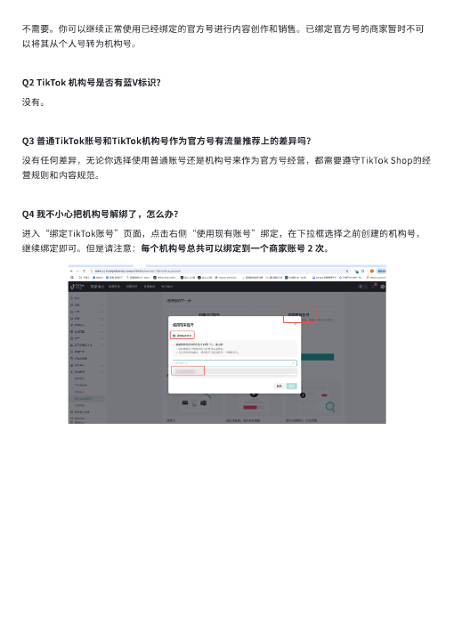](../images/23/page-013.png)

不需要。你可以继续正常使用已经绑定的官方号进行内容创作和销售。已绑定官方号的商家暂时不可以将其从个人号转为机构号。Q2⟦U+0001⟧TikTok⟦U+0001⟧机构号是否有蓝V标识？⟦U+0001⟧没有。Q3⟦U+0001⟧普通TikTok账号和TikTok机构号作为官方号有流量推荐上的差异吗？⟦U+0001⟧没有任何差异，无论你选择使用普通账号还是机构号来作为官方号经营，都需要遵守TikTok⟦U+0001⟧Shop的经营规则和内容规范。Q4⟦U+0001⟧我不小心把机构号解绑了，怎么办？⟦U+0001⟧进入“绑定TikTok账号”⻚面，点击右侧“使用现有账号”绑定，在下拉框选择之前创建的机构号，继续绑定即可。但是请注意：每个机构号总共可以绑定到一个商家账号⟦U+0001⟧2⟦U+0001⟧次。⟦U+0001⟧
