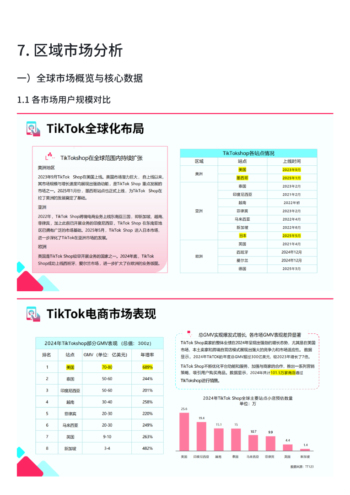
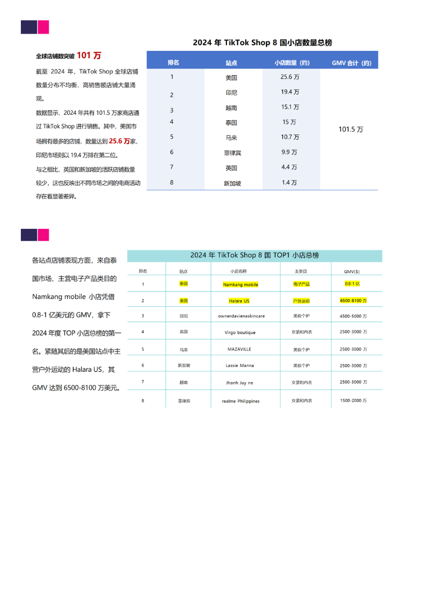
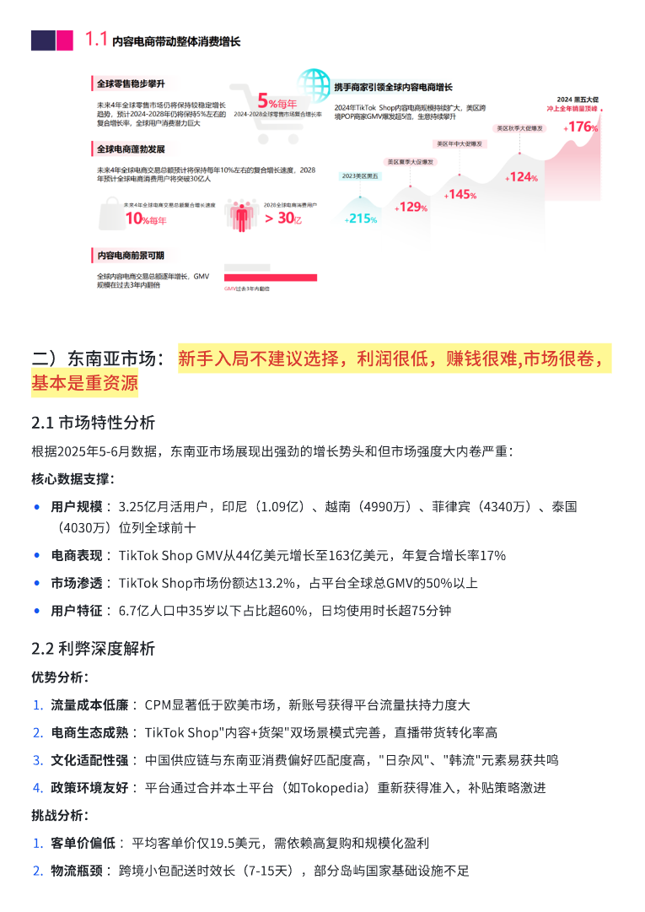
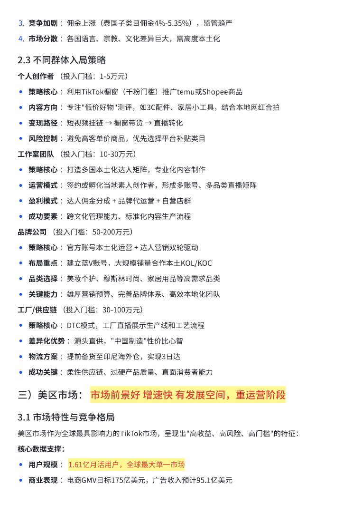
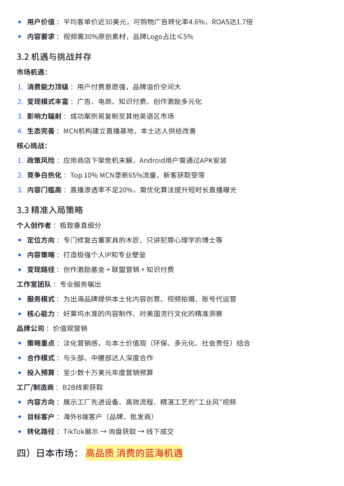
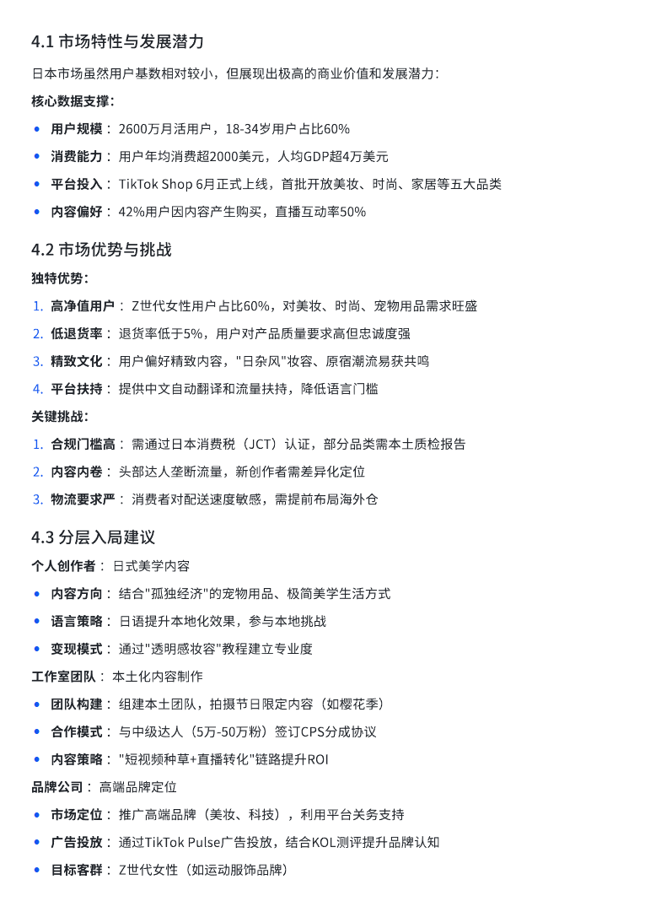
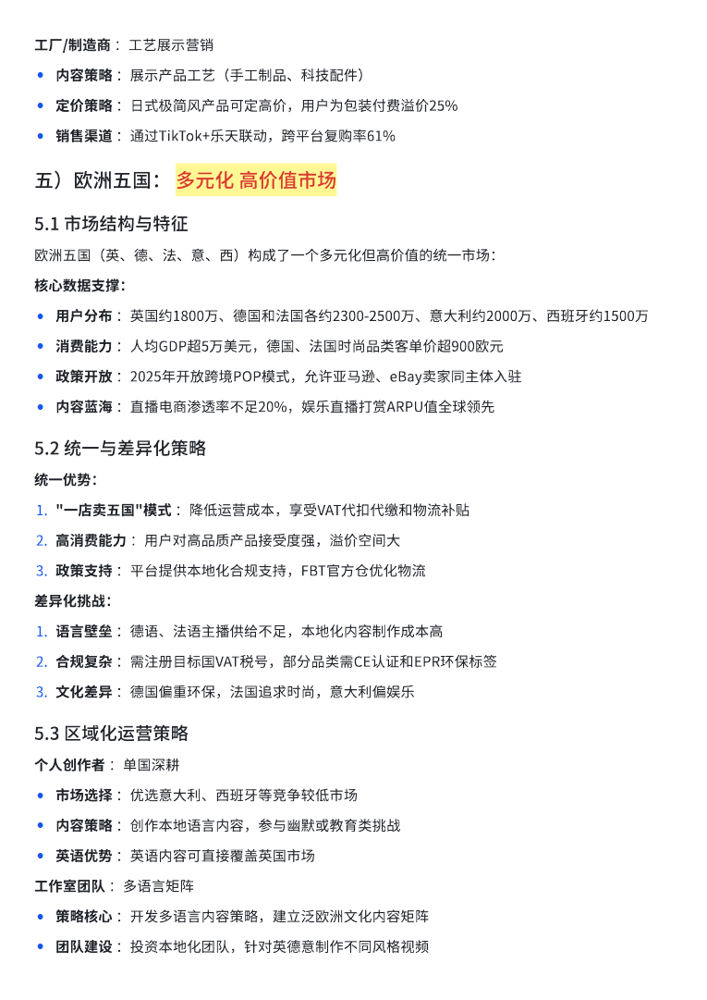
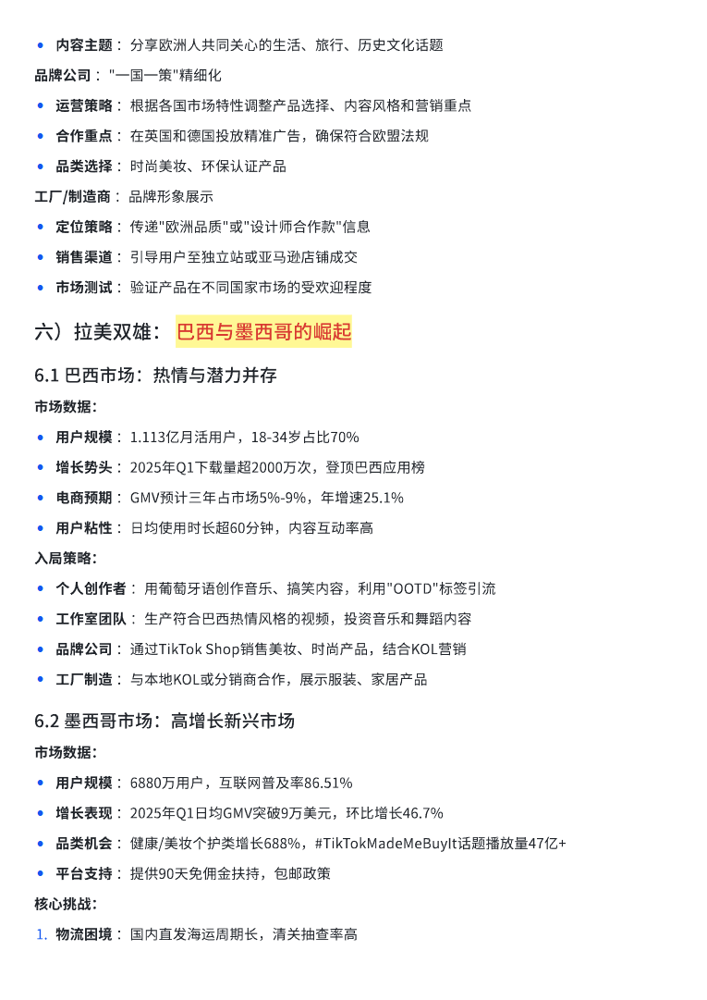
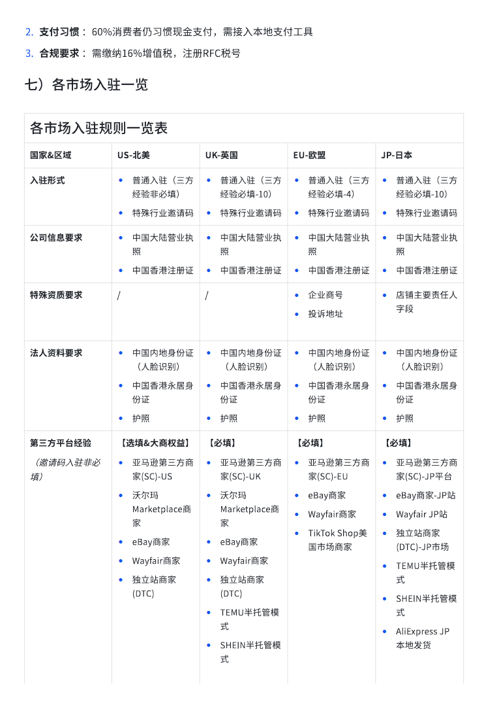
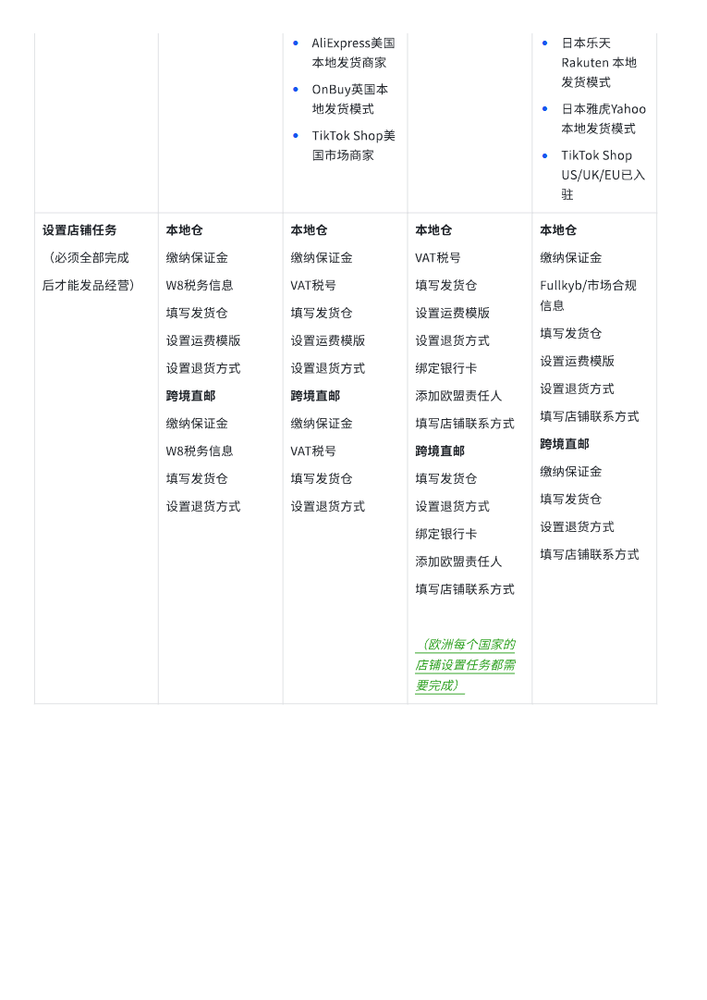

# 区域市场分析.pdf — 预览版

- 附件序号：24（manifest.attachments 原顺序）
- 来源：https://dcni26t4qg0z.feishu.cn/wiki/EVUtwnBTMiSx0Okr4QiciHrTnof
- 采集日期：2026-10-11（Asia/Shanghai）
- 采集证据：[24.dom.json](../raw/24.dom.json)
- 范围：浏览器预览文字与已采集的逐页图片；原文件下载状态另行记录，转换过程未产生原文件。
- 页图可保留预览中显示的文内图片；未恢复原始图片素材、可编辑Word文档、Excel公式或原始附件。
- 文字页覆盖：部分或未知；不能把侧栏页号当作已采集正文页。
- 预览记录总页数：10（0 表示查看器状态，不能推断原文件无页）
- 明确文字页号：1、3、4、5、6、7、8、9、10
- 页图覆盖：10/10 页；所有已观测预览页均有尺寸合格且PNG完整的页图。
- 有效页图页号：1、2、3、4、5、6、7、8、9、10
- 原文件：本次预览转换保存 0 个原文件；图片文字不计作已采集DOM文字。
- 预览文本层包含控制字符；以 ⟦U+XXXX⟧ 标记保留，不猜测其含义。
- 原始采集候选：[24.snapshot.txt](../raw/source-captures/24-315abc70f99f-24.snapshot.txt)
- 原始采集候选：[24-dom.json](../raw/source-captures/24-6a1f22bfe6db-24-dom.json)

## 预览正文

## 第 1 页

[打开第 1 页图片](../images/24/page-001.png)（765×1081）

7.⟦U+0001⟧区域市场分析⟦U+0001⟧一）全球市场概览与核心数据1.1⟦U+0001⟧各市场用戶规模对比⟦U+0001⟧

## 第 2 页

[打开第 2 页图片](../images/24/page-002.png)（765×1081）

> 此页未返回非图片DOM正文文字；不推测图片中的内容。

## 第 3 页

[打开第 3 页图片](../images/24/page-003.png)（765×1081）

二）东南亚市场：⟦U+0001⟧新手入局不建议选择，利润很低，赚钱很难,市场很卷，基本是重资源2.1⟦U+0001⟧市场特性分析⟦U+0001⟧根据2025年5-6月数据，东南亚市场展现出强劲的增⻓势头和但市场强度大内卷严重：⟦U+0001⟧核心数据支撑：•用戶规模⟦U+0001⟧：3.25亿月活用戶，印尼（1.09亿）、越南（4990万）、菲律宾（4340万）、泰国（4030万）位列全球前十⟦U+0001⟧•电商表现⟦U+0001⟧：TikTok⟦U+0001⟧Shop⟦U+0001⟧GMV从44亿美元增⻓至163亿美元，年复合增⻓率17%⟦U+0001⟧•市场渗透⟦U+0001⟧：TikTok⟦U+0001⟧Shop市场份额达13.2%，占平台全球总GMV的50%以上⟦U+0001⟧•用戶特征⟦U+0001⟧：6.7亿人口中35岁以下占比超60%，日均使用时⻓超75分钟⟦U+0001⟧2.2⟦U+0001⟧利弊深度解析⟦U+0001⟧优势分析：1.流量成本低廉⟦U+0001⟧：CPM显著低于欧美市场，新账号获得平台流量扶持力度大⟦U+0001⟧2.电商生态成熟⟦U+0001⟧：TikTok⟦U+0001⟧Shop"内容+货架"双场景模式完善，直播带货转化率高⟦U+0001⟧3.文化适配性强⟦U+0001⟧：中国供应链与东南亚消费偏好匹配度高，"日杂⻛"、"韩流"元素易获共鸣⟦U+0001⟧4.政策环境友好⟦U+0001⟧：平台通过合并本土平台（如Tokopedia）重新获得准入，补贴策略激进⟦U+0001⟧挑战分析：1.客单价偏低⟦U+0001⟧：平均客单价仅19.5美元，需依赖高复购和规模化盈利⟦U+0001⟧2.物流瓶颈⟦U+0001⟧：跨境小包配送时效⻓（7-15天），部分岛屿国家基础设施不足⟦U+0001⟧

## 第 4 页

[打开第 4 页图片](../images/24/page-004.png)（765×1081）

3.竞争加剧⟦U+0001⟧：佣金上涨（泰国子类目佣金4%-5.35%），监管趋严⟦U+0001⟧4.市场分散⟦U+0001⟧：各国语言、宗教、文化差异巨大，需高度本土化⟦U+0001⟧2.3⟦U+0001⟧不同群体入局策略⟦U+0001⟧个人创作者⟦U+0001⟧（投入⻔槛：1-5万元）⟦U+0001⟧•策略核心⟦U+0001⟧：利用TikTok橱窗（千粉⻔槛）推广temu或Shopee商品⟦U+0001⟧•内容方向⟦U+0001⟧：专注"低价好物"测评，如3C配件、家居小工具，结合本地网红合拍⟦U+0001⟧•变现路径⟦U+0001⟧：短视频挂链⟦U+0001⟧→⟦U+0001⟧橱窗带货⟦U+0001⟧→⟦U+0001⟧直播转化⟦U+0001⟧•⻛险控制⟦U+0001⟧：避免高客单价商品，优先选择平台补贴类目⟦U+0001⟧工作室团队⟦U+0001⟧（投入⻔槛：10-30万元）⟦U+0001⟧•策略核心⟦U+0001⟧：打造多国本土化达人矩阵，专业化内容制作⟦U+0001⟧•运营模式⟦U+0001⟧：签约或孵化当地素人创作者，形成多账号、多品类直播矩阵⟦U+0001⟧•盈利模式⟦U+0001⟧：达人佣金分成⟦U+0001⟧+⟦U+0001⟧品牌代运营⟦U+0001⟧+⟦U+0001⟧自营店群⟦U+0001⟧•成功要素⟦U+0001⟧：跨文化管理能力、标准化内容生产流程⟦U+0001⟧品牌公司⟦U+0001⟧（投入⻔槛：50-200万元）⟦U+0001⟧•策略核心⟦U+0001⟧：官方账号本土化运营⟦U+0001⟧+⟦U+0001⟧达人营销双轮驱动⟦U+0001⟧•布局重点⟦U+0001⟧：建立蓝V账号，大规模铺量合作本土KOL/KOC⟦U+0001⟧•品类选择⟦U+0001⟧：美妆个护、穆斯林时尚、家居用品等高需求品类⟦U+0001⟧•关键能力⟦U+0001⟧：雄厚营销预算、完善品牌体系、高效本地化团队⟦U+0001⟧工厂/供应链⟦U+0001⟧（投入⻔槛：30-100万元）⟦U+0001⟧•策略核心⟦U+0001⟧：DTC模式，工厂直播展示生产线和工艺流程⟦U+0001⟧•差异化优势⟦U+0001⟧：源头直供，"中国制造"性价比心智⟦U+0001⟧•物流方案⟦U+0001⟧：提前备货至印尼海外仓，实现3日达⟦U+0001⟧•成功关键⟦U+0001⟧：柔性供应链、过硬产品质量、直面消费者能力⟦U+0001⟧三）美区市场：⟦U+0001⟧市场前景好⟦U+0001⟧增速快⟦U+0001⟧有发展空间，重运营阶段⟦U+0001⟧3.1⟦U+0001⟧市场特性与竞争格局⟦U+0001⟧美区市场作为全球最具影响力的TikTok市场，呈现出"高收益、高⻛险、高⻔槛"的特征：⟦U+0001⟧核心数据支撑：•用戶规模⟦U+0001⟧：⟦U+0001⟧1.61亿月活用戶，全球最大单一市场⟦U+0001⟧•商业表现⟦U+0001⟧：电商GMV目标175亿美元，广告收入预计95.1亿美元⟦U+0001⟧

## 第 5 页

[打开第 5 页图片](../images/24/page-005.png)（765×1081）

•用戶价值⟦U+0001⟧：平均客单价近30美元，可购物广告转化率4.6%，ROAS达1.7倍⟦U+0001⟧•内容要求⟦U+0001⟧：视频需30%原创素材，品牌Logo占比≤5%⟦U+0001⟧3.2⟦U+0001⟧机遇与挑战并存⟦U+0001⟧市场机遇：1.消费能力顶级⟦U+0001⟧：用戶付费意愿强，品牌溢价空间大⟦U+0001⟧2.变现模式丰富⟦U+0001⟧：广告、电商、知识付费、创作激励多元化⟦U+0001⟧3.影响力辐射⟦U+0001⟧：成功案例易复制至其他英语区市场⟦U+0001⟧4.生态完善⟦U+0001⟧：MCN机构建立直播基地，本土达人供给改善⟦U+0001⟧核心挑战：1.政策⻛险⟦U+0001⟧：应用商店下架危机未解，Android用戶需通过APK安装⟦U+0001⟧2.竞争白热化⟦U+0001⟧：Top⟦U+0001⟧10%⟦U+0001⟧MCN垄断65%流量，新客获取受限⟦U+0001⟧3.内容⻔槛高⟦U+0001⟧：直播渗透率不足20%，需优化算法提升短时⻓直播曝光⟦U+0001⟧3.3⟦U+0001⟧精准入局策略⟦U+0001⟧个人创作者⟦U+0001⟧：极致垂直细分⟦U+0001⟧•定位方向⟦U+0001⟧：专⻔修复古董家具的木匠、只讲犯罪心理学的博士等⟦U+0001⟧•内容策略⟦U+0001⟧：打造极强个人IP和专业壁垒⟦U+0001⟧•变现路径⟦U+0001⟧：创作激励基金⟦U+0001⟧+⟦U+0001⟧联盟营销⟦U+0001⟧+⟦U+0001⟧知识付费⟦U+0001⟧工作室团队⟦U+0001⟧：专业服务输出⟦U+0001⟧•服务模式⟦U+0001⟧：为出海品牌提供本土化内容创意、视频拍摄、账号代运营⟦U+0001⟧•核心能力⟦U+0001⟧：好莱坞水准的内容制作、对美国流行文化的精准洞察⟦U+0001⟧品牌公司⟦U+0001⟧：价值观营销⟦U+0001⟧•策略重点⟦U+0001⟧：淡化营销感，与本土价值观（环保、多元化、社会责任）结合⟦U+0001⟧•合作模式⟦U+0001⟧：与头部、中腰部达人深度合作⟦U+0001⟧•投入预算⟦U+0001⟧：至少数十万美元年度营销预算⟦U+0001⟧工厂/制造商⟦U+0001⟧：B2B线索获取⟦U+0001⟧•内容方向⟦U+0001⟧：展示工厂先进设备、高效流程、精湛工艺的"工业⻛"视频⟦U+0001⟧•目标客戶⟦U+0001⟧：海外B端客戶（品牌、批发商）⟦U+0001⟧•转化路径⟦U+0001⟧：TikTok展示⟦U+0001⟧→⟦U+0001⟧询盘获取⟦U+0001⟧→⟦U+0001⟧线下成交⟦U+0001⟧四）日本市场：⟦U+0001⟧高品质⟦U+0001⟧消费的蓝海机遇⟦U+0001⟧

## 第 6 页

[打开第 6 页图片](../images/24/page-006.png)（765×1081）

4.1⟦U+0001⟧市场特性与发展潜力⟦U+0001⟧日本市场虽然用戶基数相对较小，但展现出极高的商业价值和发展潜力：核心数据支撑：•用戶规模⟦U+0001⟧：2600万月活用戶，18-34岁用戶占比60%⟦U+0001⟧•消费能力⟦U+0001⟧：用戶年均消费超2000美元，人均GDP超4万美元⟦U+0001⟧•平台投入⟦U+0001⟧：TikTok⟦U+0001⟧Shop⟦U+0001⟧6月正式上线，首批开放美妆、时尚、家居等五大品类⟦U+0001⟧•内容偏好⟦U+0001⟧：42%用戶因内容产生购买，直播互动率50%⟦U+0001⟧4.2⟦U+0001⟧市场优势与挑战⟦U+0001⟧独特优势：1.高净值用戶⟦U+0001⟧：Z世代女性用戶占比60%，对美妆、时尚、宠物用品需求旺盛⟦U+0001⟧2.低退货率⟦U+0001⟧：退货率低于5%，用戶对产品质量要求高但忠诚度强⟦U+0001⟧3.精致文化⟦U+0001⟧：用戶偏好精致内容，"日杂⻛"妆容、原宿潮流易获共鸣⟦U+0001⟧4.平台扶持⟦U+0001⟧：提供中文自动翻译和流量扶持，降低语言⻔槛⟦U+0001⟧关键挑战：1.合规⻔槛高⟦U+0001⟧：需通过日本消费税（JCT）认证，部分品类需本土质检报告⟦U+0001⟧2.内容内卷⟦U+0001⟧：头部达人垄断流量，新创作者需差异化定位⟦U+0001⟧3.物流要求严⟦U+0001⟧：消费者对配送速度敏感，需提前布局海外仓⟦U+0001⟧4.3⟦U+0001⟧分层入局建议⟦U+0001⟧个人创作者⟦U+0001⟧：日式美学内容⟦U+0001⟧•内容方向⟦U+0001⟧：结合"孤独经济"的宠物用品、极简美学生活方式⟦U+0001⟧•语言策略⟦U+0001⟧：日语提升本地化效果，参与本地挑战⟦U+0001⟧•变现模式⟦U+0001⟧：通过"透明感妆容"教程建立专业度⟦U+0001⟧工作室团队⟦U+0001⟧：本土化内容制作⟦U+0001⟧•团队构建⟦U+0001⟧：组建本土团队，拍摄节日限定内容（如樱花季）⟦U+0001⟧•合作模式⟦U+0001⟧：与中级达人（5万-50万粉）签订CPS分成协议⟦U+0001⟧•内容策略⟦U+0001⟧："短视频种草+直播转化"链路提升ROI⟦U+0001⟧品牌公司⟦U+0001⟧：高端品牌定位⟦U+0001⟧•市场定位⟦U+0001⟧：推广高端品牌（美妆、科技），利用平台关务支持⟦U+0001⟧•广告投放⟦U+0001⟧：通过TikTok⟦U+0001⟧Pulse广告投放，结合KOL测评提升品牌认知⟦U+0001⟧•目标客群⟦U+0001⟧：Z世代女性（如运动服饰品牌）⟦U+0001⟧

## 第 7 页

[打开第 7 页图片](../images/24/page-007.png)（765×1081）

工厂/制造商⟦U+0001⟧：工艺展示营销⟦U+0001⟧•内容策略⟦U+0001⟧：展示产品工艺（手工制品、科技配件）⟦U+0001⟧•定价策略⟦U+0001⟧：日式极简⻛产品可定高价，用戶为包装付费溢价25%⟦U+0001⟧•销售渠道⟦U+0001⟧：通过TikTok+乐天联动，跨平台复购率61%⟦U+0001⟧五）欧洲五国：⟦U+0001⟧多元化⟦U+0001⟧高价值市场⟦U+0001⟧5.1⟦U+0001⟧市场结构与特征⟦U+0001⟧欧洲五国（英、德、法、意、西）构成了一个多元化但高价值的统一市场：核心数据支撑：•用戶分布⟦U+0001⟧：英国约1800万、德国和法国各约2300-2500万、意大利约2000万、西班牙约1500万⟦U+0001⟧•消费能力⟦U+0001⟧：人均GDP超5万美元，德国、法国时尚品类客单价超900欧元⟦U+0001⟧•政策开放⟦U+0001⟧：2025年开放跨境POP模式，允许亚⻢逊、eBay卖家同主体入驻⟦U+0001⟧•内容蓝海⟦U+0001⟧：直播电商渗透率不足20%，娱乐直播打赏ARPU值全球领先⟦U+0001⟧5.2⟦U+0001⟧统一与差异化策略⟦U+0001⟧统一优势：1."一店卖五国"模式⟦U+0001⟧：降低运营成本，享受VAT代扣代缴和物流补贴⟦U+0001⟧2.高消费能力⟦U+0001⟧：用戶对高品质产品接受度强，溢价空间大⟦U+0001⟧3.政策支持⟦U+0001⟧：平台提供本地化合规支持，FBT官方仓优化物流⟦U+0001⟧差异化挑战：1.语言壁垒⟦U+0001⟧：德语、法语主播供给不足，本地化内容制作成本高⟦U+0001⟧2.合规复杂⟦U+0001⟧：需注册目标国VAT税号，部分品类需CE认证和EPR环保标签⟦U+0001⟧3.文化差异⟦U+0001⟧：德国偏重环保，法国追求时尚，意大利偏娱乐⟦U+0001⟧5.3⟦U+0001⟧区域化运营策略⟦U+0001⟧个人创作者⟦U+0001⟧：单国深耕⟦U+0001⟧•市场选择⟦U+0001⟧：优选意大利、西班牙等竞争较低市场⟦U+0001⟧•内容策略⟦U+0001⟧：创作本地语言内容，参与幽默或教育类挑战⟦U+0001⟧•英语优势⟦U+0001⟧：英语内容可直接覆盖英国市场⟦U+0001⟧工作室团队⟦U+0001⟧：多语言矩阵⟦U+0001⟧•策略核心⟦U+0001⟧：开发多语言内容策略，建立泛欧洲文化内容矩阵⟦U+0001⟧•团队建设⟦U+0001⟧：投资本地化团队，针对英德意制作不同⻛格视频⟦U+0001⟧

## 第 8 页

[打开第 8 页图片](../images/24/page-008.png)（765×1081）

•内容主题⟦U+0001⟧：分享欧洲人共同关心的生活、旅行、历史文化话题⟦U+0001⟧品牌公司⟦U+0001⟧："一国一策"精细化⟦U+0001⟧•运营策略⟦U+0001⟧：根据各国市场特性调整产品选择、内容⻛格和营销重点⟦U+0001⟧•合作重点⟦U+0001⟧：在英国和德国投放精准广告，确保符合欧盟法规⟦U+0001⟧•品类选择⟦U+0001⟧：时尚美妆、环保认证产品⟦U+0001⟧工厂/制造商⟦U+0001⟧：品牌形象展示⟦U+0001⟧•定位策略⟦U+0001⟧：传递"欧洲品质"或"设计师合作款"信息⟦U+0001⟧•销售渠道⟦U+0001⟧：引导用戶至独立站或亚⻢逊店铺成交⟦U+0001⟧•市场测试⟦U+0001⟧：验证产品在不同国家市场的受欢迎程度⟦U+0001⟧六）拉美双雄：⟦U+0001⟧巴西与墨西哥的崛起⟦U+0001⟧6.1⟦U+0001⟧巴西市场：热情与潜力并存⟦U+0001⟧市场数据：•用戶规模⟦U+0001⟧：1.113亿月活用戶，18-34岁占比70%⟦U+0001⟧•增⻓势头⟦U+0001⟧：2025年Q1下载量超2000万次，登顶巴西应用榜⟦U+0001⟧•电商预期⟦U+0001⟧：GMV预计三年占市场5%-9%，年增速25.1%⟦U+0001⟧•用戶粘性⟦U+0001⟧：日均使用时⻓超60分钟，内容互动率高⟦U+0001⟧入局策略：•个人创作者⟦U+0001⟧：用葡萄牙语创作音乐、搞笑内容，利用"OOTD"标签引流⟦U+0001⟧•工作室团队⟦U+0001⟧：生产符合巴西热情⻛格的视频，投资音乐和舞蹈内容⟦U+0001⟧•品牌公司⟦U+0001⟧：通过TikTok⟦U+0001⟧Shop销售美妆、时尚产品，结合KOL营销⟦U+0001⟧•工厂制造⟦U+0001⟧：与本地KOL或分销商合作，展示服装、家居产品⟦U+0001⟧6.2⟦U+0001⟧墨西哥市场：高增⻓新兴市场⟦U+0001⟧市场数据：•用戶规模⟦U+0001⟧：6880万用戶，互联网普及率86.51%⟦U+0001⟧•增⻓表现⟦U+0001⟧：2025年Q1日均GMV突破9万美元，环比增⻓46.7%⟦U+0001⟧•品类机会⟦U+0001⟧：健康/美妆个护类增⻓688%，#TikTokMadeMeBuyIt话题播放量47亿+⟦U+0001⟧•平台支持⟦U+0001⟧：提供90天免佣金扶持，包邮政策⟦U+0001⟧核心挑战：1.物流困境⟦U+0001⟧：国内直发海运周期⻓，清关抽查率高⟦U+0001⟧

## 第 9 页

[打开第 9 页图片](../images/24/page-009.png)（765×1081）

2.支付习惯⟦U+0001⟧：60%消费者仍习惯现金支付，需接入本地支付工具⟦U+0001⟧3.合规要求⟦U+0001⟧：需缴纳16%增值税，注册RFC税号⟦U+0001⟧七）各市场入驻一览各市场入驻规则一览表国家&区域⟦U+0001⟧US-北美⟦U+0001⟧UK-英国⟦U+0001⟧EU-欧盟⟦U+0001⟧JP-日本⟦U+0001⟧入驻形式⟦U+0001⟧•普通入驻（三方经验非必填）⟦U+0001⟧•特殊行业邀请码⟦U+0001⟧•普通入驻（三方经验必填-10）⟦U+0001⟧•特殊行业邀请码⟦U+0001⟧•普通入驻（三方经验必填-4）⟦U+0001⟧•特殊行业邀请码⟦U+0001⟧•普通入驻（三方经验必填-10）⟦U+0001⟧•特殊行业邀请码⟦U+0001⟧公司信息要求⟦U+0001⟧•中国大陆营业执照⟦U+0001⟧•中国香港注册证⟦U+0001⟧•中国大陆营业执照⟦U+0001⟧•中国香港注册证⟦U+0001⟧•中国大陆营业执照⟦U+0001⟧•中国香港注册证⟦U+0001⟧•中国大陆营业执照⟦U+0001⟧•中国香港注册证⟦U+0001⟧特殊资质要求⟦U+0001⟧/⟦U+0001⟧/⟦U+0001⟧•企业商号⟦U+0001⟧•投诉地址⟦U+0001⟧•店铺主要责任人字段⟦U+0001⟧法人资料要求⟦U+0001⟧•中国内地身份证（人脸识别）⟦U+0001⟧•中国香港永居身份证⟦U+0001⟧•护照⟦U+0001⟧•中国内地身份证（人脸识别）⟦U+0001⟧•中国香港永居身份证⟦U+0001⟧•护照⟦U+0001⟧•中国内地身份证（人脸识别）⟦U+0001⟧•中国香港永居身份证⟦U+0001⟧•护照⟦U+0001⟧•中国内地身份证（人脸识别）⟦U+0001⟧•中国香港永居身份证⟦U+0001⟧•护照⟦U+0001⟧第三方平台经验⟦U+0001⟧（邀请码入驻非必填）⟦U+0001⟧【选填&大商权益】⟦U+0001⟧•亚⻢逊第三方商家(SC)-US⟦U+0001⟧•沃尔玛Marketplace商家⟦U+0001⟧•eBay商家⟦U+0001⟧•Wayfair商家⟦U+0001⟧•独立站商家(DTC)⟦U+0001⟧【必填】⟦U+0001⟧•亚⻢逊第三方商家(SC)-UK⟦U+0001⟧•沃尔玛Marketplace商家⟦U+0001⟧•eBay商家⟦U+0001⟧•Wayfair商家⟦U+0001⟧•独立站商家(DTC)⟦U+0001⟧•TEMU半托管模式⟦U+0001⟧•SHEIN半托管模式⟦U+0001⟧【必填】⟦U+0001⟧•亚⻢逊第三方商家(SC)-EU⟦U+0001⟧•eBay商家⟦U+0001⟧•Wayfair商家⟦U+0001⟧•TikTok⟦U+0001⟧Shop美国市场商家⟦U+0001⟧【必填】⟦U+0001⟧•亚⻢逊第三方商家(SC)-JP平台⟦U+0001⟧•eBay商家-JP站⟦U+0001⟧•Wayfair⟦U+0001⟧JP站⟦U+0001⟧•独立站商家(DTC)-JP市场⟦U+0001⟧•TEMU半托管模式⟦U+0001⟧•SHEIN半托管模式⟦U+0001⟧•AliExpress⟦U+0001⟧JP本地发货⟦U+0001⟧

## 第 10 页

[打开第 10 页图片](../images/24/page-010.png)（765×1081）

•AliExpress美国本地发货商家⟦U+0001⟧•OnBuy英国本地发货模式⟦U+0001⟧•TikTok⟦U+0001⟧Shop美国市场商家⟦U+0001⟧•日本乐天Rakuten⟦U+0001⟧本地发货模式⟦U+0001⟧•日本雅⻁Yahoo⟦U+0001⟧本地发货模式⟦U+0001⟧•TikTok⟦U+0001⟧Shop⟦U+0001⟧US/UK/EU已入驻⟦U+0001⟧设置店铺任务⟦U+0001⟧（必须全部完成⟦U+0001⟧后才能发品经营）⟦U+0001⟧本地仓⟦U+0001⟧缴纳保证金⟦U+0001⟧W8税务信息⟦U+0001⟧填写发货仓⟦U+0001⟧设置运费模版⟦U+0001⟧设置退货方式⟦U+0001⟧跨境直邮⟦U+0001⟧缴纳保证金⟦U+0001⟧W8税务信息⟦U+0001⟧填写发货仓⟦U+0001⟧设置退货方式⟦U+0001⟧本地仓⟦U+0001⟧缴纳保证金⟦U+0001⟧VAT税号⟦U+0001⟧填写发货仓⟦U+0001⟧设置运费模版⟦U+0001⟧设置退货方式⟦U+0001⟧跨境直邮⟦U+0001⟧缴纳保证金⟦U+0001⟧VAT税号⟦U+0001⟧填写发货仓⟦U+0001⟧设置退货方式⟦U+0001⟧本地仓⟦U+0001⟧VAT税号⟦U+0001⟧填写发货仓⟦U+0001⟧设置运费模版⟦U+0001⟧设置退货方式⟦U+0001⟧绑定银行卡⟦U+0001⟧添加欧盟责任人⟦U+0001⟧填写店铺联系方式⟦U+0001⟧跨境直邮⟦U+0001⟧填写发货仓⟦U+0001⟧设置退货方式⟦U+0001⟧绑定银行卡⟦U+0001⟧添加欧盟责任人⟦U+0001⟧填写店铺联系方式⟦U+0001⟧（欧洲每个国家的店铺设置任务都需要完成）⟦U+0001⟧本地仓⟦U+0001⟧缴纳保证金⟦U+0001⟧Fullkyb/市场合规信息⟦U+0001⟧填写发货仓⟦U+0001⟧设置运费模版⟦U+0001⟧设置退货方式⟦U+0001⟧填写店铺联系方式⟦U+0001⟧跨境直邮⟦U+0001⟧缴纳保证金⟦U+0001⟧填写发货仓⟦U+0001⟧设置退货方式⟦U+0001⟧填写店铺联系方式⟦U+0001⟧
