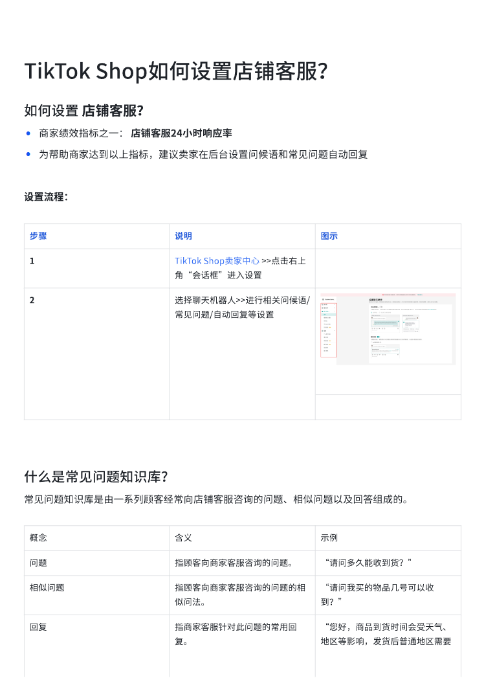
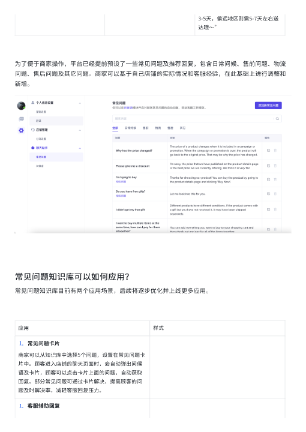
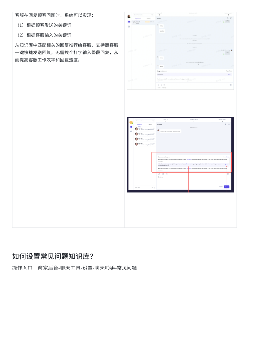
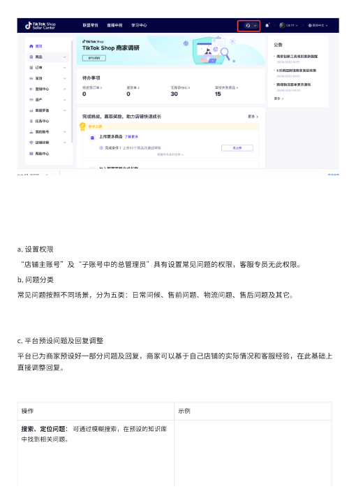
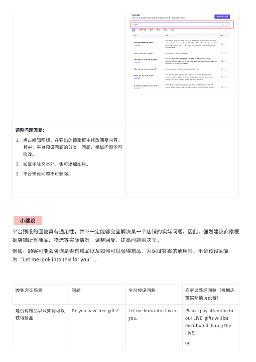
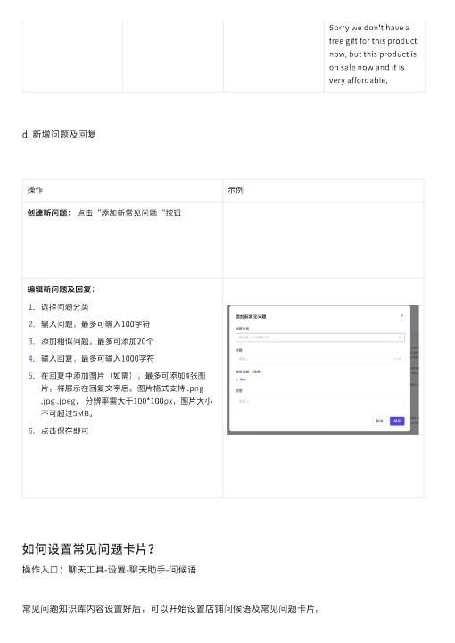
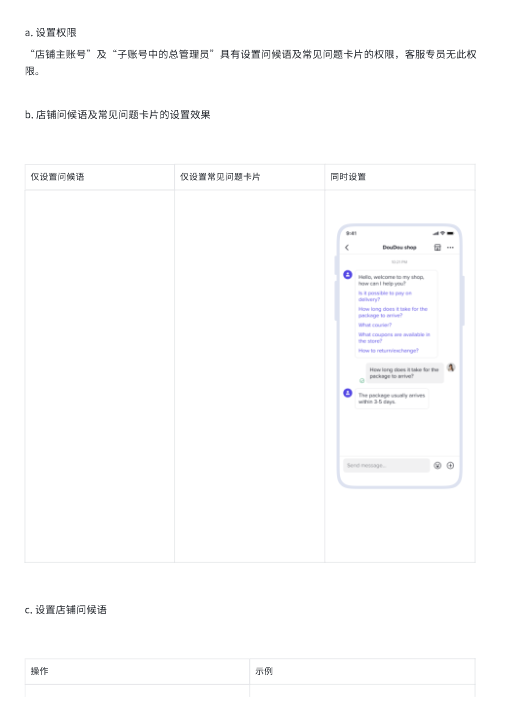
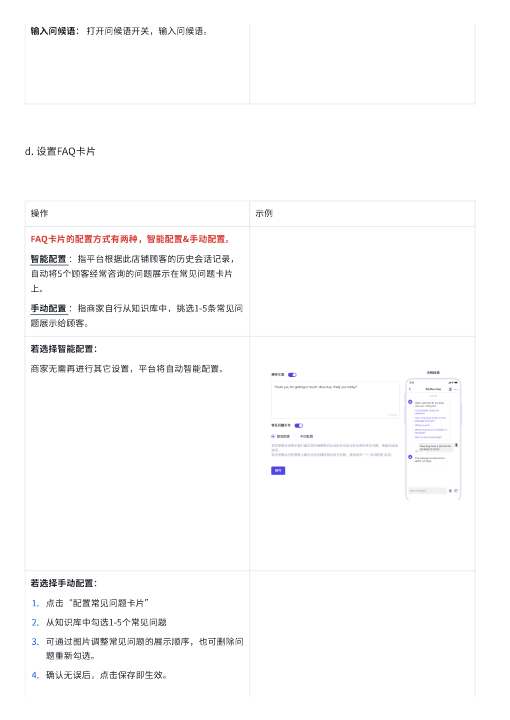
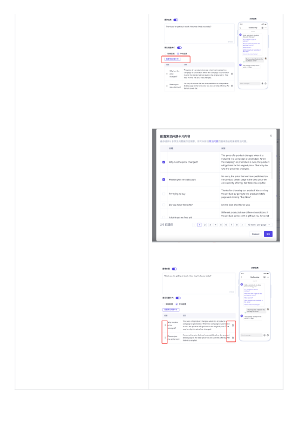
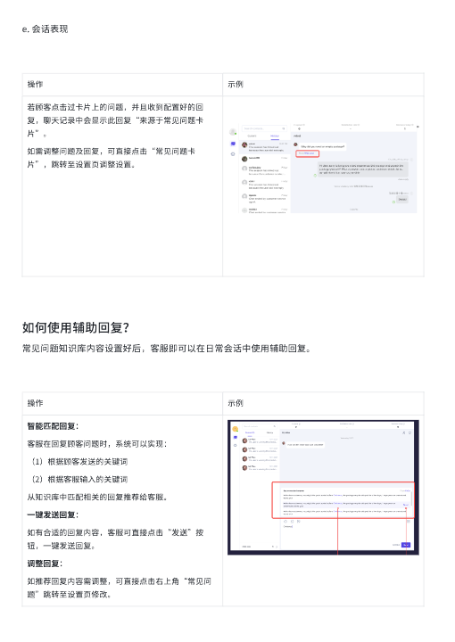

# TikTok Shop如何设置店铺客服？.pdf — 预览版

- 附件序号：26（manifest.attachments 原顺序）
- 来源：https://dcni26t4qg0z.feishu.cn/wiki/EVUtwnBTMiSx0Okr4QiciHrTnof
- 采集日期：2026-10-11（Asia/Shanghai）
- 采集证据：[26.dom.json](../raw/26.dom.json)
- 范围：浏览器预览文字与已采集的逐页图片；原文件下载状态另行记录，转换过程未产生原文件。
- 页图可保留预览中显示的文内图片；未恢复原始图片素材、可编辑Word文档、Excel公式或原始附件。
- 文字页覆盖：部分或未知；不能把侧栏页号当作已采集正文页。
- 预览记录总页数：11（0 表示查看器状态，不能推断原文件无页）
- 明确文字页号：1、2、3、4、5、6、7、8、10、11
- 页图覆盖：11/11 页；所有已观测预览页均有尺寸合格且PNG完整的页图。
- 有效页图页号：1、2、3、4、5、6、7、8、9、10、11
- 原文件：本次预览转换保存 0 个原文件；图片文字不计作已采集DOM文字。
- 预览文本层包含控制字符；以 ⟦U+XXXX⟧ 标记保留，不猜测其含义。
- 原始采集候选：[26.snapshot.txt](../raw/source-captures/26-464f604e3678-26.snapshot.txt)
- 原始采集候选：[26-dom.json](../raw/source-captures/26-3fac61c5f9aa-26-dom.json)

## 预览正文

## 第 1 页

[打开第 1 页图片](../images/26/page-001.png)（765×1081）

TikTok⟦U+0001⟧Shop如何设置店铺客服？⟦U+0001⟧如何设置⟦U+0001⟧店铺客服？⟦U+0001⟧•商家绩效指标之一：⟦U+0001⟧店铺客服24小时响应率⟦U+0001⟧•为帮助商家达到以上指标，建议卖家在后台设置问候语和常⻅问题自动回复设置流程：步骤⟦U+0001⟧说明⟦U+0001⟧图示⟦U+0001⟧1⟦U+0001⟧TikTok⟦U+0001⟧Shop卖家中心⟦U+0001⟧>>点击右上⻆“会话框”进入设置⟦U+0001⟧2⟦U+0001⟧选择聊天机器人>>进行相关问候语/常⻅问题/自动回复等设置⟦U+0001⟧什么是常⻅问题知识库？常⻅问题知识库是由一系列顾客经常向店铺客服咨询的问题、相似问题以及回答组成的。概念⟦U+0001⟧含义⟦U+0001⟧示例⟦U+0001⟧问题⟦U+0001⟧指顾客向商家客服咨询的问题。⟦U+0001⟧“请问多久能收到货？”⟦U+0001⟧相似问题⟦U+0001⟧指顾客向商家客服咨询的问题的相似问法。⟦U+0001⟧“请问我买的物品几号可以收到？”⟦U+0001⟧回复⟦U+0001⟧指商家客服针对此问题的常用回复。⟦U+0001⟧“您好，商品到货时间会受天气、地区等影响，发货后普通地区需要

## 第 2 页

[打开第 2 页图片](../images/26/page-002.png)（510×720）

3-5天，偏远地区则需5-7天左右送达哦〜”⟦U+0001⟧为了便于商家操作，平台已经提前预设了一些常⻅问题及推荐回复，包含日常问候、售前问题、物流问题、售后问题及其它问题。商家可以基于自己店铺的实际情况和客服经验，在此基础上进行调整和新增。常⻅问题知识库可以如何应用？常⻅问题知识库目前有两个应用场景，后续将逐步优化并上线更多应用。应用⟦U+0001⟧样式⟦U+0001⟧1.常⻅问题卡片⟦U+0001⟧商家可以从知识库中选择5个问题，设置在常⻅问题卡片中。顾客进入店铺的聊天⻚面时，会自动弹出问候语及卡片，顾客可以点击卡片上面的问题，自动获取回复。部分常⻅问题可通过卡片解决，提高顾客的问题及时解决率，减轻客服回复压力。⟦U+0001⟧1.客服辅助回复⟦U+0001⟧

## 第 3 页

[打开第 3 页图片](../images/26/page-003.png)（510×720）

客服在回复顾客问题时，系统可以实现：⟦U+0001⟧（1）根据顾客发送的关键词⟦U+0001⟧（2）根据客服输入的关键词⟦U+0001⟧从知识库中匹配相关的回复推荐给客服，支持商客服一键快捷发送回复，无需挨个打字输入整段回复，从而提高客服工作效率和回复速度。⟦U+0001⟧如何设置常⻅问题知识库？操作入口：商家后台-聊天工具-设置-聊天助手-常⻅问题⟦U+0001⟧

## 第 4 页

[打开第 4 页图片](../images/26/page-004.png)（510×720）

a.⟦U+0001⟧设置权限⟦U+0001⟧“店铺主账号”及“子账号中的总管理员”具有设置常⻅问题的权限，客服专员无此权限。b.⟦U+0001⟧问题分类⟦U+0001⟧常⻅问题按照不同场景，分为五类：日常问候、售前问题、物流问题、售后问题及其它。c.⟦U+0001⟧平台预设问题及回复调整⟦U+0001⟧平台已为商家预设好一部分问题及回复，商家可以基于自己店铺的实际情况和客服经验，在此基础上直接调整回复。操作⟦U+0001⟧示例⟦U+0001⟧搜索、定位问题：⟦U+0001⟧可通过模糊搜索，在预设的知识库中找到相关问题。⟦U+0001⟧

## 第 5 页

[打开第 5 页图片](../images/26/page-005.png)（510×720）

调整问题回复：⟦U+0001⟧1.点击编辑图标，在弹出的编辑框中修改回复内容。其中，平台预设问题的分类、问题、相似问题不可修改。⟦U+0001⟧2.回复中除文本外，也可添加图片。⟦U+0001⟧3.平台预设问题不可删除。⟦U+0001⟧⟦U+0001⟧💡小建议💡⟦U+0001⟧平台预设的回复具有通用性，并不一定能够完全解决某一个店铺的实际问题。因此，强烈建议商家根据店铺所售商品、物流等实际情况，调整回复，提高问题解决率。例如：顾客可能会咨询是否有赠品以及如何可以获得赠品，为保证答案的通用性，平台预设回复为“Let⟦U+0001⟧me⟦U+0001⟧look⟦U+0001⟧into⟦U+0001⟧this⟦U+0001⟧for⟦U+0001⟧you”。⟦U+0001⟧顾客咨询场景⟦U+0001⟧问题⟦U+0001⟧平台预设回复⟦U+0001⟧商家调整后回复（根据店铺实际情况设置）⟦U+0001⟧是否有赠品以及如何可以获得赠品⟦U+0001⟧Do⟦U+0001⟧you⟦U+0001⟧have⟦U+0001⟧free⟦U+0001⟧gifts?⟦U+0001⟧Let⟦U+0001⟧me⟦U+0001⟧look⟦U+0001⟧into⟦U+0001⟧this⟦U+0001⟧for⟦U+0001⟧you.⟦U+0001⟧Please⟦U+0001⟧pay⟦U+0001⟧attention⟦U+0001⟧to⟦U+0001⟧our⟦U+0001⟧LIVE,⟦U+0001⟧gifts⟦U+0001⟧will⟦U+0001⟧be⟦U+0001⟧distributed⟦U+0001⟧during⟦U+0001⟧the⟦U+0001⟧LIVE.⟦U+0001⟧or⟦U+0001⟧

## 第 6 页

[打开第 6 页图片](../images/26/page-006.png)（510×720）

Sorry⟦U+0001⟧we⟦U+0001⟧don't⟦U+0001⟧have⟦U+0001⟧a⟦U+0001⟧free⟦U+0001⟧gift⟦U+0001⟧for⟦U+0001⟧this⟦U+0001⟧product⟦U+0001⟧now,⟦U+0001⟧but⟦U+0001⟧this⟦U+0001⟧product⟦U+0001⟧is⟦U+0001⟧on⟦U+0001⟧sale⟦U+0001⟧now⟦U+0001⟧and⟦U+0001⟧it⟦U+0001⟧is⟦U+0001⟧very⟦U+0001⟧affordable.⟦U+0001⟧d.⟦U+0001⟧新增问题及回复⟦U+0001⟧操作⟦U+0001⟧示例⟦U+0001⟧创建新问题：⟦U+0001⟧点击“添加新常⻅问题“按钮⟦U+0001⟧编辑新问题及回复：⟦U+0001⟧1.选择问题分类⟦U+0001⟧2.输入问题，最多可输入100字符⟦U+0001⟧3.添加相似问题，最多可添加20个⟦U+0001⟧4.输入回复，最多可输入1000字符⟦U+0001⟧5.在回复中添加图片（如需），最多可添加4张图片，将展示在回复文字后。图片格式支持⟦U+0001⟧.png⟦U+0001⟧.jpg⟦U+0001⟧.jpeg，⟦U+0001⟧分辨率需大于100*100px，图片大小不可超过5MB。⟦U+0001⟧6.点击保存即可⟦U+0001⟧如何设置常⻅问题卡片？操作入口：聊天工具-设置-聊天助手-问候语⟦U+0001⟧常⻅问题知识库内容设置好后，可以开始设置店铺问候语及常⻅问题卡片。

## 第 7 页

[打开第 7 页图片](../images/26/page-007.png)（510×720）

a.⟦U+0001⟧设置权限⟦U+0001⟧“店铺主账号”及“子账号中的总管理员”具有设置问候语及常⻅问题卡片的权限，客服专员无此权限。b.⟦U+0001⟧店铺问候语及常⻅问题卡片的设置效果⟦U+0001⟧仅设置问候语⟦U+0001⟧仅设置常⻅问题卡片⟦U+0001⟧同时设置⟦U+0001⟧c.⟦U+0001⟧设置店铺问候语⟦U+0001⟧操作⟦U+0001⟧示例⟦U+0001⟧

## 第 8 页

[打开第 8 页图片](../images/26/page-008.png)（510×720）

输入问候语：⟦U+0001⟧打开问候语开关，输入问候语。⟦U+0001⟧d.⟦U+0001⟧设置FAQ卡片⟦U+0001⟧操作⟦U+0001⟧示例⟦U+0001⟧FAQ卡片的配置方式有两种，智能配置&手动配置。⟦U+0001⟧智能配置⟦U+0001⟧：指平台根据此店铺顾客的历史会话记录，自动将5个顾客经常咨询的问题展示在常⻅问题卡片上。⟦U+0001⟧手动配置⟦U+0001⟧：指商家自行从知识库中，挑选1-5条常⻅问题展示给顾客。⟦U+0001⟧若选择智能配置：⟦U+0001⟧商家无需再进行其它设置，平台将自动智能配置。⟦U+0001⟧若选择手动配置：⟦U+0001⟧1.点击“配置常⻅问题卡片”⟦U+0001⟧2.从知识库中勾选1-5个常⻅问题⟦U+0001⟧3.可通过图片调整常⻅问题的展示顺序，也可删除问题重新勾选。⟦U+0001⟧4.确认无误后，点击保存即生效。⟦U+0001⟧

## 第 9 页

[打开第 9 页图片](../images/26/page-009.png)（510×720）

> 此页未返回非图片DOM正文文字；不推测图片中的内容。

## 第 10 页

[打开第 10 页图片](../images/26/page-010.png)（510×720）

e.⟦U+0001⟧会话表现⟦U+0001⟧操作⟦U+0001⟧示例⟦U+0001⟧若顾客点击过卡片上的问题，并且收到配置好的回复，聊天记录中会显示此回复“来源于常⻅问题卡片”。⟦U+0001⟧如需调整问题及回复，可直接点击“常⻅问题卡片”，跳转至设置⻚调整设置。⟦U+0001⟧如何使用辅助回复？常⻅问题知识库内容设置好后，客服即可以在日常会话中使用辅助回复。操作⟦U+0001⟧示例⟦U+0001⟧智能匹配回复：⟦U+0001⟧客服在回复顾客问题时，系统可以实现：⟦U+0001⟧（1）根据顾客发送的关键词⟦U+0001⟧（2）根据客服输入的关键词⟦U+0001⟧从知识库中匹配相关的回复推荐给客服。⟦U+0001⟧一键发送回复：⟦U+0001⟧如有合适的回复内容，客服可直接点击“发送”按钮，一键发送回复。⟦U+0001⟧调整回复：⟦U+0001⟧如推荐回复内容需调整，可直接点击右上⻆“常⻅问题”跳转至设置⻚修改。⟦U+0001⟧

## 第 11 页

[打开第 11 页图片](../images/26/page-011.png)（510×720）

注意事项•目前，顾客点击了常⻅问题卡片获得了自动回复的会话，在客服⻚面仍旧会作为未回复会话显示，希望客服关注自动回复是否准确解答了顾客的问题，做出人工补充回复，并不断调整优化自动回复话术。
