# TikTok Shop流量入口分类.pdf — 预览版

- 附件序号：27（manifest.attachments 原顺序）
- 来源：https://dcni26t4qg0z.feishu.cn/wiki/EVUtwnBTMiSx0Okr4QiciHrTnof
- 采集日期：2026-10-11（Asia/Shanghai）
- 采集证据：[27.dom.json](../raw/27.dom.json)
- 范围：浏览器预览文字与已采集的逐页图片；原文件下载状态另行记录，转换过程未产生原文件。
- 页图可保留预览中显示的文内图片；未恢复原始图片素材、可编辑Word文档、Excel公式或原始附件。
- 文字页覆盖：部分或未知；不能把侧栏页号当作已采集正文页。
- 预览记录总页数：48（0 表示查看器状态，不能推断原文件无页）
- 明确文字页号：1、2、3、4、5、6、7、8、9、10、11、12、13、14、15、16、17、18、19、20、21、22、23、24、25、26、27、28、29、30、31、32、33、34、35、36、38、39、40、41、42、43、44、45、46、47、48
- 页图覆盖：48/48 页；所有已观测预览页均有尺寸合格且PNG完整的页图。
- 有效页图页号：1、2、3、4、5、6、7、8、9、10、11、12、13、14、15、16、17、18、19、20、21、22、23、24、25、26、27、28、29、30、31、32、33、34、35、36、37、38、39、40、41、42、43、44、45、46、47、48
- 原文件：本次预览转换保存 0 个原文件；图片文字不计作已采集DOM文字。
- 预览文本层包含控制字符；以 ⟦U+XXXX⟧ 标记保留，不猜测其含义。
- 原始采集候选：[27.snapshot.txt](../raw/source-captures/27-25af875499b7-27.snapshot.txt)
- 原始采集候选：[27-dom.json](../raw/source-captures/27-eb1af1529119-27-dom.json)

## 预览正文

## 第 1 页

[打开第 1 页图片](../images/27/page-001.png)（765×1081）

[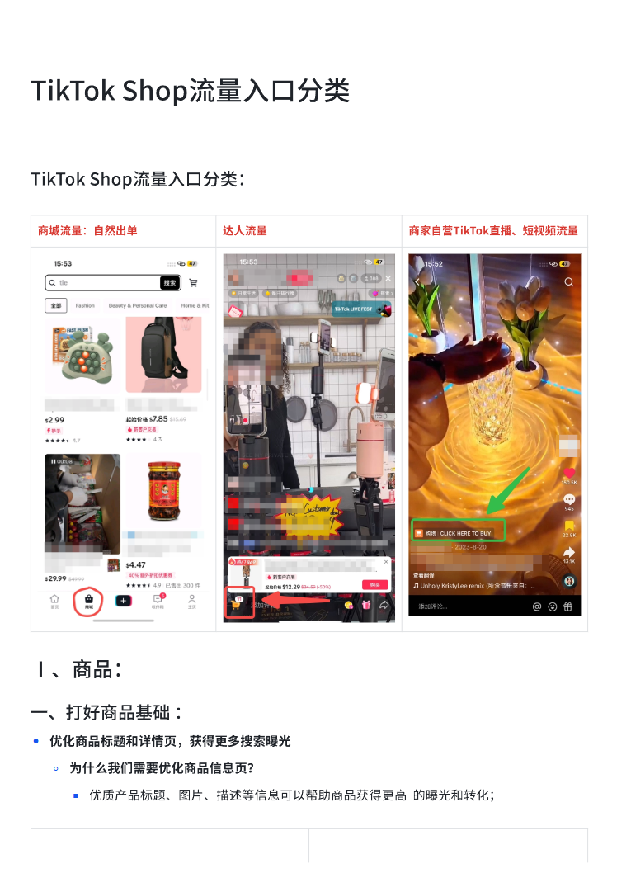](../images/27/page-001.png)

TikTok⟦U+0001⟧Shop流量入口分类⟦U+0001⟧TikTok⟦U+0001⟧Shop流量入口分类：⟦U+0001⟧商城流量：自然出单⟦U+0001⟧达人流量⟦U+0001⟧商家自营TikTok直播、短视频流量⟦U+0001⟧I、商品：一、打好商品基础⟦U+0001⟧：⟦U+0001⟧•优化商品标题和详情⻚，获得更多搜索曝光◦为什么我们需要优化商品信息⻚？▪优质产品标题、图片、描述等信息可以帮助商品获得更高⟦U+0001⟧⟦U+0001⟧的曝光和转化；⟦U+0001⟧

## 第 2 页

[打开第 2 页图片](../images/27/page-002.png)（765×1081）

[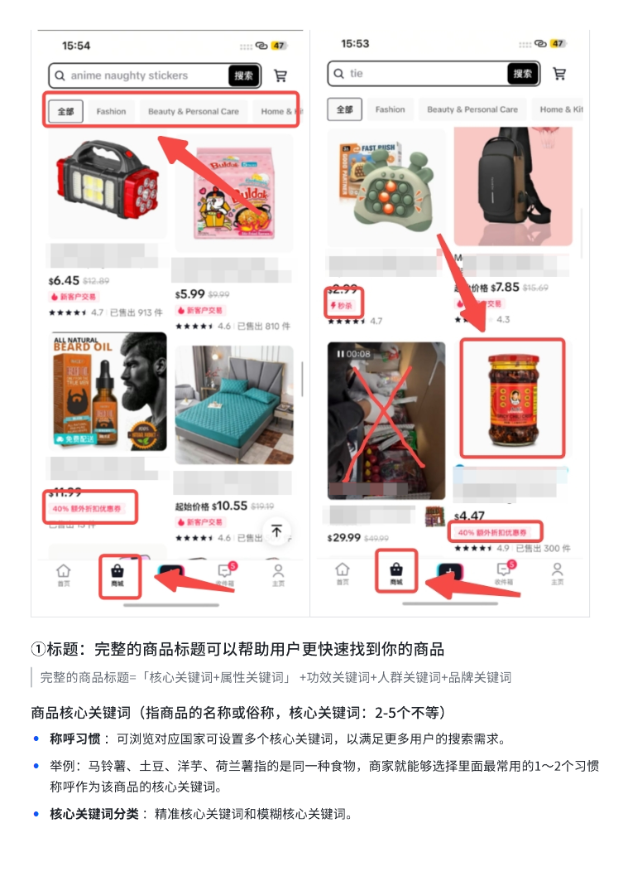](../images/27/page-002.png)

①标题：完整的商品标题可以帮助用戶更快速找到你的商品⟦U+0001⟧完整的商品标题=「核心关键词+属性关键词」⟦U+0001⟧+功效关键词+人群关键词+品牌关键词⟦U+0001⟧商品核心关键词（指商品的名称或俗称，核心关键词：2-5个不等）⟦U+0001⟧•称呼习惯⟦U+0001⟧：可浏览对应国家可设置多个核心关键词，以满足更多用戶的搜索需求。⟦U+0001⟧•举例：⻢铃薯、土豆、洋芋、荷兰薯指的是同一种⻝物，商家就能够选择里面最常用的1〜2个习惯称呼作为该商品的核心关键词。•核心关键词分类⟦U+0001⟧：精准核心关键词和模糊核心关键词。⟦U+0001⟧

## 第 3 页

[打开第 3 页图片](../images/27/page-003.png)（765×1081）

[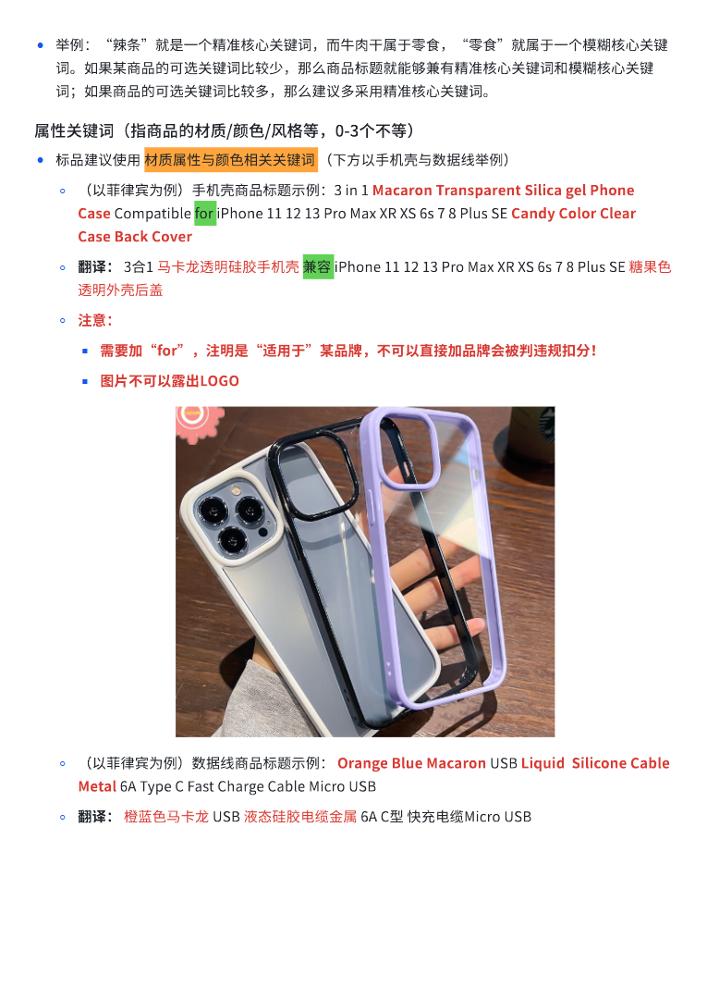](../images/27/page-003.png)

•举例：“辣条”就是一个精准核心关键词，而牛肉干属于零⻝，“零⻝”就属于一个模糊核心关键词。如果某商品的可选关键词比较少，那么商品标题就能够兼有精准核心关键词和模糊核心关键词；如果商品的可选关键词比较多，那么建议多采用精准核心关键词。属性关键词（指商品的材质/颜色/⻛格等，0-3个不等）⟦U+0001⟧•标品建议使用⟦U+0001⟧材质属性与颜色相关关键词⟦U+0001⟧（下方以手机壳与数据线举例）⟦U+0001⟧◦（以菲律宾为例）手机壳商品标题示例：3⟦U+0001⟧in⟦U+0001⟧1⟦U+0001⟧Macaron⟦U+0001⟧Transparent⟦U+0001⟧Silica⟦U+0001⟧gel⟦U+0001⟧Phone⟦U+0001⟧Case⟦U+0001⟧Compatible⟦U+0001⟧for⟦U+0001⟧iPhone⟦U+0001⟧11⟦U+0001⟧12⟦U+0001⟧13⟦U+0001⟧Pro⟦U+0001⟧Max⟦U+0001⟧XR⟦U+0001⟧XS⟦U+0001⟧6s⟦U+0001⟧7⟦U+0001⟧8⟦U+0001⟧Plus⟦U+0001⟧SE⟦U+0001⟧Candy⟦U+0001⟧Color⟦U+0001⟧Clear⟦U+0001⟧Case⟦U+0001⟧Back⟦U+0001⟧Cover⟦U+0001⟧◦翻译：⟦U+0001⟧3合1⟦U+0001⟧⻢卡⻰透明硅胶手机壳⟦U+0001⟧兼容⟦U+0001⟧iPhone⟦U+0001⟧11⟦U+0001⟧12⟦U+0001⟧13⟦U+0001⟧Pro⟦U+0001⟧Max⟦U+0001⟧XR⟦U+0001⟧XS⟦U+0001⟧6s⟦U+0001⟧7⟦U+0001⟧8⟦U+0001⟧Plus⟦U+0001⟧SE⟦U+0001⟧糖果色透明外壳后盖◦注意：▪需要加“for”，注明是“适用于”某品牌，不可以直接加品牌会被判违规扣分！⟦U+0001⟧▪图片不可以露出LOGO⟦U+0001⟧◦（以菲律宾为例）数据线商品标题示例：⟦U+0001⟧Orange⟦U+0001⟧Blue⟦U+0001⟧Macaron⟦U+0001⟧USB⟦U+0001⟧Liquid⟦U+0001⟧⟦U+0001⟧Silicone⟦U+0001⟧Cable⟦U+0001⟧Metal⟦U+0001⟧6A⟦U+0001⟧Type⟦U+0001⟧C⟦U+0001⟧Fast⟦U+0001⟧Charge⟦U+0001⟧Cable⟦U+0001⟧Micro⟦U+0001⟧USB⟦U+0001⟧◦翻译：⟦U+0001⟧橙蓝色⻢卡⻰⟦U+0001⟧USB⟦U+0001⟧液态硅胶电缆金属⟦U+0001⟧6A⟦U+0001⟧C型⟦U+0001⟧快充电缆Micro⟦U+0001⟧USB⟦U+0001⟧

## 第 4 页

[打开第 4 页图片](../images/27/page-004.png)（765×1081）

[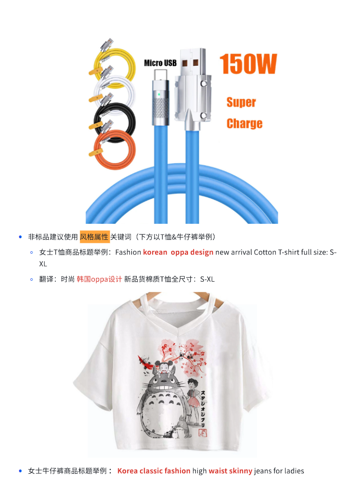](../images/27/page-004.png)

•非标品建议使用⟦U+0001⟧⻛格属性⟦U+0001⟧关键词（下方以T恤&牛仔裤举例）⟦U+0001⟧◦女士T恤商品标题举例：Fashion⟦U+0001⟧korean⟦U+0001⟧⟦U+0001⟧oppa⟦U+0001⟧design⟦U+0001⟧new⟦U+0001⟧arrival⟦U+0001⟧Cotton⟦U+0001⟧T-shirt⟦U+0001⟧full⟦U+0001⟧size:⟦U+0001⟧S-XL⟦U+0001⟧◦翻译：时尚⟦U+0001⟧韩国oppa设计⟦U+0001⟧新品货棉质T恤全尺寸：S-XL⟦U+0001⟧•女士牛仔裤商品标题举例⟦U+0001⟧：⟦U+0001⟧Korea⟦U+0001⟧classic⟦U+0001⟧fashion⟦U+0001⟧high⟦U+0001⟧waist⟦U+0001⟧skinny⟦U+0001⟧jeans⟦U+0001⟧for⟦U+0001⟧ladies⟦U+0001⟧

## 第 5 页

[打开第 5 页图片](../images/27/page-005.png)（765×1081）

[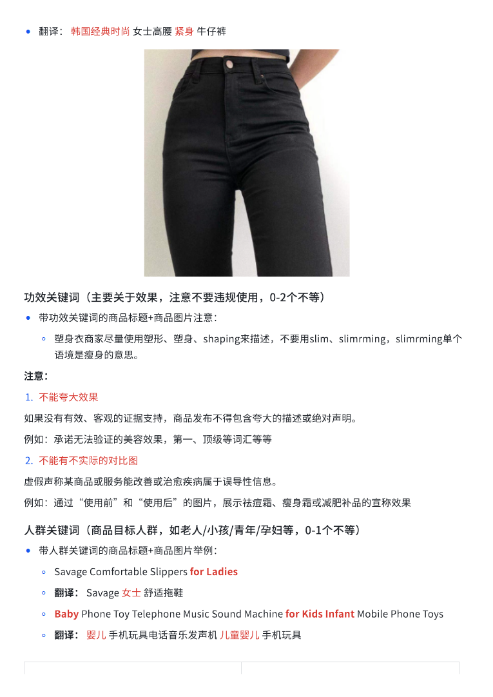](../images/27/page-005.png)

•翻译：⟦U+0001⟧韩国经典时尚⟦U+0001⟧女士高腰⟦U+0001⟧紧身⟦U+0001⟧牛仔裤⟦U+0001⟧功效关键词（主要关于效果，注意不要违规使用，0-2个不等）⟦U+0001⟧•带功效关键词的商品标题+商品图片注意：⟦U+0001⟧◦塑身衣商家尽量使用塑形、塑身、shaping来描述，不要用slim、slimrming，slimrming单个语境是瘦身的意思。注意：1.不能夸大效果如果没有有效、客观的证据支持，商品发布不得包含夸大的描述或绝对声明。例如：承诺无法验证的美容效果，第一、顶级等词汇等等2.不能有不实际的对比图虚假声称某商品或服务能改善或治愈疾病属于误导性信息。例如：通过“使用前”和“使用后”的图片，展示祛痘霜、瘦身霜或减肥补品的宣称效果人群关键词（商品目标人群，如老人/小孩/⻘年/孕妇等，0-1个不等）•带人群关键词的商品标题+商品图片举例：⟦U+0001⟧◦Savage⟦U+0001⟧Comfortable⟦U+0001⟧Slippers⟦U+0001⟧for⟦U+0001⟧Ladies⟦U+0001⟧◦翻译：⟦U+0001⟧Savage⟦U+0001⟧女士⟦U+0001⟧舒适拖鞋◦Baby⟦U+0001⟧Phone⟦U+0001⟧Toy⟦U+0001⟧Telephone⟦U+0001⟧Music⟦U+0001⟧Sound⟦U+0001⟧Machine⟦U+0001⟧for⟦U+0001⟧Kids⟦U+0001⟧Infant⟦U+0001⟧Mobile⟦U+0001⟧Phone⟦U+0001⟧Toys⟦U+0001⟧◦翻译：⟦U+0001⟧婴儿⟦U+0001⟧手机玩具电话音乐发声机⟦U+0001⟧儿童婴儿⟦U+0001⟧手机玩具⟦U+0001⟧

## 第 6 页

[打开第 6 页图片](../images/27/page-006.png)（510×720）

[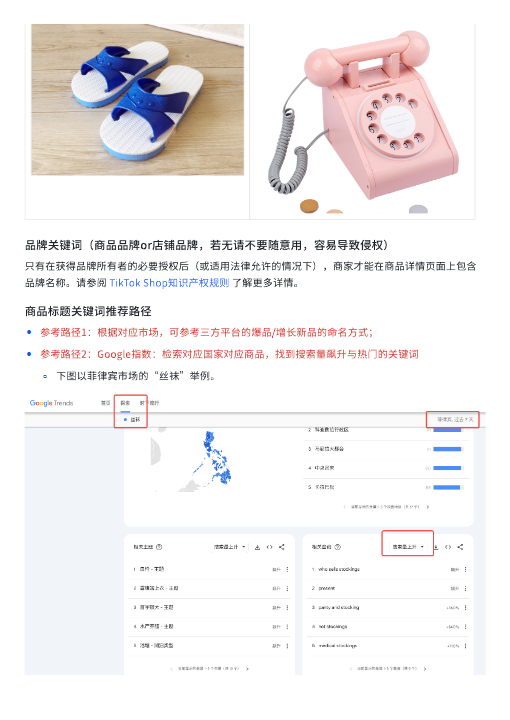](../images/27/page-006.png)

品牌关键词（商品品牌or店铺品牌，若无请不要随意用，容易导致侵权）⟦U+0001⟧只有在获得品牌所有者的必要授权后（或适用法律允许的情况下），商家才能在商品详情⻚面上包含品牌名称。请参阅⟦U+0001⟧TikTok⟦U+0001⟧Shop知识产权规则⟦U+0001⟧了解更多详情。⟦U+0001⟧商品标题关键词推荐路径⟦U+0001⟧•参考路径1：根据对应市场，可参考三方平台的爆品/增⻓新品的命名方式；⟦U+0001⟧•参考路径2：Google指数：检索对应国家对应商品，找到搜索量飙升与热⻔的关键词⟦U+0001⟧◦下图以菲律宾市场的“丝袜”举例。

## 第 7 页

[打开第 7 页图片](../images/27/page-007.png)（510×720）

[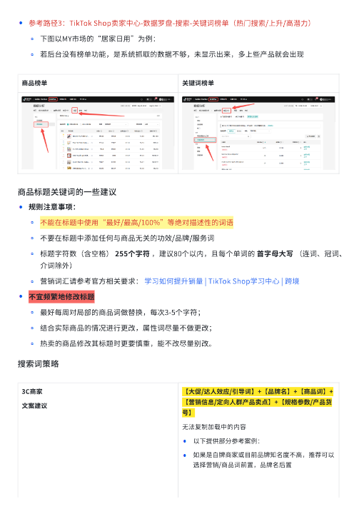](../images/27/page-007.png)

•参考路径3：TikTok⟦U+0001⟧Shop卖家中心-数据罗盘-搜索-关键词榜单（热⻔搜索/上升/高潜力）⟦U+0001⟧◦下图以MY市场的“居家日用”为例：⟦U+0001⟧◦若后台没有榜单功能，是系统抓取的数据不够，未显示出来，多上些产品就会出现商品榜单⟦U+0001⟧关键词榜单⟦U+0001⟧商品标题关键词的一些建议⟦U+0001⟧•规则注意事项：◦不能在标题中使用“最好/最高/100%”等绝对描述性的词语⟦U+0001⟧◦不要在标题中添加任何与商品无关的功效/品牌/服务词⟦U+0001⟧◦标题字符数（含空格）⟦U+0001⟧255个字符⟦U+0001⟧，建议80个以内，且每个单词的⟦U+0001⟧首字母大写⟦U+0001⟧（连词、冠词、介词除外）◦营销词汇请参考官方相关要求：⟦U+0001⟧学习如何提升销量⟦U+0001⟧|⟦U+0001⟧TikTok⟦U+0001⟧Shop学习中心⟦U+0001⟧|⟦U+0001⟧跨境⟦U+0001⟧•不宜频繁地修改标题◦最好每周对局部的商品词做替换，每次3-5个字符；⟦U+0001⟧◦结合实际商品的情况进行更改，属性词尽量不做更改；◦热卖的商品修改其标题时更要慎重，能不改尽量别改。搜索词策略⟦U+0001⟧3C商家⟦U+0001⟧文案建议⟦U+0001⟧【大促/达人效应/引导词】+【品牌名】+【商品词】+【营销信息/定向人群产品卖点】+【规格参数/产品货号】⟦U+0001⟧无法复制加载中的内容⟦U+0001⟧•以下提供部分参考案例：⟦U+0001⟧•如果是白牌商家或目前品牌知名度不高，推荐可以选择营销/商品词前置，品牌名后置⟦U+0001⟧

## 第 8 页

[打开第 8 页图片](../images/27/page-008.png)（510×720）

[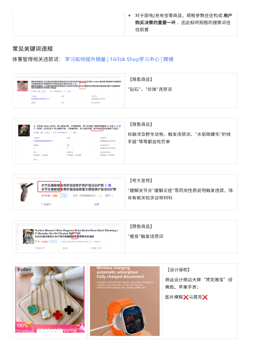](../images/27/page-008.png)

•对于厨电/充电宝等商品，规格参数往往构成⟦U+0001⟧用戶购买决策的重要一环⟦U+0001⟧，因此标明规格的搜索词往往前置⟦U+0001⟧常⻅关键词违规⟦U+0001⟧体重管理相关违禁词：⟦U+0001⟧学习如何提升销量⟦U+0001⟧|⟦U+0001⟧TikTok⟦U+0001⟧Shop学习中心⟦U+0001⟧|⟦U+0001⟧跨境⟦U+0001⟧【限售商品】⟦U+0001⟧"钻石"、"珍珠"违禁词⟦U+0001⟧【限售商品】⟦U+0001⟧标题涉及野生动物，触发违禁词。"水貂眼睫毛"豹纹手链"等等都会吃罚单⟦U+0001⟧【夸大宣传】⟦U+0001⟧"缓解关节炎"缓解炎症"等药用性质说明触发违禁，除非有相关检测证明材料⟦U+0001⟧【限售商品】⟦U+0001⟧"瘦身"触发违禁词⟦U+0001⟧【设计侵权】⟦U+0001⟧商品设计擦边大牌“梵克雅宝”经典款、苹果手表；⟦U+0001⟧图片模糊❌⻢赛克❌⟦U+0001⟧

## 第 9 页

[打开第 9 页图片](../images/27/page-009.png)（510×720）

[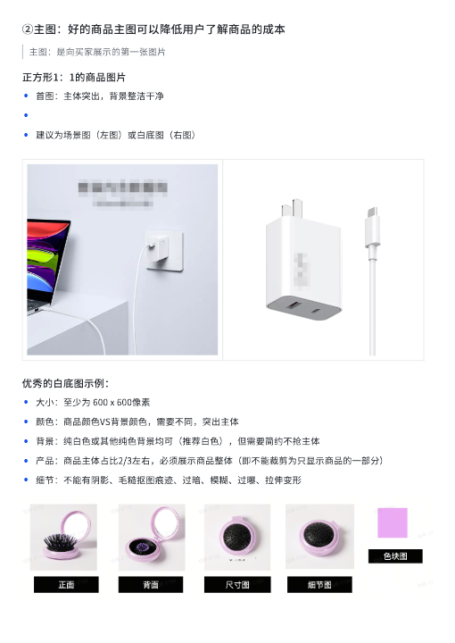](../images/27/page-009.png)

②主图：好的商品主图可以降低用戶了解商品的成本⟦U+0001⟧主图：是向买家展示的第一张图片正方形1：1的商品图片⟦U+0001⟧•首图：主体突出，背景整洁干净••建议为场景图（左图）或白底图（右图）优秀的白底图示例：⟦U+0001⟧•大小：至少为⟦U+0001⟧600⟦U+0001⟧x⟦U+0001⟧600像素•颜色：商品颜色VS背景颜色，需要不同，突出主体⟦U+0001⟧•背景：纯白色或其他纯色背景均可（推荐白色），但需要简约不抢主体•产品：商品主体占比2/3左右，必须展示商品整体（即不能裁剪为只显示商品的一部分）⟦U+0001⟧•细节：不能有阴影、毛糙抠图痕迹、过暗、模糊、过曝、拉伸变形

## 第 10 页

[打开第 10 页图片](../images/27/page-010.png)（510×720）

[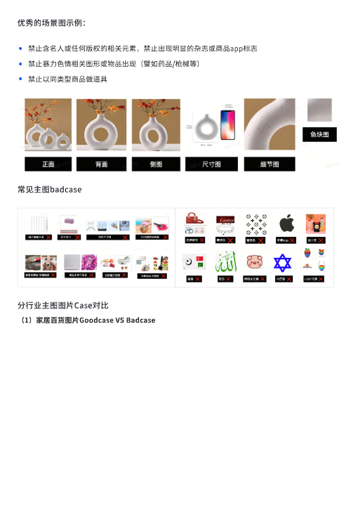](../images/27/page-010.png)

优秀的场景图示例：⟦U+0001⟧•禁止含名人或任何版权的相关元素，禁止出现明显的杂志或商品app标志⟦U+0001⟧•禁止暴力色情相关图形或物品出现（譬如药品/枪械等）⟦U+0001⟧•禁止以同类型商品做道具常⻅主图badcase分行业主图图片Case对比⟦U+0001⟧（1）家居百货图片Goodcase⟦U+0001⟧VS⟦U+0001⟧Badcase⟦U+0001⟧

## 第 11 页

[打开第 11 页图片](../images/27/page-011.png)（510×720）

[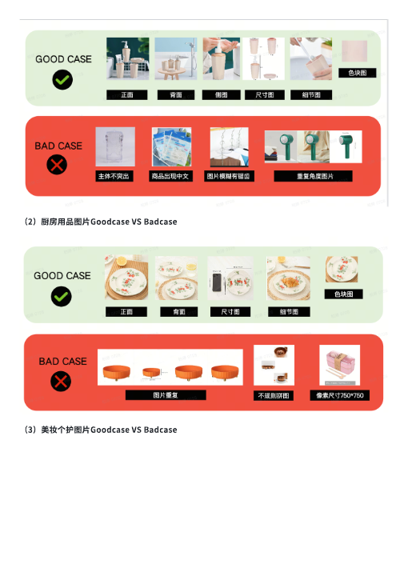](../images/27/page-011.png)

（2）厨房用品图片Goodcase⟦U+0001⟧VS⟦U+0001⟧Badcase⟦U+0001⟧（3）美妆个护图片Goodcase⟦U+0001⟧VS⟦U+0001⟧Badcase⟦U+0001⟧

## 第 12 页

[打开第 12 页图片](../images/27/page-012.png)（510×720）

[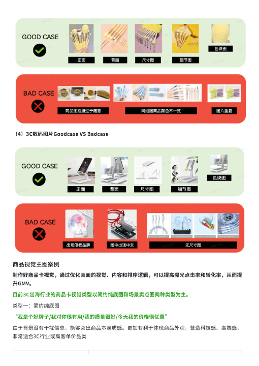](../images/27/page-012.png)

（4）3C数码图片Goodcase⟦U+0001⟧VS⟦U+0001⟧Badcase⟦U+0001⟧商品视觉主图案例⟦U+0001⟧制作好商品卡视觉，通过优化画面的视觉、内容和排序逻辑，可以提高曝光点击率和转化率，从而提升GMV。⟦U+0001⟧目前3C出海行业的商品卡视觉类型以简约纯底图和场景卖点图两种类型为主。⟦U+0001⟧类型一：简约纯底图“我是个好牌子/我对你很有用/我的质量很好/今天我的价格很优惠”⟦U+0001⟧由于背景没有干扰信息，能够突出商品本身质感。更加有利于体现商品外观，营造科技感、高端感，非常适合3C行业或高客单价品类⟦U+0001⟧

## 第 13 页

[打开第 13 页图片](../images/27/page-013.png)（510×720）

[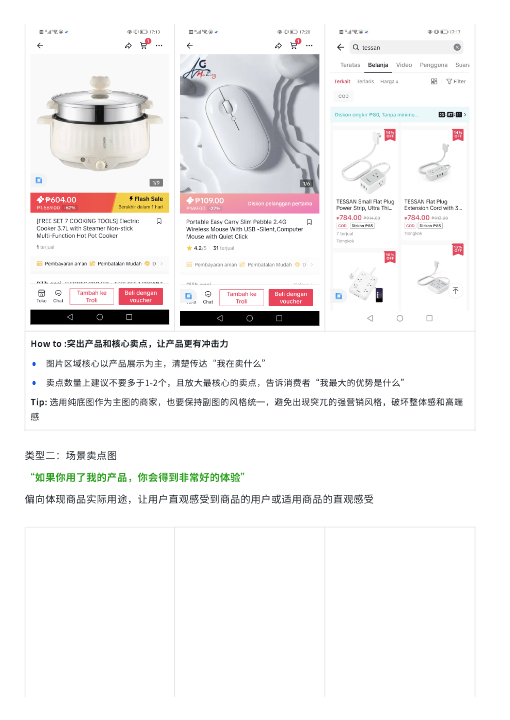](../images/27/page-013.png)

How⟦U+0001⟧to⟦U+0001⟧:突出产品和核心卖点，让产品更有冲击力⟦U+0001⟧•图片区域核心以产品展示为主，清楚传达“我在卖什么”⟦U+0001⟧•卖点数量上建议不要多于1-2个，且放大最核心的卖点，告诉消费者“我最大的优势是什么”⟦U+0001⟧Tip:⟦U+0001⟧选用纯底图作为主图的商家，也要保持副图的⻛格统一，避免出现突兀的强营销⻛格，破坏整体感和高端感⟦U+0001⟧类型二：场景卖点图“如果你用了我的产品，你会得到非常好的体验”偏向体现商品实际用途，让用戶直观感受到商品的用戶或适用商品的直观感受

## 第 14 页

[打开第 14 页图片](../images/27/page-014.png)（510×720）

[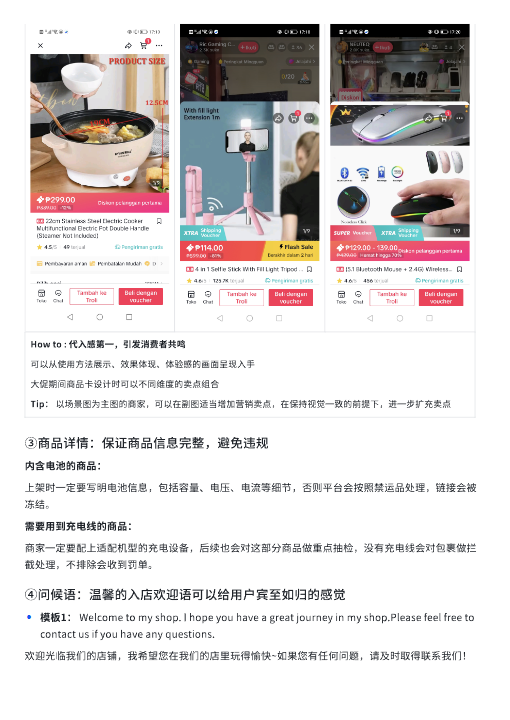](../images/27/page-014.png)

How⟦U+0001⟧to⟦U+0001⟧:⟦U+0001⟧代入感第一，引发消费者共鸣⟦U+0001⟧可以从使用方法展示、效果体现、体验感的画面呈现入手⟦U+0001⟧大促期间商品卡设计时可以不同维度的卖点组合⟦U+0001⟧Tip：⟦U+0001⟧以场景图为主图的商家，可以在副图适当增加营销卖点，在保持视觉一致的前提下，进一步扩充卖点⟦U+0001⟧③商品详情：保证商品信息完整，避免违规⟦U+0001⟧内含电池的商品：上架时一定要写明电池信息，包括容量、电压、电流等细节，否则平台会按照禁运品处理，链接会被冻结。需要用到充电线的商品：商家一定要配上适配机型的充电设备，后续也会对这部分商品做重点抽检，没有充电线会对包裹做拦截处理，不排除会收到罚单。④问候语：温馨的入店欢迎语可以给用戶宾至如归的感觉⟦U+0001⟧•模板1：⟦U+0001⟧Welcome⟦U+0001⟧to⟦U+0001⟧my⟦U+0001⟧shop.⟦U+0001⟧I⟦U+0001⟧hope⟦U+0001⟧you⟦U+0001⟧have⟦U+0001⟧a⟦U+0001⟧great⟦U+0001⟧journey⟦U+0001⟧in⟦U+0001⟧my⟦U+0001⟧shop.Please⟦U+0001⟧feel⟦U+0001⟧free⟦U+0001⟧to⟦U+0001⟧contact⟦U+0001⟧us⟦U+0001⟧if⟦U+0001⟧you⟦U+0001⟧have⟦U+0001⟧any⟦U+0001⟧questions.⟦U+0001⟧欢迎光临我们的店铺，我希望您在我们的店里玩得愉快~如果您有任何问题，请及时取得联系我们！⟦U+0001⟧

## 第 15 页

[打开第 15 页图片](../images/27/page-015.png)（510×720）

[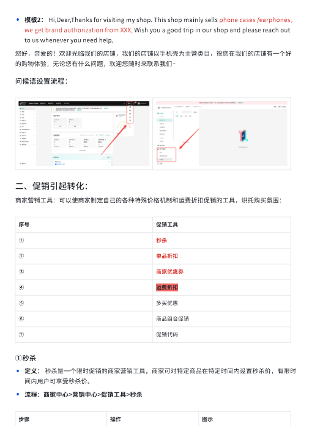](../images/27/page-015.png)

•模板2：⟦U+0001⟧Hi,Dear,Thanks⟦U+0001⟧for⟦U+0001⟧visiting⟦U+0001⟧my⟦U+0001⟧shop.⟦U+0001⟧This⟦U+0001⟧shop⟦U+0001⟧mainly⟦U+0001⟧sells⟦U+0001⟧phone⟦U+0001⟧cases⟦U+0001⟧/earphones，we⟦U+0001⟧get⟦U+0001⟧brand⟦U+0001⟧authorization⟦U+0001⟧from⟦U+0001⟧XXX,⟦U+0001⟧Wish⟦U+0001⟧you⟦U+0001⟧a⟦U+0001⟧good⟦U+0001⟧trip⟦U+0001⟧in⟦U+0001⟧our⟦U+0001⟧shop⟦U+0001⟧and⟦U+0001⟧please⟦U+0001⟧reach⟦U+0001⟧out⟦U+0001⟧to⟦U+0001⟧us⟦U+0001⟧whenever⟦U+0001⟧you⟦U+0001⟧need⟦U+0001⟧help.⟦U+0001⟧您好，亲爱的！欢迎光临我们的店铺，我们的店铺以手机壳为主营类目，祝您在我们的店铺有一个好的购物体验，无论您有什么问题，欢迎您随时来联系我们~⟦U+0001⟧问候语设置流程：⟦U+0001⟧二、促销引起转化：商家营销工具：可以使商家制定自己的各种特殊价格机制和运费折扣促销的工具，烘托购买氛围：序号⟦U+0001⟧促销工具⟦U+0001⟧①⟦U+0001⟧秒杀⟦U+0001⟧②⟦U+0001⟧单品折扣⟦U+0001⟧③⟦U+0001⟧商家优惠券⟦U+0001⟧④⟦U+0001⟧运费折扣⟦U+0001⟧⑤⟦U+0001⟧多买优惠⟦U+0001⟧⑥⟦U+0001⟧商品组合促销⟦U+0001⟧⑦⟦U+0001⟧促销代码⟦U+0001⟧①秒杀⟦U+0001⟧•定义：⟦U+0001⟧秒杀是一个限时促销的商家营销工具，商家可对特定商品在特定时间内设置秒杀价，有限时间内用戶可享受秒杀价。•流程：商家中心>营销中心>促销工具>秒杀⟦U+0001⟧步骤⟦U+0001⟧操作⟦U+0001⟧图示⟦U+0001⟧

## 第 16 页

[打开第 16 页图片](../images/27/page-016.png)（510×720）

[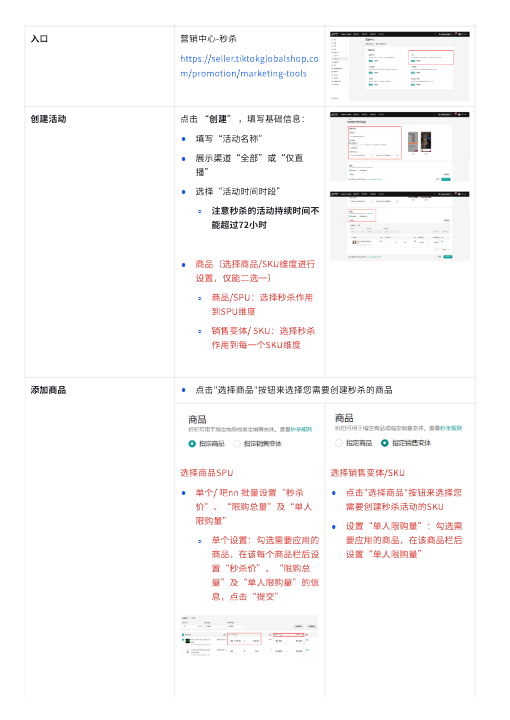](../images/27/page-016.png)

入口⟦U+0001⟧营销中心-秒杀⟦U+0001⟧https://seller.tiktokglobalshop.com/promotion/marketing-tools⟦U+0001⟧创建活动⟦U+0001⟧点击⟦U+0001⟧“创建”⟦U+0001⟧，填写基础信息：⟦U+0001⟧•填写“活动名称”⟦U+0001⟧•展示渠道“全部”或“仅直播”⟦U+0001⟧•选择“活动时间时段”⟦U+0001⟧◦注意秒杀的活动持续时间不能超过72小时⟦U+0001⟧•商品（选择商品/SKU维度进行设置，仅能二选一）⟦U+0001⟧◦商品/SPU：选择秒杀作用到SPU维度⟦U+0001⟧◦销售变体/⟦U+0001⟧SKU：选择秒杀作用到每一个SKU维度⟦U+0001⟧添加商品⟦U+0001⟧•点击"选择商品"按钮来选择您需要创建秒杀的商品⟦U+0001⟧选择商品SPU⟦U+0001⟧•单个/⟦U+0001⟧吧nn⟦U+0001⟧批量设置“秒杀价”、“限购总量”及“单人限购量”⟦U+0001⟧◦单个设置：勾选需要应用的商品，在该每个商品栏后设置“秒杀价”、“限购总量”及“单人限购量”的信息，点击“提交”⟦U+0001⟧选择销售变体/SKU⟦U+0001⟧•点击"选择商品"按钮来选择您需要创建秒杀活动的SKU⟦U+0001⟧•设置“单人限购量”：勾选需要应用的商品，在该商品栏后设置“单人限购量”⟦U+0001⟧⟦U+0001⟧

## 第 17 页

[打开第 17 页图片](../images/27/page-017.png)（510×720）

[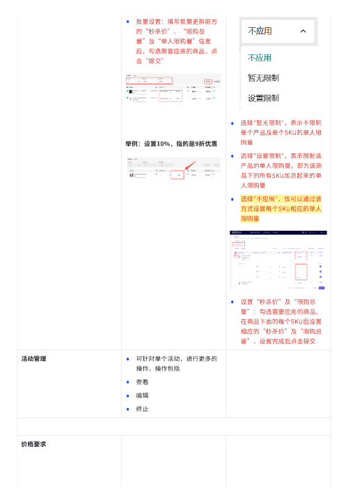](../images/27/page-017.png)

•批量设置：填写批量更新前方的“秒杀价”、“限购总量”及“单人限购量”信息后，勾选需要应用的商品，点击“提交”⟦U+0001⟧举例：设置10%，指的是9折优惠⟦U+0001⟧•选择"暂无限制"，表示不限制单个产品及单个SKU的单人限购量⟦U+0001⟧•选择"设置限制"，表示限制该产品的单人限购量，即为该商品下的所有SKU加总起来的单人限购量⟦U+0001⟧•选择"不应用"，仅可以通过该方式设置每个SKU相应的单人限购量⟦U+0001⟧•设置“秒杀价”及“限购总量”：勾选需要应用的商品，在商品下面的每个SKU后设置相应的“秒杀价”及“限购总量”，设置完成后点击提交⟦U+0001⟧活动管理⟦U+0001⟧•可针对单个活动，进行更多的操作，操作包括⟦U+0001⟧•查看⟦U+0001⟧•编辑⟦U+0001⟧•终止⟦U+0001⟧价格要求⟦U+0001⟧

## 第 18 页

[打开第 18 页图片](../images/27/page-018.png)（510×720）

[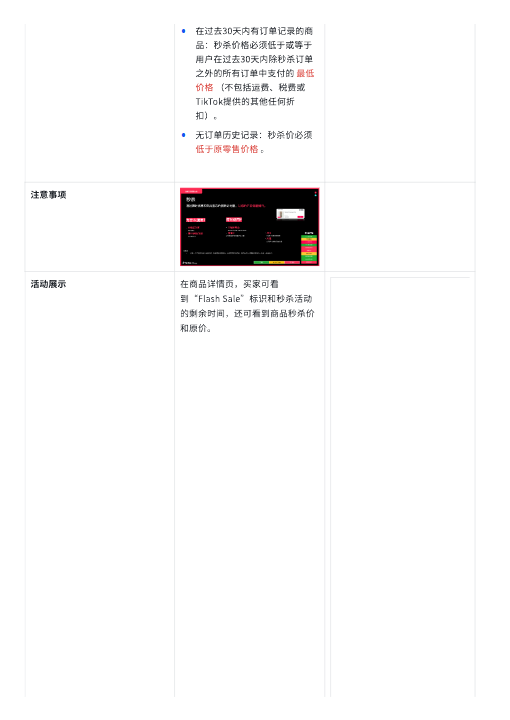](../images/27/page-018.png)

•在过去30天内有订单记录的商品：秒杀价格必须低于或等于用戶在过去30天内除秒杀订单之外的所有订单中支付的⟦U+0001⟧最低价格⟦U+0001⟧（不包括运费、税费或TikTok提供的其他任何折扣）。⟦U+0001⟧•无订单历史记录：秒杀价必须⟦U+0001⟧低于原零售价格⟦U+0001⟧。⟦U+0001⟧注意事项⟦U+0001⟧活动展示⟦U+0001⟧在商品详情⻚，买家可看到“Flash⟦U+0001⟧Sale”标识和秒杀活动的剩余时间，还可看到商品秒杀价和原价。⟦U+0001⟧

## 第 19 页

[打开第 19 页图片](../images/27/page-019.png)（510×720）

[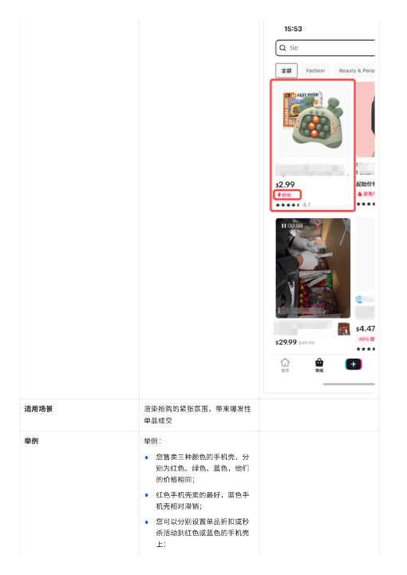](../images/27/page-019.png)

适用场景⟦U+0001⟧渲染抢购的紧张氛围，带来爆发性单品成交⟦U+0001⟧举例⟦U+0001⟧举例：⟦U+0001⟧•您售卖三种颜色的手机壳，分别为红色、绿色、蓝色，他们的价格相同；⟦U+0001⟧•红色手机壳卖的最好，蓝色手机壳相对滞销；⟦U+0001⟧•您可以分别设置单品折扣或秒杀活动到红色或蓝色的手机壳上：⟦U+0001⟧

## 第 20 页

[打开第 20 页图片](../images/27/page-020.png)（510×720）

[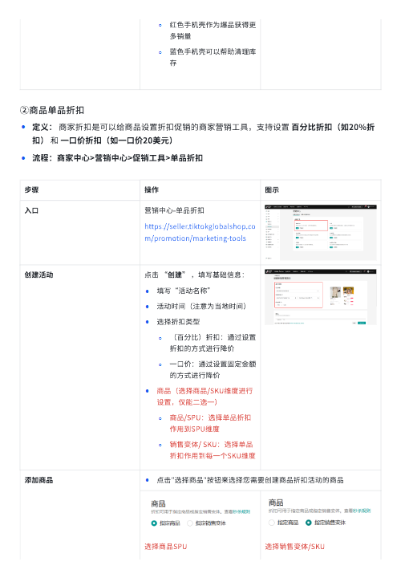](../images/27/page-020.png)

◦红色手机壳作为爆品获得更多销量⟦U+0001⟧◦蓝色手机壳可以帮助清理库存⟦U+0001⟧②商品单品折扣⟦U+0001⟧•定义：⟦U+0001⟧商家折扣是可以给商品设置折扣促销的商家营销工具，支持设置⟦U+0001⟧百分比折扣（如20%折扣）⟦U+0001⟧和⟦U+0001⟧一口价折扣（如一口价20美元）⟦U+0001⟧•流程：商家中心>营销中心>促销工具>单品折扣⟦U+0001⟧步骤⟦U+0001⟧操作⟦U+0001⟧图示⟦U+0001⟧入口⟦U+0001⟧营销中心-单品折扣⟦U+0001⟧https://seller.tiktokglobalshop.com/promotion/marketing-tools⟦U+0001⟧创建活动⟦U+0001⟧点击⟦U+0001⟧“创建”⟦U+0001⟧，填写基础信息：⟦U+0001⟧•填写“活动名称”⟦U+0001⟧•活动时间（注意为当地时间）⟦U+0001⟧•选择折扣类型⟦U+0001⟧◦（百分比）折扣：通过设置折扣的方式进行降价⟦U+0001⟧◦一口价：通过设置固定金额的方式进行降价⟦U+0001⟧•商品（选择商品/SKU维度进行设置，仅能二选一）⟦U+0001⟧◦商品/SPU：选择单品折扣作用到SPU维度⟦U+0001⟧◦销售变体/⟦U+0001⟧SKU：选择单品折扣作用到每一个SKU维度⟦U+0001⟧添加商品⟦U+0001⟧•点击"选择商品"按钮来选择您需要创建商品折扣活动的商品⟦U+0001⟧选择商品SPU⟦U+0001⟧选择销售变体/SKU⟦U+0001⟧

## 第 21 页

[打开第 21 页图片](../images/27/page-021.png)（510×720）

[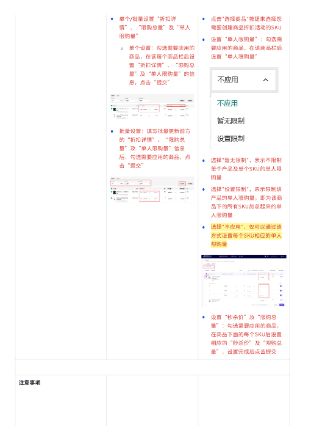](../images/27/page-021.png)

•单个/批量设置“折扣详情”、“限购总量”及“单人限购量”⟦U+0001⟧◦单个设置：勾选需要应用的商品，在该每个商品栏后设置“折扣详情”、“限购总量”及“单人限购量”的信息，点击“提交”⟦U+0001⟧•批量设置：填写批量更新前方的“折扣详情”、“限购总量”及“单人限购量”信息后，勾选需要应用的商品，点击“提交”⟦U+0001⟧•点击"选择商品"按钮来选择您需要创建商品折扣活动的SKU⟦U+0001⟧•设置“单人限购量”：勾选需要应用的商品，在该商品栏后设置“单人限购量”⟦U+0001⟧⟦U+0001⟧•选择"暂无限制"，表示不限制单个产品及单个SKU的单人限购量⟦U+0001⟧•选择"设置限制"，表示限制该产品的单人限购量，即为该商品下的所有SKU加总起来的单人限购量⟦U+0001⟧•选择"不应用"，仅可以通过该方式设置每个SKU相应的单人限购量⟦U+0001⟧•设置“秒杀价”及“限购总量”：勾选需要应用的商品，在商品下面的每个SKU后设置相应的“秒杀价”及“限购总量”，设置完成后点击提交⟦U+0001⟧注意事项⟦U+0001⟧

## 第 22 页

[打开第 22 页图片](../images/27/page-022.png)（510×720）

[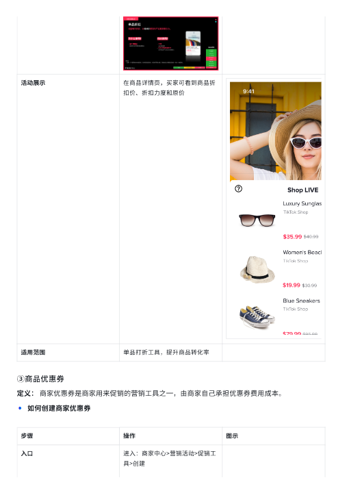](../images/27/page-022.png)

活动展示⟦U+0001⟧在商品详情⻚，买家可看到商品折扣价、折扣力度和原价⟦U+0001⟧适用范围⟦U+0001⟧单品打折工具，提升商品转化率⟦U+0001⟧③商品优惠券⟦U+0001⟧定义：⟦U+0001⟧商家优惠券是商家用来促销的营销工具之一，由商家自己承担优惠券费用成本。⟦U+0001⟧•如何创建商家优惠券步骤⟦U+0001⟧操作⟦U+0001⟧图示⟦U+0001⟧入口⟦U+0001⟧进入：商家中心>营销活动>促销工具>创建⟦U+0001⟧

## 第 23 页

[打开第 23 页图片](../images/27/page-023.png)（510×720）

[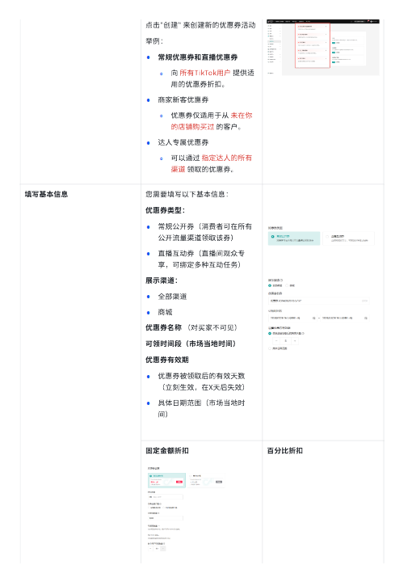](../images/27/page-023.png)

点击"创建"⟦U+0001⟧来创建新的优惠券活动⟦U+0001⟧举例：⟦U+0001⟧•常规优惠券和直播优惠券⟦U+0001⟧◦向⟦U+0001⟧所有TikTok用戶⟦U+0001⟧提供适用的优惠券折扣。⟦U+0001⟧•商家新客优惠券⟦U+0001⟧◦优惠券仅适用于从⟦U+0001⟧未在你的店铺购买过⟦U+0001⟧的客戶。⟦U+0001⟧•达人专属优惠券⟦U+0001⟧◦可以通过⟦U+0001⟧指定达人的所有渠道⟦U+0001⟧领取的优惠券。⟦U+0001⟧填写基本信息⟦U+0001⟧您需要填写以下基本信息：⟦U+0001⟧优惠券类型：⟦U+0001⟧•常规公开券（消费者可在所有公开流量渠道领取该券）⟦U+0001⟧•直播互动券（直播间观众专享，可绑定多种互动任务）⟦U+0001⟧展示渠道：⟦U+0001⟧•全部渠道⟦U+0001⟧•商城⟦U+0001⟧优惠券名称⟦U+0001⟧（对买家不可⻅）⟦U+0001⟧可领时间段（市场当地时间）⟦U+0001⟧优惠券有效期⟦U+0001⟧•优惠券被领取后的有效天数（立刻生效，在X天后失效）⟦U+0001⟧•具体日期范围（市场当地时间）⟦U+0001⟧固定金额折扣⟦U+0001⟧百分比折扣⟦U+0001⟧

## 第 24 页

[打开第 24 页图片](../images/27/page-024.png)（510×720）

[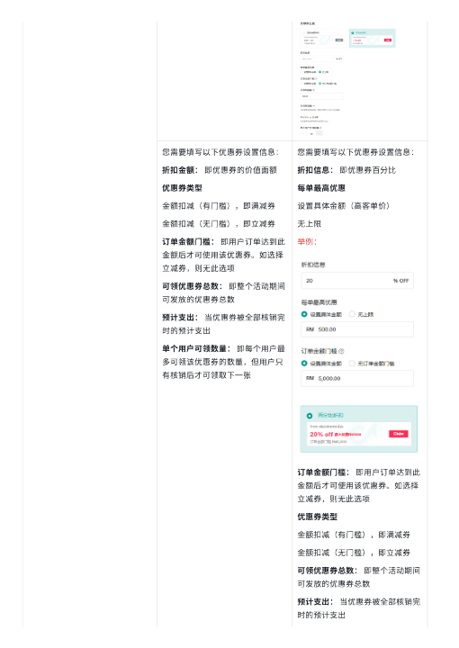](../images/27/page-024.png)

您需要填写以下优惠券设置信息：⟦U+0001⟧折扣金额：⟦U+0001⟧即优惠券的价值面额⟦U+0001⟧优惠券类型⟦U+0001⟧金额扣减（有⻔槛），即满减券⟦U+0001⟧金额扣减（无⻔槛），即立减券⟦U+0001⟧订单金额⻔槛：⟦U+0001⟧即用戶订单达到此金额后才可使用该优惠券。如选择立减券，则无此选项⟦U+0001⟧可领优惠券总数：⟦U+0001⟧即整个活动期间可发放的优惠券总数⟦U+0001⟧预计支出：⟦U+0001⟧当优惠券被全部核销完时的预计支出⟦U+0001⟧单个用戶可领数量：⟦U+0001⟧即每个用戶最多可领该优惠券的数量，但用戶只有核销后才可领取下一张⟦U+0001⟧您需要填写以下优惠券设置信息：⟦U+0001⟧折扣信息：⟦U+0001⟧即优惠券百分比⟦U+0001⟧每单最高优惠⟦U+0001⟧设置具体金额（高客单价）⟦U+0001⟧无上限⟦U+0001⟧举例：⟦U+0001⟧订单金额⻔槛：⟦U+0001⟧即用戶订单达到此金额后才可使用该优惠券。如选择立减券，则无此选项⟦U+0001⟧优惠券类型⟦U+0001⟧金额扣减（有⻔槛），即满减券⟦U+0001⟧金额扣减（无⻔槛），即立减券⟦U+0001⟧可领优惠券总数：⟦U+0001⟧即整个活动期间可发放的优惠券总数⟦U+0001⟧预计支出：⟦U+0001⟧当优惠券被全部核销完时的预计支出⟦U+0001⟧

## 第 25 页

[打开第 25 页图片](../images/27/page-025.png)（510×720）

[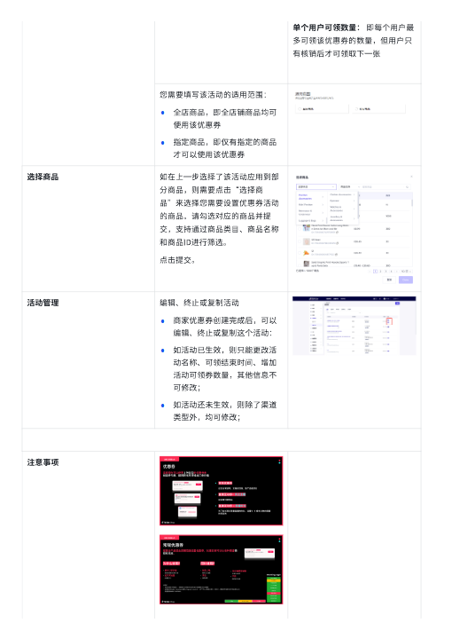](../images/27/page-025.png)

单个用戶可领数量：⟦U+0001⟧即每个用戶最多可领该优惠券的数量，但用戶只有核销后才可领取下一张⟦U+0001⟧您需要填写该活动的适用范围：⟦U+0001⟧•全店商品，即全店铺商品均可使用该优惠券⟦U+0001⟧•指定商品，即仅有指定的商品才可以使用该优惠券⟦U+0001⟧选择商品⟦U+0001⟧如在上一步选择了该活动应用到部分商品，则需要点击“选择商品”来选择您需要设置优惠券活动的商品。请勾选对应的商品并提交，支持通过商品类目、商品名称和商品ID进行筛选。⟦U+0001⟧点击提交。⟦U+0001⟧活动管理⟦U+0001⟧编辑、终止或复制活动⟦U+0001⟧•商家优惠券创建完成后，可以编辑、终止或复制这个活动：⟦U+0001⟧•如活动已生效，则只能更改活动名称、可领结束时间、增加活动可领券数量，其他信息不可修改；⟦U+0001⟧•如活动还未生效，则除了渠道类型外，均可修改；⟦U+0001⟧注意事项⟦U+0001⟧

## 第 26 页

[打开第 26 页图片](../images/27/page-026.png)（510×720）

[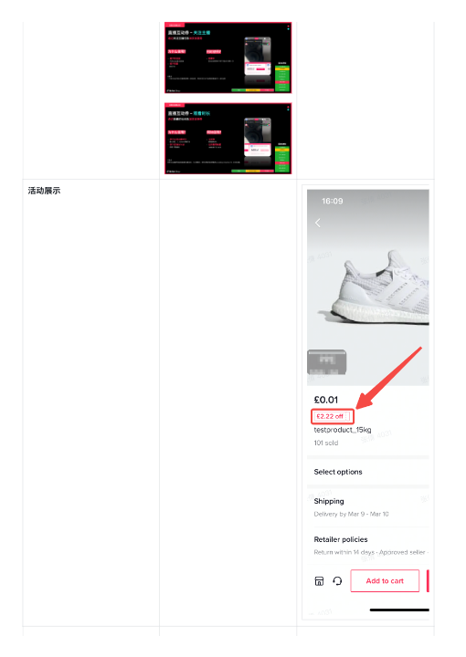](../images/27/page-026.png)

活动展示⟦U+0001⟧

## 第 27 页

[打开第 27 页图片](../images/27/page-027.png)（510×720）

[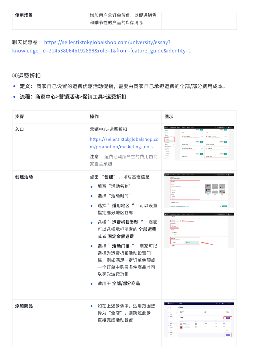](../images/27/page-027.png)

使用场景⟦U+0001⟧增加用戶总订单价值，以促进销售和季节性的产品的库存清仓⟦U+0001⟧聊天优惠卷：⟦U+0001⟧https://seller.tiktokglobalshop.com/university/essay?knowledge_id=2145380646192898&role=1&from=feature_guide&identity=1⟦U+0001⟧④运费折扣⟦U+0001⟧•定义：⟦U+0001⟧商家自己设置的运费优惠活动促销，需要由商家自己承担运费的全部/部分费用成本。⟦U+0001⟧•流程：商家中心>营销活动>促销工具>运费折扣⟦U+0001⟧步骤⟦U+0001⟧操作⟦U+0001⟧图示⟦U+0001⟧入口⟦U+0001⟧营销中心-运费折扣⟦U+0001⟧https://seller.tiktokglobalshop.com/promotion/marketing-tools⟦U+0001⟧注意：⟦U+0001⟧运费活动所产生的费用由商家自主承担⟦U+0001⟧创建活动⟦U+0001⟧点击⟦U+0001⟧“创建”⟦U+0001⟧，填写基础信息：⟦U+0001⟧•填写“活动名称”⟦U+0001⟧•选择“活动时间”⟦U+0001⟧•选择⟦U+0001⟧”适用地区“⟦U+0001⟧：可以设置指定部分地区包邮⟦U+0001⟧•选择⟦U+0001⟧”运费折扣类型“⟦U+0001⟧：商家可以选择承担买家的⟦U+0001⟧全部运费⟦U+0001⟧或者⟦U+0001⟧固定金额运费⟦U+0001⟧•选择⟦U+0001⟧”活动⻔槛“⟦U+0001⟧：商家可以选择为运费折扣活动设置⻔槛，例如满足一定订单金额或一个订单中购买多件商品才可以享受运费折扣⟦U+0001⟧•适用于⟦U+0001⟧全部/部分商品⟦U+0001⟧⟦U+0001⟧添加商品⟦U+0001⟧•如在上述步骤中，适用范围选择为“全店”，则跳过此步，直接完成活动设置⟦U+0001⟧

## 第 28 页

[打开第 28 页图片](../images/27/page-028.png)（510×720）

[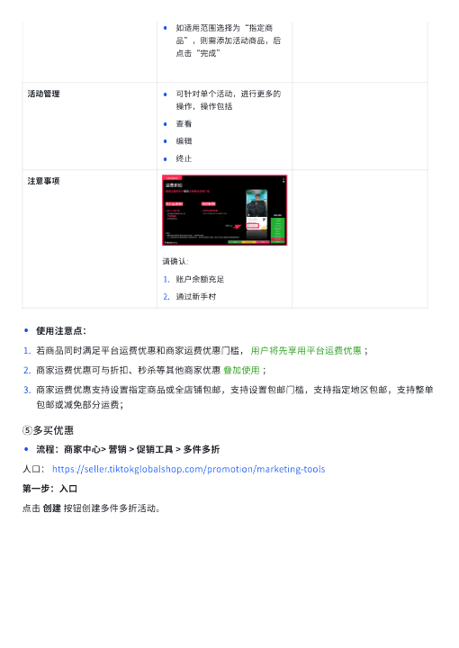](../images/27/page-028.png)

•如适用范围选择为“指定商品”，则需添加活动商品，后点击“完成”⟦U+0001⟧活动管理⟦U+0001⟧•可针对单个活动，进行更多的操作，操作包括⟦U+0001⟧•查看⟦U+0001⟧•编辑⟦U+0001⟧•终止⟦U+0001⟧注意事项⟦U+0001⟧请确认:⟦U+0001⟧1.账戶余额充足⟦U+0001⟧2.通过新手村⟦U+0001⟧•使用注意点：1.若商品同时满足平台运费优惠和商家运费优惠⻔槛，⟦U+0001⟧用戶将先享用平台运费优惠⟦U+0001⟧；⟦U+0001⟧2.商家运费优惠可与折扣、秒杀等其他商家优惠⟦U+0001⟧叠加使用⟦U+0001⟧；⟦U+0001⟧3.商家运费优惠支持设置指定商品或全店铺包邮，支持设置包邮⻔槛，支持指定地区包邮，支持整单包邮或减免部分运费；⑤多买优惠⟦U+0001⟧•流程：商家中心>⟦U+0001⟧营销⟦U+0001⟧>⟦U+0001⟧促销工具⟦U+0001⟧>⟦U+0001⟧多件多折⟦U+0001⟧人口：⟦U+0001⟧https://seller.tiktokglobalshop.com/promotion/marketing-tools⟦U+0001⟧第一步：入口点击⟦U+0001⟧创建⟦U+0001⟧按钮创建多件多折活动。⟦U+0001⟧

## 第 29 页

[打开第 29 页图片](../images/27/page-029.png)（510×720）

[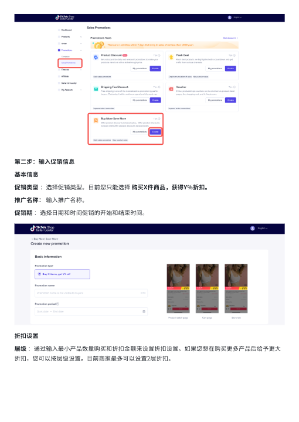](../images/27/page-029.png)

第二步：输入促销信息基本信息促销类型⟦U+0001⟧：选择促销类型。目前您只能选择⟦U+0001⟧购买X件商品，获得Y%折扣。⟦U+0001⟧推广名称：⟦U+0001⟧输入推广名称。⟦U+0001⟧促销期⟦U+0001⟧：选择日期和时间促销的开始和结束时间。⟦U+0001⟧折扣设置层级⟦U+0001⟧：通过输入最小产品数量购买和折扣金额来设置折扣设置。如果您想在购买更多产品后给予更大折扣，您可以按层级设置。目前商家最多可以设置2层折扣。⟦U+0001⟧

## 第 30 页

[打开第 30 页图片](../images/27/page-030.png)（510×720）

[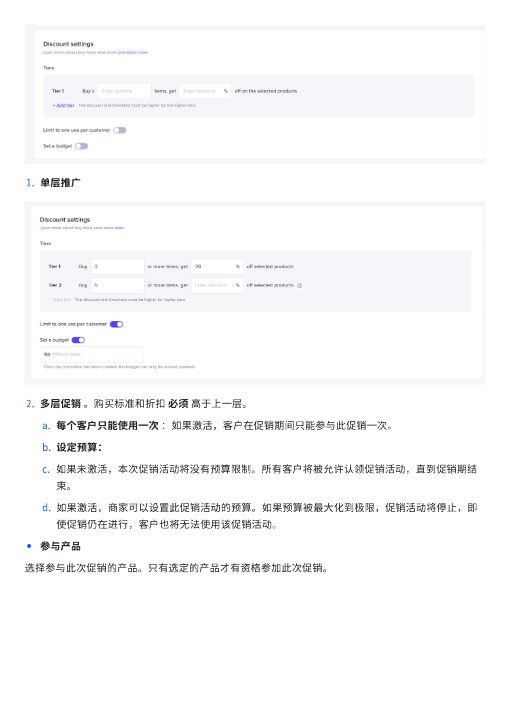](../images/27/page-030.png)

1.单层推广2.多层促销⟦U+0001⟧。购买标准和折扣⟦U+0001⟧必须⟦U+0001⟧高于上一层。⟦U+0001⟧a.每个客戶只能使用一次⟦U+0001⟧：如果激活，客戶在促销期间只能参与此促销一次。⟦U+0001⟧b.设定预算：⟦U+0001⟧c.如果未激活，本次促销活动将没有预算限制。所有客戶将被允许认领促销活动，直到促销期结束。d.如果激活，商家可以设置此促销活动的预算。如果预算被最大化到极限，促销活动将停止，即使促销仍在进行，客戶也将无法使用该促销活动。⟦U+0001⟧•参与产品选择参与此次促销的产品。只有选定的产品才有资格参加此次促销。

## 第 31 页

[打开第 31 页图片](../images/27/page-031.png)（510×720）

[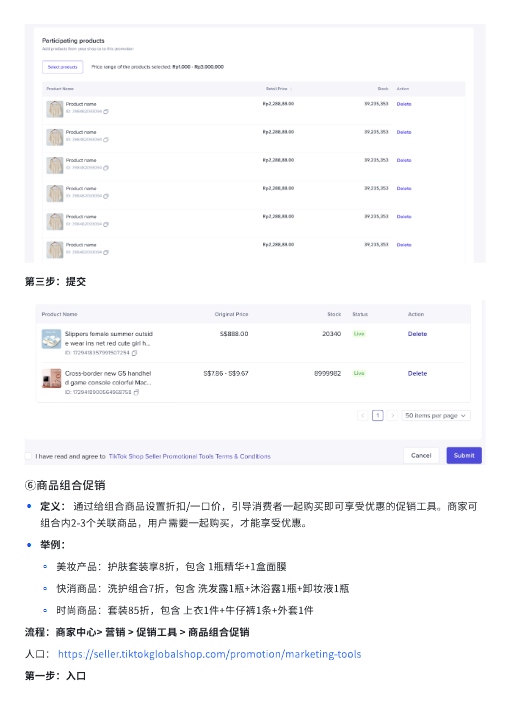](../images/27/page-031.png)

第三步：提交⑥商品组合促销⟦U+0001⟧•定义：⟦U+0001⟧通过给组合商品设置折扣/一口价，引导消费者一起购买即可享受优惠的促销工具。商家可组合内2-3个关联商品，用戶需要一起购买，才能享受优惠。⟦U+0001⟧•举例：◦美妆产品：护肤套装享8折，包含⟦U+0001⟧1瓶精华+1盒面膜⟦U+0001⟧◦快消商品：洗护组合7折，包含⟦U+0001⟧洗发露1瓶+沐浴露1瓶+卸妆液1瓶⟦U+0001⟧◦时尚商品：套装85折，包含⟦U+0001⟧上衣1件+牛仔裤1条+外套1件⟦U+0001⟧流程：商家中心>⟦U+0001⟧营销⟦U+0001⟧>⟦U+0001⟧促销工具⟦U+0001⟧>⟦U+0001⟧商品组合促销⟦U+0001⟧人口：⟦U+0001⟧https://seller.tiktokglobalshop.com/promotion/marketing-tools⟦U+0001⟧第一步：入口

## 第 32 页

[打开第 32 页图片](../images/27/page-032.png)（510×720）

[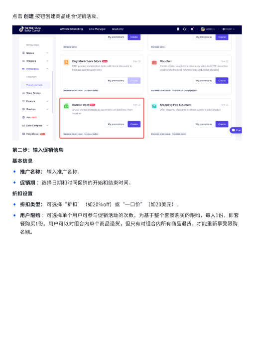](../images/27/page-032.png)

点击⟦U+0001⟧创建⟦U+0001⟧按钮创建商品组合促销活动。⟦U+0001⟧第二步：输入促销信息基本信息•推广名称：⟦U+0001⟧输入推广名称。⟦U+0001⟧•促销期⟦U+0001⟧：选择日期和时间促销的开始和结束时间。⟦U+0001⟧折扣设置•折扣类型：⟦U+0001⟧可选择“折扣”（如20%off）或“一口价”（如20美元）。⟦U+0001⟧•用戶限购⟦U+0001⟧：可选择单个用戶可参与促销活动的次数，为基于整个套餐购买的限购，每人1份，即套餐购买1份。用戶可以对组合内单个商品退货，但只有对组合内所有商品退货，才能重新享受限购名额。

## 第 33 页

[打开第 33 页图片](../images/27/page-033.png)（510×720）

[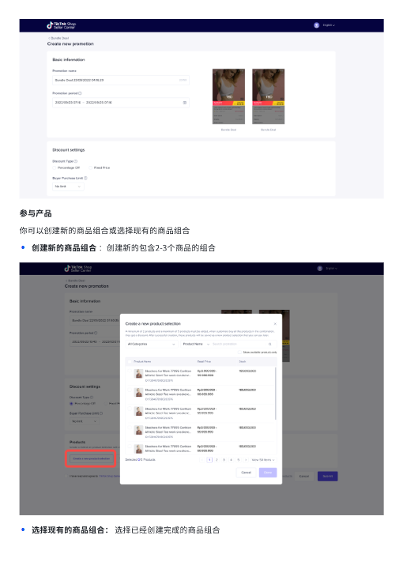](../images/27/page-033.png)

参与产品你可以创建新的商品组合或选择现有的商品组合•创建新的商品组合⟦U+0001⟧：创建新的包含2-3个商品的组合⟦U+0001⟧•选择现有的商品组合：⟦U+0001⟧选择已经创建完成的商品组合⟦U+0001⟧

## 第 34 页

[打开第 34 页图片](../images/27/page-034.png)（510×720）

[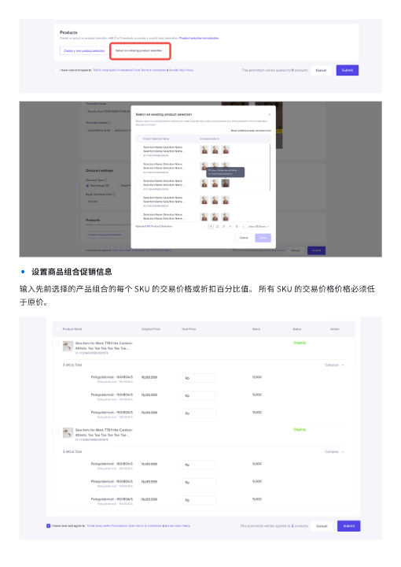](../images/27/page-034.png)

•设置商品组合促销信息输入先前选择的产品组合的每个⟦U+0001⟧SKU⟦U+0001⟧的交易价格或折扣百分比值。⟦U+0001⟧所有⟦U+0001⟧SKU⟦U+0001⟧的交易价格价格必须低于原价。

## 第 35 页

[打开第 35 页图片](../images/27/page-035.png)（510×720）

[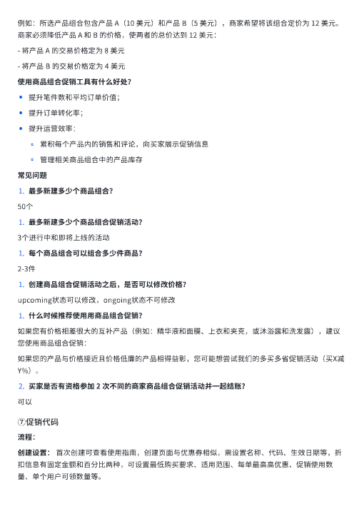](../images/27/page-035.png)

例如：所选产品组合包含产品⟦U+0001⟧A（10⟦U+0001⟧美元）和产品⟦U+0001⟧B（5⟦U+0001⟧美元），商家希望将该组合定价为⟦U+0001⟧12⟦U+0001⟧美元。⟦U+0001⟧商家必须降低产品⟦U+0001⟧A⟦U+0001⟧和⟦U+0001⟧B⟦U+0001⟧的价格，使两者的总价达到⟦U+0001⟧12⟦U+0001⟧美元：⟦U+0001⟧-⟦U+0001⟧将产品⟦U+0001⟧A⟦U+0001⟧的交易价格定为⟦U+0001⟧8⟦U+0001⟧美元⟦U+0001⟧-⟦U+0001⟧将产品⟦U+0001⟧B⟦U+0001⟧的交易价格定为⟦U+0001⟧4⟦U+0001⟧美元⟦U+0001⟧使用商品组合促销工具有什么好处？•提升笔件数和平均订单价值；•提升订单转化率；•提升运营效率：◦累积每个产品内的销售和评论，向买家展示促销信息◦管理相关商品组合中的产品库存常⻅问题1.最多新建多少个商品组合？50个⟦U+0001⟧1.最多新建多少个商品组合促销活动？3个进行中和即将上线的活动⟦U+0001⟧1.每个商品组合可以组合多少件商品？2-3件⟦U+0001⟧1.创建商品组合促销活动之后，是否可以修改价格？upcoming状态可以修改，ongoing状态不可修改⟦U+0001⟧1.什么时候推荐使用用商品组合促销？如果您有价格相差很大的互补产品（例如：精华液和面膜、上衣和夹克，或沐浴露和洗发露），建议您使用商品组合促销：如果您的产品与价格接近且价格低廉的产品相得益彰，您可能想尝试我们的多买多省促销活动（买X减Y%）。⟦U+0001⟧2.买家是否有资格参加⟦U+0001⟧2⟦U+0001⟧次不同的商家商品组合促销活动并一起结账？⟦U+0001⟧可以⑦促销代码⟦U+0001⟧流程：创建设置：⟦U+0001⟧首次创建可查看使用指南，创建⻚面与优惠券相似，需设置名称、代码、生效日期等，折扣信息有固定金额和百分比两种，可设置最低购买要求、适用范围、每单最高高优惠、促销使用数量、单个用戶可领数量等。

## 第 36 页

[打开第 36 页图片](../images/27/page-036.png)（510×720）

[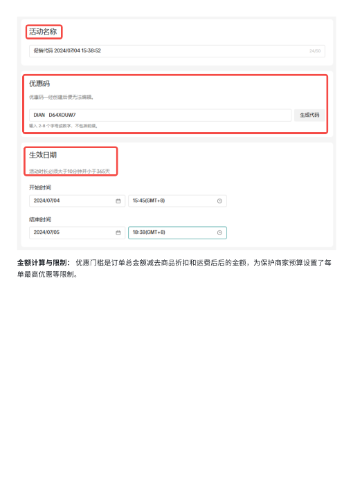](../images/27/page-036.png)

金额计算与限制：⟦U+0001⟧优惠⻔槛是订单总金额减去商品折扣和运费后后的金额，为保护商家预算设置了每单最高优惠等限制。

## 第 37 页

[打开第 37 页图片](../images/27/page-037.png)（510×720）

[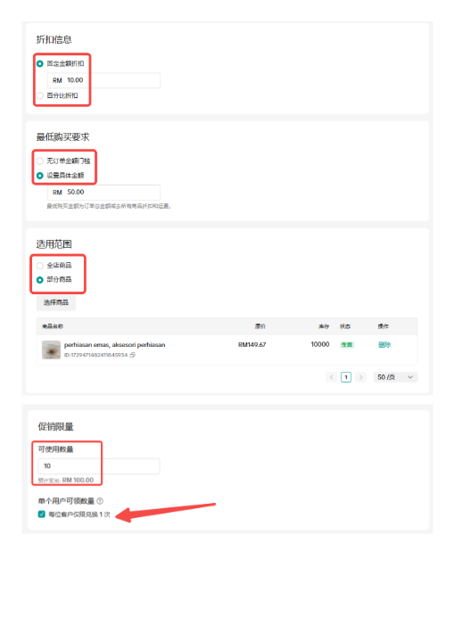](../images/27/page-037.png)

> 此页未返回非图片DOM正文文字；不推测图片中的内容。

## 第 38 页

[打开第 38 页图片](../images/27/page-038.png)（510×720）

[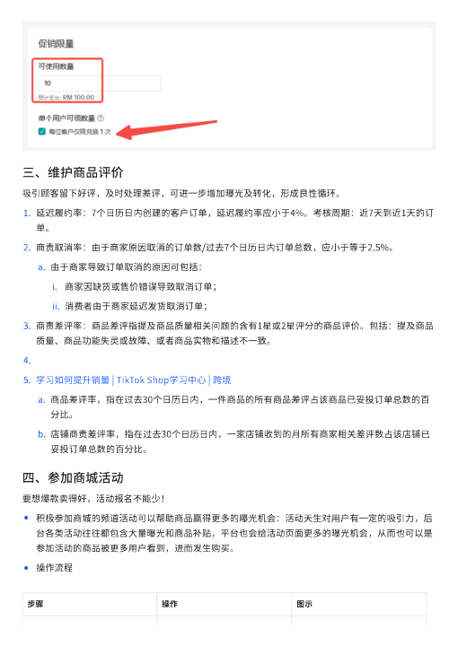](../images/27/page-038.png)

三、维护商品评价吸引顾客留下好评，及时处理差评，可进一步增加曝光及转化，形成良性循环。1.延迟履约率：7个日历日内创建的客戶订单，延迟履约率应小于4%。考核周期：近7天到近1天的订单。2.商责取消率：由于商家原因取消的订单数/过去7个日历日内订单总数，应小于等于2.5%。⟦U+0001⟧a.由于商家导致订单取消的原因可包括：i.商家因缺货或售价错误导致取消订单；ii.消费者由于商家延迟发货取消订单；3.商责差评率：商品差评指提及商品质量相关问题的含有1星或2星评分的商品评价。包括：提及商品质量、商品功能失灵或故障、或者商品实物和描述不一致。4.5.学习如何提升销量⟦U+0001⟧|⟦U+0001⟧TikTok⟦U+0001⟧Shop学习中心⟦U+0001⟧|⟦U+0001⟧跨境⟦U+0001⟧a.商品差评率，指在过去30个日历日内，一件商品的所有商品差评占该商品已妥投订单总数的百分比。b.店铺商责差评率，指在过去30个日历日内，一家店铺收到的月所有商家相关差评数占该店铺已妥投订单总数的百分比。⟦U+0001⟧四、参加商城活动要想爆款卖得好，活动报名不能少！•积极参加商城的频道活动可以帮助商品赢得更多的曝光机会：活动天生对用戶有一定的吸引力，后台各类活动往往都包含大量曝光和商品补贴，平台也会给活动⻚面更多的曝光机会，从而也可以是参加活动的商品被更多用戶看到，进而发生购买。•操作流程步骤⟦U+0001⟧操作⟦U+0001⟧图示⟦U+0001⟧

## 第 39 页

[打开第 39 页图片](../images/27/page-039.png)（510×720）

[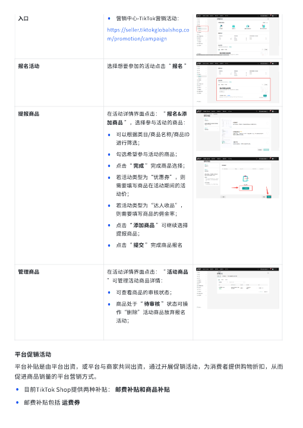](../images/27/page-039.png)

入口⟦U+0001⟧•营销中心-TikTok营销活动：⟦U+0001⟧https://seller.tiktokglobalshop.com/promotion/campaign⟦U+0001⟧报名活动⟦U+0001⟧选择想要参加的活动点击“⟦U+0001⟧报名⟦U+0001⟧”⟦U+0001⟧提报商品⟦U+0001⟧在活动详情界面点击：“⟦U+0001⟧报名&添加商品⟦U+0001⟧”，选择参与活动的商品：⟦U+0001⟧•可以根据类目/商品名称/商品ID进行筛选；⟦U+0001⟧•勾选希望参与活动的商品；⟦U+0001⟧•点击“⟦U+0001⟧完成⟦U+0001⟧”完成商品选择；⟦U+0001⟧•若活动类型为“优惠券”，则需要填写商品在活动期间的活动价；⟦U+0001⟧•若活动类型为“达人收品”，则需要填写商品的佣金率；⟦U+0001⟧•点击“⟦U+0001⟧添加商品⟦U+0001⟧”可继续选择提报商品；⟦U+0001⟧•点击“⟦U+0001⟧提交⟦U+0001⟧”完成商品报名⟦U+0001⟧管理商品⟦U+0001⟧在活动详情界面点击：“⟦U+0001⟧活动商品⟦U+0001⟧”可管理活动商品详情：⟦U+0001⟧•可查看商品的审核状态；⟦U+0001⟧•商品处于“⟦U+0001⟧待审核⟦U+0001⟧”状态可操作“删除”活动商品放弃报名活动；⟦U+0001⟧平台促销活动平台补贴是由平台出资，或平台与商家共同出资，通过开展促销活动，为消费者提供购物折扣，从而促进商品销量的平台营销方式。•目前TikTok⟦U+0001⟧Shop提供两种补贴：⟦U+0001⟧邮费补贴和商品补贴⟦U+0001⟧•邮费补贴包括⟦U+0001⟧运费券⟦U+0001⟧

## 第 40 页

[打开第 40 页图片](../images/27/page-040.png)（510×720）

[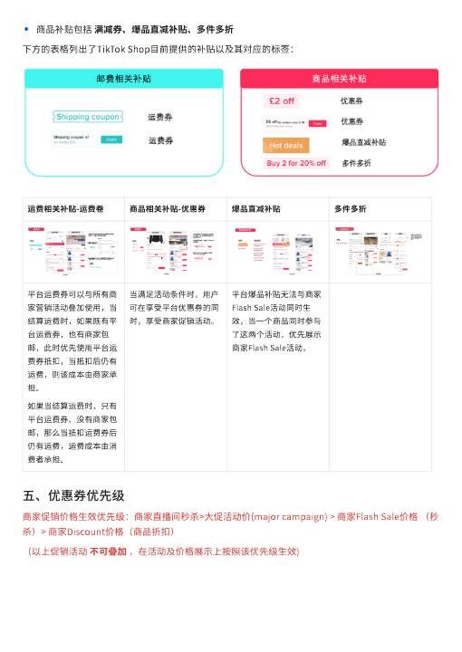](../images/27/page-040.png)

•商品补贴包括⟦U+0001⟧满减券、爆品直减补贴、多件多折⟦U+0001⟧下方的表格列出了TikTok⟦U+0001⟧Shop目前提供的补贴以及其对应的标签：⟦U+0001⟧运费相关补贴-运费卷⟦U+0001⟧商品相关补贴-优惠券⟦U+0001⟧爆品直减补贴⟦U+0001⟧多件多折⟦U+0001⟧平台运费券可以与所有商家营销活动叠加使用，当结算运费时，如果既有平台运费券，也有商家包邮，此时优先使用平台运费券抵扣，当抵扣后仍有运费，则该成本由商家承担。⟦U+0001⟧如果当结算运费时，只有平台运费券、没有商家包邮，那么当抵扣运费券后仍有运费，运费成本由消费者承担。⟦U+0001⟧当满足活动条件时，用戶可在享受平台优惠券的同时，享受商家促销活动。⟦U+0001⟧平台爆品补贴无法与商家Flash⟦U+0001⟧Sale活动同时生效，当一个商品同时参与了这两个活动，优先展示商家Flash⟦U+0001⟧Sale活动。⟦U+0001⟧五、优惠券优先级商家促销价格生效优先级：商家直播间秒杀>大促活动价(major⟦U+0001⟧campaign)⟦U+0001⟧>⟦U+0001⟧商家Flash⟦U+0001⟧Sale价格⟦U+0001⟧（秒杀）>⟦U+0001⟧商家Discount价格（商品折扣）⟦U+0001⟧（以上促销活动⟦U+0001⟧不可叠加⟦U+0001⟧，在活动及价格展示上按照该优先级生效)⟦U+0001⟧

## 第 41 页

[打开第 41 页图片](../images/27/page-041.png)（510×720）

[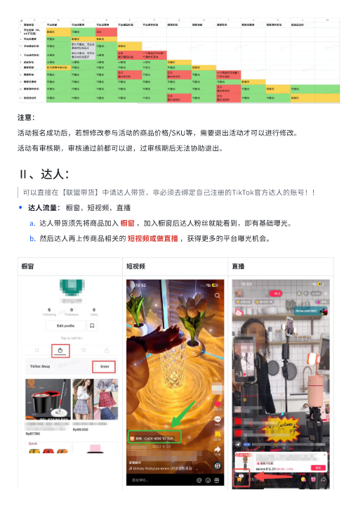](../images/27/page-041.png)

注意：活动报名成功后，若想修改参与活动的商品价格/SKU等，需要退出活动才可以进行修改。⟦U+0001⟧活动有审核期，审核通过前都可以退，过审核期后无法协助退出。II、达人：可以直接在【联盟带货】中请达人带货，非必须去绑定自己注册的TikTok官方达人的账号！！⟦U+0001⟧•达人流量：⟦U+0001⟧橱窗，短视频，直播⟦U+0001⟧a.达人带货须先将商品加入⟦U+0001⟧橱窗⟦U+0001⟧，加入橱窗后达人粉丝就能看到，即有基础曝光。⟦U+0001⟧b.然后达人再上传商品相关的⟦U+0001⟧短视频或做直播⟦U+0001⟧，获得更多的平台曝光机会。⟦U+0001⟧橱窗⟦U+0001⟧短视频⟦U+0001⟧直播⟦U+0001⟧

## 第 42 页

[打开第 42 页图片](../images/27/page-042.png)（510×720）

[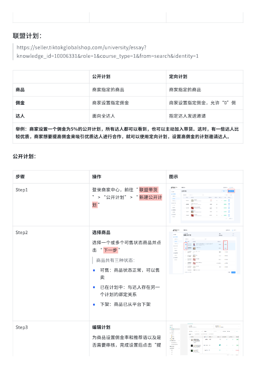](../images/27/page-042.png)

联盟计划：⟦U+0001⟧https://seller.tiktokglobalshop.com/university/essay?knowledge_id=10006331&role=1&course_type=1&from=search&identity=1⟦U+0001⟧公开计划⟦U+0001⟧定向计划⟦U+0001⟧商品⟦U+0001⟧商家指定的商品⟦U+0001⟧商家指定的商品⟦U+0001⟧佣金⟦U+0001⟧商家设置指定佣金⟦U+0001⟧商家设置指定佣金，允许“0”佣⟦U+0001⟧达人⟦U+0001⟧面向全达人⟦U+0001⟧指定达人发送邀请⟦U+0001⟧举例：商家设置一个佣金为5%的公开计划，所有达人都可以看到，也可以主动加入带货。这时，有一些达人比较优质，商家想要提高佣金来吸引优质达人进行合作，就可以使用定向计划，设置高佣金的计划邀请达人。⟦U+0001⟧公开计划：步骤⟦U+0001⟧操作⟦U+0001⟧图示⟦U+0001⟧Step1⟦U+0001⟧登录商家中心，前往“⟦U+0001⟧联盟带货⟦U+0001⟧”⟦U+0001⟧>⟦U+0001⟧“公开计划”⟦U+0001⟧>⟦U+0001⟧“⟦U+0001⟧新建公开计划⟦U+0001⟧”⟦U+0001⟧Step2⟦U+0001⟧选择商品⟦U+0001⟧选择一个或多个可售状态商品并点击⟦U+0001⟧“⟦U+0001⟧下一步⟦U+0001⟧”⟦U+0001⟧商品共有三种状态：⟦U+0001⟧•可售：商品状态正常，可以售卖⟦U+0001⟧•已在计划中：与达人存在另一个计划的绑定关系⟦U+0001⟧•下架：商品已从平台下架⟦U+0001⟧Step3⟦U+0001⟧编辑计划⟦U+0001⟧为商品设置佣金率和推荐语以及是否需要审核，完成设置后点击“提

## 第 43 页

[打开第 43 页图片](../images/27/page-043.png)（510×720）

[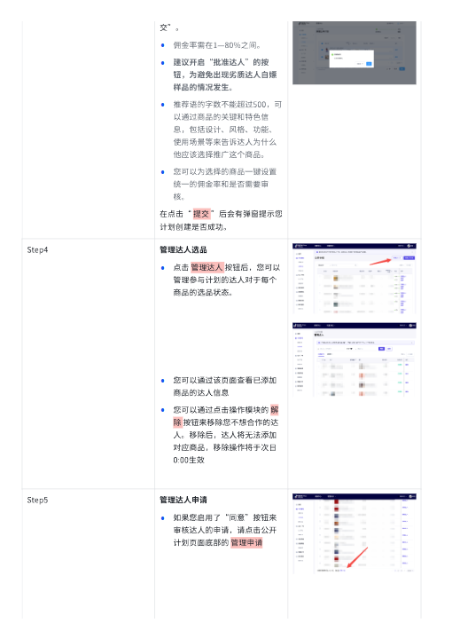](../images/27/page-043.png)

交”。⟦U+0001⟧•佣金率需在1—80%之间。⟦U+0001⟧•建议开启“批准达人”的按钮，为避免出现劣质达人白嫖样品的情况发生。⟦U+0001⟧•推荐语的字数不能超过500，可以通过商品的关键和特色信息，包括设计、⻛格、功能、使用场景等来告诉达人为什么他应该选择推广这个商品。⟦U+0001⟧•您可以为选择的商品一键设置统一的佣金率和是否需要审核。⟦U+0001⟧在点击“⟦U+0001⟧提交⟦U+0001⟧”后会有弹窗提示您计划创建是否成功。⟦U+0001⟧Step4⟦U+0001⟧管理达人选品⟦U+0001⟧•点击⟦U+0001⟧管理达人⟦U+0001⟧按钮后，您可以管理参与计划的达人对于每个商品的选品状态。⟦U+0001⟧•您可以通过该⻚面查看已添加商品的达人信息⟦U+0001⟧•您可以通过点击操作模块的⟦U+0001⟧解除⟦U+0001⟧按钮来移除您不想合作的达人。移除后，达人将无法添加对应商品，移除操作将于次日0:00生效⟦U+0001⟧Step5⟦U+0001⟧管理达人申请⟦U+0001⟧•如果您启用了“同意”按钮来审核达人的申请，请点击公开计划⻚面底部的⟦U+0001⟧管理申请⟦U+0001⟧

## 第 44 页

[打开第 44 页图片](../images/27/page-044.png)（510×720）

[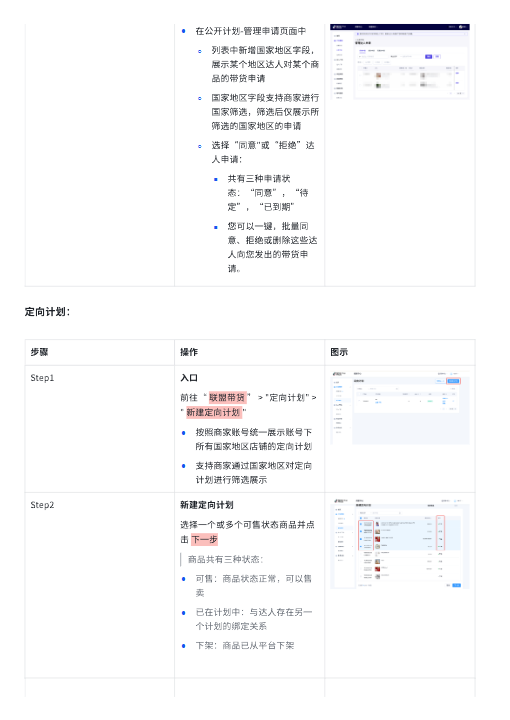](../images/27/page-044.png)

•在公开计划-管理申请⻚面中⟦U+0001⟧◦列表中新增国家地区字段，展示某个地区达人对某个商品的带货申请⟦U+0001⟧◦国家地区字段支持商家进行国家筛选，筛选后仅展示所筛选的国家地区的申请⟦U+0001⟧◦选择“同意"或“拒绝”达人申请：⟦U+0001⟧▪共有三种申请状态：“同意”，“待定”，“已到期”⟦U+0001⟧▪您可以一键，批量同意、拒绝或删除这些达人向您发出的带货申请。⟦U+0001⟧定向计划：步骤⟦U+0001⟧操作⟦U+0001⟧图示⟦U+0001⟧Step1⟦U+0001⟧入口⟦U+0001⟧前往“⟦U+0001⟧联盟带货⟦U+0001⟧”⟦U+0001⟧>⟦U+0001⟧"定向计划"⟦U+0001⟧>⟦U+0001⟧"⟦U+0001⟧新建定向计划⟦U+0001⟧"⟦U+0001⟧•按照商家账号统一展示账号下所有国家地区店铺的定向计划⟦U+0001⟧•支持商家通过国家地区对定向计划进行筛选展示⟦U+0001⟧Step2⟦U+0001⟧新建定向计划⟦U+0001⟧选择一个或多个可售状态商品并点击⟦U+0001⟧下一步⟦U+0001⟧商品共有三种状态：⟦U+0001⟧•可售：商品状态正常，可以售卖⟦U+0001⟧•已在计划中：与达人存在另一个计划的绑定关系⟦U+0001⟧•下架：商品已从平台下架⟦U+0001⟧

## 第 45 页

[打开第 45 页图片](../images/27/page-045.png)（510×720）

[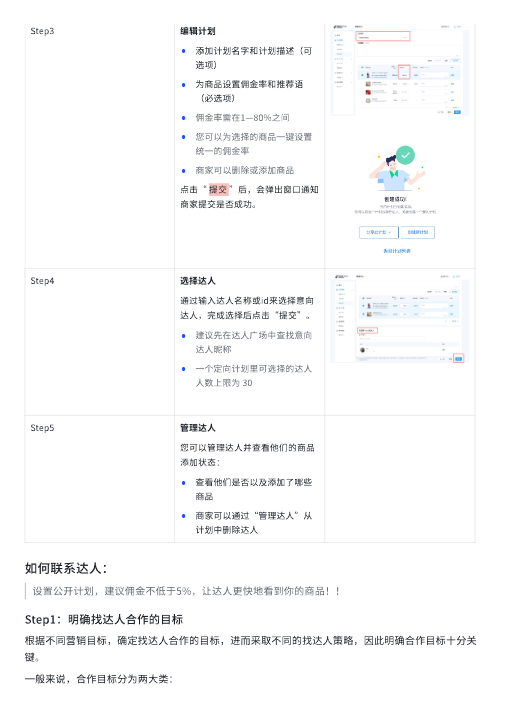](../images/27/page-045.png)

Step3⟦U+0001⟧编辑计划⟦U+0001⟧•添加计划名字和计划描述（可选项）⟦U+0001⟧•为商品设置佣金率和推荐语（必选项）⟦U+0001⟧•佣金率需在1—80%之间⟦U+0001⟧•您可以为选择的商品一键设置统一的佣金率⟦U+0001⟧•商家可以删除或添加商品⟦U+0001⟧点击“⟦U+0001⟧提交⟦U+0001⟧”后，会弹出窗口通知商家提交是否成功。⟦U+0001⟧Step4⟦U+0001⟧选择达人⟦U+0001⟧通过输入达人名称或id来选择意向达人，完成选择后点击“提交”。⟦U+0001⟧•建议先在达人广场中查找意向达人昵称⟦U+0001⟧•一个定向计划里可选择的达人人数上限为⟦U+0001⟧30⟦U+0001⟧Step5⟦U+0001⟧管理达人⟦U+0001⟧您可以管理达人并查看他们的商品添加状态：⟦U+0001⟧•查看他们是否以及添加了哪些商品⟦U+0001⟧•商家可以通过“管理达人”从计划中删除达人⟦U+0001⟧如何联系达人：⟦U+0001⟧设置公开计划，建议佣金不低于5%，让达人更快地看到你的商品！！⟦U+0001⟧Step1：明确找达人合作的目标⟦U+0001⟧根据不同营销目标，确定找达人合作的目标，进而采取不同的找达人策略，因此明确合作目标十分关键。一般来说，合作目标分为两大类：

## 第 46 页

[打开第 46 页图片](../images/27/page-046.png)（510×720）

[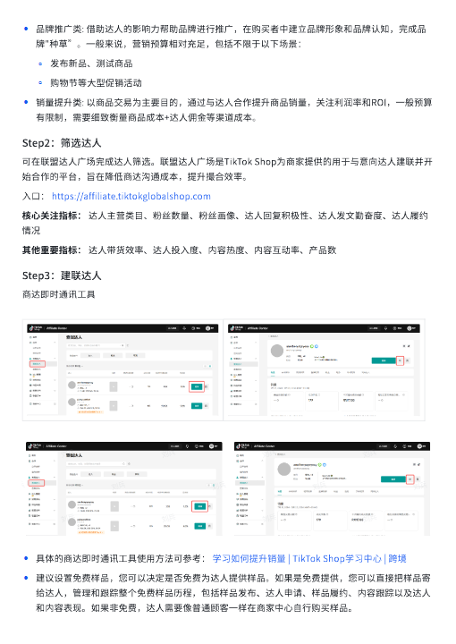](../images/27/page-046.png)

•品牌推广类:⟦U+0001⟧借助达人的影响力帮助品牌进行推广，在购买者中建立品牌形象和品牌认知，完成品牌"种草”。一般来说，营销预算相对充足，包括不限于以下场景：⟦U+0001⟧◦发布新品、测试商品◦购物节等大型促销活动•销量提升类:⟦U+0001⟧以商品交易为主要目的，通过与达人合作提升商品销量，关注利润率和ROI，一般预算有限制，需要细致衡量商品成本+达人佣金等渠道成本。⟦U+0001⟧Step2：筛选达人⟦U+0001⟧可在联盟达人广场完成达人筛选。联盟达人广场是TikTok⟦U+0001⟧Shop为商家提供的用于与意向达人建联并开始合作的平台，旨在降低商达沟通成本，提升撮合效率。入口：⟦U+0001⟧https://affiliate.tiktokglobalshop.com⟦U+0001⟧核心关注指标：⟦U+0001⟧达人主营类目、粉丝数量、粉丝画像、达人回复积极性、达人发文勤奋度、达人履约情况其他重要指标：⟦U+0001⟧达人带货效率、达人投入度、内容热度、内容互动率、产品数⟦U+0001⟧Step3：建联达人⟦U+0001⟧商达即时通讯工具•具体的商达即时通讯工具使用方法可参考：⟦U+0001⟧学习如何提升销量⟦U+0001⟧|⟦U+0001⟧TikTok⟦U+0001⟧Shop学习中心⟦U+0001⟧|⟦U+0001⟧跨境⟦U+0001⟧•建议设置免费样品，您可以决定是否免费为达人提供样品。如果是免费提供，您可以直接把样品寄给达人，管理和跟踪整个免费样品历程，包括样品发布、达人申请、样品履约、内容跟踪以及达人和内容表现。如果非免费，达人需要像普通顾客一样在商家中心自行购买样品。

## 第 47 页

[打开第 47 页图片](../images/27/page-047.png)（510×720）

[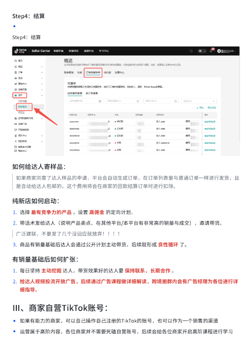](../images/27/page-047.png)

Step4：结算⟦U+0001⟧•Step4：结算⟦U+0001⟧如何给达人寄样品：⟦U+0001⟧如果商家同意了达人样品的申请，平台会自动生成订单，在订单列表里与普通订单一样进行发货，且是自动给达人包邮的，这个费用将会在商家的回款结算订单时进行扣除。纯新店如何启动：⟦U+0001⟧1.选择⟦U+0001⟧最有竞争力的产品⟦U+0001⟧，设置⟦U+0001⟧高佣金⟦U+0001⟧的定向计划。⟦U+0001⟧2.带话术发给达人（说明产品卖点、在其他平台/本平台有非常高的销量与成交），邀请带货。⟦U+0001⟧广泛建联，不要发了几个没回应就放弃！！！！3.商品有销量基础后达人会通过公开计划主动带货，后续就形成⟦U+0001⟧良性循环⟦U+0001⟧了。⟦U+0001⟧有销量基础后如何扩张：⟦U+0001⟧1.每日坚持⟦U+0001⟧主动挖掘⟦U+0001⟧达人，带货效果好的达人要⟦U+0001⟧保持联系，⻓期合作⟦U+0001⟧。⟦U+0001⟧2.给达人视频投流开放广告，后续通过广告课程做详细解读，跨境圈群内会有广告经理为各位进行详细指导。III、商家自营TikTok账号：⟦U+0001⟧•如果有能力的商家，可以自己操作自己注册的TikTok的账号，也可以作为一个销售的渠道⟦U+0001⟧•运营属于高阶内容，各位商家并不需要死磕自营账号，后续会给各位商家开启高阶课程进行学习

## 第 48 页

[打开第 48 页图片](../images/27/page-048.png)（510×720）

本节总结：新商家需要打好商品基础，通过使用促销工具让我们的商品在商城中快速出单；有销量基础的商品能够很容易找到达人带货，进一步放大订单；后续综合使用广告、直播等方式大卖。
