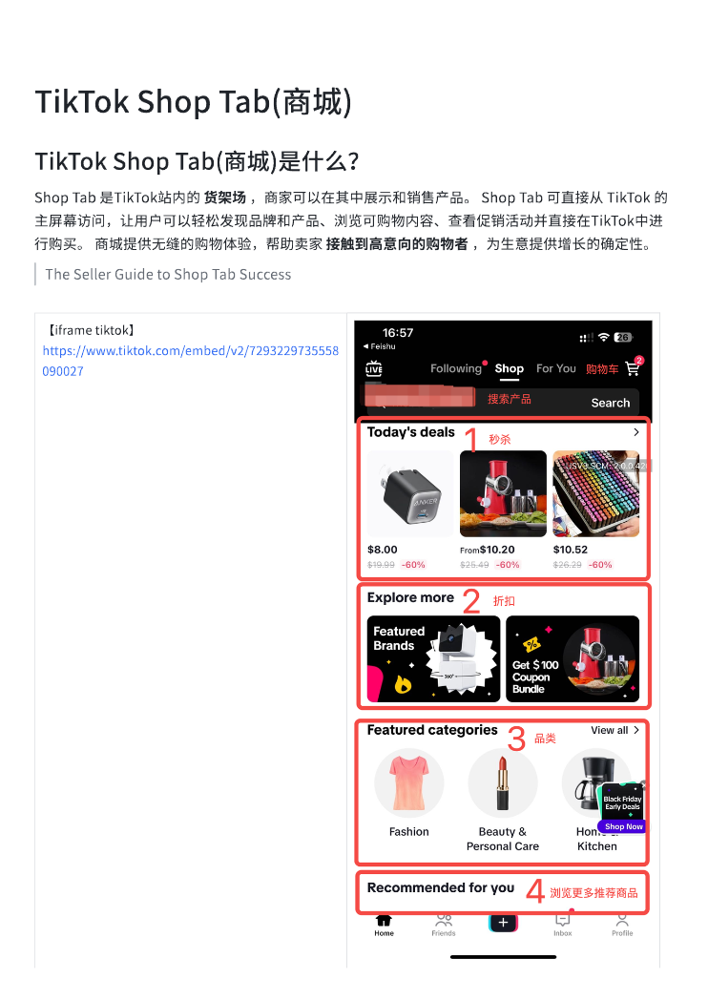
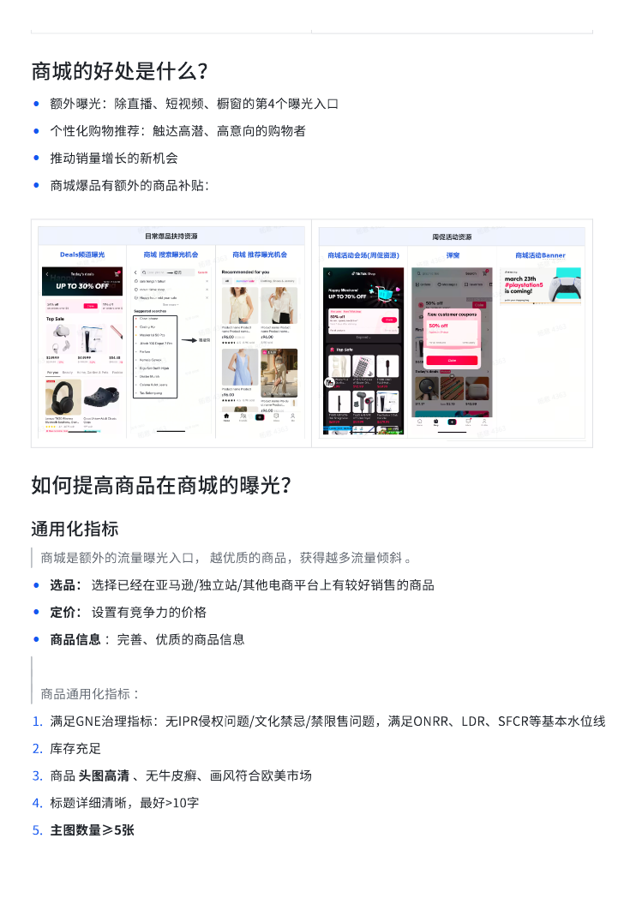
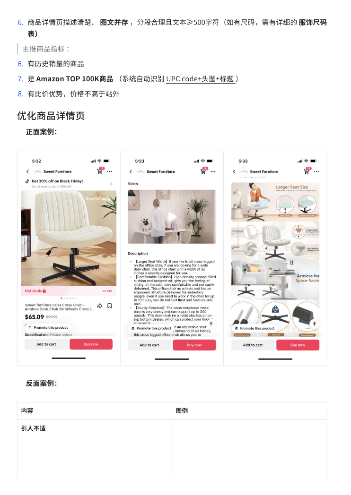
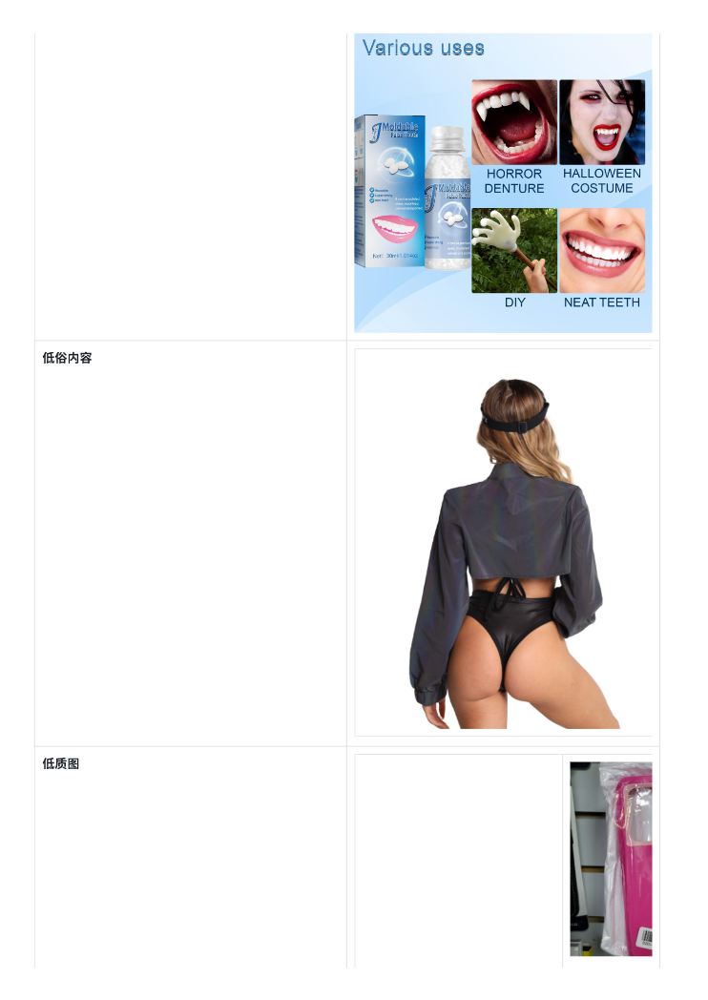
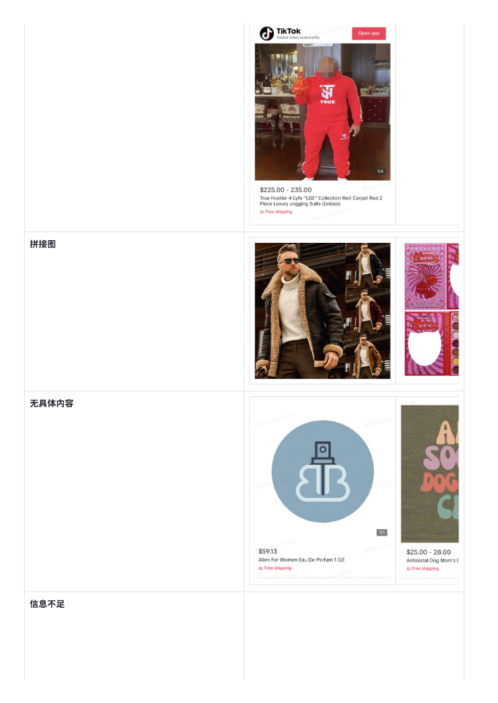
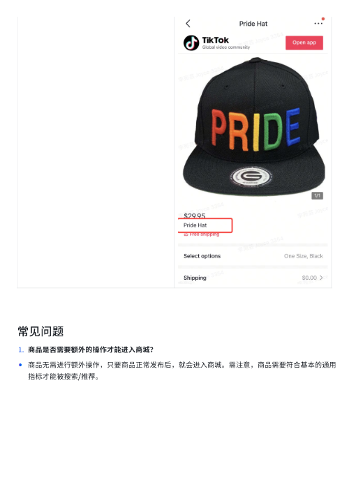

# TikTok Shop Tab(商城).pdf — 预览版

- 附件序号：28（manifest.attachments 原顺序）
- 来源：https://dcni26t4qg0z.feishu.cn/wiki/EVUtwnBTMiSx0Okr4QiciHrTnof
- 采集日期：2026-10-10（Asia/Shanghai）
- 采集证据：[28.dom.json](../raw/28.dom.json)
- 范围：浏览器预览文字与已采集的逐页图片；原文件下载状态另行记录，转换过程未产生原文件。
- 页图可保留预览中显示的文内图片；未恢复原始图片素材、可编辑Word文档、Excel公式或原始附件。
- 文字页覆盖：采集JSON中每一页均有非空DOM文字记录；这不证明图片中文字已转录或每页文字绝对完整。
- 预览记录总页数：6（0 表示查看器状态，不能推断原文件无页）
- 明确文字页号：1、2、3、4、5、6
- 页图覆盖：6/6 页；所有已观测预览页均有尺寸合格且PNG完整的页图。
- 有效页图页号：1、2、3、4、5、6
- 原文件：本次预览转换保存 0 个原文件；图片文字不计作已采集DOM文字。
- 预览文本层包含控制字符；以 ⟦U+XXXX⟧ 标记保留，不猜测其含义。
- 页内换行：仅依据原DOM顺序和真实span top坐标恢复，忽略小于半个相邻字号的基线偏移；原text整串及span样式保留在JSON中，不按语义划分段落。
- 原始采集候选：[28.snapshot.txt](../raw/source-captures/28-951a371d95de-28.snapshot.txt)
- 原始采集候选：[28-dom.json](../raw/source-captures/28-87d098ab0d52-28-dom.json)

## 预览正文

## 第 1 页

[打开第 1 页图片](../images/28/page-001.png)（742×1048）

TikTok⟦U+0001⟧Shop⟦U+0001⟧Tab(商城)⟦U+0001⟧  
TikTok⟦U+0001⟧Shop⟦U+0001⟧Tab(商城)是什么？⟦U+0001⟧  
Shop⟦U+0001⟧Tab⟦U+0001⟧是TikTok站内的⟦U+0001⟧货架场⟦U+0001⟧，商家可以在其中展示和销售产品。⟦U+0001⟧Shop⟦U+0001⟧Tab⟦U+0001⟧可直接从⟦U+0001⟧TikTok⟦U+0001⟧的  
主屏幕访问，让用戶可以轻松发现品牌和产品、浏览可购物内容、查看促销活动并直接在TikTok中进  
行购买。⟦U+0001⟧商城提供无缝的购物体验，帮助卖家⟦U+0001⟧接触到高意向的购物者⟦U+0001⟧，为生意提供增⻓的确定性。⟦U+0001⟧  
The⟦U+0001⟧Seller⟦U+0001⟧Guide⟦U+0001⟧to⟦U+0001⟧Shop⟦U+0001⟧Tab⟦U+0001⟧Success⟦U+0001⟧  
【iframe⟦U+0001⟧tiktok】  
https://www.tiktok.com/embed/v2/7293229735558  
090027⟦U+0001⟧

## 第 2 页

[打开第 2 页图片](../images/28/page-002.png)（742×1048）

商城的好处是什么？  
•额外曝光：除直播、短视频、橱窗的第4个曝光入口⟦U+0001⟧  
•个性化购物推荐：触达高潜、高意向的购物者  
•推动销量增⻓的新机会  
•商城爆品有额外的商品补贴：  
如何提高商品在商城的曝光？  
通用化指标  
商城是额外的流量曝光入口，⟦U+0001⟧越优质的商品，获得越多流量倾斜⟦U+0001⟧。⟦U+0001⟧  
•选品：⟦U+0001⟧选择已经在亚⻢逊/独立站/其他电商平台上有较好销售的商品⟦U+0001⟧  
•定价：⟦U+0001⟧设置有竞争力的价格⟦U+0001⟧  
•商品信息⟦U+0001⟧：完善、优质的商品信息⟦U+0001⟧  
商品通用化指标⟦U+0001⟧：⟦U+0001⟧  
1.满足GNE治理指标：无IPR侵权问题/文化禁忌/禁限售问题，满足ONRR、LDR、SFCR等基本水位线⟦U+0001⟧  
2.库存充足  
3.商品⟦U+0001⟧头图高清⟦U+0001⟧、无牛皮癣、画⻛符合欧美市场⟦U+0001⟧  
4.标题详细清晰，最好>10字⟦U+0001⟧  
5.主图数量≥5张⟦U+0001⟧

## 第 3 页

[打开第 3 页图片](../images/28/page-003.png)（742×1048）

6.商品详情⻚描述清楚、⟦U+0001⟧图文并存⟦U+0001⟧，分段合理且文本≥500字符（如有尺码，需有详细的⟦U+0001⟧服饰尺码  
表）  
主推商品指标⟦U+0001⟧：⟦U+0001⟧  
6.有历史销量的商品  
7.是⟦U+0001⟧Amazon⟦U+0001⟧TOP⟦U+0001⟧100K商品⟦U+0001⟧（系统自动识别⟦U+0001⟧UPC⟦U+0001⟧code+头图+标题⟦U+0001⟧）⟦U+0001⟧  
8.有比价优势，价格不高于站外  
优化商品详情⻚  
✅正面案例：⟦U+0001⟧  
❌反面案例：⟦U+0001⟧  
内容⟦U+0001⟧图例⟦U+0001⟧  
引人不适⟦U+0001⟧

## 第 4 页

[打开第 4 页图片](../images/28/page-004.png)（742×1048）

低俗内容⟦U+0001⟧  
低质图⟦U+0001⟧

## 第 5 页

[打开第 5 页图片](../images/28/page-005.png)（742×1048）

拼接图⟦U+0001⟧  
无具体内容⟦U+0001⟧  
信息不足⟦U+0001⟧

## 第 6 页

[打开第 6 页图片](../images/28/page-006.png)（510×721）

常⻅问题  
1.商品是否需要额外的操作才能进入商城？  
•商品无需进行额外操作，只要商品正常发布后，就会进入商城。需注意，商品需要符合基本的通用  
指标才能被搜索/推荐。⟦U+0001⟧
