# TikTok跨境小店注册流程.doc — 预览版

- 附件序号：29（manifest.attachments 原顺序）
- 来源：https://dcni26t4qg0z.feishu.cn/wiki/EVUtwnBTMiSx0Okr4QiciHrTnof
- 采集日期：2026-10-13（Asia/Shanghai）
- 采集证据：[29.dom.json](../raw/29.dom.json)
- 范围：浏览器预览文字与已采集的逐页图片；原文件下载状态另行记录，转换过程未产生原文件。
- 页图可保留预览中显示的文内图片；未恢复原始图片素材、可编辑Word文档、Excel公式或原始附件。
- 文字页覆盖：部分或未知；不能把侧栏页号当作已采集正文页。
- 预览记录总页数：11（0 表示查看器状态，不能推断原文件无页）
- 明确文字页号：1、2、3、4、5、6、11
- 页图覆盖：11/11 页；所有已观测预览页均有尺寸合格且PNG完整的页图。
- 有效页图页号：1、2、3、4、5、6、7、8、9、10、11
- 原文件：本次预览转换保存 0 个原文件；图片文字不计作已采集DOM文字。
- 页内换行：仅依据原DOM顺序和真实span top坐标恢复，忽略小于半个相邻字号的基线偏移；原text整串及span样式保留在JSON中，不按语义划分段落。
- 原始采集候选：[29-dom.json](../raw/source-captures/29-684e54334617-29-dom.json)

## 预览正文

## 第 1 页

[打开第 1 页图片](../images/29/page-001.png)（994×1404）

[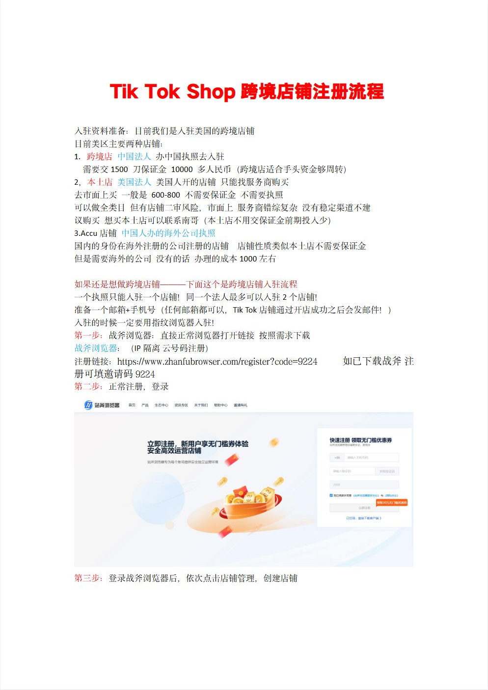](../images/29/page-001.png)

TikTokShop跨境店铺注册流程  
入驻资料准备：目前我们是入驻美国的跨境店铺  
目前美区主要两种店铺：  
1.跨境店中国法人办中国执照去入驻  
需要交1500刀保证金10000多人民币（跨境店适合手头资金够周转）  
2，本土店美国法人美国人开的店铺只能找服务商购买  
去市面上买一般是600-800不需要保证金不需要执照  
可以做全类目但有店铺二审风险，市面上服务商错综复杂没有稳定渠道不建  
议购买想买本土店可以联系南哥（本土店不用交保证金前期投入少）  
3.Accu店铺中国人办的海外公司执照  
国内的身份在海外注册的公司注册的店铺店铺性质类似本土店不需要保证金  
但是需要海外的公司没有的话办理的成本1000左右  
如果还是想做跨境店铺———下面这个是跨境店铺入驻流程  
一个执照只能入驻一个店铺！同一个法人最多可以入驻2个店铺！  
准备一个邮箱+手机号（任何邮箱都可以，TikTok店铺通过开店成功之后会发邮件！）  
入驻的时候一定要用指纹浏览器入驻！  
第一步：战斧浏览器：直接正常浏览器打开链接按照需求下载  
战斧浏览器：（IP隔离云号码注册）  
注册链接：https://www.zhanfubrowser.com/register?code=9224如已下载战斧注  
册可填邀请码9224  
第二步：正常注册，登录  
第三步：登录战斧浏览器后，依次点击店铺管理，创建店铺

## 第 2 页

[打开第 2 页图片](../images/29/page-002.png)（716×1011）

[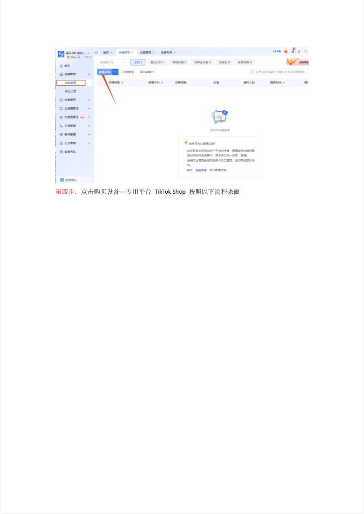](../images/29/page-002.png)

第四步：点击购买设备—专用平台TikTokShop按照以下流程来做

## 第 3 页

[打开第 3 页图片](../images/29/page-003.png)（716×1011）

[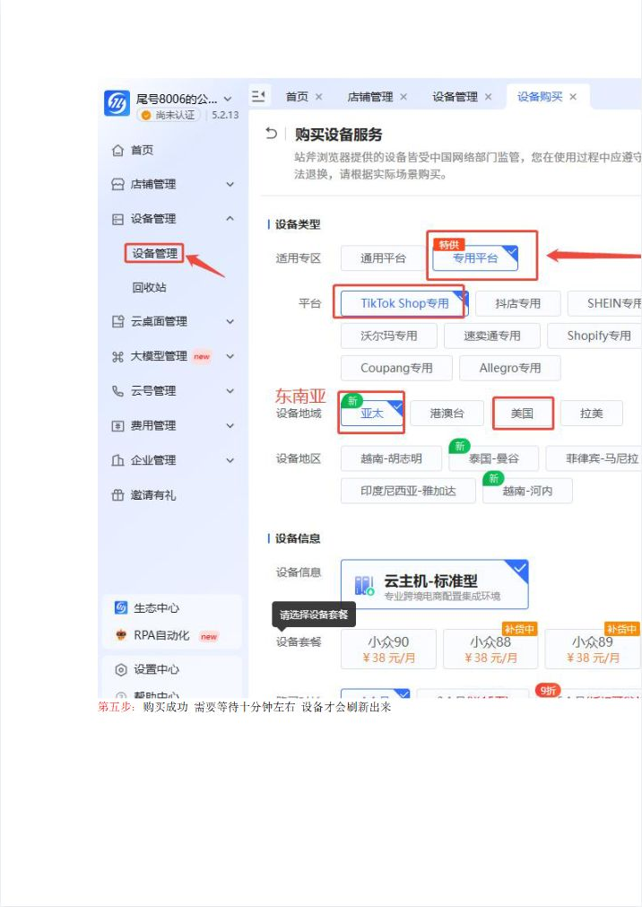](../images/29/page-003.png)

第五步：购买成功需要等待十分钟左右设备才会刷新出来

## 第 4 页

[打开第 4 页图片](../images/29/page-004.png)（716×1011）

[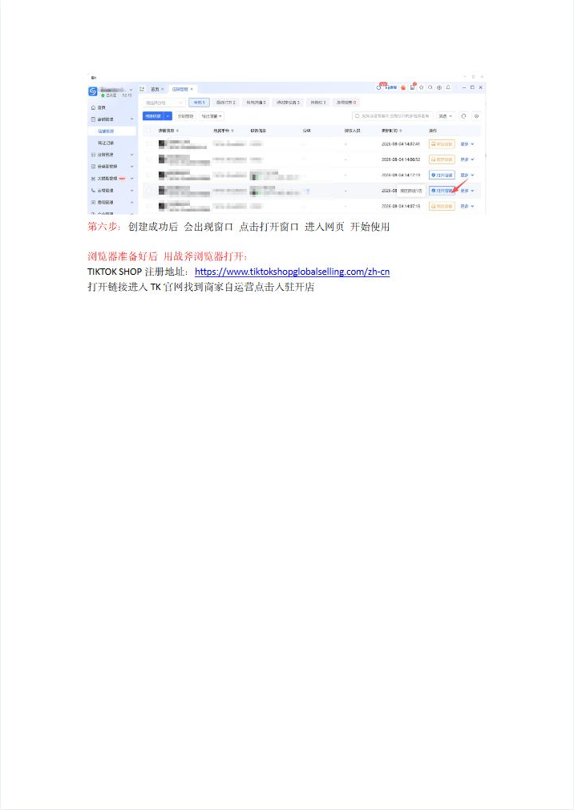](../images/29/page-004.png)

第六步：创建成功后会出现窗口点击打开窗口进入网页开始使用  
浏览器准备好后用战斧浏览器打开：  
TIKTOKSHOP注册地址：https://www.tiktokshopglobalselling.com/zh-cn  
打开链接进入TK官网找到商家自运营点击入驻开店

## 第 5 页

[打开第 5 页图片](../images/29/page-005.png)（716×1011）

[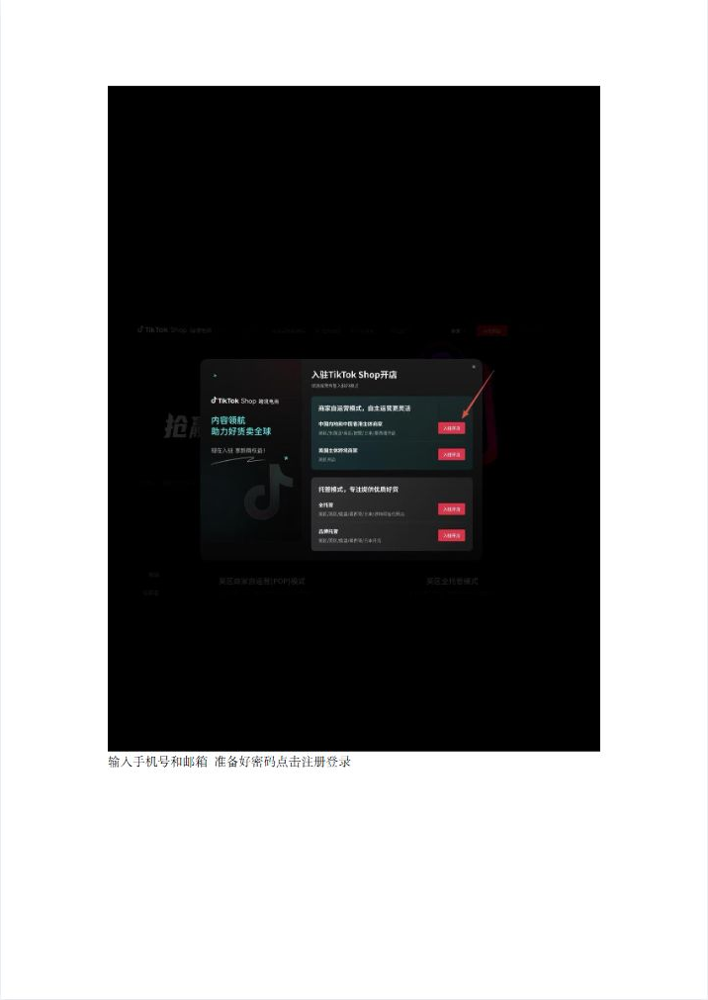](../images/29/page-005.png)

输入手机号和邮箱准备好密码点击注册登录

## 第 6 页

[打开第 6 页图片](../images/29/page-006.png)（716×1011）

[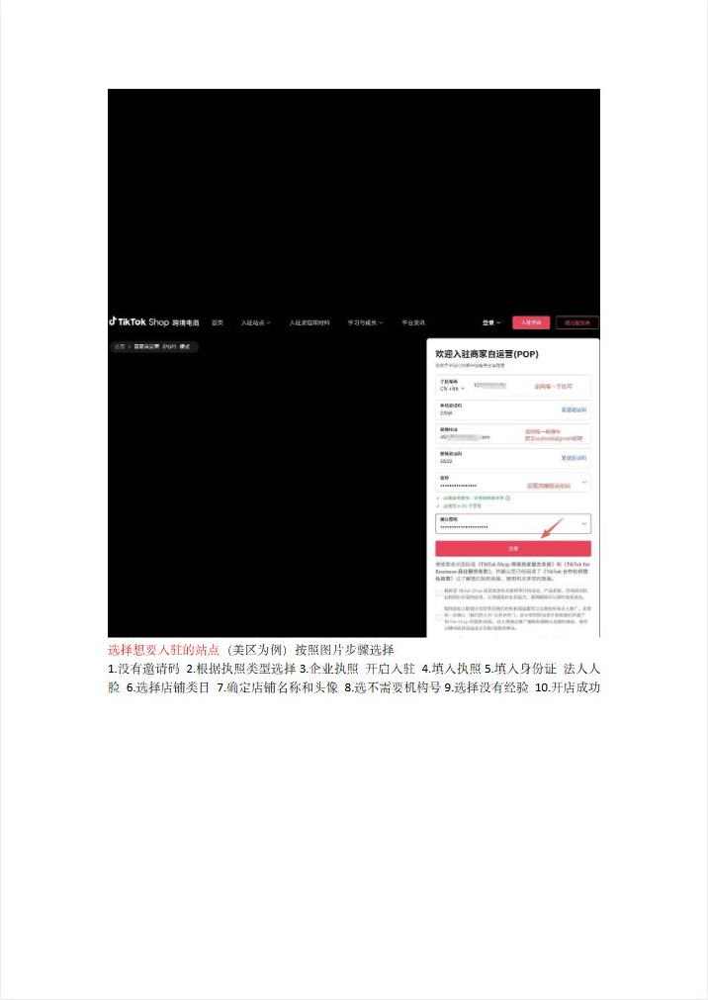](../images/29/page-006.png)

选择想要入驻的站点（美区为例）按照图片步骤选择  
1.没有邀请码2.根据执照类型选择3.企业执照开启入驻4.填入执照5.填入身份证法人人  
脸6.选择店铺类目7.确定店铺名称和头像8.选不需要机构号9.选择没有经验10.开店成功

## 第 7 页

[打开第 7 页图片](../images/29/page-007.png)（763×1080）

[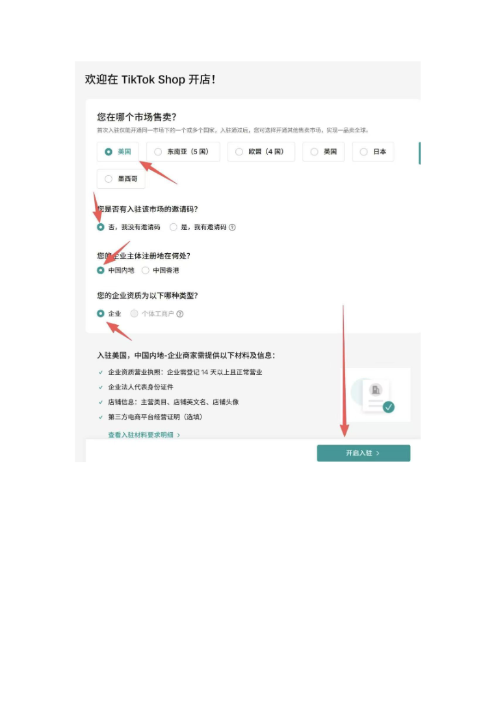](../images/29/page-007.png)

> 此页未返回非图片DOM正文文字；不推测图片中的内容。

## 第 8 页

[打开第 8 页图片](../images/29/page-008.png)（764×1080）

[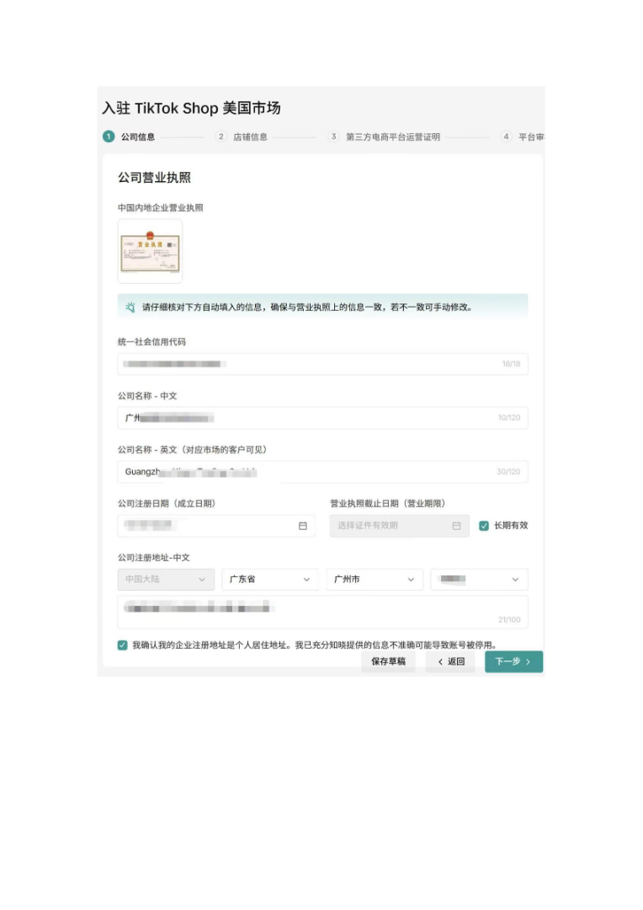](../images/29/page-008.png)

> 此页未返回非图片DOM正文文字；不推测图片中的内容。

## 第 9 页

[打开第 9 页图片](../images/29/page-009.png)（764×1080）

[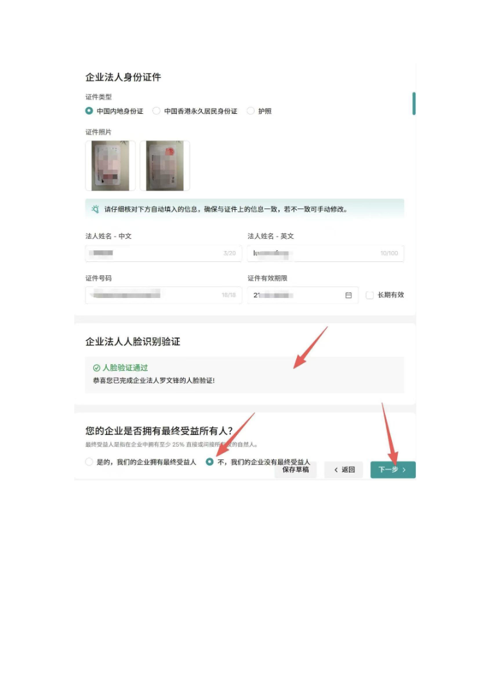](../images/29/page-009.png)

> 此页未返回非图片DOM正文文字；不推测图片中的内容。

## 第 10 页

[打开第 10 页图片](../images/29/page-010.png)（764×1080）

[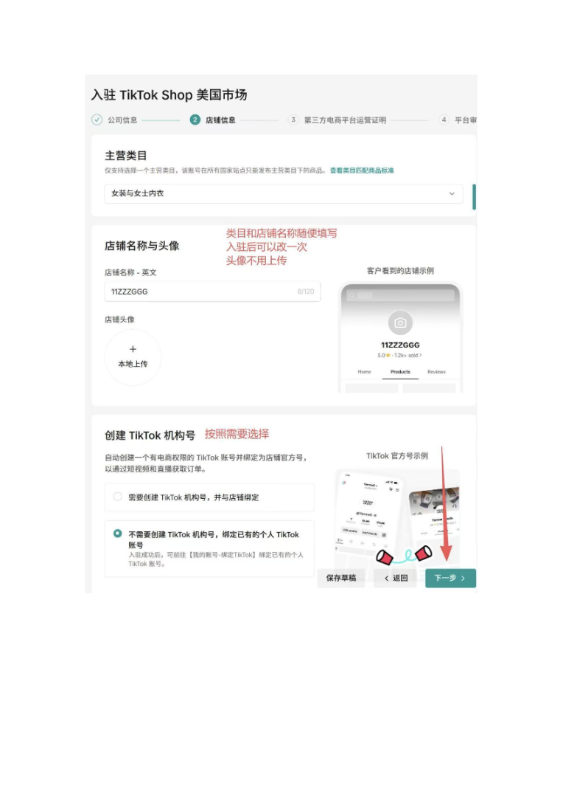](../images/29/page-010.png)

> 此页未返回非图片DOM正文文字；不推测图片中的内容。

## 第 11 页

[打开第 11 页图片](../images/29/page-011.png)（764×1080）

[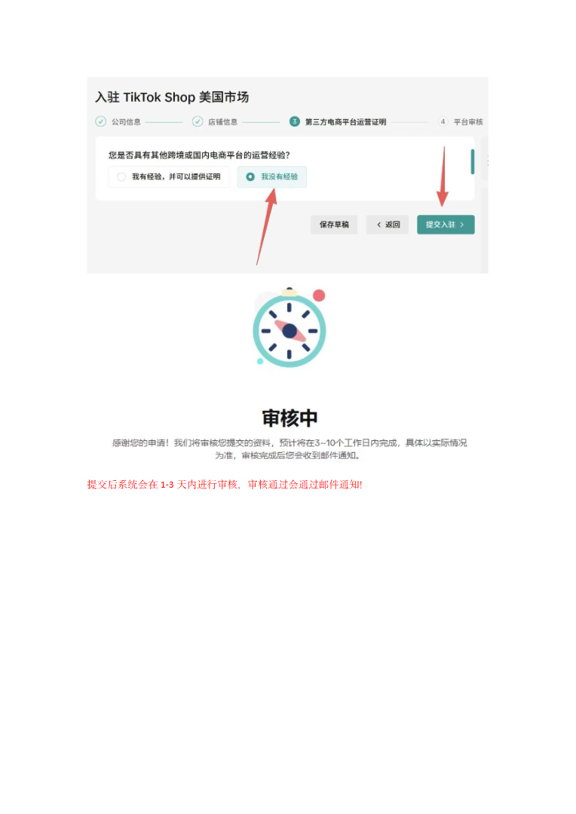](../images/29/page-011.png)

提交后系统会在1-3天内进行审核，审核通过会通过邮件通知！
