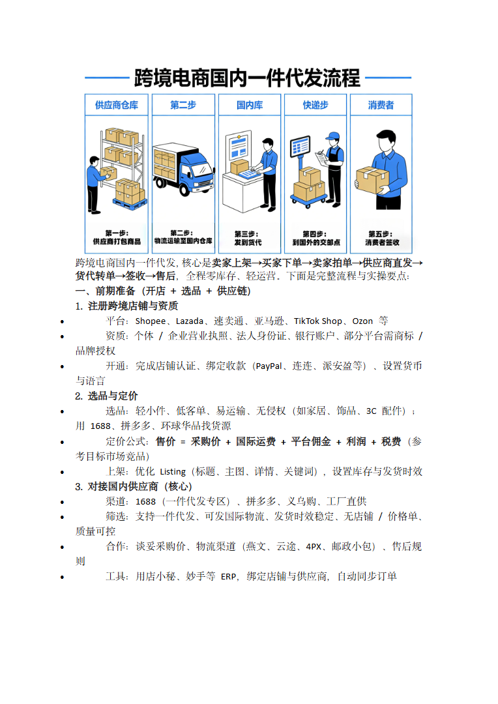

# 跨境电商国内一件代发流程.doc — 预览版

- 附件序号：31（manifest.attachments 原顺序）
- 来源：https://dcni26t4qg0z.feishu.cn/wiki/EVUtwnBTMiSx0Okr4QiciHrTnof
- 采集日期：2026-10-13（Asia/Shanghai）
- 采集证据：[31.dom.json](../raw/31.dom.json)
- 范围：浏览器预览文字与已采集的逐页图片；原文件下载状态另行记录，转换过程未产生原文件。
- 页图可保留预览中显示的文内图片；未恢复原始图片素材、可编辑Word文档、Excel公式或原始附件。
- 文字页覆盖：采集JSON中每一页均有非空DOM文字记录；这不证明图片中文字已转录或每页文字绝对完整。
- 预览记录总页数：1（0 表示查看器状态，不能推断原文件无页）
- 明确文字页号：1
- 页图覆盖：1/1 页；所有已观测预览页均有尺寸合格且PNG完整的页图。
- 有效页图页号：1
- 原文件：本次预览转换保存 0 个原文件；图片文字不计作已采集DOM文字。
- 页内换行：仅依据原DOM顺序和真实span top坐标恢复，忽略小于半个相邻字号的基线偏移；原text整串及span样式保留在JSON中，不按语义划分段落。
- 原始采集候选：[31-dom.json](../raw/source-captures/31-23b910c98053-31-dom.json)

## 预览正文

## 第 1 页

[打开第 1 页图片](../images/31/page-001.png)（764×1080）

跨境电商国内一件代发，核心是卖家上架→买家下单→卖家拍单→供应商直发→  
货代转单→签收→售后，全程零库存、轻运营。下面是完整流程与实操要点：  
一、前期准备（开店+选品+供应链）  
1.注册跨境店铺与资质  
平台：Shopee、Lazada、速卖通、亚马逊、TikTokShop、Ozon等  
资质：个体/企业营业执照、法人身份证、银行账户、部分平台需商标/  
品牌授权  
开通：完成店铺认证、绑定收款（PayPal、连连、派安盈等）、设置货币  
与语言  
2.选品与定价  
选品：轻小件、低客单、易运输、无侵权（如家居、饰品、3C配件）；  
用1688、拼多多、环球华品找货源  
定价公式：售价=采购价+国际运费+平台佣金+利润+税费（参  
考目标市场竞品）  
上架：优化Listing（标题、主图、详情、关键词），设置库存与发货时效  
3.对接国内供应商（核心）  
渠道：1688（一件代发专区）、拼多多、义乌购、工厂直供  
筛选：支持一件代发、可发国际物流、发货时效稳定、无店铺/价格单、  
质量可控  
合作：谈妥采购价、物流渠道（燕文、云途、4PX、邮政小包）、售后规  
则  
工具：用店小秘、妙手等ERP，绑定店铺与供应商，自动同步订单
