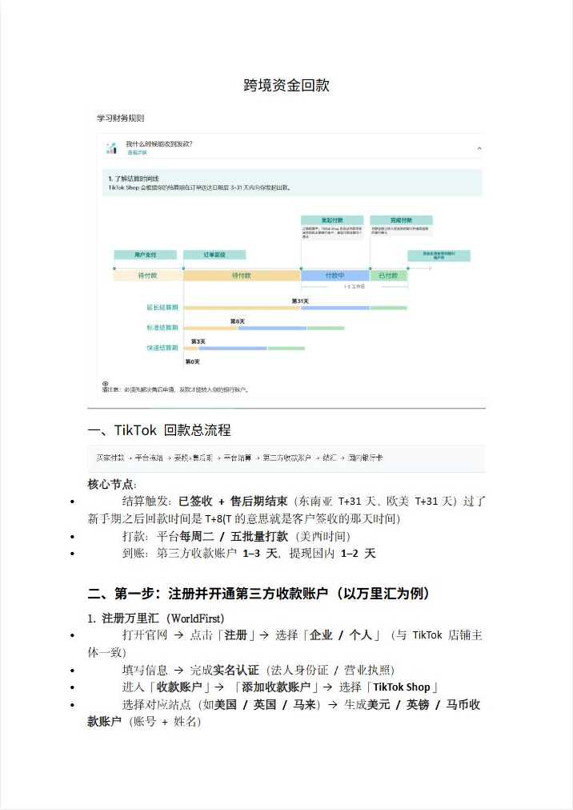
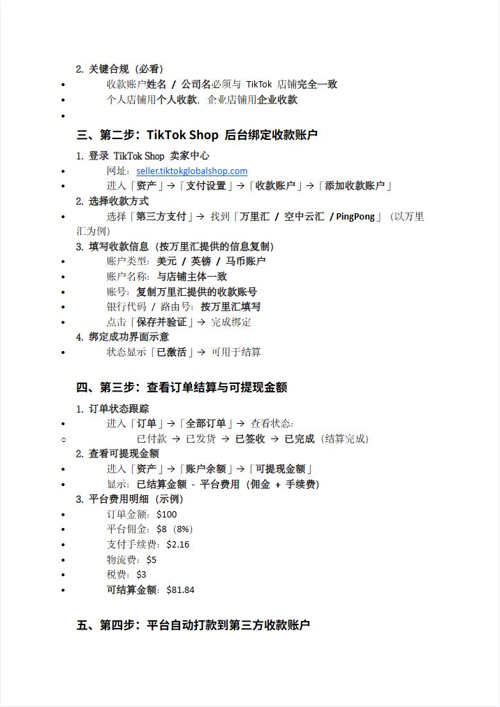
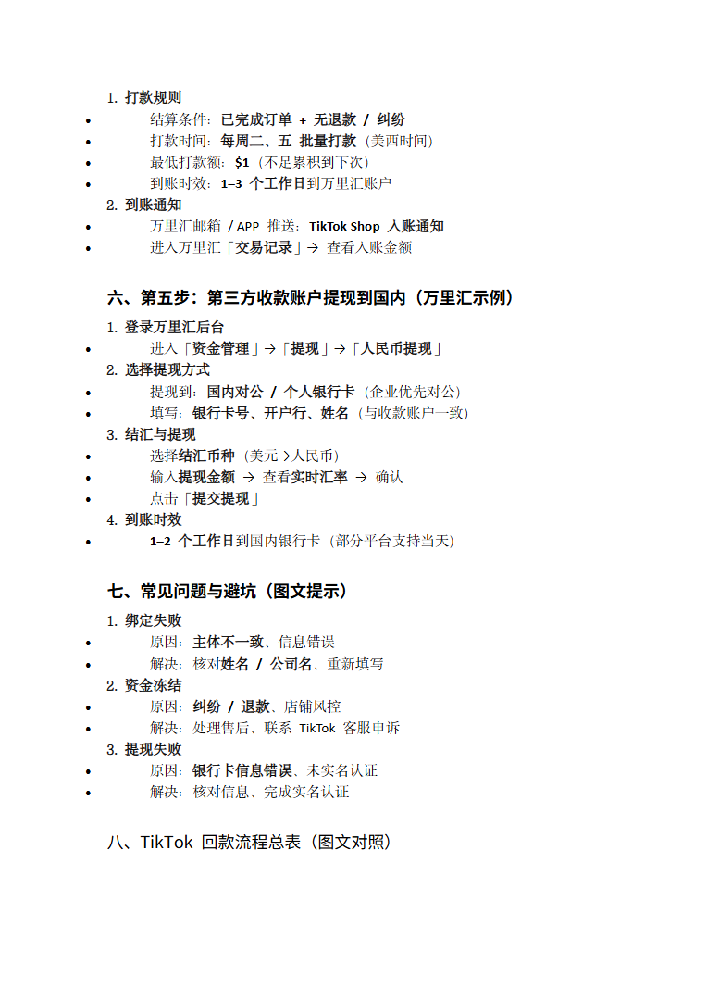
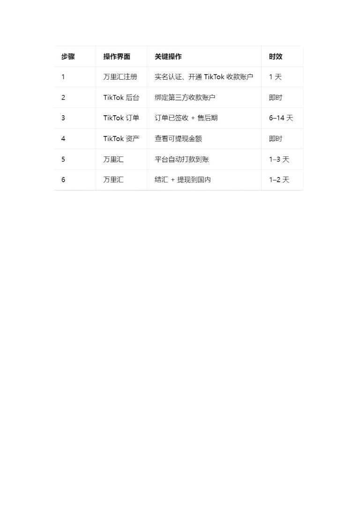

# 资金回款.doc — 预览版

- 附件序号：32（manifest.attachments 原顺序）
- 来源：https://dcni26t4qg0z.feishu.cn/wiki/EVUtwnBTMiSx0Okr4QiciHrTnof
- 采集日期：2026-10-13（Asia/Shanghai）
- 采集证据：[32.dom.json](../raw/32.dom.json)
- 范围：浏览器预览文字与已采集的逐页图片；原文件下载状态另行记录，转换过程未产生原文件。
- 页图可保留预览中显示的文内图片；未恢复原始图片素材、可编辑Word文档、Excel公式或原始附件。
- 文字页覆盖：部分或未知；不能把侧栏页号当作已采集正文页。
- 预览记录总页数：4（0 表示查看器状态，不能推断原文件无页）
- 明确文字页号：1、2、3
- 页图覆盖：4/4 页；所有已观测预览页均有尺寸合格且PNG完整的页图。
- 有效页图页号：1、2、3、4
- 原文件：本次预览转换保存 0 个原文件；图片文字不计作已采集DOM文字。
- 页内换行：仅依据原DOM顺序和真实span top坐标恢复，忽略小于半个相邻字号的基线偏移；原text整串及span样式保留在JSON中，不按语义划分段落。
- 原始采集候选：[32-dom.json](../raw/source-captures/32-784f80ec7cbc-32-dom.json)

## 预览正文

## 第 1 页

[打开第 1 页图片](../images/32/page-001.png)（716×1011）

跨境资金回款  
一、TikTok回款总流程  
核心节点：  
结算触发：已签收+售后期结束（东南亚T+31天、欧美T+31天）过了  
新手期之后回款时间是T+8(T的意思就是客户签收的那天时间）  
打款：平台每周二/五批量打款（美西时间）  
到账：第三方收款账户1–3天，提现国内1–2天  
二、第一步：注册并开通第三方收款账户（以万里汇为例）  
1.注册万里汇（WorldFirst）  
打开官网→点击「注册」→选择「企业/个人」（与TikTok店铺主  
体一致）  
填写信息→完成实名认证（法人身份证/营业执照）  
进入「收款账户」→「添加收款账户」→选择「TikTokShop」  
选择对应站点（如美国/英国/马来）→生成美元/英镑/马币收  
款账户（账号+姓名）

## 第 2 页

[打开第 2 页图片](../images/32/page-002.png)（716×1011）

2.关键合规（必看）  
收款账户姓名/公司名必须与TikTok店铺完全一致  
个人店铺用个人收款，企业店铺用企业收款  
  
三、第二步：TikTokShop后台绑定收款账户  
1.登录TikTokShop卖家中心  
网址：seller.tiktokglobalshop.com  
进入「资产」→「支付设置」→「收款账户」→「添加收款账户」  
2.选择收款方式  
选择「第三方支付」→找到「万里汇/空中云汇/PingPong」（以万里  
汇为例）  
3.填写收款信息（按万里汇提供的信息复制）  
账户类型：美元/英镑/马币账户  
账户名称：与店铺主体一致  
账号：复制万里汇提供的收款账号  
银行代码/路由号：按万里汇填写  
点击「保存并验证」→完成绑定  
4.绑定成功界面示意  
状态显示「已激活」→可用于结算  
四、第三步：查看订单结算与可提现金额  
1.订单状态跟踪  
进入「订单」→「全部订单」→查看状态：  
o已付款→已发货→已签收→已完成（结算完成）  
2.查看可提现金额  
进入「资产」→「账户余额」→「可提现金额」  
显示：已结算金额-平台费用（佣金+手续费）  
3.平台费用明细（示例）  
订单金额：$100  
平台佣金：$8（8%）  
支付手续费：$2.16  
物流费：$5  
税费：$3  
可结算金额：$81.84  
五、第四步：平台自动打款到第三方收款账户

## 第 3 页

[打开第 3 页图片](../images/32/page-003.png)（764×1080）

1.打款规则  
结算条件：已完成订单+无退款/纠纷  
打款时间：每周二、五批量打款（美西时间）  
最低打款额：$1（不足累积到下次）  
到账时效：1–3个工作日到万里汇账户  
2.到账通知  
万里汇邮箱/APP推送：TikTokShop入账通知  
进入万里汇「交易记录」→查看入账金额  
六、第五步：第三方收款账户提现到国内（万里汇示例）  
1.登录万里汇后台  
进入「资金管理」→「提现」→「人民币提现」  
2.选择提现方式  
提现到：国内对公/个人银行卡（企业优先对公）  
填写：银行卡号、开户行、姓名（与收款账户一致）  
3.结汇与提现  
选择结汇币种（美元→人民币）  
输入提现金额→查看实时汇率→确认  
点击「提交提现」  
4.到账时效  
1–2个工作日到国内银行卡（部分平台支持当天）  
七、常见问题与避坑（图文提示）  
1.绑定失败  
原因：主体不一致、信息错误  
解决：核对姓名/公司名、重新填写  
2.资金冻结  
原因：纠纷/退款、店铺风控  
解决：处理售后、联系TikTok客服申诉  
3.提现失败  
原因：银行卡信息错误、未实名认证  
解决：核对信息、完成实名认证  
八、TikTok回款流程总表（图文对照）

## 第 4 页

[打开第 4 页图片](../images/32/page-004.png)（764×1080）

> 此页未返回非图片DOM正文文字；不推测图片中的内容。
