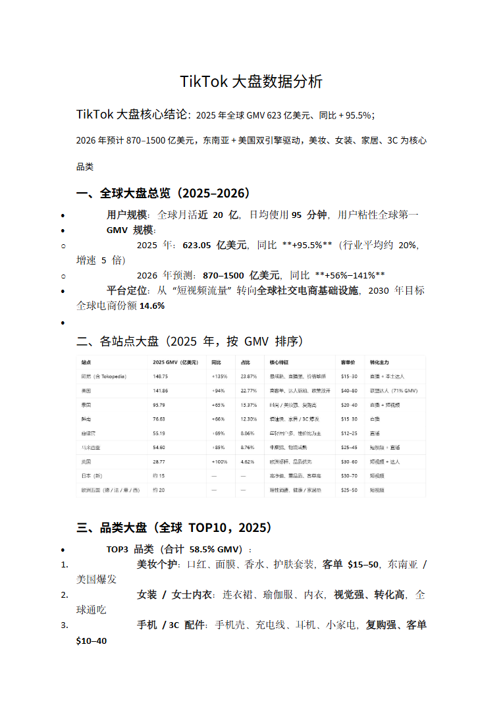
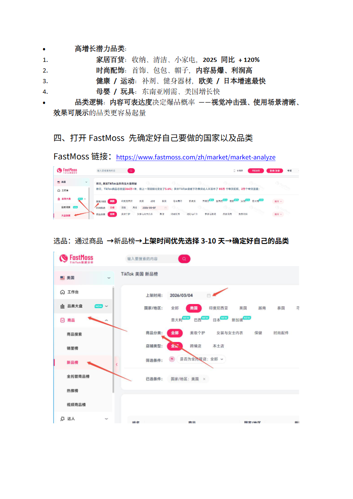
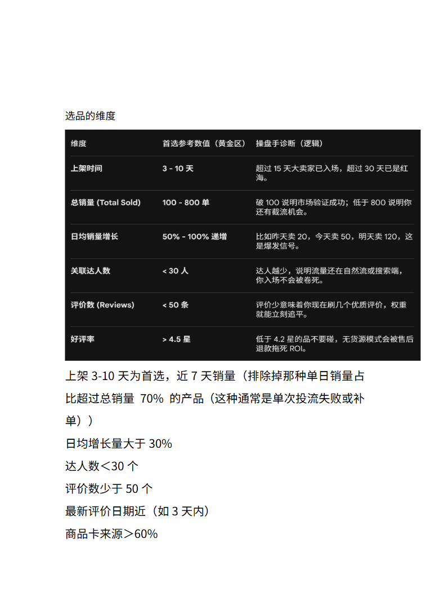
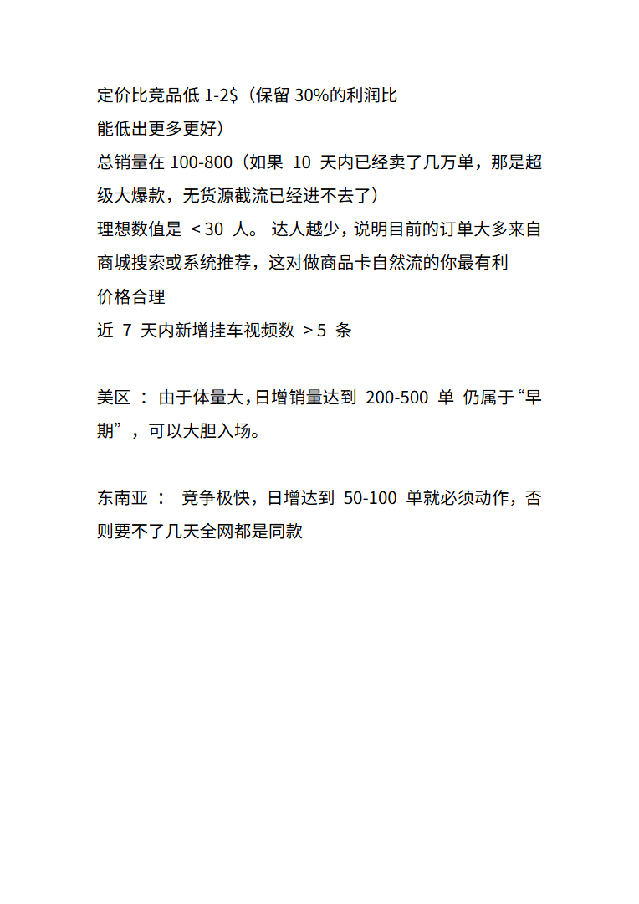

# tiktok大盘数据分析.doc — 预览版

- 附件序号：33（manifest.attachments 原顺序）
- 来源：https://dcni26t4qg0z.feishu.cn/wiki/EVUtwnBTMiSx0Okr4QiciHrTnof
- 采集日期：2026-10-14（Asia/Shanghai）
- 采集证据：[33.dom.json](../raw/33.dom.json)
- 范围：浏览器预览文字与已采集的逐页图片；原文件下载状态另行记录，转换过程未产生原文件。
- 页图可保留预览中显示的文内图片；未恢复原始图片素材、可编辑Word文档、Excel公式或原始附件。
- 文字页覆盖：采集JSON中每一页均有非空DOM文字记录；这不证明图片中文字已转录或每页文字绝对完整。
- 预览记录总页数：4（0 表示查看器状态，不能推断原文件无页）
- 明确文字页号：1、2、3、4
- 页图覆盖：4/4 页；所有已观测预览页均有尺寸合格且PNG完整的页图。
- 有效页图页号：1、2、3、4
- 原文件：本次预览转换保存 0 个原文件；图片文字不计作已采集DOM文字。
- 页内换行：仅依据原DOM顺序和真实span top坐标恢复，忽略小于半个相邻字号的基线偏移；原text整串及span样式保留在JSON中，不按语义划分段落。
- 原始采集候选：[33-dom.json](../raw/source-captures/33-b243c2d8b910-33-dom.json)

## 预览正文

## 第 1 页

[打开第 1 页图片](../images/33/page-001.png)（764×1080）

TikTok大盘数据分析  
TikTok大盘核心结论：2025年全球GMV623亿美元、同比+95.5%；  
2026年预计870–1500亿美元，东南亚+美国双引擎驱动，美妆、女装、家居、3C为核心  
品类  
一、全球大盘总览（2025–2026）  
用户规模：全球月活近20亿，日均使用95分钟，用户粘性全球第一  
GMV规模：  
o2025年：623.05亿美元，同比**+95.5%**（行业平均约20%，  
增速5倍）  
o2026年预测：870–1500亿美元，同比**+56%–141%**  
平台定位：从“短视频流量”转向全球社交电商基础设施，2030年目标  
全球电商份额14.6%  
  
二、各站点大盘（2025年，按GMV排序）  
三、品类大盘（全球TOP10，2025）  
TOP3品类（合计58.5%GMV）：  
1.美妆个护：口红、面膜、香水、护肤套装，客单$15–50，东南亚/  
美国爆发  
2.女装/女士内衣：连衣裙、瑜伽服、内衣，视觉强、转化高，全  
球通吃  
3.手机/3C配件：手机壳、充电线、耳机、小家电，复购强、客单  
$10–40

## 第 2 页

[打开第 2 页图片](../images/33/page-002.png)（764×1080）

高增长潜力品类：  
1.家居百货：收纳、清洁、小家电，2025同比+120%  
2.时尚配饰：首饰、包包、帽子，内容易爆、利润高  
3.健康/运动：补剂、健身器材，欧美/日本增速最快  
4.母婴/玩具：东南亚刚需、美国增长快  
品类逻辑：内容可表达度决定爆品概率——视觉冲击强、使用场景清晰、  
效果可展示的品类更容易起量  
四、打开FastMoss先确定好自己要做的国家以及品类  
FastMoss链接：https://www.fastmoss.com/zh/market/market-analyze  
选品：通过商品→新品榜→上架时间优先选择3-10天→确定好自己的品类

## 第 3 页

[打开第 3 页图片](../images/33/page-003.png)（764×1080）

选品的维度  
上架3-10天为首选，近7天销量（排除掉那种单日销量占  
比超过总销量70%的产品（这种通常是单次投流失败或补  
单））  
日均增长量大于30%  
达人数＜30个  
评价数少于50个  
最新评价日期近（如3天内）  
商品卡来源＞60%

## 第 4 页

[打开第 4 页图片](../images/33/page-004.png)（764×1080）

定价比竞品低1-2$（保留30%的利润比  
能低出更多更好）  
总销量在100-800（如果10天内已经卖了几万单，那是超  
级大爆款，无货源截流已经进不去了）  
理想数值是<30人。达人越少，说明目前的订单大多来自  
商城搜索或系统推荐，这对做商品卡自然流的你最有利  
价格合理  
近7天内新增挂车视频数>5条  
美区：由于体量大，日增销量达到200-500单仍属于“早  
期”，可以大胆入场。  
东南亚：竞争极快，日增达到50-100单就必须动作，否  
则要不了几天全网都是同款
